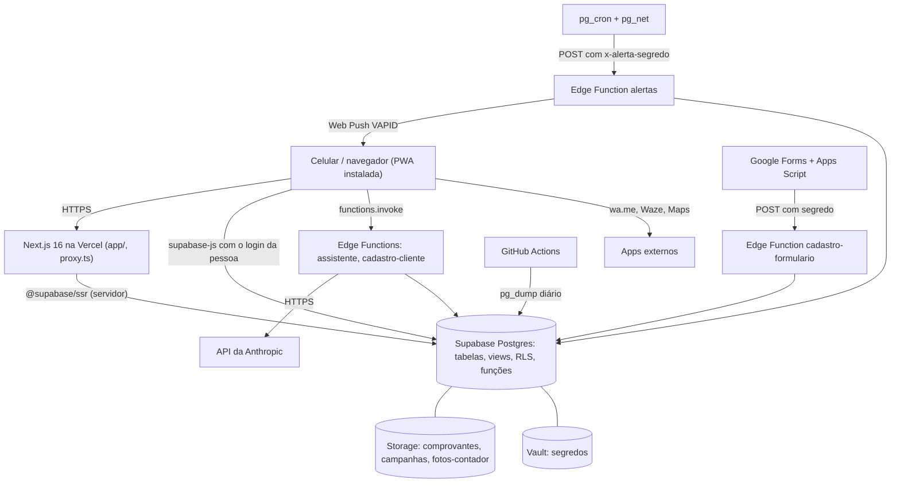

# ARCHITECTURE.md · Harmonize OS (documentação mestre)

> Gerado a partir do código-fonte e do banco em 26/10/2026 (commit base `304d349`). Os nomes de tabelas, colunas, funções, arquivos e chaves foram extraídos do próprio código: as tabelas, colunas, chaves, índices, políticas, gatilhos e funções vêm de um Postgres local carregado com o `schema.sql`, conferido contra o banco real do Supabase (projeto `vidnlzbxaxjlmzncqhxw`) por soma de verificação das 553 colunas e dos 141 nomes de função (idênticos); as operações de cada tela vêm da leitura de todos os `.from()`, `.rpc()`, `storage.from()` e `functions.invoke()` dos arquivos TypeScript e da árvore de imports de cada rota.

## Sumário

- 1.1 Visão geral e arquitetura
- 1.2 Dicionário de dados e tabelas
- 1.3 Mapa de funcionalidades e regras de negócio
- 1.4 Matriz de rastreabilidade (funcionalidade x tabela)
- 1.5 Integrações, eventos e automações
- Anexo A: schema das funções (código completo)

## 1.1 Visão geral e arquitetura

Harmonize OS é o sistema interno da Harmonize: locação dos equipamentos HIPRO 1 e HIPRO 2 (aparelhos de estética que contam disparos), mentorias, relacionamento com clientes e leads, agenda, cobrança, financeiro da empresa e financeiro pessoal do dono. Um operador só, que usa quase sempre pelo celular (app instalável). Existem ainda dois tipos de login secundários: acesso só de visualização (`profiles.somente_leitura`) e login de cliente que só enxerga o Planejador (`profiles.cliente_id`).

### Stack tecnológica

| Camada | Tecnologia | Onde aparece |
|---|---|---|
| Linguagem | TypeScript 5 (`typescript` ^5.5.4), SQL (PostgreSQL / PL/pgSQL), Python 3 (scripts), Google Apps Script | `app/`, `components/`, `lib/`, `supabase/functions/`, `schema.sql`, `migrations/`, `scripts/` |
| Framework web | Next.js `16.3.8` (App Router, Turbopack, `proxy.ts` no lugar do middleware) com React `19.3.0` e React DOM `19.3.0` | `app/`, `next.config.js`, `proxy.ts` |
| Estilo | Tailwind CSS `^3.4.9`, PostCSS e Autoprefixer; variáveis de cor `--n-50` a `--n-950` e temas em `app/globals.css` | `tailwind.config.ts`, `postcss.config.js`, `app/globals.css` |
| Ícones | `lucide-react` ^0.441.0 | componentes e telas |
| Banco de dados | Supabase (PostgreSQL 17) com Row Level Security, funções `security definer`, gatilhos, views, pg_cron, pg_net, Vault e Storage | `schema.sql`, `migrations/` |
| Cliente do banco | `@supabase/supabase-js` ^2.117.2 e `@supabase/ssr` ^0.5.1 (cliente de navegador em `lib/supabase/client.ts`, de servidor em `lib/supabase/server.ts`) | `lib/supabase/` |
| Autenticação | Supabase Auth (e-mail e senha, passkey nativa) | `app/login/page.tsx`, `lib/digital.ts`, `proxy.ts` |
| Funções de servidor | Supabase Edge Functions (Deno): `alertas`, `assistente`, `cadastro-cliente`, `cadastro-formulario` | `supabase/functions/` |
| Inteligência artificial | API da Anthropic (`https://api.anthropic.com/v1/messages`), modelo pelo segredo `ASSISTENTE_MODELO` (padrão `claude-sonnet-5-5`) | `supabase/functions/assistente/` |
| PDF | `@react-pdf/renderer` ^4.9.0 (contrato gerado no navegador) | `lib/contrato-pdf.tsx` |
| Planilhas | `fflate` ^0.8.3 (arquivo .xlsx montado à mão, com gráficos nativos do Office) | `lib/planilha-xlsx.ts`, `lib/planilha-graficos.ts`, `lib/exportar-planilha.ts` |
| Datas | `date-fns` ^3.6.0 e funções próprias de fuso de Brasília em `lib/period.ts` | telas e `lib/` |
| Arrastar e soltar | `@dnd-kit/core` ^6.1.0 (quadro do Funil) | `app/(app)/funil/FunilClient.tsx` |
| Testes | Vitest `^1.6.1` (testes de regras puras em `lib/*.test.ts` e `tests/`) | `lib/`, `tests/` |
| App instalável | PWA com `public/manifest.webmanifest` (atalhos e `share_target`) e service worker `public/sw.js` (cache offline, compartilhamento, web push) | `public/` |
| Notificações | Web Push (VAPID) enviado pela Edge Function `alertas`; inscrições em `push_inscricoes` | `lib/push.ts`, `supabase/functions/alertas/` |
| Hospedagem | Vercel, projeto `harmonize-os`, publica a cada push em `main` (harmonize-os.vercel.app) | repositório `harmonizequip-cmyk/harmonize-os` |
| Rotina externa | GitHub Actions (`.github/workflows/backup-banco.yml`): `pg_dump` diário | `.github/` |
| Integrações de navegador | WhatsApp por link `https://wa.me/`, Waze `https://waze.com/ul`, Google Maps `https://www.google.com/maps/search/`, Web Share API, Contact Picker API, Web Speech API (voz), Speech Synthesis (leitura em voz alta), Clipboard API, WebAuthn (passkey) | `lib/format.ts`, `lib/contatos.ts`, `lib/reconhecer-fala.ts`, `lib/falar.ts` |
| Formulário externo | Google Forms + Apps Script da planilha de respostas | `scripts/apps-script-formulario.gs` |

### Arquitetura em camadas



Fluxo de dados: as telas de servidor (`page.tsx` sem `"use client"`) leem com `createClient()` de `lib/supabase/server.ts`, que usa o cookie de sessão; os componentes de navegador usam `createClient()` de `lib/supabase/client.ts`. Toda leitura respeita as políticas RLS de quem está logado. Gravações de negócio passam por funções RPC `security definer` (com `has_module_permission` e `registrar_movimentacao`); poucas telas gravam direto em tabela (as políticas decidem). Regras puras e testadas ficam em `lib/` (sem acesso ao banco), carregadores em `lib/carregar-*.ts` e telas em `app/`.

### Árvore de diretórios e arquivos

Responsabilidade de cada arquivo versionado (git), na ordem da árvore. A descrição vem do comentário de cabeçalho do próprio arquivo ou, quando ele não tem, da leitura do código. Para telas, a rota está entre parênteses.


#### `(raiz)/`

- `.env.example`: Modelo do .env.local: define as duas variáveis públicas do Supabase, NEXT_PUBLIC_SUPABASE_URL (URL do projeto) e NEXT_PUBLIC_SUPABASE_ANON_KEY (chave anon), com valores de exemplo, usadas por lib/supabase/client.ts e proxy.ts.
- `.gitignore`: Lista o que o Git ignora: node_modules/, .next/, .env.local, tsconfig.tsbuildinfo, next-env.d.ts, package-lock.json e .claude/worktrees/ (cópias de trabalho temporárias do Claude Code).
- `CLAUDE.md`: # Harmonize OS Sistema interno da Harmonize (locação dos equipamentos HIPRO 1 e HIPRO 2 e mentorias). Um operador só, que usa quase sempre pelo celular.
- `README.md`: # Harmonize OS, MVP (Fase 1, parte 1) Sistema de gestão da Harmonize. Esta entrega cobre: login, dashboard,
- `next.config.js`: @type {import('next').NextConfig}
- `package.json`: Manifesto do projeto "harmonize-os" 0.1.0, privado. Scripts: dev (`next dev`), build (`next build`), start (`next start`), test (`vitest run`). Next 16.3.8, React e React DOM 19.3.0 fixos, Supabase, date-fns, fflate, lucide-react, @dnd-kit/core, @react-pdf/renderer, Tailwind 3.4, TypeScript 5.5 e Vitest 1.6.
- `postcss.config.js`: Configuração do PostCSS com dois plugins: `tailwindcss` e `autoprefixer`.
- `proxy.ts`: Proxy do Next 16 (`proxy`): confere o login Supabase. Libera /login e /cadastro/ sem sessão, manda quem não tem login para /login e quem já está logado de /login para /dashboard. O matcher exclui _next/static, _next/image, favicon.ico, manifest.webmanifest, sw.js, sem-internet.html e arquivos icone-.
- `schema.sql`: HARMONIZE OS, Schema consolidado (estado atual) Alvo: Supabase (Postgres + Auth + RLS) Gerado em: 2026-09-25 O QUE É ESTE ARQUIVO Este arquivo substitui a versão "Fase 1" original: aquela nunca mais foi re-rodada desde 21/09/2026, e toda mudança depois disso virou uma migration incremental própria (pasta migrations/, 21 arquivos entre 21/09 e 25/09). Isso deixou o schema.sql documentando um estado que a base de produção não tem mais há dias.
- `tailwind.config.ts`: Configuração do Tailwind: darkMode "class", conteúdo em app e components, cinzas `neutral` por variáveis `--n-*`, cores `brand` (teal, pink, blue, lilac), gradientes `brand-gradient`, sombras `glow-teal` e `glow-brand` e raios xl, 2xl e 3xl.
- `tsconfig.json`: Configuração do TypeScript: target es2017, modo strict, noEmit, moduleResolution "bundler", jsx react-jsx, plugin "next", alias @/* para a raiz do projeto, inclui todos os .ts e .tsx e exclui node_modules e supabase.

#### `.github/workflows/`

- `backup-banco.yml`: Workflow do GitHub Actions "Backup do banco": roda todo dia às 06:00 UTC (03:00 de Fortaleza, cron "0 6 * * *") e manualmente (workflow_dispatch). Instala o PostgreSQL 17, confere a string de conexão do segredo SUPABASE_DB_URL, gera o dump com pg_dump --no-owner, compacta com gzip, confere se o dump restauraria um sistema funcionando (GRANTs, schema auth, políticas RLS, funções como create_rental, views contabilizáveis e dados das tabelas principais) e guarda o arquivo como artefato por 30 dias.

#### `app/`

- `globals.css`: Estilos globais: camadas do Tailwind, bloqueio de zoom por toque, padrão visual (fundo, classe `.cartao`, regras para cartões de vidro antigos), cores do espaço Pessoal (`.espaco-pessoal`), variáveis de cinza `--n-50` a `--n-950` e tema Aurora (`.tema-aurora`).
- `layout.tsx`: Layout raiz (`RootLayout`): metadata, manifest e ícones, viewport sem zoom, script que aplica as classes de tema Aurora e do espaço Pessoal e o `DialogosHost`.
- `page.tsx` (rota `/`): Página / (`Home`): redireciona para /dashboard.

#### `app/(app)/`

- `error.tsx`: Rede de segurança das telas internas: se uma consulta falhar (o caso típico é a conexão cair), mostra o aviso e deixa tentar de novo, em vez de uma tela que parece normal mas vazia (ex.: "ninguém devendo" quando a lista não carregou).
- `layout.tsx`: Layout das telas logadas (`AppLayout`): confere o login, lê o perfil e as configurações, manda login de cliente para /portal e monta menu lateral, cabeçalho do celular, barra de baixo, faixa de modo teste e componentes globais. Lê `profiles` e `settings`.
- `loading.tsx`: Mostrado enquanto qualquer tela do app carrega no servidor (sem isso, o toque num menu parecia não fazer nada até a tela nova chegar).

#### `app/(app)/agenda/`

- `AgendaClient.tsx`: `hex` é a mesma cor de `dot`, só que em valor puro, necessário porque o indicador do dia no calendário (abaixo) usa conic-gradient via style inline quando há mais de um tipo no mesmo dia, e isso não lê classes do Tailwind. HIPRO 1/2 ficaram parecidos demais (teal e azul, os dois "esverdeados"/claros); trocado o HIPRO 2 para rosa, que também liberou o rosa que "Outro" usava antes, foi para o azul que sobrou do HIPRO 2. Mentoria ganhou amarelo, uma cor que não existia ainda na paleta.
- `EditarEventoModal.tsx`: Janela de edição de um atendimento da Agenda (`EditarEventoModal`): edita, reagenda, cancela, finaliza reserva com disparos, define deslocamento, contagem inicial e troca de ponteira, gera contrato, arte de divulgação e despesas da reserva.
- `NovoEventoModal.tsx`: Janela para criar um compromisso da Agenda sem equipamento (`NovoEventoModal`, tipo "outros"): pede título, cliente, data e observação e grava direto em `calendar_events`. Reservas de HIPRO e mentoria passam por ReservarHiproModal.
- `ReservarHiproModal.tsx`: Janela "Reservar HIPRO" (`ReservarHiproModal`): cria uma pré-reserva em `calendar_events` para um cliente, equipamento e data (com data final opcional e opção de mentoria), sugere o equipamento livre consultando `calendar_events` e `bloqueios_equipamento` e oferece o vínculo com campanha (`VinculoCampanha`).
- `page.tsx` (rota `/agenda`): Página /agenda (`AgendaPage`, servidor): carrega atendimentos não cancelados, clientes, equipamentos, bloqueios, saldo de crédito e configurações e entrega tudo ao `AgendaClient`. Lê `calendar_events`, `clients`, `equipments`, `bloqueios_equipamento` e `creditos_saldo`, paginando com `buscarTodas`.

#### `app/(app)/agenda-hoje/`

- `page.tsx` (rota `/agenda-hoje`): Página /agenda-hoje (`AgendaHojePage`, dinâmica): lista os próximos atendimentos de hoje em diante, com locações finalizadas e pré-reservas ainda sem locação, cada uma com botões de receber pagamento e dar baixa na taxa. Lê as tabelas `rentals` e `calendar_events` e a view `rentals_situacao_pagamento` (saldo).

#### `app/(app)/agenda/encaixe/`

- `page.tsx` (rota `/agenda/encaixe`): Encaixe de datas livres: dias sem HIPRO marcado com atendimento no dia anterior ou seguinte, e quem está perto (até RAIO_KM) para oferecer a data. Regras em lib/encaixe.ts. ?data=AAAA-MM-DD mostra só aquele dia (vem do cancelamento ou reagendamento).

#### `app/(app)/assistente/`

- `AssistenteClient.tsx`: Tela de chat do assistente de IA (`AssistenteClient`, escopo harmonize ou pessoal), usada em /assistente e /pessoal/assistente: envia perguntas à Edge Function `assistente`, mostra cartões de resposta (WhatsApp, planilha, agenda, planejamento, escolha de áreas), voz, memória e gasto do mês. Usa `assistente_conversas`, `assistente_memoria`, `assistente_uso`, `clients` e a RPC `assistente_consultar`.
- `CartaoAgenda.tsx`: Cartão do assistente para envio da agenda (`CartaoAgenda`): por cliente gera a imagem das datas livres, abre o WhatsApp com a mensagem pronta (com imagem ou só texto) e permite "Marcar enviado" pela RPC `registrar_envio_agenda`.
- `CartaoEscolhaAreas.tsx`: O seletor monta o planejamento pelas regras e abre no planejador; "Pedir ajuste à IA" devolve a escolha para o assistente redistribuir.
- `CartaoPlanejamento.tsx`: Cartão do assistente que resume um planejamento montado pela IA (`CartaoPlanejamento`): lista áreas e disparos e leva ao planejador guardando o estado para abrir em /planejador/novo. Não acessa o banco.
- `mensagem-erro.ts`: Erro da Edge Function `assistente`: usa o texto que ela devolveu em `erro` (limite do mês, permissão) e, sem ele, a mensagem padrão de quem chamou.
- `page.tsx` (rota `/assistente`): Página /assistente (`AssistentePage`): apenas renderiza `AssistenteClient` com o escopo padrão da Harmonize.

#### `app/(app)/campanhas/`

- `BotaoNovaCampanha.tsx`: Some para quem tem acesso só de visualização.
- `CampanhaClient.tsx`: mensagem, público e limite). Quem é só de visualização vê o resultado e a campanha, sem enviar, editar, arquivar nem apagar.
- `EditorCampanha.tsx`: Editor da campanha: nome, arte (reduzida no aparelho e guardada na pasta privada "campanhas"), mensagem com {saudacao}, {nome} e {cidade}, público (filtros com contagem ao vivo e caixinha para tirar alguém) e limite diário. Mensagem com variável errada bloqueia o salvar (o texto é do dono, não há padrão para voltar). Regras em lib/campanhas.ts.
- `FilaCampanha.tsx`: Fila de envio da campanha: uma pessoa por vez, com a mensagem já no nome dela (editável só para ela), a arte e os botões. Nada sai sozinho: "Abrir conversa" cai direto na conversa da pessoa com a mensagem digitada; a arte o dono anexa pelo clipe (o WhatsApp não aceita imagem por link). O Compartilhar da arte só serve a quem já está nos contatos. O limite diário protege o número de ser marcado como spam. Modelo: app/(app)/assistente/CartaoAgenda.tsx e tarefas/ModoFila.tsx.
- `ResultadoCampanha.tsx`: Resultado da campanha: contagem por situação e a lista de quem recebeu (e de quem foi pulado ou não quer), onde o dono marca "Respondeu", "Agendou", "Não quer receber" ou desfaz o envio (a pessoa volta à fila).
- `comum.tsx`: Peças visuais comuns das telas de Campanhas.
- `page.tsx` (rota `/campanhas`): Campanhas: arte fixa + mensagem enviadas um a um pelo WhatsApp. Lista das ativas e, em aba separada, das arquivadas. Regras em lib/campanhas.ts.

#### `app/(app)/campanhas/[id]/`

- `page.tsx` (rota `/campanhas/[id]`): Página da campanha: fila de envio um a um, resultado e editor.

#### `app/(app)/campanhas/nova/`

- `page.tsx` (rota `/campanhas/nova`): Nova campanha: o mesmo editor da página da campanha, ainda sem envios.

#### `app/(app)/clientes/`

- `ClientesClient.tsx`: Lista de clientes (`ClientesClient`): tabela com busca, filtros de situação e período, selo de funil, exportação de planilha, botão de novo cliente e link de cadastro. Confirma agendamento pela RPC `confirmar_agendamento`; os dados chegam por props da página.
- `NovoClienteModal.tsx`: Janela de cadastro de cliente (`NovoClienteModal`): nome, tratamento, WhatsApp, cidade, endereço, parceiro e isenção de taxa; grava em `clients`.
- `page.tsx` (rota `/clientes`): Página /clientes (`ClientesPage`, servidor): monta a lista inteira de clientes, com locações e totais do período, taxas e última agenda. Lê `clients`, `rentals_contabilizaveis`, `calendar_events` e a view `clientes_taxas`, e entrega ao `ClientesClient`.

#### `app/(app)/clientes/[id]/`

- `ClienteDetailClient.tsx`: Ficha do cliente (`ClienteDetailClient`): dados, resumo de locações, próximos agendamentos, histórico, créditos, anotações, acesso ao Planejador, contrato, melhores datas, cobrança da taxa (RPC `definir_taxa_agendamento`) e abertura dos modais de editar cliente e locação.
- `EditarClienteModal.tsx`: Janela de edição do cadastro do cliente (`EditarClienteModal`): dados de contato, tratamento, documento e dados alternativos de contrato, indicação, parceiro e isenção de taxa; atualiza `clients` e permite excluir.
- `EditarLocacaoModal.tsx`: Janela de edição de uma locação (`EditarLocacaoModal`): valores, datas, contagens, deslocamento, pagamentos, despesas, crédito e cancelamento. Usa `categories`, `clients`, `creditos_cliente`, `creditos_saldo`, `locacao_contagens`, `rental_payments`, `rentals_situacao_pagamento`, `transactions` e as RPCs `update_rental`, `cancelar_locacao`, `corrigir_contagens_locacao`, `definir_deslocamento_locacao`, `registrar_despesa_locacao`, `registrar_pagamento_locacao`, `remover_pagamento_locacao` e `transferir_cliente_locacao`.
- `HistoricoClienteSection.tsx`: Histórico de movimentações do cliente, embutido na própria ficha (o usuário pediu explicitamente que fosse aqui, não só na tela geral de /movimentacoes). Junta tudo que já é registrado por registrar_movimentacao em qualquer lugar do sistema (agendamento, reagendamento, cancelamento, edição, pagamento, exclusão) e filtra só o que pertence a este cliente: o registro do cliente em si, mais tudo que aconteceu nas locações, na agenda e nos lançamentos financeiros dele.
- `page.tsx` (rota `/clientes/[id]`): Página /clientes/[id] (`ClienteDetailPage`, servidor): carrega o cliente, suas locações, pré-reservas e saldos e entrega ao `ClienteDetailClient`. Lê `clients`, `rentals`, `rentals_contabilizaveis`, `rentals_situacao_pagamento`, `calendar_events` e `equipments`, mais os dados de relacionamento.

#### `app/(app)/clientes/cadastros/`

- `CadastrosClient.tsx`: Tela de cadastros recebidos do formulário (`CadastrosClient`): compara cada resposta com cliente parecido, deixa marcar o que gravar e mostra o bloco de liberar na Academy. Usa as RPCs `confirmar_cadastro_recebido` e `descartar_cadastro_recebido`.
- `page.tsx` (rota `/clientes/cadastros`): Página /clientes/cadastros (`CadastrosRecebidosPage`): carrega os pendentes de `cadastros_recebidos` (até 300) e os clientes de `clients` (fora modo teste) e entrega ao `CadastrosClient`.

#### `app/(app)/clientes/creditos/`

- `page.tsx` (rota `/clientes/creditos`): Créditos em aberto: clientes com saldo de disparos (disponível ou aguardando o pagamento da locação de origem) ou de R$ (view creditos_saldo).

#### `app/(app)/configuracoes/`

- `ConfiguracoesHub.tsx`: Central de Configurações (pedido do dono, 17/10/2026): em vez de uma tela comprida com tudo aberto, um check-up do app no topo e os assuntos em grupos, em blocos de duas colunas como o Menu. Tocar num bloco abre só aquele assunto (?secao=), e o voltar do celular volta para a central.
- `page.tsx` (rota `/configuracoes`): Central de Configurações: check-up e assuntos em grupos. ?secao=<id> abre um assunto; ?acao=backup (aviso de domingo) abre o Backup com o arquivo pronto.
- `secoes-ids.ts`: Assuntos de Configurações (?secao=<id>). Fica fora do componente do navegador porque a página (servidor) também precisa conferir o id.
- `ui.tsx`: Peças comuns das seções de Configurações: chave liga/desliga, campo com rótulo, bloco com título e o botão flutuante de salvar que só aparece quando há alteração.

#### `app/(app)/configuracoes/dados-teste/`

- `DadosTesteClient.tsx`: Painel do modo teste em /configuracoes/dados-teste (`DadosTesteClient`): liga e desliga o modo teste, lista registros de teste, marca ou desmarca registros e apaga dados com confirmação por senha. Usa `settings`, `clients`, `transactions` e as RPCs `set_record_test_flag`, `set_client_test_flag_cascade`, `purge_test_data` e `delete_record_forever`.
- `page.tsx` (rota `/configuracoes/dados-teste`): Sempre buscar do banco: esta tela existe justamente pra conferir o estado atual da marcação antes de apagar alguma coisa, então servir uma versão em cache seria pior que não ter a tela.

#### `app/(app)/configuracoes/secoes/`

- `Aparencia.tsx`: Aparência: escolher entre o tema Clássico e o Aurora vendo como fica. Mesma chave do botão de paleta do topo (localStorage harmonize-tema).
- `Automacoes.tsx`: Automações: tarefas que a agenda cria sozinha e as regras do funil de clientes (recontato e Reativar).
- `Categorias.tsx`: Categorias de lançamento (24/10/2026): Harmonize e Pessoal, entradas e saídas. As do sistema (cadeado) não se renomeiam, arquivam nem apagam. Arquivar tira da lista de escolha sem mexer nos lançamentos antigos; apagar só vale para categoria sem nenhum lançamento.
- `Cidades.tsx`: Cidades do encaixe de datas livres (24/10/2026): posição de cada cidade para medir a distância em linha reta. Cidade que não está aqui não entra no encaixe; o aviso no topo lista as cidades do cadastro de clientes que faltam.
- `ContasPix.tsx`: Contas PIX que recebem pagamentos (24/10/2026). A padrão vem marcada nas telas de pagamento; a chave e o favorecido vão no resumo do WhatsApp. Conta que já recebeu pagamento não se apaga: desativa (some da escolha).
- `MinhaConta.tsx`: Minha conta: quem está entrado, trocar a senha e sair.
- `Precos.tsx`: Preços: locação HIPRO (faixas), taxa de reserva e mentoria. A simulação mostra, antes de salvar, quanto ficam algumas quantidades de disparos com os valores atuais e com os novos.
- `PrefsAgenda.tsx`: Agenda: encaixe de datas livres (raio, "perto" das Melhores datas, janela, pessoas por data, pergunta ao cancelar) e a cidade base da imagem de datas. Grava o grupo `encaixe`.
- `PrefsContrato.tsx`: Contrato: os números das cláusulas (multa e aviso prévio de rescisão). O texto jurídico não muda; só o número e o extenso. Contrato já emitido continua com os números da época.
- `PrefsDashboard.tsx`: Dashboard: quantos avisos aparecem, quais avisos e blocos ficam à mostra.
- `PrefsDeslocamento.tsx`: Deslocamento: quanto se cobra por bloco de km (ida e volta) na calculadora da locação. Locações já lançadas não mudam.
- `PrefsEmpresa.tsx`: Empresa: dados da Harmonize que saem no contrato (cabeçalho, quadro do contratado, foro e assinatura), no rodapé do recibo e no rodapé do prontuário e da ficha do paciente. Contrato já emitido não muda: ele guarda os dados da época.
- `PrefsListas.tsx`: Listas: origens do lead, devedores sugeridos de empréstimo e link da Academy.
- `PrefsMensagens.tsx`: Mensagens de WhatsApp (etapa 3a): um texto por modelo, com as variáveis entre chaves, prévia com dados de exemplo e "Restaurar padrão". Regras e textos padrão em lib/mensagens-modelos.ts. Cobrança, taxa de reserva e avisos do celular continuam fixos (a função alertas tem cópia deles).
- `PrefsMetas.tsx`: Metas: quantas locações no mês e a base do cálculo de "quanto falta".
- `PrefsPlanejador.tsx`: Planejador: janela de "Retornos nos próximos N dias" e perfis de disparos do seletor de saldo. Planos já salvos não mudam.
- `PrefsRecibo.tsx`: Recibo: se o app oferece mandar o recibo logo depois de receber um pagamento.
- `PrefsRelacionamento.tsx`: Relacionamento: cadência por classe, limite de "Chamar hoje" e os limites que separam Nova, Em risco, Sumida, Morna, VIP e Frequente. Grava o grupo `relacionamento` das preferências.
- `PrefsTabelaPrecos.tsx`: Tabela de preços (arte): estimativas de disparos por procedimento, a linha em destaque, as "Informações importantes" e a nota. Os preços da arte vêm de Preços; aqui ficam só os textos e as estimativas.
- `Tags.tsx`: Tags dos clientes: criar, renomear, trocar a cor e apagar.

#### `app/(app)/contratos/`

- `ContratosClient.tsx`: Lista de contratos emitidos (`ContratosClient`) em /contratos: mostra cada contrato com atalho para a locação ou reserva de origem e permite baixar o PDF de novo (carrega `lib/contrato-pdf` sob demanda). Recebe os dados por props e não acessa o banco.
- `page.tsx` (rota `/contratos`): Controle dos contratos emitidos (leva X). O PDF em si não fica salvo, só o retrato (snapshot) usado em cada geração, guardado em contratos_emitidos.dados. Esta tela é o "onde eu vejo o que já foi gerado", com a opção de baixar de novo o mesmo PDF a partir do retrato.

#### `app/(app)/dashboard/`

- `page.tsx` (rota `/dashboard`): Página /dashboard (`DashboardPage`, servidor): painel do mês com destaque, avisos "Precisa de você", plano da meta, previsão de caixa, radar e números do período. Lê `rentals`, `rentals_contabilizaveis`, `rentals_lucro`, `rentals_situacao_pagamento`, `transactions_contabilizaveis`, `calendar_events`, `clients`, `equipments`, `tasks`, `profiles`, `faturas_cartao`, `aplicadores_uso`, `cadastros_recebidos`, `convites_cadastro` e chama as RPCs `gerar_tarefas_agenda` e `gerar_tarefas_recontato`.

#### `app/(app)/dashboard/equipamentos/[id]/`

- `page.tsx` (rota `/dashboard/equipamentos/[id]`): Página /dashboard/equipamentos/[id] (`EquipmentDetailPage`): lista as locações de um HIPRO no período vindo do Dashboard, com valores e saldos. Lê `equipments`, `rentals_contabilizaveis` e `rentals_situacao_pagamento`.

#### `app/(app)/equipamentos/`

- `page.tsx` (rota `/equipamentos`): Página /equipamentos (`EquipamentosPage`): mostra os HIPROs com status, próxima reserva, locações, receita e previstas do período, bloqueios e aplicadores. Lê `equipments`, `calendar_events`, `bloqueios_equipamento`, `aplicadores_uso`, `rentals_contabilizaveis`, `rentals_situacao_pagamento` e chama a RPC `aplicar_previsoes_manutencao_vencidas`.

#### `app/(app)/financeiro/`

- `EditarLancamentoModal.tsx`: Janela de edição de lançamento do Financeiro (`EditarLancamentoModal`): altera ou apaga um lançamento e edita o pagamento de locação ligado a ele. Usa `transactions`, `rental_payments`, `rentals_situacao_pagamento` e as RPCs `editar_pagamento_locacao` e `remover_pagamento_locacao`.
- `FinanceiroClient.tsx`: Lista de lançamentos (`FinanceiroClient`, escopo harmonize ou pessoal) usada em /financeiro e /pessoal/lancamentos: resumo, filtros, linhas por fatura de cartão, gráficos, exportação de planilha e abertura dos modais de novo e edição. Grava em `transactions`.
- `NovoLancamentoModal.tsx`: Janela de novo lançamento (`NovoLancamentoModal`): entrada, saída, conta pessoal, compra no cartão, empréstimo e despesa ligada a locação ou reserva, com preenchimento por voz. Usa `transactions`, `categories`, `cartoes` e as RPCs `registrar_compra_cartao` e `registrar_emprestimo`.
- `carregar-lancamentos.ts`: Teto de segurança. Com período obrigatório, um mês de lançamentos fica muito abaixo disso; o teto existe para uma consulta absurda não travar a tela. Quando ele é atingido, a tela avisa em vez de mostrar um total menor do que a realidade calado, que era o risco do limit(200) antigo.
- `page.tsx` (rota `/financeiro`): Página /financeiro (`FinanceiroPage`): carrega os lançamentos da Harmonize por `carregarLancamentos` e entrega ao `FinanceiroClient`.

#### `app/(app)/financeiro/cartoes/`

- `CartoesClient.tsx`: pagar a fatura e cadastrar/editar cartão. A compra conta como gasto no mês em que a fatura vence; o pagamento da fatura tira o dinheiro e fica fora do resultado.
- `page.tsx` (rota `/financeiro/cartoes`): Cartões de crédito e as faturas de cada um (view faturas_cartao). Mostra os cartões da Harmonize e os pessoais que o login pode ver.

#### `app/(app)/financeiro/emprestimos/`

- `EmprestimosClient.tsx`: Tela de empréstimos em /financeiro/emprestimos (`EmprestimosClient`): saldo por devedor e movimentos, com registrar, editar e apagar. Usa as RPCs `registrar_emprestimo`, `editar_emprestimo` e `remover_emprestimo`.
- `page.tsx` (rota `/financeiro/emprestimos`): quanto voltou e quanto ainda falta voltar, por devedor.

#### `app/(app)/funil/`

- `FunilClient.tsx`: Funil de leads e clientes (`FunilClient`): quadro kanban ou lista por etapas, mover etapa, tarefas, confirmação de agendamento e WhatsApp. Exporta `STAGES`, `StageKey`, `LEAD_STAGES`, `TagOption`, `LeadRow`, `TaskRow`. Usa `clients`, `tasks` e as RPCs `confirmar_agendamento`, `register_contact_attempt` e `registrar_pedido_confirmacao`.
- `LeadCardModal.tsx`: Cartão de detalhe do lead no Funil (`LeadCardModal`): edita dados, tags, indicação e etapa, mostra agendamentos e abre datas disponíveis, melhores datas e tabela de preços. Usa `clients`, `client_tags`, `tags`, `calendar_events` e `rentals`.
- `NovaTarefaModal.tsx`: ficha do cliente, botão "+" global em qualquer tela), então não depende do tipo completo de nenhuma tela específica, só do que realmente precisa pra montar a lista.
- `NovoLeadModal.tsx`: Exportado para o filtro do Funil usar a mesma lista, em vez de duplicar os valores em outro arquivo. A lista vem de Configurações (preferencias.listas.origens); este export é o padrão, para quem ainda usa a lista fixa.
- `page.tsx` (rota `/funil`): Página /funil (`FunilPage`, servidor): carrega leads, clientes, tags, tarefas e datas e entrega ao `FunilClient`. Lê `clients`, `tags`, `tasks`, `calendar_events`, `clientes_taxas` e `clientes_ultima_locacao` e chama as RPCs `gerar_tarefas_agenda` e `gerar_tarefas_recontato`.

#### `app/(app)/insights/`

- `InsightsClient.tsx`: Tela do Cérebro (`InsightsClient`): lista os insights por categoria, gera novos pela Edge Function `assistente` em modo insights e permite marcar como feito, arquivar e avaliar. Usa `insights` e `clients`.
- `page.tsx` (rota `/insights`): Página /insights (`InsightsPage`): apenas renderiza `InsightsClient`.

#### `app/(app)/locacoes/`

- `LocacoesClient.tsx`: Lista de locações (`LocacoesClient`) em /locacoes: filtros, totais, saldo a receber, lucro, botão de receber e exportação de planilha. Recebe os dados por props e não acessa o banco.
- `page.tsx` (rota `/locacoes`): Histórico de locações realizadas (item 4 da auditoria, segunda metade). Tela separada da de Movimentações de propósito: lá ficam as AÇÕES (quem confirmou, quem cancelou, quem apagou), aqui ficam os FATOS (que procedimento aconteceu, quanto valeu, se foi pago). Misturar as duas foi justamente o que o pedido proibiu, porque servem a perguntas diferentes: uma responde "o que houve com este registro", a outra "quanto rodamos neste mês". Teto do que a tela mostra. A consulta vem em páginas (o Supabase devolve no máximo 1000 linhas por vez);

#### `app/(app)/movimentacoes/`

- `MovimentacoesClient.tsx`: Histórico de movimentações (`MovimentacoesClient`) em /movimentacoes: lista cronológica com filtros e exportação de planilha, com link para o item ligado. Recebe os dados por props.
- `page.tsx` (rota `/movimentacoes`): Histórico de movimentações (item 4 da auditoria, primeira metade): toda ação e mudança de status, com data, hora e usuário. É uma tela separada do histórico de locações realizadas de propósito; misturar as duas foi justamente o que o pedido proibiu. A tabela movimentacoes não tem policy de insert, update nem delete: ela só é escrita pelas funções do banco. Então esta tela é, por construção, somente leitura.

#### `app/(app)/pendencias/`

- `PendenciasClient.tsx`: Tela de Pendências (`PendenciasClient`) em /pendencias: devedores e taxas de reserva por cobrar, com cobrança por WhatsApp, receber pagamento, baixa da taxa e exportação de planilha. Recebe os dados por props.
- `page.tsx` (rota `/pendencias`): Controle de pendências de pagamento: quem está devendo, quanto e há quantos dias. O cálculo vive em lib/pendencias.ts e é o mesmo do total do Dashboard. Também lista as taxas de reserva vencidas, que o aviso vermelho do Dashboard aponta para cá.

#### `app/(app)/pessoal/`

- `page.tsx` (rota `/pessoal`): Página /pessoal (`PessoalInicioPage`): início "Meu dinheiro" do espaço Pessoal, com resultado do mês, avisos, faturas, orçamento, categorias e linha do tempo. Lê `transactions`, `transactions_contabilizaveis`, `categories`, `cartoes`, `faturas_cartao`, `orcamentos_pessoais` e `clients`.

#### `app/(app)/pessoal/assistente/`

- `page.tsx` (rota `/pessoal/assistente`): conversas e orçamento próprios, sem clientes).

#### `app/(app)/pessoal/cartoes/`

- `page.tsx` (rota `/pessoal/cartoes`): Cartões de crédito e as faturas de cada um (view faturas_cartao). Mostra os cartões da Harmonize e os pessoais que o login pode ver.

#### `app/(app)/pessoal/lancamentos/`

- `page.tsx` (rota `/pessoal/lancamentos`): Financeiro pessoal: mesma tela do Financeiro, com os lançamentos de scope = 'pessoal', o saldo de sempre da conta e as contas fixas pessoais (Configurações > contas fixas do tipo pessoal).

#### `app/(app)/pessoal/relatorios/`

- `page.tsx` (rota `/pessoal/relatorios`): mês a mês e cartões pessoais.

#### `app/(app)/planejador/`

- `EditorPlanejamento.tsx`: Editor de planejamento HIPRO em tela cheia (`EditorPlanejamento`): abas Paciente, Áreas e Resumo, sessões do pacote, custos de disparos, PDFs e salvamento automático. Usado pelo planejador e pelo portal. Lê `calendar_events` e usa as RPCs `salvar_planejamento` e `excluir_planejamento`.
- `PlanejadorLista.tsx`: Linha da lista + o que sai do estado sem baixar ele todo (quantas sessões tem e em qual está).
- `carregar.ts`: Funções de carga do planejador: `nomeProfissional`, `carregarClientes` (de `clients`) e `carregarContexto` (atendimento de `calendar_events` e cliente de um planejamento novo).
- `page.tsx` (rota `/planejador`): Página /planejador (`PlanejadorPage`): lista os planejamentos por cliente, com filtro `?cliente=`, lendo `planejamentos` e `clients`, e renderiza `PlanejadorLista`.

#### `app/(app)/planejador/[id]/`

- `page.tsx` (rota `/planejador/[id]`): Página /planejador/[id] (`PlanejamentoPage`): carrega um planejamento de `planejamentos` e abre o `EditorPlanejamento`.

#### `app/(app)/planejador/novo/`

- `page.tsx` (rota `/planejador/novo`): Planejamento novo: abre o planejador já com a profissional (cliente) e a data do atendimento. Só vira registro no banco quando ganha conteúdo.

#### `app/(app)/relacionamento/`

- `RelacionamentoClient.tsx`: com a mensagem de WhatsApp pronta) e a carteira de clientes e leads com a classificação automática. Conversar (WhatsApp ou "Já falei") grava o contato como tarefa concluída, e a pessoa só volta quando a cadência da classe dela vencer de novo.
- `page.tsx` (rota `/relacionamento`): Relacionamento: quem chamar hoje (limite diário em Configurações, por prioridade) e a carteira de clientes e leads classificada sozinha. Regras em lib/relacionamento.ts; dados em lib/carregar-relacionamento.ts.

#### `app/(app)/relatorios/`

- `CompletarOrigem.tsx`: Completa a origem de quem já alugou e está sem ela. São esses cadastros que dizem qual canal traz quem fecha; os leads antigos que nunca alugaram não mudam a conclusão e ficam de fora. Um toque grava e a pessoa some.
- `RelatoriosClient.tsx`: Tela de Relatórios (`RelatoriosClient`): cartões com conclusão em uma linha (degrau de incentivo, taxa parada, lucro por cliente, concentração de receita, origem dos clientes e dia mais vazio) e `CompletarOrigem`. Recebe os dados por props.
- `page.tsx` (rota `/relatorios`): Página /relatorios (`RelatoriosPage`, servidor): reúne dados para os relatórios e o financeiro da Harmonize. Lê `rentals_contabilizaveis`, `rentals_lucro`, `transactions_contabilizaveis`, `clients`, `calendar_events`, `client_tags`, `tags` e a view `clientes_taxas`.

#### `app/(app)/tarefas/`

- `ModoFila.tsx`: "Atacar a fila": mostra uma tarefa de cada vez (as de hoje e as atrasadas), com a mensagem do WhatsApp pronta. Manda, marca o resultado e a próxima aparece sozinha. As ações são as mesmas da lista de Tarefas (vêm por props), só que em sequência.
- `TarefasClient.tsx`: Lista de tarefas (`TarefasClient`) em /tarefas: pendentes e concluídas, concluir, adiar, desfazer, modo fila e WhatsApp pronto. Exporta `TarefaRow`. Usa `tasks` e as RPCs `desfazer_conclusao_tarefa` e `register_contact_attempt`.
- `page.tsx` (rota `/tarefas`): Página /tarefas (`TarefasPage`, servidor): carrega as 50 tarefas mais recentes e dados da reserva de cada uma. Lê `tasks` e `calendar_events` e chama as RPCs `gerar_tarefas_agenda` e `gerar_tarefas_recontato`.

#### `app/(portal)/`

- `PortalTopo.tsx`: Cabeçalho do portal da cliente (`PortalTopo`): logo, nome e botões de trocar senha (validada por `problemaSenha`) e sair, usando o login do Supabase Auth.
- `layout.tsx`: Portal da cliente: login de cliente (profiles.cliente_id) vê só o Planejador dela. Quem não é login de cliente volta para o sistema.

#### `app/(portal)/portal/`

- `carregar.ts`: Cliente do login (portal_cliente): id, nome e "Profissional" (tratamento + nome).
- `page.tsx` (rota `/portal`): A política planejamentos_select_cliente só devolve os planejamentos dela.

#### `app/(portal)/portal/[id]/`

- `page.tsx` (rota `/portal/[id]`): Página /portal/[id] (`PortalPlanejamentoPage`): abre um planejamento da cliente no `EditorPlanejamento` em modo portal. Lê `planejamentos`.

#### `app/(portal)/portal/novo/`

- `page.tsx` (rota `/portal/novo`): Página /portal/novo (`PortalNovoPage`): abre um planejamento novo no `EditorPlanejamento` em modo portal, com o profissional da cliente (`clienteDoPortal`).

#### `app/api/backup/`

- `route.ts` (rota `/api/backup`): Backup manual: baixa um arquivo JSON com todas as tabelas do negócio. Só administrador ativo. A leitura passa pelo login de quem pede (RLS), então nada vem a mais do que a pessoa já enxerga. Não inclui chaves de acesso biométrico (webauthn_credentials), que não servem para restaurar dados.

#### `app/cadastro/[token]/`

- `FormularioCadastro.tsx`: Formulário que a cliente preenche sozinha (link /cadastro/<token>, sem login). Fala com a Edge Function "cadastro-cliente", que confere o token, cria o login com a senha dela e atualiza o cadastro. O acesso ao Planejador só abre quando a Harmonize liberar.
- `page.tsx` (rota `/cadastro/[token]`): Página pública /cadastro/[token] (`CadastroPage`): renderiza `FormularioCadastro` com o token do convite, aberta sem login.

#### `app/compartilhar/`

- `route.ts` (rota `/compartilhar`): Reserva para quando o compartilhamento chega antes do service worker estar ativo (o normal é o sw.js responder sem chegar aqui): texto sem arquivo vai para o assistente; o resto abre a janela de receber, sem o arquivo.

#### `app/login/`

- `page.tsx` (rota `/login`): Página /login (`LoginPage`): entra com e-mail e senha (`signInWithPassword`) ou com a digital (`signInWithPasskey`) e redireciona para /dashboard.

#### `components/`

- `AcessoPlanejadorCard.tsx`: Acesso da cliente ao Planejador (portal). Dois caminhos: mandar o link do formulário (/cadastro/<token>), em que ela mesma completa o cadastro e cria a senha, e depois tocar em "Liberar acesso"; ou o formulário feito aqui uma vez por cliente. Completa o cadastro (e-mail, WhatsApp, endereço), cria o login com senha inicial e libera pelo liberar_acesso_planejador. Ela entra no mesmo endereço do sistema e cai direto no Planejador dela (/portal).
- `AcessoVisualizacaoCard.tsx`: Acesso só de visualização (ex.: esposa do dono): cria o login com e-mail e senha e libera o perfil marcado somente_leitura. Ela vê tudo, menos Configurações, e o banco recusa qualquer alteração vinda dela.
- `AgendamentosDoCliente.tsx`: Uma linha por agendamento do cliente, já com o rótulo de situação resolvido pelo banco. A função agendamentos_do_cliente é quem combina os dois eixos (status da locação e marca de confirmado) num rótulo só, de propósito: se cada tela recombinasse por conta própria, uma hora duas telas mostrariam situações diferentes para o mesmo agendamento. Desde a Leva C3a há um terceiro eixo, o dinheiro, e ele é independente da situação: locação realizada pode estar paga ou não, e é só quando alguém marca o pagamento que o lançamento financeiro nasce.
- `AjudaCustoReserva.tsx`: Ajuda de custo do deslocamento de uma reserva (ainda sem locação). O mesmo campo da janela da reserva na Agenda, para lançar também pelo cartão do Funil e pela ficha. Ao finalizar, o valor segue para a locação.
- `AnotacoesCliente.tsx`: Anotações da cliente: cada uma é um item curto com data e hora (tabela cliente_anotacoes), falado pelo microfone ou digitado. Não há edição: errou, apaga e anota de novo, para o histórico ficar fiel. O assistente lê tudo isso pelo dossiê da cliente (dossie_cliente).
- `AnotacoesFicha.tsx`: Cartão "Anotações" da ficha da cliente: as 3 últimas, com data e hora, e o botão que abre o painel completo (falar, digitar, histórico).
- `AplicadoresCard.tsx`: Aplicadores do HIPRO: a contagem de disparos é por aplicador, e eles trocam de aparelho. O banco soma à última leitura do contador os disparos das locações do HIPRO em que o aplicador estava montado (view aplicadores_uso, mentoria fora). Ler o contador de novo corrige a conta.
- `ArteDivulgacaoModal.tsx`: Arte para a cliente divulgar o dia do HIPRO (status do WhatsApp, Instagram). Monta com os dados da reserva e do cadastro; tudo editável antes de mandar.
- `Atalhos.tsx`: locação, lançamento) sem voltar para o menu. Os dois param o clique para não abrir também a linha/cartão onde estão. Endereços em lib/atalhos.ts.
- `AvailabilityImageModal.tsx`: Janela da imagem de datas livres (`AvailabilityImageModal`), modos agenda e funil: desenha o calendário do mês com dias ocupados circulados para baixar ou mandar por WhatsApp. Lê `calendar_events` e `bloqueios_equipamento`.
- `AvisosCelularCard.tsx`: Cartão "Avisos no celular" de Configurações (`AvisosCelularCard`): liga e desliga o web push deste aparelho, instala o app e manda aviso de teste. Usa `push_inscricoes` e `lib/push`.
- `AvisosDesligadosFaixa.tsx`: Faixa no topo do app quando os avisos do Harmonize não estão chegando neste celular: permissão de notificação não dada (reinstalar o app zera) ou inscrição que não ficou gravada. O Android só deixa pedir a permissão depois de um toque, então a faixa traz o botão. Some quando liga, quando o dono tocou em "Desligar" em Configurações, ou por hoje no "agora não".
- `BackupCard.tsx`: Cartão de backup de Configurações (`BackupCard`, `CHAVE_BACKUP`): baixa o backup de /api/backup, manda para o Drive pelo Compartilhar e guarda a data do último backup no aparelho.
- `BloqueiosEquipamento.tsx`: Bloqueio da agenda por período (manutenção, recesso ou outro motivo). Enquanto bloqueado, o banco recusa reserva nova do equipamento nesses dias (gatilho validar_bloqueio_equipamento). Manutenção que começa hoje coloca o equipamento em manutenção sozinha, com volta no dia seguinte ao último dia. Reservas que já existiam no período continuam: a tela lista quais são antes de confirmar, para reagendar se precisar.
- `BonecoCorporal.tsx`: Modelo corporal em foto, frente e costas lado a lado (fotos do dono). Toque na região marca em turquesa; as outras ficam tracejadas para mostrar onde dá para tocar. Região que aparece nas duas vistas marca nas duas.
- `BottomNav.tsx`: Os 4 atalhos de uso diário, nessa ordem. O 5º e último botão não é um link, é o gatilho do menu com o restante (ver MORE_ITEMS).
- `CaixaIsencaoTaxa.tsx`: "Isentar taxa de reserva", ao lado da caixinha Parceiro nos cadastros. Serve para cliente que não é parceiro mas nunca pagou a taxa (clientes antigas). Grava clients.isento_taxa (migration 2026-10-17-cliente-isento-taxa). Marcar tira a taxa pendente e a cobrança das reservas dela; reserva nova já nasce sem taxa. Taxa que já foi paga não muda.
- `CalculadoraLocacaoModal.tsx`: HARMONIZE OS, Calculadora unificada de locação (leva 2) Substitui NovaLocacaoModal (app/(app)/clientes/[id]) e FinalizarReservaModal (app/(app)/agenda): mesmo layout/fluxo do protótipo aprovado (contagem -> resumo com faixa -> ajustes finais -> pagamento -> WhatsApp), agora com a fórmula real de precificação (lib/rental-pricing, não a tabela fixa do protótipo) e os recursos da leva O: pagamento múltiplo/parcial, deslocamento, custo por disparo negociado, e despesa da locação lançada na hora.
- `CalculoImagemBotao.tsx`: Botão "Gerar imagem do cálculo": desenha o cálculo dos disparos numa única imagem (mesmo estilo da tela) e deixa compartilhar ou baixar. No celular abre o compartilhamento nativo com a imagem anexada; onde não existe, baixa a imagem e abre a conversa do cliente no WhatsApp para anexá-la (o WhatsApp não aceita anexo por link).
- `ClientPicker.tsx`: Seletor de cliente com busca (`ClientPicker`, tipo `ClientOption`): filtra por nome, cidade e telefone e permite cadastrar novo cliente ou lead em `clients`.
- `Comprovantes.tsx`: Lista os comprovantes guardados de uma locação ou de uma taxa de reserva (pasta "comprovantes" do Storage, ver lib/comprovante.ts) e deixa anexar mais um à mão, da galeria ou de um PDF.
- `ConfirmarApagarModal.tsx`: Confirmação por palavra (mesmo critério do ConfirmarExclusaoModal): só apaga depois de escrever APAGAR. Para exclusões que não passam pela prévia do banco (ex.: planejamento de paciente).
- `ConfirmarExclusaoModal.tsx`: Prévia devolvida pela função preview_exclusao do banco. A conta de o que sai junto é feita lá, e não aqui, porque é o mesmo lugar que vai efetivamente apagar: se a regra fosse duplicada no front, um dia as duas discordariam e a tela prometeria uma coisa enquanto o banco faz outra.
- `ContasFixasCard.tsx`: Cartão de contas fixas do mês de Configurações (`ContasFixasCard`): edita a lista e grava em `settings.despesas_fixas`.
- `CreditosClienteCard.tsx`: Créditos da cliente (creditos_cliente / creditos_saldo): saldo, extrato e lançamento à mão (disparos, permuta ou ajuste em R$). Crédito de troca de ponteira só fica disponível quando a locação de origem está paga.
- `DashboardCharts.tsx`: Gráficos do Dashboard, desenhados em SVG próprio: 1. Fluxo do período: resultado, margem, resultado acumulado (área) e entradas/saídas por dia (barras para cima e para baixo). Arrastar o dedo sobre o gráfico mostra o dia. 2. Para onde foi / De onde veio: categorias em barras, maiores primeiro. Contas em lib/grafico-fluxo.ts. Os lançamentos chegam já sem empréstimo e sem pagamento de fatura, os mesmos dos quadros de Entradas e Saídas.
- `DesfazerImportacaoModal.tsx`: Desfazer importação de fatura: lista as importações feitas num cartão (por data e hora) e apaga a escolhida, ou tudo o que foi importado. Lançamento feito à mão não é tocado.
- `DespesasDaReserva.tsx`: Bloco de despesas de uma reserva sem disparos (`DespesasDaReserva`): lista, lança por `registrar_despesa_reserva` e vincula despesa solta. Usa `transactions` e `categories`.
- `Dialogos.tsx`: Janelas de confirmação, pedido de texto e avisos rápidos (toast) com a cara do app, no lugar do confirm/alert/prompt do navegador (que no Android aparecem cinzas, com o endereço do site no topo). Uso, de qualquer componente do navegador: if (!(await confirmar({ titulo: "Apagar a tag?", perigo: true }))) return; avisar("Salvo."); // toast verde avisar("Não consegui salvar.", "erro"); // toast vermelho const motivo = await pedirTexto({ titulo: "Motivo do cancelamento" }); O DialogosHost fica no app/layout.tsx. Sem ele montado (ex.: teste), cai no diálogo do navegador.
- `DigitalCard.tsx`: Cartão da digital de Configurações (`DigitalCard`): lista, cadastra (`registerPasskey`) e remove passkeys do Supabase Auth.
- `EquipamentoInfoControl.tsx`: Leva W: número de série e registro ANVISA do aparelho, usados na geração do contrato de locação. Como só existem 2 equipamentos e o valor quase nunca muda (só se o aparelho físico for trocado), não há RPC dedicada, a RLS de equipments (equipments_update, exige permissão de "configuracoes") já protege a escrita direta, igual ao padrão usado em EditarClienteModal para a tabela clients.
- `EquipamentoPrevistasControl.tsx`: Contador de locações previstas (`EquipamentoPrevistasControl`): mostra o número e, ao tocar, abre lista de clientes e datas. Não acessa o banco.
- `EquipamentoStatusControl.tsx`: Controle de status do equipamento (`EquipamentoStatusControl`): muda entre ativo e manutenção e adia a previsão de retorno. Usa as RPCs `definir_status_equipamento` e `adiar_previsao_manutencao`.
- `EspacoSwitch.tsx`: Chave do topo: Harmonize (o negócio) ou Pessoal (o dinheiro do dono). O menu muda junto (Sidebar e BottomNav leem o mesmo endereço). A chave muda na hora do toque e mostra "abrindo" enquanto a tela carrega (o Dashboard da Harmonize leva alguns segundos e, sem isso, o toque parecia não ter feito nada).
- `EspacoTema.tsx`: Marca o <html> com "espaco-pessoal" enquanto o endereço for /pessoal: o Pessoal tem paleta e destaque próprios (app/globals.css), para nunca ser confundido com a Harmonize. O primeiro desenho já vem marcado pelo script do app/layout.tsx; este componente cuida da troca de espaço sem recarregar.
- `FiltroBarra.tsx`: BARRA DE FILTROS POR QUE O ESTADO FICA NA URL, E NÃO NO COMPONENTE Com o filtro na URL, a página é um server component que lê searchParams e consulta o banco já filtrado: a tela nunca baixa mil linhas para esconder novecentas no navegador. De lambuja, o link fica compartilhável, o botão voltar funciona e recarregar não perde o filtro. Se o estado morasse aqui dentro, cada tela precisaria de um caminho próprio para chegar aos dados. POR QUE O PERÍODO É OBRIGATÓRIO Não existe opção "todos".
- `FiltroComBusca.tsx`: Filtro de lista longa (ex: "Todos os clientes") com campo de busca, no lugar do select nativo, que no celular vira uma roleta de 200 nomes.
- `GerarContratoModal.tsx`: Janela de gerar contrato (`GerarContratoModal`, tipos `RentalParaContrato`, `ReservaParaContrato`, `OrigemContrato`): monta e baixa o PDF a partir de locação ou reserva e registra pela RPC `registrar_contrato_emitido`.
- `GlobalSearch.tsx`: Busca global do cabeçalho (`GlobalSearch`): procura em `clients`, `tasks` e `calendar_events` e leva ao item.
- `GuardarAgendaOffline.tsx`: telefone, endereço, equipamento, contagem inicial, saldo), para a página /sem-internet.html mostrar quando abrir o app sem sinal. Atualiza ao abrir o app, ao voltar a internet e a cada 30 minutos com ele aberto.
- `ImportarFaturaModal.tsx`: Importar fatura do cartão: o dono exporta o OFX no app do banco e escolhe o arquivo aqui. Mostra a prévia (agrupada por estabelecimento, com categoria) e grava de uma vez. Contas em lib/importar-fatura.ts; gravação por importar_compras_cartao.
- `IndicadoPorSelect.tsx`: Seletor do cliente que indicou (`IndicadoPorSelect`): busca em `clients` e impede indicar a si mesmo.
- `LiberarAcademy.tsx`: "Liberar na Contourline Academy": quem cadastra a cliente lá é o dono, então o link da Academy só aparece nas telas dele, nunca vai para a cliente. O botão abre a página de convite já com nome e e-mail no endereço (linkAcademyPreenchido); se a Academy ignorar os campos, abre vazia e os botões de copiar resolvem.
- `LinkCadastroBotao.tsx`: Link do formulário de cadastro para quem ainda não tem ficha (ou não se sabe qual é). Ao enviar, o sistema acha a ficha pelo WhatsApp e completa; sem ficha parecida, cria um lead. O aviso chega no celular.
- `LocacaoDoClienteSelect.tsx`: A que a despesa está ligada: a uma locação já lançada, a uma reserva que ainda não tem disparos, ou a nada (os dois nulos).
- `MelhoresDatasModal.tsx`: Melhores datas por logística (menu ⋮ da cliente): as datas livres do mês separadas pela distância da cidade da pessoa até onde o Eder vai estar no dia anterior ou no seguinte, num termômetro (Perto, Mais ou menos, Longe) e em grupos. Só lê o banco; visualização também vê. Regras em lib/datas-logistica.ts.
- `MenuAtalhosCliente.tsx`: Tarefas, Pendências, Agenda de hoje). "Abrir cadastro" entra na ficha da pessoa (some quando já está nela). Cada opção leva a uma tela ou ação que já existe: Melhores datas abre a janela das datas livres por logística (MelhoresDatasModal), WhatsApp e Waze pelo cadastro, Agendar sem disparos e Nova locação abrem a ficha já com a janela certa (?acao=), e o resto são as listas filtradas pela cliente. No celular abre como folha de baixo; no computador, como menu ao lado do botão. Teclado: Enter/Espaço abre, setas andam, Home/End, Esc fecha e devolve o foco ao botão.
- `MobileHeader.tsx`: O menu de navegação (antigo botão de hambúrguer aqui no topo) mudou para o último botão da BottomNav, ver components/BottomNav.tsx. Manter os dois ao mesmo tempo (um em cima, seis embaixo) tinha virado botão demais na tela; agora a barra de baixo é o único lugar de navegação.
- `NovoLancamentoPessoalBotao.tsx`: Botão "+ Novo lançamento" do espaço Pessoal: abre o mesmo formulário do Financeiro já com "Conta pessoal" marcada.
- `OpportunityRadar.tsx`: Radar de oportunidades do Dashboard (`OpportunityRadar`, tipo `DormantLead`): cruza dias livres com leads parados e abre a imagem de datas. Recebe dados por props.
- `PeriodFilter.tsx`: Filtro de período (`PeriodFilter`): botões Hoje, 7 dias, Este mês, Mês anterior e Personalizado, guardados nos parâmetros period, from e to da URL.
- `PrevisaoCaixaCard.tsx`: Previsão de caixa dos próximos 30 ou 60 dias (conta em lib/previsao.ts). Valores das reservas são estimativas: a locação só tem valor quando é finalizada com os disparos.
- `QuickActionsButton.tsx`: Os modais do "+" só carregam quando abrem: o botão está em todas as telas, e importá-los direto mandava umas 5 mil linhas (a calculadora sozinha tem 2 mil) para cada página.
- `ReceberPagamentoBotao.tsx`: Botão de receber saldo de uma locação (`ReceberPagamentoBotao`): quitação, abatimento, crédito em R$ e permuta. Usa `rentals`, `categories`, `creditos_saldo` e as RPCs `registrar_pagamento_locacao`, `usar_credito_valor` e `registrar_permuta`.
- `ReceberPagamentoModal.tsx`: Janela do "+" Receber pagamento (`ReceberPagamentoModal`): abas Aluguel e Taxa de reserva, com comprovante compartilhado. Lê `rentals`, `rentals_situacao_pagamento` e `calendar_events`.
- `ReciboHost.tsx`: Depois de registrar um pagamento de locação (em qualquer tela), oferece mandar o recibo à cliente: monta a imagem (lib/recibo-image.ts) e abre o Compartilhar do celular. Fica no layout e escuta o evento que o ReceberPagamentoBotao dispara, porque o botão costuma sumir da tela assim que a locação fica paga.
- `RegistrarServiceWorker.tsx`: Registra o service worker em toda tela logada: é o que deixa o Harmonize ser instalado como app e receber avisos com ele fechado. Também confere se este aparelho continua inscrito nos avisos e refaz a inscrição se ela morreu (reinstalar o app mata a antiga), sem precisar ir em Configurações.
- `RelacaoFicha.tsx`: Faixa da ficha do cliente com a classificação automática (Relacionamento): classe, valor (VIP/Frequente), última conversa e, quando está na hora, o motivo e o atalho para a tela Relacionamento.
- `RelatorioFinanceiro.tsx`: Relatório financeiro de um lado (Harmonize ou Pessoal): gastos e entradas por categoria no período, evolução dos últimos 12 meses, faturas de cartão e, na Harmonize, empréstimos. Contas em lib/relatorio-financeiro.ts.
- `RevisaoAnualControl.tsx`: Revisão anual do HIPRO: mostra a última e a próxima (última + 1 ano) e registra a revisão feita (registrar_revisao_equipamento).
- `SeletorPlanejamento.tsx`: Seletor do planejamento (`SeletorPlanejamento`): rosto, papada por adipômetro e corporal por boneco; monta o plano por `montarPlanejamento`. Não acessa o banco.
- `Sidebar.tsx`: Menu do espaço Pessoal (chave Harmonize | Pessoal no topo).
- `SomenteLeitura.tsx`: Acesso só de visualização (profiles.somente_leitura): o banco já recusa qualquer gravação; aqui as telas escondem os botões de alterar.
- `TabelaPrecosModal.tsx`: Arte da tabela de preços do HIPRO, com os valores de Configurações. Abre pelo "+" e pelo cartão do cliente no Funil (já com a mensagem para aquele cliente). Desenho em lib/tabela-precos-arte.ts.
- `TaxaRecebidaBotao.tsx`: Botão da taxa de reserva (`TaxaRecebidaBotao`): dá baixa ou isenta pela RPC `definir_taxa_agendamento`.
- `ThemeToggle.tsx`: Troca entre o tema Clássico (padrão) e o Aurora (brilho da marca no topo, cartões brancos e barra flutuante). A escolha fica guardada no aparelho; o script do app/layout.tsx aplica antes da tela aparecer, sem piscar.
- `VinculoCampanha.tsx`: "Veio de campanha?" na hora de agendar: o dono liga à mão a reserva/locação à campanha que a pessoa recebeu. Só aparece quando a pessoa recebeu alguma campanha e ainda não está marcada como "agendou" nela. Ligar = registrar_envio_campanha(status 'agendou'), que entra na contagem "Agendaram" da campanha e vira anotação na ficha da pessoa.

#### `components/dashboard/`

- `MesCard.tsx`: Destaque do topo do Dashboard: o mês, no mesmo estilo do "Meu dinheiro" do Pessoal (cartão escuro com rosca), mas no verde-turquesa da borboleta da marca (pedido do dono, 19/10/2026). Locações contra a meta (com as reservas que ainda podem virar locação), faturado e contas fixas. Leva às locações do mês.
- `PlanoDaMeta.tsx`: Plano para bater a meta (logo abaixo do destaque do mês): o que fazer com o "faltam N". Mostra datas livres, as que têm gente perto e quem chamar, e leva direto à lista que resolve (Encaixe ou Relacionamento). Conta em lib/plano-meta.ts.
- `PrecisaDeVoce.tsx`: Bloco "Precisa de você" do Dashboard: todos os avisos num cartão só, os urgentes primeiro, em linhas curtas. Cada linha leva à lista do que avisa (regra do CLAUDE.md). Mostra os primeiros (4 por padrão); o resto abre em "ver mais".

#### `components/equipamentos/`

- `EquipamentoCard.tsx`: Cartão de um HIPRO na tela Equipamentos (desenho aprovado pelo dono em 17/10/2026): nome, status e próxima reserva; números do período; revisão anual; aplicador montado, número de série e bloqueio de período.
- `SeletorPeriodo.tsx`: Seletor de período em forma de pílula ("Este mês ⌄"), do desenho aprovado da tela de Equipamentos. Mesmo contrato do FiltroBarra: o período vive na URL (period, from, to) e o servidor consulta já filtrado.

#### `components/pessoal/`

- `FaturasCartoes.tsx`: Cartão de faturas do Pessoal (`FaturasCartoes`): faturas abertas em cartões que rolam para o lado, com link para /pessoal/cartoes. Não acessa o banco.
- `HeroPessoal.tsx`: Destaque do topo do Pessoal: escuro (noite), com a rosca de quanto da entrada já foi embora. De propósito bem diferente do destaque claro da Harmonize, para os dois espaços nunca se confundirem.
- `OrcamentosCard.tsx`: Cartão de orçamento do mês do Pessoal (`OrcamentosCard`): barras de uso por categoria e link para o assistente. Não acessa o banco.
- `RosquinhaGastos.tsx`: Rosca de "para onde foi" com a variação de cada categoria contra a média dos 3 meses anteriores.

#### `components/planejador/`

- `CustoDisparos.tsx`: Painel de custos de disparos do planejador (`CustoDisparos`): multiplica disparos por 0,12, 0,10 e 0,07 e gera imagem. Não acessa o banco.
- `HistoricoPaciente.tsx`: Linha do tempo do paciente (`HistoricoPaciente`): sessões, áreas, disparos e saldo, com busca e período. Lê `planejamentos`.
- `Partes.tsx`: Peças do Planejador HIPRO nativo: folha (bottom sheet), campo de disparos com - e +, cartão de área (modelo facial + linhas por profundidade), folha da modelo ampliada e folha de área manual.
- `ResumoPlano.tsx`: Aba Resumo: números do plano, alertas, distribuição por área (barras com a modelo de cada área) e prévia do texto, do prontuário e da ficha do paciente.

#### `components/ui/`

- `HeroTela.tsx`: Destaque escuro do topo das telas da Harmonize (pedido do dono, 19/10/2026): mesmo desenho do "Meu dinheiro" do Pessoal e do destaque do mês do Dashboard, no verde-turquesa da borboleta. Uma tela usa este cartão para o número que mais importa nela; o resto (filtros, listas) fica logo abaixo. - `anel`: opcional, 0 a 1 (fração preenchida) com rótulo curto no meio. - `chips`: fatos rápidos em pílulas (cada um com ícone opcional). - `tom`: cor do número e do anel quando há alerta ("ok" turquesa, "alerta" âmbar, "ruim" rosa).
- `Visual.tsx`: Peças visuais do padrão do app (aprovado pelo dono em 17/10/2026, a partir do Dashboard): cartão branco com sombra suave, ícone num quadradinho de cor clara, selo com ícone e a onda da marca no canto dos destaques. Use estas peças em tela nova em vez de emoji solto ou cartão de vidro.

#### `docs/`

- `AUDITORIA-HARMONIZE-2026-10-05.md`: # Harmonize OS: auditoria de 05/10/2026 e plano de trabalho Este arquivo é a passagem de bastão de uma auditoria feita com acesso de leitura ao código (commit `e26b02c` da `main`), ao banco de produção (Supabase `vidnlzbxaxjlmzncqhxw`) e ao Vercel. Complementa o `CLAUDE.md`, que continua sendo a referência de como o sistema funciona.
- `PLANO-VARREDURA-2026-10-05.md`: # Varredura tela por tela: achados e plano (05/10/2026) Feita só com leitura: código da `main` (commit `61d037e`) e consultas de leitura no banco de produção. Nada foi alterado. Complementa `docs/AUDITORIA-HARMONIZE-2026-10-05.md`.
- `RESTAURACAO-BACKUP.md`: # Restaurar um backup O backup é o arquivo `backup-harmonize-AAAA-MM-DD.json` baixado em Configurações > Baixar backup (só administrador). Traz 16 tabelas do negócio. Não traz o login (e-mail e senha ficam no Auth do Supabase) nem as chaves de biometria.

#### `lib/`

- `agenda-imagens.test.ts`: Testes automatizados (Vitest) das regras de `lib/agenda-imagens.ts`.
- `agenda-imagens.ts`: Imagens da agenda para mandar às clientes: a mesma arte de "datas disponíveis" da Agenda, uma por mês que o período toca. Dia livre = os dois HIPROs sem evento não cancelado e sem bloqueio, fora domingo e dia passado (mesma regra da imagem da Agenda, sem o ajuste de cidade base).
- `anotacoes.test.ts`: Testes automatizados (Vitest) das regras de `lib/anotacoes.ts`.
- `anotacoes.ts`: Origem de cada anotação da cliente (tabela cliente_anotacoes). 'campanha' nasce só das funções do banco registrar_envio_campanha e desfazer_envio_campanha (migration 2026-10-26-campanha-registra-anotacao.sql).
- `aplicador.test.ts`: Testes automatizados (Vitest) das regras de `lib/aplicador.ts`.
- `aplicador.ts`: Garantia do aplicador do HIPRO (o fabricante garante até um número de disparos): quanto já foi usado. Passar da garantia não para o aplicador, só tira a cobertura.
- `arte-divulgacao.test.ts`: Testes automatizados (Vitest) das regras de `lib/arte-divulgacao.ts`.
- `arte-divulgacao.ts`: ARTE PARA A CLIENTE DIVULGAR O DIA DO HIPRO A cliente posta no status do WhatsApp e no Instagram para encher a agenda do dia (mais pacientes = mais disparos = locação maior). Não leva a marca da Harmonize: quem divulga é a clínica. Textos editáveis na tela.
- `assistente.test.ts`: Testes automatizados (Vitest) das regras de `lib/assistente.ts`.
- `assistente.ts`: Tela do assistente: conversão do histórico guardado (formato da API, com as consultas no meio) para as bolhas da tela, e um markdown mínimo.
- `atalhos.test.ts`: Testes automatizados (Vitest) das regras de `lib/atalhos.ts`.
- `atalhos.ts`: Endereços dos atalhos entre telas: cada um abre direto o item, não a lista. Usados pelo componente components/Atalhos.tsx em todas as telas.
- `availability-image.ts`: Mesmas cores da identidade visual (ver tailwind.config), só que em hex puro porque canvas não entende classes do Tailwind.
- `avisos-dashboard.test.ts`: Testes automatizados (Vitest) das regras de `lib/avisos-dashboard.ts`.
- `avisos-dashboard.ts`: Filtra os avisos do Dashboard pelas preferências. Aviso urgente nunca some (dinheiro atrasado não pode ficar escondido) e os de acesso ao Planejador (`acesso-<id>`) também não.
- `boneco-corporal.test.ts`: Testes automatizados (Vitest) das regras de `lib/boneco-corporal.ts`.
- `boneco-corporal.ts`: Boneco corporal (frente e costas, corpo inteiro) com a região da área marcada na cor da marca. Usado no seletor de áreas (toque na região) e como imagem das áreas corporais no planejador: os arquivos de public/ferramentas/corpo/<id>.svg saem de svgBoneco (o teste confere).
- `busca-cliente.test.ts`: Testes automatizados (Vitest) das regras de `lib/busca-cliente.ts`.
- `busca-cliente.ts`: Busca de cliente nas listas de escolha (formulários e filtros). Muita gente entrou pelo WhatsApp com o telefone no lugar do nome, e em ordem alfabética esses cadastros ("+55 ") vinham primeiro e escondiam os nomes.
- `buscar-todas.ts`: O Supabase devolve no máximo 1000 linhas por consulta, mesmo com limit maior. Conta que precisa de tudo (saldo de sempre) busca em páginas. A consulta precisa ter uma ordem fixa (ex.: .order("id")) para as páginas não repetirem nem pularem linhas.
- `cadastro-formulario.test.ts`: Testes automatizados (Vitest) das regras de `lib/cadastro-formulario.ts`.
- `cadastro-formulario.ts`: Cadastros que chegam do formulário (Google Forms da Contourline Academy): achar o cliente que já existe e separar cidade e UF.
- `calculo-image.test.ts`: Testes automatizados (Vitest) das regras de `lib/calculo-image.ts`.
- `calculo-image.ts`: IMAGEM DO CÁLCULO DOS DISPAROS Uma imagem para mandar ao cliente conferir. O total a pagar fica no topo, num destaque com o degradê da marca (o WhatsApp corta a prévia de imagem alta pela parte de baixo); embaixo, o detalhe em formato de recibo (contagens, faixa, ajustes) e, quando há, o crédito que fica para a próxima. A montagem dos números (montarDadosCalculo, linhasRecibo) é separada do desenho (drawCalculoImage) para poder ser testada sem canvas.
- `campanha-arte.ts`: Arte das campanhas no navegador: reduz a imagem no próprio aparelho, sobe para a pasta privada "campanhas" do Storage e prepara o arquivo para o Compartilhar. Só código de navegador (canvas, fetch, File).
- `campanhas.test.ts`: Testes automatizados (Vitest) das regras de `lib/campanhas.ts`.
- `campanhas.ts`: CAMPANHAS: regras puras (público, mensagem, limite diário). Uma campanha tem uma arte fixa e uma mensagem e é enviada UM A UM pelo WhatsApp: nada sai sozinho, o dono toca em cada contato. Tabelas campanhas e campanha_envios (migrations/2026-10-25-campanhas.sql). Público: parte da carteira do Relacionamento (lib/relacionamento.ts, que já tira teste e desqualificado) e aplica os filtros guardados em campanhas.filtros. Sempre fora: sem WhatsApp, quem já está nesta campanha (qualquer situação) e quem marcou "não quer receber" em qualquer campanha.
- `carregar-campanhas.ts`: Carga das campanhas (tabelas campanhas e campanha_envios). Se o SQL das campanhas ainda não rodou no banco, as telas mostram um aviso em vez de quebrar.
- `carregar-cidades.ts`: Carga e contas das cidades: `CidadeLinha`, `buscarCidades` (de `cidades_coordenadas`), `mapaDasCidades`, `carregarMapaCidades` (com a lista fixa `CIDADES_PADRAO` como reserva) e `cidadesSemPosicao`.
- `carregar-encaixe.ts`: Dados do encaixe de datas livres: dias ocupados (HIPRO marcado ou bloqueio), atendimentos com a cidade da cliente (para saber onde o Eder vai estar) e a carteira do Relacionamento. `pessoas` pode vir pronta (o Dashboard já carrega).
- `carregar-relacionamento.ts`: Busca todas as páginas e troca a mensagem de erro genérica por uma que diz o que faltou.
- `carregar-relatorio-financeiro.ts`: Função `carregarFinanceiro(supabase, escopo, periodo)`: dados do relatório financeiro de um lado. Lê `transactions_contabilizaveis`, `faturas_cartao`, `cartoes` e `emprestimos`.
- `cartao.test.ts`: Testes automatizados (Vitest) das regras de `lib/cartao.ts`.
- `cartao.ts`: Cartão de crédito. A compra conta como gasto no mês em que a fatura dela vence (transactions.date = vencimento; data_compra = dia da compra), mas não tira dinheiro da conta; o pagamento da fatura tira o dinheiro e não conta como gasto (as compras já contaram). Assim nada é somado duas vezes.
- `categorias.test.ts`: Testes automatizados (Vitest) das regras de `lib/categorias.ts`.
- `categorias.ts`: Categorias de lançamento (tabela categories). Desde 24/10/2026 o dono cuida delas em Configurações > Categorias: as do sistema têm cadeado, as outras se renomeiam, arquivam e apagam (só sem lançamento). Os lançamentos guardam o id da categoria, então renomear não mexe neles. As telas que oferecem categoria para escolher leem com select("*") e passam por `paraEscolha`: assim funcionam antes e depois da migration (sem a coluna `arquivada`, nada é escondido) e mantêm a ordem alfabética de sempre.
- `cidades-coordenadas.ts`: para o encaixe de datas livres saber quem está perto. Distância em linha reta (grátis, sem serviço de mapa); a estrada costuma dar uns 20% a 30% a mais. Desde 24/10/2026 a lista mora na tabela cidades_coordenadas (Configurações > Cidades; carga em lib/carregar-cidades.ts). Esta lista fixa é a reserva quando a tabela não pode ser lida e o padrão das funções sem mapa.
- `cobranca.ts`: Mensagem de cobrança por WhatsApp de um cliente com saldo em aberto. Saudação com tratamento e primeiro nome, na regra de lib/saudacao.ts (cadastro primeiro, campo "Nome" como reserva). A cobrança vai sempre inteira, porque aqui o assunto é o valor e não pode se perder.
- `comprovante.ts`: Comprovantes de pagamento, na pasta privada "comprovantes" do Storage: locacao/<id da locação>/<data e hora>.jpg|pdf taxa/<id da reserva>/<data e hora>.jpg|pdf
- `confirmacao.test.ts`: Testes automatizados (Vitest) das regras de `lib/confirmacao.ts`.
- `confirmacao.ts`: Monta a mensagem do botão "Pedir confirmação no WhatsApp". A mensagem depende só do nome do cliente e da data: nunca do equipamento (HIPRO 1/HIPRO 2) nem de qualquer outro dado interno. Saudação: tratamento e primeiro nome, na mesma regra das outras mensagens (lib/saudacao.ts). Vem do cadastro (Tratamento e Nome de exibição) e, na falta deles, do campo "Nome" ("DRA. SIMONE KARLA - BOM JARDIM" vira "Dra. Simone"). A mensagem vai sempre inteira. Antes, cadastro sem Tratamento ou Nome de exibição reduzia tudo a "Olá! 😊" para forçar o preenchimento;
- `contas-pix.test.ts`: Testes automatizados (Vitest) das regras de `lib/contas-pix.ts`.
- `contas-pix.ts`: Contas PIX que recebem pagamentos (tabela contas_pix, 24/10/2026). O código de cada conta é o que fica gravado em rental_payments.pix_conta. As três de sempre ficam aqui como reserva: se a tabela não puder ser lida (SQL ainda não rodado, sem rede), as telas e o texto do WhatsApp usam estas.
- `contatos.test.ts`: Testes automatizados (Vitest) das regras de `lib/contatos.ts`.
- `contatos.ts`: Escolher um contato da agenda do celular (Contact Picker do Chrome no Android). Em outros navegadores a função some: podeEscolherContato() dá false e o botão não aparece.
- `contrato-pdf.tsx`: Leva X: geração do PDF do contrato de locação, direto no navegador (nenhum arquivo fica salvo no servidor, só o retrato dos dados usados, em contratos_emitidos.dados). Texto e estrutura replicam fielmente o modelo real usado pela operação fora do sistema (contrato de 08/06/2026, INSTITUTO ISABEL ALBUQUERQUE), com duas mudanças deliberadas: (1) a 2ª cláusula (valor) monta a tabela de faixas a partir da precificação configurada em Configurações no momento da geração, em vez de repetir os números daquele contrato específico, assim o texto gerado sempre bate com o que o sistema.
- `contrato-textos.test.ts`: Testes automatizados (Vitest) das regras de `lib/contrato-textos.ts`.
- `contrato-textos.ts`: Partes do contrato de locação que vêm de Configurações (dados da Harmonize e números das cláusulas). O texto jurídico continua fixo em lib/contrato-pdf.tsx; aqui só se interpolam os números, com o mesmo formato de sempre ("20% (vinte por cento)", "48 (quarenta e oito) horas"). O contrato guarda um retrato desses valores em contratos_emitidos.dados, para "baixar de novo" sair igual mesmo que Configurações mude depois. Contrato antigo, sem o retrato, usa os padrões, que são exatamente os textos de antes.
- `corpo-foto-dados.ts`: Fotos da modelo corporal (frente e costas, enviadas pelo dono em 16/10/2026), 228 x 666, em base64. Geradas de public/ferramentas/corpo-frente.jpg e corpo-costas.jpg. Ficam no código para a imagem das áreas funcionar dentro de SVG (data URI) e na impressão, sem depender de arquivo.
- `corpo-foto.ts`: Modelo corporal em foto, frente e costas (enviada pelo dono em 16/10/2026). As regiões são elipses no espaço de cada foto (76 x 222, corpo inteiro).
- `creditos.test.ts`: Testes automatizados (Vitest) das regras de `lib/creditos.ts`.
- `creditos.ts`: Créditos da cliente (tabela creditos_cliente, view creditos_saldo): disparos (abatem os disparos da próxima locação antes do cálculo) e R$ (abatem como pagamento com forma permuta). Crédito de contagem só vale depois que a locação de origem estiver paga.
- `custo-disparos-imagem.ts`: Imagem "Distribuição por área" + "Cálculo do valor total" (layout enviado pelo dono em 22/10/2026): tabela com foto, profundidade, direito, esquerdo, quadrantes e total de cada área, o total geral de disparos e três cartões com o total vezes R$ 0,12, 0,10 e 0,07. A montagem dos números (montarTabelaCusto) é separada do desenho para testar sem canvas.
- `custo-disparos.test.ts`: Testes automatizados (Vitest) das regras de `lib/custo-disparos.ts`.
- `custo-disparos.ts`: Custo dos disparos do planejamento: quantidade de disparos de cada área vezes o valor por disparo (0,12, 0,10 ou 0,07 nos exemplos do dono, ou outro valor digitado). A tela de custos pode simular outras quantidades por área; "aplicar" reescreve as linhas da área em proporção (escalarArea).
- `datas-logistica.test.ts`: Testes automatizados (Vitest) das regras de `lib/datas-logistica.ts`.
- `datas-logistica.ts`: Melhores datas por logística (pedido do dono, 26/10/2026): no menu ⋮ de cada cartão de lead/cliente, as datas livres do mês separadas pela distância da cidade da pessoa até onde o Eder vai estar no dia anterior ou no seguinte. Dia livre e "onde ele vai estar" seguem exatamente o Encaixe (ehDiaLivre, vizinhosDoDia em lib/encaixe.ts); distância em linha reta pelo mapa de Configurações > Cidades (lista fixa de reserva).
- `digital.ts`: Entrar com a digital (passkey do Supabase Auth). A digital nunca sai do celular: o aparelho guarda uma chave e o Supabase só confere a assinatura.
- `emprestimos.test.ts`: Testes automatizados (Vitest) das regras de `lib/emprestimos.ts`.
- `emprestimos.ts`: Empréstimos a terceiros: dinheiro que sai do caixa e deve voltar. Os lançamentos espelho ficam nestas categorias, e as telas os deixam fora de Entradas/Saídas/Resultado e do faturamento (continuam no Saldo do caixa).
- `encaixe.test.ts`: Testes automatizados (Vitest) das regras de `lib/encaixe.ts`.
- `encaixe.ts`: Encaixe de datas livres (pedido do dono, 23/10/2026): dia livre (os dois HIPROs sem evento e sem bloqueio, fora domingo) que tem atendimento no dia anterior ou no seguinte vira oportunidade; a cidade das clientes desses atendimentos diz onde o Eder vai estar, e entram as clientes e leads até RAIO_KM dali, sem reserva marcada. Ordem: quem já está na hora de conversar, depois a prioridade do Relacionamento, depois a distância.
- `espaco.ts`: Dois espaços no app: Harmonize (o negócio) e Pessoal (o dinheiro do dono). O espaço sai do endereço: tudo em /pessoal é o Pessoal.
- `exportar-planilha.ts`: EXPORTAR PLANILHA (.xlsx com o layout da Harmonize) Substitui o CSV em todas as telas. Monta o arquivo com as linhas que estão na tela (lib/planilha-xlsx.ts) e tenta abrir o Compartilhar do celular, onde basta escolher Drive. Quando o aparelho não aceita compartilhar esse tipo de arquivo, baixa e avisa como mandar ao Drive.
- `falar.ts`: Leitura em voz alta com a voz do próprio aparelho (speechSynthesis do navegador, grátis). No Android usa a voz do Google em português. Texto longo vai em pedaços de frase: o Chrome corta falas muito longas.
- `format.ts`: Formatação comum: `formatCurrency`, `formatDate`, `toUpperTrim`, `toUpperOrNull`, `buildMapsLink`, `buildWazeLink`, `buildWhatsAppLink` e `extractCityFromAddress`. Não acessa o banco.
- `foto.ts`: JPEG. Uma foto de 4 MB do celular vira algo perto de 200 KB, o que cabe muitas no plano gratuito do Supabase e sobe rápido no 4G.
- `funil-clientes.ts`: Funil de clientes: a etapa não é gravada no banco, é calculada aqui a partir de dados que já existem (reservas futuras, taxa de reserva e última locação concluída). Assim ela nunca fica desatualizada: paga a taxa, a etapa muda sozinha; passam 45 dias, cai em Reativar sozinha.
- `grafico-fluxo.test.ts`: Testes automatizados (Vitest) das regras de `lib/grafico-fluxo.ts`.
- `grafico-fluxo.ts`: Contas dos gráficos do Dashboard (sem React, para testar). Fluxo: entradas e saídas por dia (ou por mês, em período longo) e o resultado acumulado ao longo do período. Categorias: soma por categoria, as maiores primeiro, o resto em "Outras".
- `graficos-exportacao.ts`: Gráficos que acompanham cada planilha exportada. Feitos com as mesmas linhas da tela (o que você vê é o que vai para a planilha).
- `historico-paciente.test.ts`: Testes automatizados (Vitest) das regras de `lib/historico-paciente.ts`.
- `historico-paciente.ts`: Histórico do paciente (visto pela cliente, que aluga o HIPRO, e pelo dono): junta os planejamentos do mesmo paciente e monta a linha do tempo com cada sessão (as fechadas e a aberta). Só contas, sem tela.
- `importar-fatura.test.ts`: Testes automatizados (Vitest) das regras de `lib/importar-fatura.ts`.
- `importar-fatura.ts`: Importar fatura do cartão (arquivo OFX do banco). Funções puras e testadas. Formato visto na fatura do Nubank: cada compra é um <STMTTRN> com TRNTYPE (DEBIT = compra, CREDIT = pagamento ou desconto), DTPOSTED (AAAAMMDD), TRNAMT (compra negativa), FITID e MEMO. Parcela vem no fim do MEMO (" - Parcela 3/12"). O FITID é o mesmo em todas as parcelas da mesma compra (e no IOF ou desconto dela), então serve para ligar as parcelas entre faturas.
- `insights.test.ts`: Testes automatizados (Vitest) das regras de `lib/insights.ts`.
- `insights.ts`: Cérebro (tela /insights): categorias e ordem dos insights gerados pela IA.
- `lancamentos-fatura.test.ts`: Testes automatizados (Vitest) das regras de `lib/lancamentos-fatura.ts`.
- `lancamentos-fatura.ts`: Lista de lançamentos com o cartão agrupado: as compras de uma fatura viram uma linha só ("Fatura NUBANK nov/2026"), que abre a tela Cartões. A compra conta no vencimento da fatura (transactions.date), então todas as compras de uma fatura têm a mesma data e o grupo fica no lugar da primeira delas. Função pura (testada).
- `mensagens-modelos.test.ts`: Testes automatizados (Vitest) das regras de `lib/mensagens-modelos.ts`.
- `mensagens-modelos.ts`: Mensagens de WhatsApp editáveis em Configurações > Mensagens (etapa 3a). Cada modelo tem um texto padrão IGUAL ao que estava fixo no código (os testes em mensagens-modelos.test.ts conferem byte a byte) e uma lista de variáveis que aceita, escritas entre chaves: {saudacao}, {data} Regra de segurança: se o texto salvo tiver variável desconhecida, variável que aquele modelo não aceita ou chave quebrada ("{data" ou "}"), o modelo INTEIRO volta ao padrão. Nunca sai mensagem com "{xyz}" literal.
- `meta-mes.test.ts`: Testes automatizados (Vitest) das regras de `lib/meta-mes.ts`.
- `meta-mes.ts`: QUADRO "ESTE MÊS" DO DASHBOARD Responde uma pergunta só: quanto ainda falta sobrar das locações deste mês para pagar as contas fixas (Configurações > Contas fixas do mês), e quantas locações isso representa. "Sobra" é o lucro da locação (valor cobrado menos as despesas lançadas nela: combustível, hotel, comida), da view rentals_lucro. Usar o valor bruto enganaria: uma locação de R$ 3.000 com R$ 600 de viagem paga R$ 2.400 de conta, não R$ 3.000.
- `movimentacoes.ts`: compartilhados entre a tela geral (/movimentacoes) e o histórico embutido na ficha do cliente. Ficam num lugar só para as duas telas nunca divergirem sobre o que cada ação/entidade significa.
- `pendencias.test.ts`: Testes automatizados (Vitest) das regras de `lib/pendencias.ts`.
- `pendencias.ts`: PENDÊNCIAS DE PAGAMENTO: quem está devendo e quanto Uma única função alimenta a tela de Pendências e o total do Dashboard, para os dois números nunca divergirem. O QUE CONTA COMO "DEVENDO" Locação que já aconteceu (data final anterior a hoje), não cancelada, fora do modo teste e com saldo em aberto. O saldo vem da view rentals_situacao_pagamento, que já desconta a taxa de reserva paga e os pagamentos parciais. Reserva futura não entra: ainda não venceu. A taxa de reserva pendente também fica de fora: ela tem o próprio aviso.
- `period-periodo.test.ts`: Testes automatizados (Vitest).
- `period.ts`: PERÍODO: fonte única de "que intervalo de datas a tela está mostrando" POR QUE ESTE ARQUIVO CALCULA NO FUSO DE BRASÍLIA A versão anterior usava o relógio do servidor. Na Vercel o servidor roda em UTC, e você trabalha em UTC-3. Às 21h do dia 24, em UTC já é dia 25: "Hoje" mostrava o dia seguinte e escondia o que tinha acontecido no dia. No dia 30 às 21h, "Este mês" pulava para o mês que vem, e o fechamento do mês aparecia zerado. Aqui a data de referência sai do Intl com timeZone America/Sao_Paulo, que é o calendário que você tem na parede.
- `pessoal-controle.test.ts`: Testes automatizados (Vitest) das regras de `lib/pessoal-controle.ts`.
- `pessoal-controle.ts`: CONTROLE PESSOAL (17/10/2026): as contas por trás da tela Pessoal > Início. Funções puras (testadas): resumo do mês com projeção, comparação por categoria com a média dos 3 meses anteriores e os avisos de "Precisa de você" do Pessoal. Compra no cartão conta no mês em que a fatura vence (todas no dia do vencimento), por isso entra na projeção pelo valor cheio, sem ser esticada pelo ritmo do mês; empréstimo e pagamento de fatura ficam fora (mesma regra de lib/relatorio-financeiro).
- `pessoal-icones.ts`: Ícone e cor de cada categoria de gasto do Pessoal (pelo nome, sem acento). Categoria desconhecida cai em "Tag". Usado na lista de lançamentos e na rosca.
- `planejador-impressao.ts`: Documentos A4 do Planejador HIPRO: prontuário (interno, com profundidades e disparos) e ficha do paciente (áreas tratadas, recomendações e assinaturas). O mesmo HTML serve para a prévia na tela e para a impressão (Salvar como PDF).
- `planejador.test.ts`: Testes automatizados (Vitest) das regras de `lib/planejador.ts`.
- `planejador.ts`: Planejador HIPRO nativo: áreas, contas, alertas e o texto do resumo. O estado salvo (planejamentos.estado) é o mesmo objeto do planejador antigo em HTML (paciente, data, DATA, customAreas), então os planos já guardados abrem iguais. Novidades: o "Arco Mandibular" agora se chama Terço médio (mesmo id, arcomandibular) e as áreas manuais guardam a parte do corpo em `parte` (antes iam com a imagem inteira dentro do estado).
- `planejamento.test.ts`: Testes automatizados (Vitest) das regras de `lib/planejamento.ts`.
- `planejamento.ts`: Planejador HIPRO dentro do app (tela nativa em app/(app)/planejador, contas em lib/planejador.ts): aqui ficam as contas da lista, o que decide quando vale guardar no banco e a montagem pelas regras. Terço médio usa o id antigo "arcomandibular"; Nasolabial saiu (fica dentro do Jowls).
- `planilha-graficos.ts`: GRÁFICOS DENTRO DA PLANILHA (.xlsx) Gráficos nativos do Office (DrawingML), que o Google Planilhas e o Excel abrem como gráficos de verdade, editáveis. Ficam numa aba "Gráficos", com os números de cada um numa tabelinha ao lado (o gráfico lê dela). Mesmas cores do Dashboard. Usado por lib/planilha-xlsx.ts.
- `planilha-xlsx.test.ts`: Testes automatizados (Vitest) das regras de `lib/planilha-xlsx.ts`.
- `planilha-xlsx.ts`: PLANILHA .XLSX COM O LAYOUT DA HARMONIZE Monta o arquivo à mão (XML do Office + zip pelo fflate), sem biblioteca de planilha: fica leve e o visual é todo nosso. Abre igual no Google Planilhas e no Excel: título, período, resumo, cabeçalho nas cores da marca, linhas zebradas, valores em R$, datas de verdade (ordenáveis), filtro no cabeçalho, cabeçalho fixo e total no fim. Assim como o CSV, recebe as MESMAS linhas que estão na tela.
- `plano-meta.test.ts`: Testes automatizados (Vitest) das regras de `lib/plano-meta.ts`.
- `plano-meta.ts`: PLANO PARA BATER A META DO MÊS (pedido do dono, 26/10/2026) O destaque do mês diz quantas locações faltam para a meta; este plano diz o que fazer com isso: quantas datas livres ainda restam no mês, quantas delas estão coladas a um atendimento com gente por perto (Encaixe), quantas pessoas estão na hora de chamar (Relacionamento) e o ritmo que a meta pede por semana. Só lê o que as telas já calculam; nada é gravado. "Livre" segue a regra de sempre: os dois HIPROs sem reserva nem bloqueio, fora domingo.
- `preferencias.test.ts`: Testes automatizados (Vitest) das regras de `lib/preferencias.ts`.
- `preferencias.ts`: Preferências configuráveis em Configurações (settings.preferencias, jsonb). Tudo aqui tem um padrão igual ao que antes estava fixo no código: coluna vazia ou valor inválido volta ao padrão, então nada quebra por falta de configuração. lerPreferencias() é a única porta de entrada: completa o que falta e prende cada número na faixa válida.
- `previsao.test.ts`: Testes automatizados (Vitest) das regras de `lib/previsao.ts`.
- `previsao.ts`: Previsão de caixa dos próximos 30 ou 60 dias. As reservas ainda não têm valor (ele só existe quando a locação é finalizada com os disparos), então cada uma é estimada pela média das locações do próprio cliente ou, se ele nunca alugou, pela média geral. A taxa de reserva já paga sai do que falta entrar (ela é abatida do saldo). Custos da locação (combustível, hospedagem) seguem a proporção das despesas sobre o faturamento das locações passadas. Contas fixas contam uma vez a cada 30 dias.
- `pricing-opportunity.ts`: Achado estrutural na tabela de preços: como a faixa 3 (acima de tier2Limit) cobra a taxa menor sobre o TOTAL de disparos, existe um ponto onde disparar UM POUCO A MAIS custa menos no total. Isso já era conhecido como comportamento intencional (ver rental-pricing.ts), mas ninguém tinha calculado o tamanho exato do buraco nem cruzado com o histórico real de locações. É exatamente esse cruzamento que este módulo faz.
- `push.test.ts`: Testes automatizados (Vitest) das regras de `lib/push.ts`.
- `push.ts`: Avisos no celular (web push). A chave pública de envio pode ficar no código: ela só identifica o Harmonize para o serviço de entrega do navegador. A chave privada correspondente fica no cofre do Supabase (função alertas).
- `recibo-image.ts`: IMAGEM DO RECIBO DE PAGAMENTO Sai logo depois de registrar um pagamento ("Enviar recibo"), para mandar à cliente pelo WhatsApp: quanto pagou, quando, como, e quanto ainda falta. Mesmo estilo da imagem do cálculo (cartões claros, azul-petróleo).
- `reconhecer-fala.ts`: podeReconhecerFala() dá false e o microfone não aparece.
- `relacionamento-mensagem.test.ts`: Testes automatizados (Vitest).
- `relacionamento.test.ts`: Testes automatizados (Vitest) das regras de `lib/relacionamento.ts`.
- `relacionamento.ts`: RELACIONAMENTO: classificar clientes e leads e decidir quem chamar hoje (pedido do dono, 17/10/2026: "não esquecer de conversar com clientes e leads, e uma forma de classificá-los"). A classificação é automática, a partir do que já existe no banco (locações, reservas, etapa do funil e o último contato). Nada para marcar à mão: as tags manuais nunca foram usadas, então a regra é o sistema classificar sozinho.
- `relatorio-financeiro.test.ts`: Testes automatizados (Vitest) das regras de `lib/relatorio-financeiro.ts`.
- `relatorio-financeiro.ts`: Contas dos relatórios financeiros (aba Harmonize e aba Pessoal). Ficam fora de Entradas/Saídas: empréstimo e devolução (caixa, não resultado) e pagamento de fatura (as compras do cartão já contaram).
- `rental-calculator.test.ts`: Testes automatizados (Vitest) das regras de `lib/rental-calculator.ts`.
- `rental-calculator.ts`: HARMONIZE OS, Calculadora unificada de locação (leva 2) Suporte de cálculo para o CalculadoraLocacaoModal: junta a fórmula real de precificação (lib/rental-pricing.ts) com os recursos novos da leva O (pagamento múltiplo/parcial, deslocamento, custo por disparo negociado) e monta o texto de resumo para copiar/enviar no WhatsApp. Substitui lib/rental-summary.ts (usado só pelos dois modais antigos, removidos nesta leva) por uma versão que também sabe de itens personalizados (+ / -) e de mais de um pagamento por locação.
- `rental-pricing.ts`: HARMONIZE OS, Cálculo de valor da locação HIPRO Day Modelo por faixa única (não progressivo/marginal), confirmado com exemplos numéricos em conversa: - até 20.000 disparos: pacote fixo de R$ 2.500,00 - de 20.001 a 80.000 disparos: TODO o excedente acima de 20.000 é cobrado a R$ 0,10/disparo Ex: 70.000 disparos -> 2.500 + (50.000 x 0,10) = R$ 7.500,00 - acima de 80.000 disparos: R$ 0,07 por disparo sobre o TOTAL de disparos, sem o pacote fixo (como na tabela que o dono manda ao cliente;
- `revisao.test.ts`: Testes automatizados (Vitest) das regras de `lib/revisao.ts`.
- `revisao.ts`: Revisão anual do HIPRO: próxima = última + 1 ano. Avisa 30 dias antes.
- `saudacao.test.ts`: Testes automatizados (Vitest) das regras de `lib/saudacao.ts`.
- `saudacao.ts`: SAUDAÇÃO CURTA: "Olá, Dra. Simone!" O campo "Nome" do cadastro costuma carregar tudo junto, por exemplo "DRA. SIMONE KARLA - BOM JARDIM - PE - HIPRO". Em mensagem para o cliente só interessa o tratamento e o primeiro nome. Ordem de preferência: tratamento e nome de exibição do cadastro (os campos feitos para isso); na falta deles, o que dá para tirar do campo "Nome". Se nem assim houver um nome, a saudação vira só "Olá!".
- `senha.test.ts`: Testes automatizados (Vitest) das regras de `lib/senha.ts`.
- `senha.ts`: Regra de senha do Supabase Auth (Authentication > Providers > Email, 16/10/2026): no mínimo 8 caracteres, com letra minúscula, letra maiúscula e número. Mudou lá, mudar aqui.
- `settings.ts`: Configurações do app: `AppSettings`, `DEFAULT_SETTINGS`, `fetchSettings`, `fetchPreferencias` e `salvarPreferencias`. Lê e grava `settings` (colunas de preço e `preferencias`).
- `tabela-precos-arte.test.ts`: Testes automatizados (Vitest) das regras de `lib/tabela-precos-arte.ts`.
- `tabela-precos-arte.ts`: ARTE DA TABELA DE PREÇOS DO HIPRO (layout da Harmonize) Os valores saem de Configurações (PricingConfig e taxa de reserva): mudou o preço lá, a arte já sai com o novo. As estimativas de disparos por procedimento, a linha em destaque, as "Informações importantes" e a nota vêm de Configurações > Tabela de preços (padrão = a tabela que o dono usava).
- `tarefa-mensagem.test.ts`: Testes automatizados (Vitest) das regras de `lib/tarefa-mensagem.ts`.
- `tarefa-mensagem.ts`: Mensagem de WhatsApp de cada tarefa: `TipoTarefa` e `mensagemDaTarefa`. Não acessa o banco.
- `taxa.ts`: Data (calendário de Brasília) em que o registro foi criado. created_at vem em UTC; Brasília é UTC-3 o ano todo, igual ao resto do sistema.
- `usar-contas-pix.ts`: Contas PIX para componentes do navegador. Começa com as de sempre (a tela nunca espera) e troca pelas da tabela contas_pix quando chegam. Uma busca só por carregamento da página, compartilhada entre componentes.
- `usar-preferencias.ts`: Preferências de Configurações para componentes do navegador. Começa com os padrões (a tela nunca espera) e troca pelos valores salvos quando chegam. Uma busca só por carregamento da página, compartilhada entre componentes.
- `valor.test.ts`: Testes automatizados (Vitest) das regras de `lib/valor.ts`.
- `valor.ts`: Converte o texto de um campo de valor em reais para número. Aceita "1.500,50", "1500,50", "1500.50", "1.500" (milhar) e "150". Devolve NaN quando não dá para ler.
- `voz.test.ts`: Testes automatizados (Vitest) das regras de `lib/voz.ts`.
- `voz.ts`: "Anotar por voz": transforma uma frase falada numa tarefa. Exemplo: "tarefa cobrar a Ylka amanhã" vira título "Cobrar a Ylka", data de amanhã e cliente Ylka. A pessoa sempre confere antes de salvar, então aqui vale acertar o caso comum e, na dúvida, deixar em branco em vez de chutar.

#### `lib/supabase/`

- `client.ts`: Cria o cliente Supabase do navegador (`createClient`) com `createBrowserClient`, usando NEXT_PUBLIC_SUPABASE_URL e NEXT_PUBLIC_SUPABASE_ANON_KEY.
- `server.ts`: No Next.js 15+ cookies() devolve uma Promise. O cliente do Supabase aceita leitura e escrita assíncronas, então a função continua síncrona por fora (as telas seguem chamando createClient() como antes) e espera os cookies por dentro.

#### `migrations/`

- `2026-09-21-leva-a-fonte-unica.sql`: Migration: LEVA A DA AUDITORIA: fonte única dos valores PROBLEMA Cinco telas somavam rentals.calculated_value, cada uma com um conjunto diferente de filtros, e nenhuma das cinco excluía locação cancelada: Dashboard (por equipamento) is_test sim | período sim | cancelada NÃO Lista de Clientes is_test NÃO | período NÃO | cancelada NÃO Ficha do cliente is_test NÃO | período NÃO | cancelada NÃO Equipamentos is_test NÃO | período NÃO | cancelada NÃO Relatórios is_test sim | período NÃO | cancelada NÃO Efeito medido na base em 21/09/2026: 7 locações canceladas somando R$ 39.581,97 como se fossem.
- `2026-09-21-leva-b-exclusao-cascata.sql`: Migration: LEVA B DA AUDITORIA: exclusão em cascata de verdade, com auditoria PROBLEMA A delete_record_forever atual DESVINCULA em vez de apagar junto. Apagar uma locação fazia isto: update transactions set rental_id = null where rental_id = X; update calendar_events set rental_id = null where rental_id = X; delete from rentals where id = X; O lançamento financeiro continuava vivo no caixa com o valor cheio e o evento continuava vivo na agenda. Pior: depois disso eles ficavam indetectáveis, porque sem o rental_id nenhuma busca por órfão conseguia enxergá-los.
- `2026-09-21-modo-teste.sql`: Migration: MODO TESTE Permite usar o sistema de verdade enquanto se testa, sem sujar relatório. Três peças: 1. settings.test_mode -> a chave geral, ligada/desligada em Configurações. Enquanto ligada, tudo que for criado nasce marcado como teste, inclusive o que o sistema cria em cascata (uma locação cria lançamento e evento de agenda junto). 2. is_test em cada tabela de dados -> a marca em si, por registro, sempre editável nos dois sentidos.
- `2026-09-22-leva-c1-status-agendamento.sql`: Migration: LEVA C1: o ciclo de status do agendamento O pedido descreve quatro ações na ficha do lead: confirmado, reagendado, realizado e cancelado. Esta migração cria as funções que fazem cada uma delas de forma atômica e registrada. A interface vem na C2, e pagamento e taxa de compromisso vêm na C3. MAPA DOS ESTADOS O banco já tinha dois eixos sem usá-los assim.
- `2026-09-22-leva-c3a-pagamento-e-taxa.sql`: Migration: LEVA C3a: pagamento separado de realizado, e a taxa de compromisso A REGRA QUE MUDA Até aqui o sistema criava o lançamento financeiro no instante em que a locação nascia, ou seja, assumia que foi paga na hora. Era por isso que o faturamento contava dinheiro que talvez ainda não tivesse entrado. Agora são coisas separadas: realizada = o procedimento aconteceu paga = o dinheiro entrou Locação realizada e não paga é receita a receber, e não aparece no caixa. O lançamento financeiro só passa a existir quando o pagamento é marcado.
- `2026-09-22-limpeza-dados-teste.sql`: Migration: LIMPEZA GERAL: zera os dados de operação, mantém a configuração Pedido em 22/09/2026: tudo que estava no sistema até aqui era teste, e a operação real começa do zero a partir de agora. APAGA (dados de operação): clientes, locações, lançamentos financeiros, eventos da agenda, tarefas, mentorias, vínculos de tag com cliente e o histórico de movimentações dos testes. MANTÉM (configuração, que não é dado de teste): categorias financeiras, equipamentos, etiquetas, configurações de preço e taxa, limites de despesa, e os perfis de usuário com suas permissões.
- `2026-09-24-acerto-parceiros-e-taxas.sql`: Migration: ACERTO: parceiros, taxas que não serão cobradas, e o cadastro de teste CONTEXTO O acerto da C3c marcou como pendente todo agendamento futuro de cliente não parceiro, seguindo a regra geral. Na conferência ficou claro que nenhuma dessas 21 datas será cobrada: são reservas anteriores à taxa existir, combinadas sem ela. O QUE ESTE ARQUIVO FAZ 1. Marca como parceiro quem reserva sem pagar taxa. 2. Devolve para nao_aplica as taxas pendentes que não serão cobradas. 3. Marca o cadastro de teste como teste, para ele sair dos números.
- `2026-09-24-leva-c3c-taxa-automatica.sql`: Migration: LEVA C3c: a taxa de compromisso nasce sozinha O PROBLEMA A C3a ensinou o create_rental a nascer com a taxa pendente, mas o "Reservar HIPRO Day" não passa por ele: grava o evento direto na agenda. E é justamente esse o caminho de travar uma data futura, que é a razão de a taxa existir. Resultado: toda reserva feita por ali nascia sem taxa, e alguém teria de lembrar de cobrar na mão, toda vez. POR QUE A REGRA VEM PARA O BANCO Consertar no modal consertaria um caminho. Já existem pelo menos três que criam evento de equipamento, e a próxima tela que alguém escrever seria o quarto.
- `2026-09-24-leva-c4-taxas-por-cliente.sql`: Migration: LEVA C4: a taxa do cliente passa a ser lida dos agendamentos O QUE ESTÁ ERRADO HOJE clients.reservation_fee_status guarda UMA taxa por cliente. Desde a C3a a taxa pertence ao agendamento, porque ela garante uma data específica: um cliente que aluga cinco vezes reserva cinco datas e deve cinco taxas. Os dois campos convivem na mesma tela do funil, um dizendo "Pendente" e o outro dizendo outra coisa, sem nada indicando qual vale. O QUE ESTA VIEW RESOLVE Ela responde, por cliente, o que as telas precisam: quantas taxas estão pendentes, quantas foram pagas e quanto isso dá em dinheiro.
- `2026-09-24-leva-e-reativar-guarda-status.sql`: Migration: LEVA E (parte 2): reativar devolvia o status errado O PROBLEMA, achado testando o fluxo completo de ponta a ponta cancelar_agendamento aceita cancelar qualquer agendamento que não esteja já cancelado, inclusive um já realizado (é assim de propósito: cancelar por engano uma locação que já aconteceu tem que ser possível de desfazer). Mas reativar_agendamento sempre devolvia o status fixo 'confirmada', não importa o que era antes.
- `2026-09-24-leva-e-trava-exclusao-direta.sql`: Migration: LEVA E (parte 1): fecha a exclusão direta que pula a auditoria O QUE ESTAVA ERRADO clients, rentals, calendar_events, mentoring_events, tasks e transactions têm política de RLS "for all", que cobre select, insert, update E delete com a mesma regra: basta ter a permissão do módulo (ex: "clientes"). Isso significa que qualquer usuário com essa permissão consegue apagar uma linha direto (pelo console do navegador, por uma chamada solta, por um bug futuro de tela) sem passar pelo delete_record_forever. Duas coisas ficam furadas quando isso acontece: 1.
- `2026-09-24-rodar-tudo-c3c-c4.sql`: Migration: RODAR TUDO: C3c + C4 num arquivo só Junta as duas migrações de 24/09/2026 para serem executadas de uma vez no SQL Editor do Supabase, na ordem certa. C3c: faz a taxa de compromisso nascer sozinha em qualquer caminho que reserve uma data futura, e acerta os agendamentos que já estavam na agenda sem taxa. C4: cria a view clientes_taxas, que é de onde o Funil, a lista de Clientes e os Relatórios passam a ler a taxa. Sem ela essas três telas abrem com as etiquetas de taxa zeradas.
- `2026-09-25-leva-f-confirmacao-e-identidade-cliente.sql`: Migration: LEVA F: separar "pedir confirmação" de "confirmar", e separar "etapa do funil" de "é cliente", CORREÇÃO DE FLUXO DE CONFIRMAÇÃO DE RESERVAS + CORREÇÃO DO FUNIL LEAD/CLIENTE Duas correções pedidas juntas porque as duas são a mesma família de bug: alguém apertou um botão de um significado e o sistema aplicou outro significado junto, sem avisar. Aqui: 1) "Pedir confirmação no WhatsApp" e "Confirmar reserva" viram duas ações independentes (hoje uma só fazia as duas coisas: confirmava a reserva E abria o WhatsApp).
- `2026-09-25-leva-g-laser-dream-exclusao-financeiro.sql`: Migration: LEVA G: LASER DREAM JP nunca deve contar como faturamento CONTEXTO LASER DREAM JP é a própria clínica do usuário, cadastrada só para travar data na agenda (reservar o HIPRO 1/2 para não deixar outro cliente marcar o "dia da clínica"). Nunca gera faturamento de verdade, é diferente de: parceiro -> isenta só a taxa de compromisso, mas ainda é negócio real e pode gerar receita (LASER DREAM JP também é parceiro desde a leva de 24/09, isso não muda aqui). is_test -> some de toda tela (Clientes, Funil, Relatórios, Agenda).
- `2026-09-25-leva-h-corrige-active-bypassa-admin.sql`: Migration: LEVA H: active deixa de ser ignorado quando is_admin=true CONTEXTO has_module_permission nunca esteve versionado neste repositório, foi criado direto no painel do Supabase. Ela é a função por trás de toda política de RLS do sistema (clients, calendar_events, rentals, transactions, tasks, etc, ver `select * from pg_policies`), então esta migration serve dois propósitos: registrar a definição atual (documentação) e corrigir um furo real encontrado numa auditoria de segurança pedida pelo usuário.
- `2026-09-25-leva-i-movimentacoes-por-modulo.sql`: Migration: LEVA I: leitura de movimentacoes passa a respeitar o módulo CONTEXTO movimentacoes_leitura (leva B) foi criada de propósito como "true" para qualquer logado, na época fazia sentido, só existia um usuário com acesso total. Na auditoria de segurança pedida pelo usuário (mesma leva da correção em has_module_permission, leva H), ele confirmou que hoje só ele tem login, mas que pode no futuro criar uma conta só com o módulo "agenda" liberado.
- `2026-09-25-leva-j-correcoes-auditoria-externa.sql`: Migration: LEVA J: correções da auditoria externa ao schema.sql CONTEXTO O usuário recebeu uma revisão de segurança/lógica de outra IA, feita em cima de schema.sql (o schema inicial da Fase 1, nunca mais re-rodado desde 21/09, a partir daí toda mudança passou a ser uma migration incremental, como esta). Cada item foi conferido contra o estado atual (schema.sql + todas as migrations já aplicadas) antes de decidir o que ainda procede.
- `2026-09-25-leva-k-marcar-reserva-mentoria.sql`: Migration: LEVA K: marcar reserva de HIPRO como mentoria CONTEXTO event_type já serve dois papéis ao mesmo tempo: "qual equipamento está reservado" (hipro_1/hipro_2, usado pela constraint no_equipment_double_booking e por toda tela que filtra por equipamento) e "que tipo de uso é esse" (mentoria/outros, sem equipamento vinculado). Isso trava o usuário: reservar uma data de HIPRO de verdade (com equipment_id, protegido contra duplo-agendamento) e ao mesmo tempo marcar "isso aqui é mentoria, não locação de cliente" não é possível hoje, porque os dois usam o mesmo campo.
- `2026-09-25-leva-l-check-horario-calendar-events.sql`: Migration: LEVA L: check (time_end >= time_start) em calendar_events Item 10 da auditoria externa. Conferido antes de travar: rodei select id, time_start, time_end from calendar_events where time_start is not null and time_end is not null and time_end < time_start; e voltou vazio, então não há dado existente que essa regra rejeite.
- `2026-09-25-leva-m-preco-mentoria-settings.sql`: Migration: LEVA M: preço da mentoria em settings CONTEXTO Mentoria tem cobrança de verdade, por paciente modelo: R$1.500,00 quando o pagamento é parcelado no crédito (até 10x), ou R$1.200,00 em qualquer outra forma de pagamento ("à vista"). Confirmado em 25/09/2026. Antes disso a is_mentoria (leva K) tinha sido escopada só como destaque visual, sem cobrança, corrigido aqui. Segue o mesmo padrão já usado para o preço do HIPRO Day (settings.
- `2026-09-25-leva-n-finalizar-mentoria.sql`: Migration: LEVA N: finalize_rental_reservation cobra mentoria de verdade CONTEXTO A leva K adicionou calendar_events.is_mentoria só como destaque visual, partindo do entendimento (errado, corrigido depois) de que mentoria nunca gerava faturamento. Na prática existe cobrança por paciente modelo (ver leva M para os valores em settings).
- `2026-09-25-leva-o-pagamentos-multiplos.sql`: Migration: LEVA O: pagamentos múltiplos/parciais, despesa ligada à locação, deslocamento, custo por disparo negociado e infraestrutura de biometria CONTEXTO Hoje uma locação só entende "paga" ou "não paga", com UMA forma de pagamento (rentals.payment_method / rentals.transaction_id). Na prática, um mesmo atendimento pode ser pago em duas parcelas e duas formas diferentes (ex: Dra. Karla de Guarabira pagou R$ 1.000,00 em dinheiro e R$ 4.190,00 em PIX), e às vezes só uma parte foi paga até agora.
- `2026-09-25-leva-p-pago-parcial-finalize-reserva.sql`: Migration: LEVA P, permitir "a receber"/parcial também ao FINALIZAR uma pré-reserva (disparo ou mentoria), não só ao criar locação do zero. finalize_rental_reservation sempre lançava o valor cheio em rental_payments/transactions na hora de finalizar, sem opção de nascer "a receber" (zero pagamentos) ou parcial (dois ou mais pagamentos), diferente de create_rental, que já tinha p_pago desde a leva O.
- `2026-09-25-leva-p2-transferir-cliente-locacao.sql`: Migration: LEVA P.2, corrigir o cliente de uma locação já lançada Até aqui não existia NENHUM jeito de corrigir o cliente de uma locação: EditarLocacaoModal edita equipamento/data/disparos/ valor/forma/status, mas não tem campo de cliente, e a tela de evento da Agenda bloqueia totalmente a edição quando o evento veio de uma locação ("Para editar () isso é feito na própria locação"), sobrando só "Ir para a locação", que também não deixa trocar o cliente.
- `2026-09-25-leva-p3-excluir-cliente-lead.sql`: Migration: LEVA P.3, permitir excluir lead/cliente, mas nunca em cascata sobre locação, pagamento ou lançamento financeiro delete_record_forever já sabia apagar 'clients' em cascata total (locações, transações, taxas, agenda, tarefas, etiquetas), mas isso nunca tinha um botão na tela, e cascata total é arriscado demais pra expor num botão de "excluir lead": um clique errado apagaria faturamento de verdade sem volta.
- `2026-09-26-leva-q-seguranca-fuso-legado.sql`: Migration: LEVA Q: segurança residual (leva H não cobriu require_admin), fuso horário nas datas "de hoje" e limpeza de coluna morta CONTEXTO Diagnóstico pedido pelo usuário a partir de uma auditoria externa do schema.sql, cruzada ponto a ponto com o código real do projeto antes de qualquer implementação. Esta migration cobre só os dois primeiros itens da prioridade combinada (E1 e E8); o resto (fonte única da reserva, motivo de cancelamento, manutenção, contador de disparos) fica para levas futuras.
- `2026-09-26-leva-r-fonte-unica-reserva.sql`: Migration: LEVA R: calendar_events vira fonte única de quando/status de uma locação, e event_type/equipment_id não podem mais discordar CONTEXTO Item E2 do diagnóstico. Antes de aplicar, foi conferido por consulta direta que hoje não existe nenhuma linha divergente: nenhuma locação com data ou status diferente do seu evento de agenda, nenhum event_type discordando do equipment_id, nenhuma locação sem evento vinculado. Ou seja, esta migration só formaliza no banco uma coerência que já existe na prática, sem precisar de nenhuma limpeza de dados antes.
- `2026-09-26-leva-s-corrige-overload-cancelar-agendamento.sql`: Migration: LEVA S (correção): remove a sobra do cancelar_agendamento antigo CONTEXTO "create or replace function" não substitui uma função quando a lista de parâmetros muda de tamanho, no Postgres isso conta como criar uma função DISTINTA, com o mesmo nome. A migration da leva S criou cancelar_agendamento(uuid, text, boolean) do lado da versão antiga cancelar_agendamento(uuid, text), que continuou existindo. Com duas funções de mesmo nome, o "grant execute on function public.cancelar_agendamento" (sem especificar os parâmetros) ficou ambíguo e falhou, foi o erro "function name 
- `2026-09-26-leva-s-motivo-cancelamento-no-show.sql`: Migration: LEVA S: motivo de cancelamento vira coluna consultável, e "não compareceu" (no-show) passa a existir como marcação distinta de um cancelamento comum CONTEXTO Item E6 do diagnóstico. Hoje o motivo de cancelamento só existe dentro do jsonb de auditoria (movimentacoes.detalhes->>'motivo'), não é uma coluna consultável. E "não compareceu" não existe: tudo vira só 'cancelada'.
- `2026-09-27-leva-t-manutencao-bloqueia-agenda.sql`: Migration: LEVA T: manutenção do equipamento passa a bloquear a agenda CONTEXTO Item E3 do diagnóstico. equipments.status existe desde sempre (coluna texto, default 'ativo'), mas não tem nenhuma UI para mudar de valor e nada no banco olha para ele, ou seja, hoje ele não faz literalmente nada. Esta leva fecha as duas pontas: dá um jeito de marcar um equipamento em manutenção (com motivo), e faz esse status realmente bloquear reservas novas.
- `2026-09-27-leva-x-contrato-emitido.sql`: Migration: LEVA X: geração de contrato de locação em PDF (sob demanda, sem guardar o arquivo) + controle dos contratos emitidos. CONTEXTO: a Leva W já tinha adicionado clients.document (CPF/CNPJ) e equipments.serial_number/anvisa_registro pensando exatamente nisso. Faltava: (1) quem assina o contrato e recebe a nota fiscal pode ser uma pessoa/empresa diferente da cadastrada como cliente (ex: a clínica paga e emite a NF-e, mas o cliente cadastrado é a médica), por isso os campos abaixo, que servem de PADRÃO mas continuam editáveis a cada geração;
- `2026-09-27-leva-y-contrato-pre-reserva.sql`: Migration: LEVA Y: contrato assinado ANTES da locação, nunca depois CONTEXTO: a leva X amarrou o "Gerar contrato" a uma linha de `rentals`, mas essa linha só existe DEPOIS que a locação é lançada ou finalizada, com disparos já contados. O usuário apontou a contradição: o contrato tem que poder ser assinado já na pré-reserva ("Agendar sem disparos", calendar_events com status pre_reserva), antes de qualquer disparo existir, porque "o contrato sempre será assinado antes da locação, nunca depois".
- `2026-09-27-leva-z-deslocamento-pre-reserva.sql`: Migration: LEVA Z: deslocamento também pode ser lançado ANTES da locação existir, na própria pré-reserva CONTEXTO: o deslocamento (leva O) só existia em `rentals`, então só dava para lançar depois que a locação já tinha sido criada/finalizada (disparos contados). Mas o cliente pode pagar o deslocamento adiantado, ainda na pré-reserva ("Agendar sem disparos"), exatamente o mesmo problema que o contrato já tinha (leva Y): um valor que precisa poder ser registrado ANTES de existir uma linha em `rentals`. Esta leva: (1) calendar_events ganha km_ida/valor_deslocamento, iguais aos de rentals;
- `2026-09-28-leva-u-previsao-retorno-manutencao.sql`: Migration: LEVA U: previsão de retorno da manutenção, com aviso e retorno automático CONTEXTO Depois da leva T (manutenção bloqueia agenda), o usuário pediu duas coisas: (1) que o erro de bloqueio mostre o motivo de verdade em vez de uma mensagem genérica, isso foi corrigido só no front-end (ver ReservarHiproModal.tsx, EditarLocacaoModal.tsx e CalculadoraLocacaoModal.tsx, que agora exibem insertError.message / rpcError.message em vez de um texto fixo); e (2) marcar uma previsão de quando o equipamento volta, com aviso 2 dias antes e retorno automático quando a data chega.
- `2026-09-28-leva-v-adiar-e-desfazer-tarefa.sql`: Migration: LEVA V: adiar e desfazer conclusão de tarefas CONTEXTO Pedido do usuário: dar um jeito de (1) adiar uma tarefa pendente pra outra data, e (2) desfazer a conclusão de uma tarefa marcada como feita por engano. (1) Adiar é só trocar tasks.due_date, não tem regra de negócio nenhuma por trás, então não precisa de função nova: a RLS de tasks já permite update direto pra quem tem o módulo 'clientes' (mesmo caminho que a tela já usa pra completeManualTask). A mudança fica só no front-end (TarefasClient.tsx). (2) Desfazer é a parte que precisa de cuidado.
- `2026-09-28-leva-w-contrato-periodo.sql`: Migration: LEVA W: campos para o contrato de locação (CPF/CNPJ do cliente, número de série e registro ANVISA do equipamento) + suporte a locação de período (mais de um dia), com a mesma proteção contra duplo-agendamento que já existe pra reserva de um dia só. CONTEXTO: o modelo de contrato que a operação já usa fora do sistema exige CPF/CNPJ do contratante e número de série do equipamento, sem isso não dá pra gerar o contrato pelo sistema.
- `2026-10-01-leva-ab-reagendadas-registro.sql`: Migration: LEVA AB: registrar no repositório a marca de "reagendado" que já existe no banco, e fechar o que faltava nela CONTEXTO: as colunas calendar_events.rescheduled/rescheduled_at e rentals.rescheduled_at, e a versão de reagendar_agendamento que grava nelas, foram criadas direto no banco, sem migração. Esta leva só traz isso para o repositório (tudo aqui é seguro de rodar de novo) e corrige três pontos: (1) reagendar_agendamento tinha perdido o `set search_path = public`, proteção padrão de função security definer;
- `2026-10-01-leva-ac-ajuda-custo-financeiro.sql`: Migration: LEVA AC: ajuda de custo (deslocamento) vira lançamento no financeiro REGRA: entra no financeiro (Dashboard Entradas/Resultado/Saldo, tela Financeiro) como entrada na categoria "Deslocamento", mas NÃO entra no faturamento (que soma rentals.calculated_value). Forma de pagamento e data são as da própria locação. ANTI DUPLA CONTAGEM: quando o deslocamento foi calculado pela calculadora (km -> valor), ele já está dentro de calculated_value e os pagamentos da locação já cobrem o total. Nesse caso NÃO se cria lançamento (rentals.deslocamento_incluso_no_valor = true).
- `2026-10-01-leva-ad-trava-pagamento.sql`: Migration: LEVA AD: registrar_pagamento_locacao deixa de aceitar pagamento maior que o saldo em aberto (saldo já desconta taxa de reserva paga). Assinatura inalterada: create or replace basta. Rodar também no SQL editor do Supabase. Seguro rodar de novo.
- `2026-10-02-funil-clientes-automacoes.sql`: Migration: FUNIL DE CLIENTES, PARTE 1 A etapa do cliente (Reativar / Pré-reserva / Agendamento / Cliente) não é gravada: a tela calcula na hora, a partir das reservas futuras, da taxa de reserva e da última locação. Por isso aqui só entram: 1) duas configurações de automação em settings; 2) uma view com a última locação concluída de cada cliente. Rodar também no SQL editor do Supabase. Seguro rodar de novo.
- `2026-10-02-funil-recontato-automatico.sql`: Migration: FUNIL DE CLIENTES, PARTE 2: tarefa automática de recontato. Rodar também no SQL editor do Supabase. Seguro rodar de novo.
- `2026-10-02-remove-etiqueta-reagendamento.sql`: Migration: Remove a etiqueta automática "Reagendamento" dos clientes. A contagem de reagendadas (Dashboard, ficha, Funil, Locações) vem de calendar_events.rescheduled e rentals.rescheduled e NÃO é afetada. Rodar também no SQL editor do Supabase. Seguro rodar de novo.
- `2026-10-03-despesas-ligadas-a-locacao.sql`: Migration: Despesas ligadas à locação (Financeiro). O Financeiro passa a gravar transactions.rental_id nas despesas (saídas) de um cliente, para elas aparecerem na locação e no lucro por locação. Antes disso, apagar QUALQUER lançamento com rental_id apagava a locação inteira. Isso continua certo para a entrada da locação, e errado para uma despesa: apagar o combustível não pode apagar o atendimento. Aqui as duas funções de exclusão passam a tratar despesa como lançamento próprio.
- `2026-10-03-item2-tarefas-agenda.sql`: Migration: ITEM 2: rotina automática de tarefas da agenda (confirmação D-2, pós-locação D+1, cobrança da taxa de reserva em 3 dias). Chamada ao abrir Funil e Tarefas, junto com o recontato. Rodar também no SQL editor do Supabase. Seguro rodar de novo.
- `2026-10-03-item7-indicacao.sql`: Migration: Item 7: indicação. Guarda quem indicou cada cliente/lead (outro cliente já cadastrado). Só registro por enquanto: o benefício ao indicador será definido depois. Se o indicador for excluído, o vínculo some e o indicado continua cadastrado.
- `2026-10-04-despesa-na-reserva.sql`: Migration: Despesa dentro da reserva + amarração automática ao finalizar. 1. transactions.calendar_event_id: a despesa pode nascer na reserva. 2. registrar_despesa_reserva: lança a despesa a partir do agendamento. 3. Gatilho: ao finalizar a reserva com os disparos, as despesas dela passam para a locação criada. 4. A view transactions_contabilizaveis usa select *, então precisa ser recriada para enxergar a coluna nova.
- `2026-10-05-apaga-backup-etapa-clientes.sql`: Migration: STATUS: APLICADA no Supabase (projeto vidnlzbxaxjlmzncqhxw) em 05/10/2026, pelo dono, e conferida por consulta de leitura. Apaga clients_backup_stage: cópia antiga (id, etapa do funil) de 191 clientes. Nada no app lê e nenhuma view depende dela. Prévia (05/10/2026): 153 das 191 etapas guardadas já são diferentes das atuais, ou seja, é um retrato de uma etapa antiga do funil. Só rode se não precisar mais dele. Faça o backup em Configurações antes. Apagar não tem volta pelo banco.
- `2026-10-05-contagem-inicial-da-reserva.sql`: Migration: STATUS: APLICADA no Supabase (projeto vidnlzbxaxjlmzncqhxw) em 05/10/2026, pelo dono, e conferida por consulta de leitura. Guardar a contagem inicial do equipamento na reserva, sem fechar a conta. Uso: no dia em que deixa o equipamento com o cliente, o dono digita a contagem inicial na reserva. No dia de buscar, a calculadora já abre com esse valor preenchido e só falta a contagem final para calcular os disparos. A contagem fica na reserva (calendar_events), que já é o registro que sobrevive à finalização (passa a apontar para a locação via rental_id).
- `2026-10-05-data-da-taxa-recebida.sql`: Migration: STATUS: APLICADA no Supabase (projeto vidnlzbxaxjlmzncqhxw) em 05/10/2026, pelo dono, e conferida por consulta de leitura. Data da taxa de reserva = dia em que o dinheiro entrou. Antes: definir_taxa_agendamento(, 'paga') lançava a entrada no caixa na data do EVENTO (futura). A taxa recebida hoje não aparecia em "Entradas" de hoje nem do mês corrente. Regra decidida pelo dono em 05/10/2026: a taxa entra no caixa no dia em que foi paga, que é uma data diferente da do fechamento dos disparos (event_date da locação) e da data da reserva.
- `2026-10-05-fecha-calendario-publico.sql`: Migration: STATUS: APLICADA no Supabase (projeto vidnlzbxaxjlmzncqhxw) em 05/10/2026, pelo dono, e conferida por consulta de leitura. Fecha o último ponto do banco aberto para quem não está logado: disponibilidade_publica (calendário público de datas livres). Decisão do dono em 05/10/2026: ele não envia nenhum link público, e nenhuma tela do app chama essa função (conferido no código). Depois disto nenhuma função do schema public é executável por anon. Reverter: grant execute on function public.disponibilidade_publica(date, date) to anon;
- `2026-10-05-fecha-funcoes-sem-login.sql`: Migration: STATUS: APLICADA no Supabase (projeto vidnlzbxaxjlmzncqhxw) em 05/10/2026, pelo dono, e conferida por consulta de leitura. Fecha as funções do banco que qualquer pessoa sem login podia executar. Achado (auditoria 05/10/2026): as 70 funções do schema public estavam com EXECUTE liberado para anon (a chave pública do app) e para PUBLIC. As tabelas e views estão protegidas por RLS (as views são security_invoker), mas as funções security definer rodam como dono do banco e ignoram RLS.
- `2026-10-05-gatilho-duplicado-profiles.sql`: Migration: STATUS: APLICADA no Supabase (projeto vidnlzbxaxjlmzncqhxw) em 05/10/2026, pelo dono, e conferida por consulta de leitura. Gatilho duplicado em profiles: trg_protect_profile_privileges e trg_profiles_lock_privileged_fields rodam o MESMO corpo (confirmado por hash em 05/10/2026). Fica trg_profiles_lock_privileged_fields; sai o duplicado e a função dele. Não mexe em dados. (handle_new_user saiu só do schema.sql: nunca existiu no banco.) Reverter: recriar protect_profile_privileges e o gatilho com o corpo de profiles_lock_privileged_fields.
- `2026-10-05-periodo-de-varios-dias.sql`: Migration: STATUS: APLICADA no Supabase (projeto vidnlzbxaxjlmzncqhxw) em 05/10/2026, pelo dono, e conferida por consulta de leitura (assinaturas das 3 funções). Locação de vários dias = uma reserva só, com data final, uma taxa só. O banco já aceitava período (calendar_events.date_end, a restrição no_equipment_double_booking vale para o período inteiro, e create_rental grava a data final). Faltavam três pontos: 1. finalize_rental_reservation não levava a data final da reserva para a locação (rentals.event_date_end ficava vazio). 2.
- `2026-10-06-despesas-fixas-e-categorias.sql`: Migration: STATUS: APLICADA no Supabase (projeto vidnlzbxaxjlmzncqhxw) em 06/10/2026, pelo dono, e conferida por consulta de leitura. Quadro "Este mês" do Dashboard: quanto falta para pagar as contas fixas do mês e quantas locações isso representa. 1. settings.despesas_fixas: lista editável em Configurações, cada item {"nome": text, "valor": number, "tipo": "negocio" | "pessoal"}. 2. Categorias de saída novas: "Parcela de equipamento" e "Impostos", para tirar de "Outros"/"Retiradas" o que não é nem uma coisa nem outra. Não mexe em lançamentos (isso vai em scripts separados, com prévia).
- `2026-10-06-despesas-fixas-iniciais.sql`: Migration: STATUS: APLICADA no Supabase (projeto vidnlzbxaxjlmzncqhxw) em 06/10/2026, pelo dono, e conferida por consulta de leitura. Depende de 2026-10-06-despesas-fixas-e-categorias.sql. Preenche a lista de contas fixas com o que apareceu em setembro. Depois dá para mudar tudo em Configurações > Contas fixas do mês. Só preenche se a lista ainda estiver vazia.
- `2026-10-06-emprestimo-laser-dream-cg.sql`: Migration: STATUS: APLICADA no Supabase (projeto vidnlzbxaxjlmzncqhxw) em 06/10/2026, pelo dono, e conferida por consulta de leitura. Depende de 2026-10-06-emprestimos.sql. Prévia (06/10/2026): o lançamento "IMPOSTOS CAMPINA GRANDE" de R$ 13.082,33 (22/09/2026, hoje em Retiradas) foi um empréstimo à LASER DREAM CAMPINA GRANDE, segundo o dono. Passa para a categoria "Empréstimo concedido" e entra no controle de empréstimos. Valor, data e forma de pagamento ficam iguais; a descrição original fica guardada na observação.
- `2026-10-06-emprestimos.sql`: Migration: STATUS: APLICADA no Supabase (projeto vidnlzbxaxjlmzncqhxw) em 06/10/2026, pelo dono, e conferida por consulta de leitura. Controle de empréstimos que o dono faz a terceiros (LASER DREAM CAMPINA GRANDE, LASER DREAM MIRAMAR). Empréstimo não é despesa nem receita: é dinheiro que sai do caixa e deve voltar. - Cada movimento (empréstimo ou devolução) vira uma linha em emprestimos e um lançamento no Financeiro, para o saldo do caixa continuar certo.
- `2026-10-06-recategoriza-impostos.sql`: Migration: STATUS: NÃO APLICADA por decisão do dono (06/10/2026): o lançamento continua em Retiradas. Depende de 2026-10-06-despesas-fixas-e-categorias.sql. Prévia (06/10/2026): 1 lançamento de "Retiradas" passa para "Impostos": IMPOSTOS CAMPINA GRANDE R$ 13.082,33 22/09/2026 Rode só se esse valor foi imposto da empresa. Se foi dinheiro pessoal, não rode e ele continua em Retiradas.
- `2026-10-06-recategoriza-parcelas.sql`: Migration: STATUS: APLICADA no Supabase (projeto vidnlzbxaxjlmzncqhxw) em 06/10/2026, pelo dono, e conferida por consulta de leitura. Depende de 2026-10-06-despesas-fixas-e-categorias.sql. Prévia (06/10/2026): 2 lançamentos de "Outros" passam para "Parcela de equipamento": PARCELA HIPRO 2 R$ 5.750,00 22/09/2026 PARCELA HIPRO 1 R$ 4.255,00 23/09/2026 Só muda a categoria. Valor, data e forma de pagamento ficam iguais.
- `2026-10-06-recategoriza-pessoais.sql`: Migration: STATUS: APLICADA no Supabase (projeto vidnlzbxaxjlmzncqhxw) em 06/10/2026, pelo dono, e conferida por consulta de leitura. Prévia (06/10/2026): 2 contas pessoais pagas pelo caixa da empresa saem de "Outros" e vão para "Retiradas" (dinheiro que sai do negócio para a vida pessoal): ALUGUEL MORADIA R$ 2.250,00 12/09/2026 FACULDADE R$ 317,59 25/09/2026 Só muda a categoria.
- `2026-10-08-aviso-de-domingo.sql`: Migration: STATUS: APLICADA no Supabase (projeto vidnlzbxaxjlmzncqhxw) em 08/10/2026, pelo dono, e conferida por consulta de leitura (job harmonize-alerta-domingo, 0 22 * * 0, ativo). Aviso de domingo no celular: todo domingo às 19h (22:00 em UTC) a função "alertas" manda o fechamento da semana (faturado, recebido, a receber, contas fixas do mês) e o lembrete do backup semanal, que abre Configurações já com o arquivo pronto para salvar no Google Drive. Mesmo formato dos dois horários que já existem (7h30 e 18h). O bloco só roda onde existem pg_cron, pg_net e o cofre (vault);
- `2026-10-08-avisos-no-celular.sql`: Migration: STATUS: APLICADA no Supabase (projeto vidnlzbxaxjlmzncqhxw) em 08/10/2026, pelo dono, e conferida por consulta de leitura. A Edge Function "alertas" (supabase/functions/alertas) foi publicada no mesmo dia. Avisos no celular (notificação do próprio Harmonize, web push). 1. push_inscricoes: cada aparelho que tocou em "Ativar avisos" em Configurações. Guarda só o endereço de entrega do navegador, nenhum dado de cliente. Cada usuário vê e mexe só nas próprias linhas. 2.
- `2026-10-08-etapa-desqualificado.sql`: Migration: STATUS: APLICADA no Supabase (projeto vidnlzbxaxjlmzncqhxw) em 08/10/2026, pelo dono, e conferida por consulta de leitura. Nova etapa do funil de leads: "Desqualificado" (desqualificado), logo depois de Nutrição. Para lead que não tem perfil ou não vai fechar. Só amplia a lista de etapas aceitas; não mexe em nenhum cadastro.
- `2026-10-08-etapa-em-contato.sql`: Migration: STATUS: APLICADA no Supabase (projeto vidnlzbxaxjlmzncqhxw) em 08/10/2026, pelo dono, e conferida por consulta de leitura. Nova etapa do funil de leads: "Em contato" (em_contato), entre Nutrição e Interesse. É para quem está respondendo no WhatsApp. 1. clients.stage passa a aceitar 'em_contato'. 2. Ao marcar "respondeu" numa tarefa de contato, o lead vai sozinho para "Em contato" (só se estiver em Novo contato, Tentativa de contato ou Nutrição; quem já está em Interesse ou adiante fica onde está). Não mexe em nenhum cadastro existente.
- `2026-10-08-fotos-e-comprovantes.sql`: Migration: STATUS: APLICADA no Supabase (projeto vidnlzbxaxjlmzncqhxw) em 08/10/2026, pelo dono, e conferida por consulta de leitura (2 pastas privadas, 3 e 4 regras). Fotos do contador do HIPRO e comprovantes de pagamento. Pasta privada "fotos-contador" no Storage do Supabase. Cada reserva ou locação da agenda guarda até duas fotos do visor do equipamento: <id do evento>/entrega.jpg e <id do evento>/busca.jpg. O app reduz a foto antes de enviar (cerca de 200 KB), então o 1 GB do plano gratuito cabe alguns milhares de fotos.
- `2026-10-10-bloqueio-por-periodo.sql`: Migration: STATUS: APLICADA no Supabase (projeto vidnlzbxaxjlmzncqhxw) em 10/10/2026, pelo dono, e conferida por consulta de leitura (tabela 1, funções 5, gatilho 1; anon sem acesso). Bloqueio da agenda do HIPRO por período. 1. bloqueios_equipamento: um período (de / até, inclusive) em que o equipamento não pode ser reservado. Tipo: manutencao, recesso ou outro. Serve para manutenção programada (começando hoje ou numa data futura) e para recesso, viagem, feriado 2. Funções para criar, mudar o último dia e excluir (só por elas; quem tem o módulo "agenda").
- `2026-10-12-aplicadores.sql`: Migration: STATUS: APLICADA no Supabase (projeto vidnlzbxaxjlmzncqhxw) em 12/10/2026, pelo dono, e conferida por consulta de leitura (tabelas 2, view 1, coluna_revisao 1, funções 4; anon sem acesso). Garantia dos aplicadores (disparos) e revisão anual dos HIPROs. A contagem de disparos do HIPRO é por aplicador, não por aparelho, e os aplicadores trocam de aparelho (4 aplicadores, 2 montados e 2 de reserva). 1. aplicadores: cada aplicador com nome, número de série, garantia em disparos (o fabricante garante até 6 milhões;
- `2026-10-13-cartoes.sql`: Migration: STATUS: APLICADA no Supabase (projeto vidnlzbxaxjlmzncqhxw) em 13/10/2026, pelo dono, e conferida por consulta de leitura (colunas, categorias pessoais, 23 tabelas protegidas, funções; anon sem acesso). Cartão de crédito com fatura. 1. cartoes: cada cartão é de um lado (scope harmonize ou pessoal), com dia de fechamento, dia de vencimento e limite opcional. 2. Compra no cartão (registrar_compra_cartao): vira uma saída por parcela, cada uma no mês dela (data da compra + n meses), com a fatura em que cai (fatura_ref = mês do vencimento, 'AAAA-MM').
- `2026-10-13-editar-emprestimo.sql`: Migration: STATUS: APLICADA no Supabase (projeto vidnlzbxaxjlmzncqhxw) em 13/10/2026, pelo dono, e conferida por consulta de leitura (funções 2, registrar com 7 parâmetros, anon sem acesso). Editar um lançamento de empréstimo (Laser Dream João Pessoa / Campina Grande). editar_emprestimo muda devedor, valor, data, forma e descrição do empréstimo e do lançamento do Financeiro ligado a ele, juntos. Recusa se a mudança deixar algum devedor com devolução maior que o emprestado.
- `2026-10-13-financeiro-pessoal.sql`: Migration: STATUS: APLICADA no Supabase (projeto vidnlzbxaxjlmzncqhxw) em 13/10/2026, pelo dono, e conferida por consulta de leitura (colunas, categorias pessoais, 23 tabelas protegidas, funções; anon sem acesso). Financeiro pessoal e acesso só de visualização. 1. Acesso só de visualização (para a esposa do dono): profiles ganha somente_leitura. Um gatilho em toda tabela do schema public recusa qualquer gravação de quem é só de visualização, inclusive pelas funções do sistema; no Storage, uma política restritiva faz o mesmo.
- `2026-10-13-parceiro-sem-taxa.sql`: Migration: STATUS: APLICADA no Supabase (projeto vidnlzbxaxjlmzncqhxw) em 13/10/2026, pelo dono, e conferida por consulta de leitura (taxas pendentes de parceiro 0, gatilhos 2, anon sem acesso). Parceiro não paga taxa de reserva, também nas reservas que já existiam. A taxa nasce no insert (definir_taxa_ao_criar_evento), olhando se o cliente é parceiro naquele momento. Quem virava parceiro depois, ou reserva que trocava de cliente, ficava com a taxa pendente e era cobrada (ex.: DR. EDUARDO, reserva de 03/11/2026). 1.
- `2026-10-14-assistente.sql`: Migration: ASSISTENTE (IA dentro do Harmonize), etapa 1: só perguntas. STATUS: APLICADA (14/10/2026, conferida: 3 tabelas, 2 colunas por cliente, 3 gatilhos, consulta só para logado) O assistente roda na Edge Function "assistente", com o login de quem pergunta (RLS vale para ele igual vale para a tela). Aqui ficam: - assistente_memoria: o que o dono ensinou ("quando eu falar a Luci é a Dra. Luci Lima"). Lida a cada pergunta. Com client_id, é memória daquele cliente (preferências, combinados, jeito de falar). - assistente_conversas: histórico das conversas, por pessoa;
- `2026-10-14-cadastros-formulario.sql`: Migration: CADASTROS DO FORMULÁRIO (Google Forms "CADASTRO CONTOURLINE ACADEMY") STATUS: APLICADA (14/10/2026, conferida: tabela, 3 funções, segredo no cofre, anon sem acesso) Cada resposta nova do formulário chega pela Edge Function "cadastro-formulario" (chamada pelo Apps Script da planilha de respostas) e fica em cadastros_recebidos até o dono revisar. Nada entra em clients sem o toque em Confirmar: - confirmar_cadastro_recebido(id, client_id, campos): cria lead novo (client_id nulo) ou atualiza só os campos escolhidos de um cliente. - descartar_cadastro_recebido(id).
- `2026-10-14-endurecer-seguranca.sql`: Migration: STATUS: APLICADA no Supabase (projeto vidnlzbxaxjlmzncqhxw) em 14/10/2026, pelo dono, e conferida por consulta de leitura (gatilhos abertos 0, disponibilidade fechada, anon sem tabelas, search_path fixo nas 5 funções, acesso de quem está logado intacto). Endurecimento de segurança (checklist de 24 pontos, 14/10/2026). Não altera nenhum dado. Só tira acessos que ninguém usa: 1. Funções de gatilho: são disparadas pelo banco, não chamadas pelo app. Tira o EXECUTE de quem está logado (o gatilho continua funcionando). 2.
- `2026-10-14-envios-agenda.sql`: Migration: ENVIOS DA AGENDA (imagem das datas livres + mensagem, de 15 em 15 dias) STATUS: APLICADA (14/10/2026, conferida: tabela, função, gatilho, anon sem acesso) Cada vez que o dono marca "Enviado" num cartão do assistente, fica aqui quem recebeu, quando e a mensagem usada. Serve para: - não mandar duas vezes na mesma quinzena; - a IA nunca repetir uma mensagem para a mesma cliente (ela lê as últimas antes de escrever a nova). Escrito só por registrar_envio_agenda.
- `2026-10-14-insights.sql`: Migration: CÉREBRO (tela /insights): insights gerados pela IA a partir dos dados STATUS: APLICADA (15/10/2026, conferida: tabela, 4 políticas, gatilho, anon sem acesso) A Edge Function "assistente" (modo insights) lê o banco com o login do dono, cruza com o que sabe de mercado e grava aqui cada insight: o que os dados mostram, por que importa, o próximo passo e os números que sustentam. O dono marca "Fiz", "Útil / Não útil" ou arquiva; a IA lê os anteriores para não repetir e para saber o tipo de ideia que serve. Dados do próprio dono (como assistente_memoria): RLS por user_id.
- `2026-10-16-acesso-cliente-planejador.sql`: Migration: ACESSO DA CLIENTE AO PLANEJADOR (tela /portal) STATUS: APLICADA (16/10/2026, conferida: coluna, 4 funções, 2 políticas, anon sem execução, travas de módulo e de perfil) A cliente (profissional que aluga o HIPRO) ganha login próprio e vê só o Planejador dela: os planejamentos com o client_id dela, que ela cria e edita. Perfil de cliente = profiles.cliente_id preenchido. A trava fica no banco: has_module_permission é sempre falso para ela (nenhuma tela da Harmonize abre), a leitura de planejamentos tem política própria e salvar/excluir forçam o client_id dela.
- `2026-10-16-convite-cadastro.sql`: Migration: FORMULÁRIO DE CADASTRO PARA A CLIENTE PREENCHER (acesso ao Planejador) STATUS: APLICADA (16/10/2026, conferida: tabela, 3 funções, receber só service_role, anon sem execução, gatilho, token de 64) O dono gera um link (convite com token, vale 14 dias, uso único) e manda no WhatsApp. A cliente abre /cadastro/<token>, preenche os dados e cria a senha.
- `2026-10-16-creditos-ajustes.sql`: Migration: CRÉDITOS: AJUSTES (corrigir contagens, ponteira por contagem, permuta pessoal) STATUS: APLICADA (16/10/2026, conferida: 2 colunas, 3 funções, gatilho, função interna fechada, view com ponteira) 1. Cada contagem pode dizer qual ponteira (aplicador) foi usada. A view aplicadores_uso passa a dar os disparos dessa contagem para ela; o resto da locação segue a montagem no HIPRO, como antes. 2. corrigir_contagens_locacao: na edição da locação, troca as contagens e refaz o crédito gerado e o usado por ela. Recusa se o crédito que ela gerou já foi usado em outra locação e ficaria faltando.
- `2026-10-16-creditos-e-permuta.sql`: Migration: CRÉDITOS DA CLIENTE (disparos e R$) E PERMUTA STATUS: APLICADA (16/10/2026, conferida: 2 tabelas, view, 6 funções, forma permuta, anon sem execução, 2 gatilhos) 1. Contagens da locação (locacao_contagens): a finalização pode ter mais de uma contagem (troca de ponteira). Cada uma é "somar" (só entra no total) ou "gerar crédito": a cliente paga tudo hoje e os disparos dessa contagem viram crédito para a próxima. O crédito só vale depois que a locação de origem estiver paga. 2. creditos_cliente: extrato de crédito por cliente, em disparos ou em R$. Entrada positiva, uso negativo.
- `2026-10-16-planejamentos.sql`: Migration: PLANEJADOR HIPRO (tela /planejador) STATUS: APLICADA (16/10/2026, conferida: tabela, 2 funções, anon sem execução, gatilho, 1 política) O "Planejador HIPRO HOF" (HTML do dono, em public/ferramentas) roda dentro do app. Cada planejamento é de um paciente atendido numa cliente da Harmonize (a profissional que aluga o HIPRO) e pode ficar amarrado ao atendimento da agenda. O estado inteiro do planejador fica em "estado" (jsonb, o mesmo objeto que ele salvava no aparelho); as colunas de cima saem dele para a lista e a busca. Escrito só por salvar_planejamento e excluir_planejamento.
- `2026-10-16-portal-validade.sql`: Migration: PORTAL DA CLIENTE: VALIDADE DE 60 DIAS STATUS: APLICADA (16/10/2026, conferida: coluna, 5 funções, trava 60/45, primeiros 60, anon sem execução) Regra do dono (16/10/2026): ao liberar o acesso, a cliente ganha 60 dias; cada agendamento de HIPRO (locação ou reserva não cancelada, fora teste) prorroga até 45 dias depois da data do atendimento (reserva futura já conta). Vale o maior prazo. Passou, trava sozinho: ela vê o aviso para falar com a Harmonize. O dono também libera à mão na ficha ("Liberar por mais 60 dias" = clients.portal_liberado_ate). Os planejamentos continuam guardados;
- `2026-10-16-troca-ponteira-reserva.sql`: Migration: TROCA DE PONTEIRA DURANTE O ATENDIMENTO (antes de finalizar) STATUS: APLICADA (16/10/2026, conferida: coluna, tabela, 2 funções, anon sem execução, gatilho) Na reserva, o dono já grava a contagem inicial (calendar_events.contagem_inicial). Quando troca a ponteira no meio do atendimento, grava agora o disparo final da ponteira que saiu (somar ou gerar crédito) e a contagem inicial da nova. As contagens fechadas ficam em reserva_contagens; contagem_inicial passa a ser a da ponteira atual (contagem_aplicador_id). Na finalização tudo vem preenchido e vai para locacao_contagens.
- `2026-10-17-assistente-pessoal.sql`: Migration: Assistente do Pessoal (17/10/2026): separa memória e conversas por espaço (harmonize ou pessoal) e cria o orçamento mensal por categoria do Pessoal. Não apaga nem altera dados existentes: tudo que já existe fica 'harmonize'.
- `2026-10-17-cliente-isento-taxa.sql`: Migration: STATUS: APLICADA no Supabase (projeto vidnlzbxaxjlmzncqhxw) em 17/10/2026, pelo dono, e conferida por consulta de leitura (coluna 1, gatilho 1, create_rental 1, reserva nova 1, clientes isentos 0). Cliente isento de taxa de reserva, mesmo sem ser parceiro (pedido do dono, 17/10/2026: clientes antigos que nunca pagaram a taxa e funcionava assim). 1. clients.isento_taxa (padrão false). Parceiro continua como está. 2. Reserva nova de cliente isento nasce sem taxa (definir_taxa_ao_criar_evento e create_rental). 3.
- `2026-10-18-auditoria-seguranca-e-dinheiro.sql`: Migration: Auditoria geral (18/10/2026): fecha brechas de acesso e corrige regras de dinheiro. Nada aqui apaga ou altera dado existente: só políticas de acesso, funções e duas views. Por que: o cadastro do Supabase Auth é aberto (o acesso de visualização e o portal da cliente criam login pelo navegador), então qualquer pessoa consegue uma conta logada sem permissão nenhuma. Toda política ou função que só olhava auth.uid() ficava aberta para ela.
- `2026-10-18-cartao-conta-no-vencimento.sql`: Migration: Compra no cartão conta no mês em que a fatura vence (decisão do dono, 18/10/2026). A data (transactions.date) de cada compra/parcela passa a ser o vencimento da fatura dela; o dia da compra fica em transactions.data_compra. Assim todas as telas que somam por data (Lançamentos, Início, Relatórios, Dashboard, orçamentos) contam o cartão no mês em que ele é pago, e a lista de Lançamentos mostra uma linha por fatura. Vale para os cartões da Harmonize e do pessoal. Pagamento de fatura não muda.
- `2026-10-18-desfazer-importacao-cartao.sql`: Migration: Desfazer importação de fatura (18/10/2026): apaga, de um cartão, o que veio de importação (compras, parcelas e pagamentos), de uma janela de horário ou de tudo. Lançamento feito à mão não é tocado. Quem usa é a tela Cartões > "Desfazer importação".
- `2026-10-18-importar-fatura-cartao.sql`: Migration: Importar fatura do cartão (18/10/2026): lê o arquivo OFX do banco no app e grava as compras de uma vez. Cada linha leva uma chave (importacao_chave) para o mesmo arquivo, ou a fatura seguinte, nunca duplicar compra nem parcela. Não altera nem apaga nada que já existe: só acrescenta a coluna e a função.
- `2026-10-19-deslocamento-quando-pago.sql`: Migration: Deslocamento cobrado à parte entra no caixa só quando a cliente paga (decisão do dono, 19/10/2026). Antes: o deslocamento lançado na reserva (ou na edição da locação, sem a caixinha "já está no valor") virava uma entrada no Financeiro na hora da finalização, pago ou não, ficava fora do saldo a receber e fora do lucro. Agora: ele faz parte do que a cliente deve (saldo, Pendências, Receber pagamento) e do lucro líquido da locação; o dinheiro entra no caixa pelo pagamento da locação, como o resto.
- `2026-10-23-anotacoes-e-dossie-cliente.sql`: Migration: Anotações da cliente e dossiê para o assistente (23/10/2026, pedido do dono). 1. cliente_anotacoes: histórico de anotações curtas (digitadas, por voz ou guardadas pelo assistente), cada uma com data e hora. Só se cria e apaga pelas funções; não há edição, para o histórico ficar fiel. 2. dossie_cliente(id): junta tudo o que existe da cliente numa consulta só, para o assistente ler antes de responder sobre ela. Não apaga nem altera dados existentes.
- `2026-10-24-categorias-editaveis.sql`: Migration: Categorias de lançamento editáveis em Configurações (24/10/2026, etapa 2b). As categorias já moram na tabela categories (o lançamento guarda category_id, não o nome): esta migration só acrescenta o que falta para o dono cuidar delas pela tela, sem mudar nada do que existe hoje. 1. Colunas sistema (cadeado: não renomeia, não arquiva, não apaga), arquivada (some da escolha, continua nos relatórios) e ordem. 2. Marca como sistema as que o banco ou o código procuram pelo nome. 3. Um nome por espaço e tipo (sem diferença de maiúscula/espaço). 4.
- `2026-10-24-cidades-coordenadas.sql`: Migration: Cidades do encaixe no banco (24/10/2026, etapa 2b). A lista fixa de lib/cidades-coordenadas.ts (posição de cada cidade, usada no encaixe de datas livres para medir distância em linha reta) passa para a tabela cidades_coordenadas, editável em Configurações > Cidades. A migration copia exatamente as cidades de hoje; o app continua com a lista fixa de reserva se a tabela não puder ser lida. 1. normalizar_cidade(texto): igual a normalizarCidade do app ("JOÃO PESSOA - PB" vira "joao pessoa"). 2. Tabela cidades_coordenadas (nome normalizado único). 3.
- `2026-10-24-contas-pix.sql`: Migration: Contas PIX editáveis em Configurações (24/10/2026, etapa 2b). As três contas que estavam fixas no código (lib/rental-calculator.ts) e na regra do banco (rental_payments.pix_conta só aceitava eder, harmonize e laser_dream) passam para a tabela contas_pix. O código de cada conta é o mesmo gravado nos pagamentos, então nada muda nos pagamentos antigos. 1. Tabela contas_pix com as três contas de hoje. 2. rental_payments.pix_conta deixa a lista fixa e passa a apontar para contas_pix.codigo (conta usada em pagamento não se apaga: desativa). 3.
- `2026-10-24-preferencias-configuracoes.sql`: Migration: Preferências configuráveis em Configurações (24/10/2026, pedido do dono). Uma coluna jsonb só em settings guarda os números, listas e chaves que antes estavam fixos no código (meta do mês, cadência do Relacionamento, encaixe, deslocamento, listas, avisos do Dashboard, planejador, recibo). Os valores padrão e a validação ficam em lib/preferencias.ts: coluna vazia = padrão de sempre, então nada muda até o dono salvar alguma coisa. Não apaga nem altera dados existentes.
- `2026-10-25-campanhas.sql`: Migration: Campanhas: arte e mensagem enviadas uma a uma pelo WhatsApp (25/10/2026) Pedido do dono: um público escolhido recebe a mesma arte e a mesma mensagem. Nada sai sozinho: o dono toca em cada contato e marca o que aconteceu. 1. campanhas: nome, mensagem, arte (caminho no Storage), filtros do público (jsonb), limite diário (1 a 100, padrão 15) e arquivada. 2. campanha_envios: um por cliente e campanha, com o status (enviado, respondeu, agendou, nao_quer, pulado) e o texto exato enviado. 3.
- `2026-10-26-bloquear-exclusao-cliente-com-movimentos.sql`: Migration: Excluir cliente: quem tem movimentos não pode ser apagado (decisão do dono, 26/10/2026: "Quem tem movimentos deve bloquear") A trava da Leva P.3 (2026-09-25-leva-p3-excluir-cliente-lead.sql) recusava excluir lead/cliente com locação ou lançamento. Ela se perdeu quando 2026-10-03-despesas-ligadas-a-locacao.sql recriou delete_record_forever a partir de uma versão anterior: desde então o ramo 'clients' apagava em cascata locações, lançamentos, taxas e agenda, e o botão "Excluir" da ficha podia apagar faturamento.
- `2026-10-26-campanha-registra-anotacao.sql`: Migration: Campanhas registram anotação na cliente (26/10/2026) Pedido do dono: tudo o que acontece numa campanha fica no histórico da cliente, como anotação (tabela cliente_anotacoes, a mesma do painel "Anotações" e que o assistente lê pelo dossiê). 1. cliente_anotacoes aceita a origem 'campanha' (as linhas existentes continuam válidas: só se acrescenta um valor ao check). 2. registrar_envio_campanha grava a anotação, na mesma transação, quando o status MUDA para enviado, respondeu, agendou ou nao_quer. Gravar de novo o mesmo status não duplica; 'pulado' não gera anotação (não houve contato).

#### `public/`

- `harmonize-borboleta.png`: Imagem estática do app (logotipo ou ícone do app instalável).
- `harmonize-logo-full-dark.png`: Imagem estática do app (logotipo ou ícone do app instalável).
- `harmonize-logo-full.png`: Imagem estática do app (logotipo ou ícone do app instalável).
- `icone-180.png`: Imagem estática do app (logotipo ou ícone do app instalável).
- `icone-192.png`: Imagem estática do app (logotipo ou ícone do app instalável).
- `icone-512.png`: Imagem estática do app (logotipo ou ícone do app instalável).
- `manifest.webmanifest`: Manifesto do app instalável Harmonize OS: nome, start_url /dashboard, modo standalone, tema #2e9a94, ícones 192 e 512, atalhos (Receber pagamento, Nova reserva de HIPRO, Agenda de hoje, Dias disponíveis) e `share_target` em /compartilhar (POST, imagem e PDF).
- `sem-internet.html`: Página "Sem internet" mostrada pelo service worker: lê a cópia da agenda no localStorage `harmonize-agenda-offline` e lista atendimentos por dia, com Ligar e WhatsApp. Tem botão para tentar de novo e volta a /dashboard quando a conexão retorna.
- `sw.js`: Service worker do Harmonize: recebe os avisos (web push) mesmo com o app fechado e, ao tocar no aviso ou num botão dele, abre a tela certa (ou o WhatsApp da cliente, no botão de cobrar). Página que abre quando o app é aberto sem sinal (mostra a cópia da agenda guardada no aparelho). Fica guardada desde a instalação.

#### `public/ferramentas/`

- `corpo-costas.jpg`: Imagem do Planejador HIPRO (modelo corporal ou tabela de protocolos).
- `corpo-frente.jpg`: Imagem do Planejador HIPRO (modelo corporal ou tabela de protocolos).

#### `public/ferramentas/areas/`

- `arcomandibular.jpg`: Foto recortada da área do rosto usada no Planejador HIPRO (cartão da área e ampliação).
- `frontal.jpg`: Foto recortada da área do rosto usada no Planejador HIPRO (cartão da área e ampliação).
- `jowls.jpg`: Foto recortada da área do rosto usada no Planejador HIPRO (cartão da área e ampliação).
- `olhos.jpg`: Foto recortada da área do rosto usada no Planejador HIPRO (cartão da área e ampliação).
- `papada.jpg`: Foto recortada da área do rosto usada no Planejador HIPRO (cartão da área e ampliação).
- `perioral_inf.jpg`: Foto recortada da área do rosto usada no Planejador HIPRO (cartão da área e ampliação).
- `perioral_sup.jpg`: Foto recortada da área do rosto usada no Planejador HIPRO (cartão da área e ampliação).
- `pescoco.jpg`: Foto recortada da área do rosto usada no Planejador HIPRO (cartão da área e ampliação).
- `temporal.jpg`: Foto recortada da área do rosto usada no Planejador HIPRO (cartão da área e ampliação).

#### `public/ferramentas/corpo/`

- `abdomen.svg`: Desenho SVG de região do corpo (catálogo antigo `lib/boneco-corporal.ts`).
- `bracos.svg`: Desenho SVG de região do corpo (catálogo antigo `lib/boneco-corporal.ts`).
- `corpo.svg`: Desenho SVG de região do corpo (catálogo antigo `lib/boneco-corporal.ts`).
- `costas.svg`: Desenho SVG de região do corpo (catálogo antigo `lib/boneco-corporal.ts`).
- `coxa_anterior.svg`: Desenho SVG de região do corpo (catálogo antigo `lib/boneco-corporal.ts`).
- `coxa_interna.svg`: Desenho SVG de região do corpo (catálogo antigo `lib/boneco-corporal.ts`).
- `coxa_posterior.svg`: Desenho SVG de região do corpo (catálogo antigo `lib/boneco-corporal.ts`).
- `culote.svg`: Desenho SVG de região do corpo (catálogo antigo `lib/boneco-corporal.ts`).
- `flancos.svg`: Desenho SVG de região do corpo (catálogo antigo `lib/boneco-corporal.ts`).
- `gluteos.svg`: Desenho SVG de região do corpo (catálogo antigo `lib/boneco-corporal.ts`).
- `joelhos.svg`: Desenho SVG de região do corpo (catálogo antigo `lib/boneco-corporal.ts`).
- `panturrilhas.svg`: Desenho SVG de região do corpo (catálogo antigo `lib/boneco-corporal.ts`).

#### `scripts/`

- `apps-script-formulario.gs`: Apps Script da planilha "CADASTRO CONTOURLINE ACADEMY (respostas)". Manda cada resposta nova do formulário para o Harmonize (Clientes > Cadastros recebidos). Colar em Extensões > Apps Script, trocar o SEGREDO pelo que está no cofre do Supabase (formulario_cadastro_segredo) e rodar instalar() uma vez. O segredo nunca vai para o git.
- `gerar-pagina-sql.py`: Gera a página HTML (para publicar como Artifact) com os SQLs que o dono vai rodar no SQL Editor do Supabase pelo celular: um bloco por arquivo, na ordem em que forem passados, cada um com botão Copiar. Uso: python3 scripts/gerar-pagina-sql.py saida.html migrations/a.sql migrations/b.sql \ [--conferencia "select ;" --conferencia-texto "Deve voltar uma linha: x."] O título de cada bloco é a primeira linha de comentário depois do STATUS, e a descrição são as linhas seguintes do mesmo comentário (até 3). Comentários do início e do fim do arquivo não vão para a página: só o SQL.
- `pagina-sql.modelo.html`: Modelo HTML de `scripts/gerar-pagina-sql.py`: página de celular "SQL para rodar no Supabase" com marcadores {{TOTAL}}, {{BLOCOS}} e {{CONFERENCIA}}, botão Copiar por bloco e script de cópia.
- `restaurar-backup.py`: Gera o SQL que restaura um backup baixado em Configurações > Baixar backup. Uso: python3 scripts/restaurar-backup.py backup-harmonize-AAAA-MM-DD.json saida.sql O SQL gerado serve para um banco NOVO (schema.sql já carregado e nenhum dado de negócio). Ele se recusa a rodar se o banco já tiver clientes, locações ou lançamentos, para nunca escrever por cima de dados reais. Cada tabela é carregada com jsonb_populate_recordset, que converte os tipos pelo próprio banco.
- `retroativo-anotacoes-campanha.sql`: Retroativo: anotações das campanhas já marcadas ANTES da migration 2026-10-26-campanha-registra-anotacao.sql (correção de dados única, NÃO é migration). Rodar DEPOIS dessa migration (precisa da origem 'campanha' no check). Para cada envio com contato (enviado, respondeu, agendou, nao_quer; 'pulado' fica de fora) grava em cliente_anotacoes o mesmo texto que registrar_envio_campanha grava hoje: enviado: «campanha»: mensagem enviada em dd/mm/aaaa às hh:mm (horário de Brasília).

#### `supabase/functions/alertas/`

- `index.ts`: Função "alertas" (Supabase Edge Function): manda os avisos do Harmonize para os celulares inscritos (web push). Quem chama: - o relógio do banco (pg_cron), com o cabeçalho x-alerta-segredo: { "tipo": "resumo" } 7h30, resumo do dia { "tipo": "vespera" } 18h, reservas de amanhã (só envia se houver) e um aviso por cliente ainda sem pedido de confirmação { "tipo": "domingo" } domingo 19h, fechamento da semana e lembrete do backup - o botão "Enviar aviso de teste" em Configurações, com o login de quem está no app: { "tipo": "teste" } manda só para os aparelhos dessa pessoa.
- `mensagens.ts`: Textos das mensagens para o cliente, iguais aos do app (lib/saudacao.ts e lib/cobranca.ts). Ficam copiados aqui porque a função roda no Supabase, fora do projeto Next. Se mudar lá, mudar aqui também.

#### `supabase/functions/assistente/`

- `conhecimento.ts`: O que o assistente sabe do Harmonize. Fica fixo (vai em cache na API, então custa pouco repetir a cada pergunta). Mudou uma regra no app: mudar aqui e publicar a função de novo.
- `index.ts`: Função "assistente" (Supabase Edge Function): a IA do Harmonize. Quem chama: a tela /assistente, com o login de quem está no app. { "mensagem": "quem me deve?", "conversa_id": "<uuid opcional>", "cliente_id": "<uuid opcional>" } Responde { conversa_id, cliente_id, resposta, whatsapp, planilhas, agendas, gasto_mes_usd }. cliente_id amarra uma conversa nova a um cliente (histórico e memórias dele); whatsapp traz as mensagens prontas para o botão "Abrir no WhatsApp";

#### `supabase/functions/cadastro-cliente/`

- `index.ts`: Função "cadastro-cliente" (Supabase Edge Function, sem login): o formulário que a cliente preenche sozinha em /cadastro/<token> para ganhar acesso ao Planejador. GET ?token= -> o link vale? + o que já se sabe dela POST { token, dados: {}, senha } -> cria o login dela e atualiza/cria o cadastro O token (convites_cadastro, uso único, 14 dias) é a única chave: sem ele nada acontece. O login nasce sem acesso nenhum; quem libera é o dono, na ficha da cliente (liberar_acesso_planejador). Avisa o dono no celular. Roda como service_role; a chave dos avisos vem de alertas_segredos().

#### `supabase/functions/cadastro-formulario/`

- `index.ts`: Função "cadastro-formulario" (Supabase Edge Function): recebe as respostas do formulário de cadastro (Google Forms "CADASTRO CONTOURLINE ACADEMY"). Quem chama: o Apps Script da planilha de respostas, a cada envio, com { "segredo": "", "linhas": [{ "Carimbo de data/hora": "", "NOME COMPLETO": "",  }], "avisar": true } (ou de uma vez só as respostas antigas, com "avisar": false). Guarda em cadastros_recebidos (a mesma resposta duas vezes é ignorada) e, quando é cadastro novo, avisa no celular.

#### `tests/`

- `leva-f-regressao.sql`: LEVA F, testes de regressão de banco (RPCs + gatilho is_client) Não é pgTAP (não está instalado no harness local), é uma sequência de blocos DO com RAISE EXCEPTION quando uma expectativa falha, então basta rodar com psql -v ON_ERROR_STOP=1 -f para o script parar no primeiro problema em vez de seguir e esconder o erro real: psql -h /tmp -p 5433 -U postgres -d teste -v ON_ERROR_STOP=1 \ -f tests/leva-f-regressao.sql Roda como superusuário de propósito (sem "set role authenticated"): as RPCs abaixo são security definer e fazem a própria checagem de permissão via.

## 1.2 Dicionário de dados e tabelas

O banco tem **40 tabelas**, **11 views**, **6 tipos enumerados**, **141 funções** (nomes distintos), **67 gatilhos**, **91 políticas RLS** (tabelas e Storage), **3 pastas no Storage**, **3 segredos no Vault** e **3 rotinas no pg_cron**. Além do banco, o app guarda estado no navegador (localStorage, sessionStorage, Cache Storage) e em objetos de memória, listados no fim desta seção.

Convenções gerais:

- Toda tabela tem chave primária `id` (uuid gerado por `gen_random_uuid()`, salvo `settings`, que tem uma linha só).
- Toda tabela de `public` tem RLS ligada e o gatilho `trg_somente_leitura` (`bloquear_somente_leitura()`, por comando), que recusa gravação de quem é só de visualização, inclusive por funções `security definer`.
- `anon` (quem não está logado) não tem acesso a tabelas, views nem funções.
- `is_test` marca o que foi criado em modo teste; as views `*_contabilizaveis` excluem esses registros e os cancelados.
- As tabelas `clients`, `rentals`, `calendar_events`, `mentoring_events`, `tasks` e `transactions` não aceitam `delete` direto: apagar só pelas funções.

### Tipos enumerados

| Tipo | Valores |
|---|---|
| `calendar_event_type` | `hipro_1`, `hipro_2`, `mentoria`, `outros` |
| `entry_type` | `entrada`, `saida` |
| `equipment_code_type` | `hipro_1`, `hipro_2` |
| `event_status_type` | `pre_reserva`, `confirmada`, `realizada`, `cancelada` |
| `payment_method_type` | `pix`, `dinheiro`, `debito`, `credito`, `transferencia`, `outros`, `permuta` |
| `scope_type` | `harmonize`, `pessoal` |

### Tabelas

#### `agenda_envios`

Histórico das agendas (imagem de datas livres mais mensagem) enviadas a cada cliente. Serve para não repetir envio no mesmo período e não repetir texto: o assistente lê estas linhas antes de escrever. Escrita só por `registrar_envio_agenda` (permissão `clientes`), disparada pelo botão Marcar enviado do cartão `app/(app)/assistente/CartaoAgenda.tsx`.

| Nome do campo | Tipo de dado | Obrigatório | Valor padrão | Descrição / finalidade |
|---|---|---|---|---|
| `id` | `uuid` | Sim | `gen_random_uuid()` | Identificador único do envio. |
| `client_id` | `uuid` | Sim | (sem padrão) | Referência a `clients.id`: cliente que recebeu a agenda. |
| `enviado_em` | `timestamp with time zone` | Sim | `now()` | Data e hora do registro do envio (padrão `now()`). A atualização do dia 5 e o Relacionamento usam esta data como último contato. |
| `mensagem` | `text` | Sim | (sem padrão) | Texto exato enviado à cliente, limitado a 2000 caracteres por `registrar_envio_agenda`. O assistente consulta para escrever mensagem diferente a cada envio. |
| `periodo_inicio` | `date` | Não | (sem padrão) | Primeiro dia do período de datas oferecido (normalmente o mês da agenda). A regra de abertura e atualização compara o mês deste campo. |
| `periodo_fim` | `date` | Não | (sem padrão) | Último dia do período de datas oferecido. |
| `created_by` | `uuid` | Não | `auth.uid()` | Referência a `profiles.id`: usuário que registrou o envio (padrão `auth.uid()`). |

Chaves e restrições:

- PK `agenda_envios_pkey`: `PRIMARY KEY (id)`
- FK `agenda_envios_client_id_fkey`: `client_id` → `clients.id` (ON DELETE CASCADE)
- FK `agenda_envios_created_by_fkey`: `created_by` → `profiles.id` (ON DELETE SET NULL)

Índices:

- `agenda_envios_cliente_idx`: `INDEX agenda_envios_cliente_idx em agenda_envios USING btree (client_id, enviado_em DESC)`

Segurança (RLS ligada):

- Política `agenda_envios_select` (SELECT, permissiva, papéis {public}): usando `has_module_permission('clientes'::text)`

Gatilhos:

- `trg_somente_leitura` (BEFORE INSERT OR DELETE OR UPDATE, por comando) executa `bloquear_somente_leitura()`

Funções que gravam nesta tabela: `registrar_envio_agenda`.

Arquivos que acessam direto (`.from`): `lib/carregar-relacionamento.ts`, `supabase/functions/assistente/index.ts`.

#### `aplicador_montagens`

Histórico de onde cada aplicador (ponteira) esteve montado. O intervalo é [`desde`, `ate`): a locação do dia da troca conta para o aplicador que entrou. `ate` nulo significa montado agora; há índices únicos garantindo no máximo uma montagem aberta por aplicador e por HIPRO. Escrita só por `montar_aplicador` (também chamada por `trocar_ponteira_reserva`); alimenta a view `aplicadores_uso` que calcula os disparos de cada aplicador.

| Nome do campo | Tipo de dado | Obrigatório | Valor padrão | Descrição / finalidade |
|---|---|---|---|---|
| `id` | `uuid` | Sim | `gen_random_uuid()` | Identificador único do registro de montagem, gerado automaticamente. |
| `aplicador_id` | `uuid` | Sim | (sem padrão) | FK para `aplicadores.id` (`on delete cascade`): o aplicador que ficou montado. |
| `equipment_id` | `uuid` | Sim | (sem padrão) | FK para `equipments.id` (`on delete cascade`): o HIPRO em que o aplicador esteve montado. |
| `desde` | `date` | Sim | (sem padrão) | Primeiro dia em que o aplicador esteve montado no HIPRO (inclusivo). `montar_aplicador` usa a data informada ou `hoje_local()` e recusa data futura ou anterior a uma troca já registrada. |
| `ate` | `date` | Não | (sem padrão) | Dia em que o aplicador saiu do HIPRO (exclusivo), nunca antes de `desde` (check). Nulo = ainda montado. `montar_aplicador` preenche com a data da nova troca. |
| `created_at` | `timestamp with time zone` | Sim | `now()` | Data e hora de criação do registro (padrão `now()`). |

Chaves e restrições:

- PK `aplicador_montagens_pkey`: `PRIMARY KEY (id)`
- FK `aplicador_montagens_aplicador_id_fkey`: `aplicador_id` → `aplicadores.id` (ON DELETE CASCADE)
- FK `aplicador_montagens_equipment_id_fkey`: `equipment_id` → `equipments.id` (ON DELETE CASCADE)
- Check `aplicador_montagens_check`: `CHECK (((ate IS NULL) OR (ate >= desde)))`

Índices:

- `aplicador_montagens_aplicador_aberta_idx`: `UNIQUE INDEX aplicador_montagens_aplicador_aberta_idx em aplicador_montagens USING btree (aplicador_id) WHERE (ate IS NULL)`
- `aplicador_montagens_equipamento_aberta_idx`: `UNIQUE INDEX aplicador_montagens_equipamento_aberta_idx em aplicador_montagens USING btree (equipment_id) WHERE (ate IS NULL)`

Segurança (RLS ligada):

- Política `aplicador_montagens_select` (SELECT, permissiva, papéis {public}): usando `(has_module_permission('equipamentos'::text) OR has_module_permission('agenda'::text))`

Gatilhos:

- `trg_somente_leitura` (BEFORE INSERT OR DELETE OR UPDATE, por comando) executa `bloquear_somente_leitura()`

Funções que gravam nesta tabela: `montar_aplicador`, `salvar_aplicador`, `trocar_ponteira_reserva`.

Arquivos que acessam direto (`.from`): `components/CalculadoraLocacaoModal.tsx`.

#### `aplicadores`

Aplicadores (ponteiras) do HIPRO: são 4, dois montados e dois de reserva, e a contagem de disparos e o desgaste são por aplicador. Escrita só por `salvar_aplicador`, `montar_aplicador` e `registrar_leitura_aplicador` (permissão `equipamentos`). Os disparos atuais vêm da view `aplicadores_uso` (última leitura mais disparos das locações do HIPRO onde estava montado).

| Nome do campo | Tipo de dado | Obrigatório | Valor padrão | Descrição / finalidade |
|---|---|---|---|---|
| `id` | `uuid` | Sim | `gen_random_uuid()` | Identificador único do aplicador. |
| `nome` | `text` | Sim | (sem padrão) | Nome do aplicador exibido em Equipamentos > Aplicadores. Obrigatório; gravado por `salvar_aplicador`. |
| `numero_serie` | `text` | Não | (sem padrão) | Número de série do aplicador, opcional, gravado por `salvar_aplicador`. |
| `garantia_disparos` | `integer` | Não | (sem padrão) | Limite de disparos da garantia do fabricante (opcional, deve ser maior que zero; o fabricante garante até 6 milhões). Passar do limite não impede o uso. Gera aviso no Dashboard entre 90% e 100%; fora da garantia só aparece no cartão. |
| `contador_base` | `integer` | Sim | `0` | Última leitura do contador de disparos do aplicador (não negativa, padrão 0). Definida na criação (`p_contador_inicial` de `salvar_aplicador`) e atualizada por `registrar_leitura_aplicador`; a view `aplicadores_uso` soma a ela os disparos das locações posteriores. |
| `contador_base_em` | `date` | Sim | `hoje_local()` | Data da leitura registrada em `contador_base` (padrão `hoje_local()`, não aceita data futura). Só locações com data depois dela entram na soma de `aplicadores_uso`. |
| `ativo` | `boolean` | Sim | `true` | Indica se o aplicador está em uso (padrão `true`). Alterado por `salvar_aplicador`. |
| `created_at` | `timestamp with time zone` | Sim | `now()` | Data e hora de criação (padrão `now()`). |

Chaves e restrições:

- PK `aplicadores_pkey`: `PRIMARY KEY (id)`
- Check `aplicadores_contador_base_check`: `CHECK ((contador_base >= 0))`
- Check `aplicadores_garantia_disparos_check`: `CHECK (((garantia_disparos IS NULL) OR (garantia_disparos > 0)))`

Índices:

- Só os das chaves acima.

Segurança (RLS ligada):

- Política `aplicadores_select` (SELECT, permissiva, papéis {public}): usando `(has_module_permission('equipamentos'::text) OR has_module_permission('agenda'::text))`

Gatilhos:

- `trg_somente_leitura` (BEFORE INSERT OR DELETE OR UPDATE, por comando) executa `bloquear_somente_leitura()`

Funções que gravam nesta tabela: `registrar_leitura_aplicador`, `salvar_aplicador`.

Arquivos que acessam direto (`.from`): `app/(app)/agenda/EditarEventoModal.tsx`, `components/CalculadoraLocacaoModal.tsx`.

#### `assistente_conversas`

Histórico das conversas com o Assistente (IA, `/assistente` e `/pessoal/assistente`), no formato completo da API da Anthropic, para a IA lembrar do contexto. Cada usuário só vê as suas (RLS por `user_id`). A Edge Function `assistente` cria e atualiza a linha ao fim de cada pergunta (não grava na rodada do Cérebro); a tela `AssistenteClient.tsx` lista, reabre e apaga. Conversas dos espaços Harmonize e Pessoal não se misturam, pelo campo `escopo`.

| Nome do campo | Tipo de dado | Obrigatório | Valor padrão | Descrição / finalidade |
|---|---|---|---|---|
| `id` | `uuid` | Sim | `gen_random_uuid()` | Identificador único da conversa, gerado por `gen_random_uuid()`; a tela o reenvia como `conversa_id` para continuar a conversa. |
| `user_id` | `uuid` | Sim | `auth.uid()` | FK para `profiles.id` (`on delete cascade`): dono da conversa. Padrão `auth.uid()`; a Edge Function `assistente` grava o usuário que perguntou. As políticas só deixam o dono ler e alterar. |
| `client_id` | `uuid` | Não | (sem padrão) | FK para `clients.id` (`on delete set null`): cliente a que a conversa está amarrada (chip "Sobre: <cliente>", `/assistente?cliente=<id>` ou ferramenta `vincular_cliente`). Opcional; no escopo `pessoal` não é usado. A função põe o dossiê da cliente no contexto. |
| `titulo` | `text` | Sim | `'Conversa'::text` | Título exibido na lista de conversas, texto obrigatório, padrão `Conversa`. A Edge Function `assistente` grava a primeira pergunta, cortada em 57 caracteres mais reticências quando passa de 60. |
| `mensagens` | `jsonb` | Sim | `'[]'::jsonb` | Array JSON (check `jsonb_typeof = 'array'`, padrão `[]`) com a conversa completa no formato da API, inclusive as consultas à base. Regravado pela função `assistente` a cada turno (sem os blocos de raciocínio, por `semRaciocinio`). |
| `created_at` | `timestamp with time zone` | Sim | `now()` | Data e hora de criação da conversa, preenchida por `now()`. |
| `updated_at` | `timestamp with time zone` | Sim | `now()` | Data e hora da última mensagem. Atualizada pela função `assistente` a cada turno; a lista da tela ordena por ela (índices `assistente_conversas_user_idx` e `assistente_conversas_escopo_idx`). |
| `escopo` | `text` | Sim | `'harmonize'::text` | Espaço da conversa, com check: `harmonize` (padrão) ou `pessoal`. Migration `2026-10-17-assistente-pessoal.sql`. A tela filtra por `escopo` e a função `assistente` só abre conversa do escopo recebido; o escopo `pessoal` exige a permissão `pessoal`. |

Chaves e restrições:

- PK `assistente_conversas_pkey`: `PRIMARY KEY (id)`
- FK `assistente_conversas_client_id_fkey`: `client_id` → `clients.id` (ON DELETE SET NULL)
- FK `assistente_conversas_user_id_fkey`: `user_id` → `profiles.id` (ON DELETE CASCADE)
- Check `assistente_conversas_escopo_check`: `CHECK ((escopo = ANY (ARRAY['harmonize'::text, 'pessoal'::text])))`
- Check `assistente_conversas_mensagens_check`: `CHECK ((jsonb_typeof(mensagens) = 'array'::text))`

Índices:

- `assistente_conversas_cliente_idx`: `INDEX assistente_conversas_cliente_idx em assistente_conversas USING btree (client_id, updated_at DESC) WHERE (client_id IS NOT NULL)`
- `assistente_conversas_escopo_idx`: `INDEX assistente_conversas_escopo_idx em assistente_conversas USING btree (user_id, escopo, updated_at DESC)`
- `assistente_conversas_user_idx`: `INDEX assistente_conversas_user_idx em assistente_conversas USING btree (user_id, updated_at DESC)`

Segurança (RLS ligada):

- Política `assistente_conversas_delete` (DELETE, permissiva, papéis {public}): usando `(user_id = auth.uid())`
- Política `assistente_conversas_insert` (INSERT, permissiva, papéis {public}); checagem `((user_id = auth.uid()) AND has_module_permission('dashboard'::text))`
- Política `assistente_conversas_select` (SELECT, permissiva, papéis {public}): usando `(user_id = auth.uid())`
- Política `assistente_conversas_update` (UPDATE, permissiva, papéis {public}): usando `(user_id = auth.uid())`; checagem `(user_id = auth.uid())`

Gatilhos:

- `trg_somente_leitura` (BEFORE INSERT OR DELETE OR UPDATE, por comando) executa `bloquear_somente_leitura()`


Arquivos que acessam direto (`.from`): `app/(app)/assistente/AssistenteClient.tsx`, `supabase/functions/assistente/index.ts`.

#### `assistente_memoria`

Memórias que o dono ensina ao assistente de IA (Edge Function `assistente`): fatos gerais, regras e, quando há `client_id`, notas sobre uma cliente. São lidas a cada pergunta. Cada usuário só vê, grava e apaga as próprias (RLS por `user_id`); o insert exige a permissão do módulo dashboard. Gravada pela ferramenta `guardar_memoria` da função e por `AssistenteClient.tsx`; não há update (para mudar, apaga e guarda de novo).

| Nome do campo | Tipo de dado | Obrigatório | Valor padrão | Descrição / finalidade |
|---|---|---|---|---|
| `id` | `uuid` | Sim | `gen_random_uuid()` | Identificador único da memória, `gen_random_uuid()`. É o id que a ferramenta `esquecer_memoria` e o botão de apagar em `AssistenteClient.tsx` usam. |
| `user_id` | `uuid` | Sim | `auth.uid()` | FK para `profiles.id` (on delete cascade): dono da memória, padrão `auth.uid()`. As policies `assistente_memoria_select`, `_insert` e `_delete` comparam com `auth.uid()`, então memórias não se misturam entre usuários. |
| `client_id` | `uuid` | Não | (sem padrão) | FK para `clients.id` (on delete cascade): quando preenchido, a memória é sobre aquela cliente e entra no contexto e no `dossie_cliente` dela; nulo é memória geral. No escopo `pessoal` a função `assistente` sempre grava nulo. |
| `texto` | `text` | Sim | (sem padrão) | Texto da memória, de 1 a 500 caracteres depois de aparar espaços (check). A função `assistente` corta em 500 antes de gravar; protocolos do dono usam o prefixo 'Protocolo HIPRO:'. |
| `created_at` | `timestamp with time zone` | Sim | `now()` | Quando a memória foi guardada, `now()` por padrão. Define a ordem em que são lidas. |
| `escopo` | `text` | Sim | `'harmonize'::text` | Espaço a que a memória pertence, check com `harmonize` (padrão) ou `pessoal` (migration `2026-10-17-assistente-pessoal.sql`). Gravado por `guardar_memoria` conforme o espaço da conversa; memórias do Harmonize e do Pessoal não se misturam. |

Chaves e restrições:

- PK `assistente_memoria_pkey`: `PRIMARY KEY (id)`
- FK `assistente_memoria_client_id_fkey`: `client_id` → `clients.id` (ON DELETE CASCADE)
- FK `assistente_memoria_user_id_fkey`: `user_id` → `profiles.id` (ON DELETE CASCADE)
- Check `assistente_memoria_escopo_check`: `CHECK ((escopo = ANY (ARRAY['harmonize'::text, 'pessoal'::text])))`
- Check `assistente_memoria_texto_check`: `CHECK (((length(TRIM(BOTH FROM texto)) >= 1) AND (length(TRIM(BOTH FROM texto)) <= 500)))`

Índices:

- `assistente_memoria_cliente_idx`: `INDEX assistente_memoria_cliente_idx em assistente_memoria USING btree (client_id) WHERE (client_id IS NOT NULL)`
- `assistente_memoria_user_idx`: `INDEX assistente_memoria_user_idx em assistente_memoria USING btree (user_id, created_at)`

Segurança (RLS ligada):

- Política `assistente_memoria_delete` (DELETE, permissiva, papéis {public}): usando `(user_id = auth.uid())`
- Política `assistente_memoria_insert` (INSERT, permissiva, papéis {public}); checagem `((user_id = auth.uid()) AND has_module_permission('dashboard'::text))`
- Política `assistente_memoria_select` (SELECT, permissiva, papéis {public}): usando `(user_id = auth.uid())`

Gatilhos:

- `trg_somente_leitura` (BEFORE INSERT OR DELETE OR UPDATE, por comando) executa `bloquear_somente_leitura()`


Arquivos que acessam direto (`.from`): `app/(app)/assistente/AssistenteClient.tsx`, `supabase/functions/assistente/index.ts`.

#### `assistente_uso`

Registro de consumo de IA do Assistente: uma linha por resposta com modelo, tokens e custo estimado em dólar. É gravada pela Edge Function `assistente` (`supabase/functions/assistente/index.ts`) com o login de quem perguntou. Serve para o "Gasto estimado este mês" e para o limite `ASSISTENTE_LIMITE_MENSAL_USD` (padrão 20), acima do qual a função recusa. Cada usuário lê o próprio uso; quem tem `configuracoes` lê todos.

| Nome do campo | Tipo de dado | Obrigatório | Valor padrão | Descrição / finalidade |
|---|---|---|---|---|
| `id` | `uuid` | Sim | `gen_random_uuid()` | Identificador único da linha (uuid gerado por `gen_random_uuid()`). |
| `user_id` | `uuid` | Sim | `auth.uid()` | Chave estrangeira para `profiles.id` (on delete cascade), padrão `auth.uid()`: usuário que fez a pergunta e cujo gasto foi contado. |
| `conversa_id` | `uuid` | Não | (sem padrão) | Chave estrangeira para `assistente_conversas.id` (on delete set null): conversa em que o gasto ocorreu. Nulo quando não há conversa, como na geração de insights (`modo: "insights"`) ou depois que a conversa é apagada. |
| `modelo` | `text` | Sim | (sem padrão) | Nome do modelo da Anthropic usado na resposta (texto obrigatório), por padrão `claude-sonnet-5-5` ou o definido pelo segredo `ASSISTENTE_MODELO`. |
| `tokens_entrada` | `integer` | Sim | `0` | Tokens de entrada (prompt) cobrados na chamada (inteiro, padrão 0). Gravado pela função `assistente`. |
| `tokens_saida` | `integer` | Sim | `0` | Tokens de saída (resposta) gerados na chamada (inteiro, padrão 0). Gravado pela função `assistente`. |
| `tokens_cache_leitura` | `integer` | Sim | `0` | Tokens lidos do cache de prompt da API (inteiro, padrão 0), cobrados a preço menor. Gravado pela função `assistente`. |
| `tokens_cache_escrita` | `integer` | Sim | `0` | Tokens gravados no cache de prompt da API (inteiro, padrão 0). Gravado pela função `assistente`. |
| `custo_usd` | `numeric(10,5)` | Sim | `0` | Custo estimado da chamada em dólares (numeric 10,5), calculado pela função `assistente` a partir dos tokens e arredondado a 5 casas. A soma do mês é comparada ao limite mensal antes de aceitar nova pergunta. |
| `created_at` | `timestamp with time zone` | Sim | `now()` | Data e hora do registro (timestamptz, padrão `now()`); usado para somar o gasto do mês. |

Chaves e restrições:

- PK `assistente_uso_pkey`: `PRIMARY KEY (id)`
- FK `assistente_uso_conversa_id_fkey`: `conversa_id` → `assistente_conversas.id` (ON DELETE SET NULL)
- FK `assistente_uso_user_id_fkey`: `user_id` → `profiles.id` (ON DELETE CASCADE)

Índices:

- `assistente_uso_user_idx`: `INDEX assistente_uso_user_idx em assistente_uso USING btree (user_id, created_at)`

Segurança (RLS ligada):

- Política `assistente_uso_insert` (INSERT, permissiva, papéis {public}); checagem `((user_id = auth.uid()) AND has_module_permission('dashboard'::text))`
- Política `assistente_uso_select` (SELECT, permissiva, papéis {public}): usando `((user_id = auth.uid()) OR has_module_permission('configuracoes'::text))`

Gatilhos:

- `trg_somente_leitura` (BEFORE INSERT OR DELETE OR UPDATE, por comando) executa `bloquear_somente_leitura()`


Arquivos que acessam direto (`.from`): `app/(app)/assistente/AssistenteClient.tsx`, `supabase/functions/assistente/index.ts`.

#### `bloqueios_equipamento`

Períodos em que um HIPRO não pode ser reservado (manutenção programada, recesso ou outro), com datas inclusivas. Escrita só por `criar_bloqueio_equipamento`, `alterar_fim_bloqueio_equipamento` e `excluir_bloqueio_equipamento`. O gatilho `trg_validar_bloqueio_equipamento` recusa reserva nova ou mudança de data ou equipamento que caia num bloqueio; reservas já existentes ficam. A Agenda, a imagem de datas livres e os avisos tratam dia bloqueado como ocupado.

| Nome do campo | Tipo de dado | Obrigatório | Valor padrão | Descrição / finalidade |
|---|---|---|---|---|
| `id` | `uuid` | Sim | `gen_random_uuid()` | Identificador único do bloqueio, gerado automaticamente. |
| `equipment_id` | `uuid` | Sim | (sem padrão) | FK para `equipments.id` (`on delete cascade`): o HIPRO que fica indisponível no período. |
| `tipo` | `text` | Sim | (sem padrão) | Tipo do bloqueio. Valores do check: `manutencao`, `recesso` e `outro`. Bloqueio `manutencao` que cobre hoje faz `sincronizar_manutencao_por_bloqueio` pôr o equipamento em manutenção. |
| `motivo` | `text` | Não | (sem padrão) | Texto livre explicando o bloqueio. Opcional (parâmetro `p_motivo` de `criar_bloqueio_equipamento`). |
| `data_inicio` | `date` | Sim | (sem padrão) | Primeiro dia bloqueado (inclusive). Combinado com `data_fim` forma o período; há índice por equipamento e período. |
| `data_fim` | `date` | Sim | (sem padrão) | Último dia bloqueado (inclusive), nunca antes de `data_inicio` (check). Pode ser alterado por `alterar_fim_bloqueio_equipamento` (usado por "Adiar previsão" e "Voltar para ativo"). |
| `created_by` | `uuid` | Não | `auth.uid()` | FK para `profiles.id`: usuário que criou o bloqueio (padrão `auth.uid()`). |
| `created_at` | `timestamp with time zone` | Sim | `now()` | Data e hora de criação do bloqueio (padrão `now()`). |

Chaves e restrições:

- PK `bloqueios_equipamento_pkey`: `PRIMARY KEY (id)`
- FK `bloqueios_equipamento_created_by_fkey`: `created_by` → `profiles.id`
- FK `bloqueios_equipamento_equipment_id_fkey`: `equipment_id` → `equipments.id` (ON DELETE CASCADE)
- Check `bloqueios_equipamento_check`: `CHECK ((data_fim >= data_inicio))`
- Check `bloqueios_equipamento_tipo_check`: `CHECK ((tipo = ANY (ARRAY['manutencao'::text, 'recesso'::text, 'outro'::text])))`

Índices:

- `bloqueios_equipamento_periodo_idx`: `INDEX bloqueios_equipamento_periodo_idx em bloqueios_equipamento USING btree (equipment_id, data_inicio, data_fim)`

Segurança (RLS ligada):

- Política `bloqueios_select` (SELECT, permissiva, papéis {public}): usando `(has_module_permission('agenda'::text) OR has_module_permission('equipamentos'::text))`

Gatilhos:

- `trg_somente_leitura` (BEFORE INSERT OR DELETE OR UPDATE, por comando) executa `bloquear_somente_leitura()`

Funções que gravam nesta tabela: `adiar_previsao_manutencao`, `alterar_fim_bloqueio_equipamento`, `criar_bloqueio_equipamento`, `definir_status_equipamento`, `excluir_bloqueio_equipamento`.

Arquivos que acessam direto (`.from`): `app/(app)/agenda/ReservarHiproModal.tsx`, `app/(app)/agenda/page.tsx`, `app/(app)/equipamentos/page.tsx`, `components/AvailabilityImageModal.tsx`, `components/MelhoresDatasModal.tsx`, `lib/agenda-imagens.ts`, `lib/carregar-encaixe.ts`, `supabase/functions/alertas/index.ts`.

#### `cadastros_recebidos`

Respostas do formulário Google "CADASTRO CONTOURLINE ACADEMY" esperando o dono revisar. Entram pela Edge Function `cadastro-formulario` (service_role, protegida pelo segredo de `formulario_segredo()`), sem duplicar pela `chave`. Viram lead ou atualizam cliente só por `confirmar_cadastro_recebido`, ou são dispensadas por `descartar_cadastro_recebido`; a leitura exige o módulo `clientes`.

| Nome do campo | Tipo de dado | Obrigatório | Valor padrão | Descrição / finalidade |
|---|---|---|---|---|
| `id` | `uuid` | Sim | `gen_random_uuid()` | Identificador único da resposta recebida, gerado automaticamente (`gen_random_uuid()`). |
| `chave` | `text` | Sim | (sem padrão) | Chave única que evita guardar a mesma resposta duas vezes. Montada pela função `cadastro-formulario` como carimbo\|nome\|e-mail em minúsculas (`supabase/functions/cadastro-formulario/index.ts`). |
| `respondido_em` | `timestamp with time zone` | Não | (sem padrão) | Data e hora em que a pessoa respondeu o formulário (coluna "Carimbo de data/hora", convertida de Brasília por `carimboIso` na `cadastro-formulario`). Nulo se o carimbo não puder ser lido. |
| `recebido_em` | `timestamp with time zone` | Sim | `now()` | Data e hora em que o Harmonize recebeu a resposta (padrão `now()`). |
| `nome` | `text` | Não | (sem padrão) | Nome completo informado no formulário (coluna "NOME COMPLETO"), limitado a 300 caracteres. Nulo se vazio. |
| `profissao` | `text` | Não | (sem padrão) | Profissão informada no formulário (coluna "PROFISSAO"). Ao confirmar, vai para as observações do cliente (`notes_add`). |
| `whatsapp` | `text` | Não | (sem padrão) | WhatsApp informado no formulário. Usado pela tela Clientes > Cadastros recebidos (`lib/cadastro-formulario.ts`) para achar cliente parecido pelos 10 dígitos finais. |
| `email` | `text` | Não | (sem padrão) | E-mail informado no formulário (colunas "E-MAIL" ou "EMAIL"). Também ajuda a achar cliente parecido e compõe a `chave`. |
| `empresa` | `text` | Não | (sem padrão) | Nome da empresa informado no formulário (coluna "NOME EMPRESA"). Pode virar `clients.clinic_name` ao confirmar. |
| `estabelecimento` | `text` | Não | (sem padrão) | Tipo de estabelecimento informado no formulário (coluna "ESTABELECIMENTO"). Ao confirmar, vai para as observações do cliente. |
| `cidade_estado` | `text` | Não | (sem padrão) | Cidade e estado informados no formulário em texto único (coluna "CIDADE/ESTADO"). A tela separa em `clients.city` e `clients.state` ao confirmar. |
| `dados` | `jsonb` | Sim | `'{}'::jsonb` | Linha inteira da planilha como chegou, em jsonb (cabeçalho da coluna para valor), guardada para consulta. Padrão `{}`. |
| `status` | `text` | Sim | `'pendente'::text` | Situação da resposta. Valores do check: `pendente` (padrão, aguardando revisão), `importado` (confirmada por `confirmar_cadastro_recebido`) e `descartado` (por `descartar_cadastro_recebido`). |
| `client_id` | `uuid` | Não | (sem padrão) | FK para `clients.id` (`on delete set null`): o cliente ou lead criado ou atualizado ao confirmar. Preenchido por `confirmar_cadastro_recebido`; nulo enquanto pendente ou descartado. |
| `resolvido_em` | `timestamp with time zone` | Não | (sem padrão) | Data e hora em que o cadastro foi confirmado ou descartado (`now()` em `confirmar_cadastro_recebido` e `descartar_cadastro_recebido`). |
| `resolvido_por` | `uuid` | Não | (sem padrão) | FK para `profiles.id` (`on delete set null`): usuário que confirmou ou descartou (`auth.uid()` nas duas funções). |

Chaves e restrições:

- PK `cadastros_recebidos_pkey`: `PRIMARY KEY (id)`
- FK `cadastros_recebidos_client_id_fkey`: `client_id` → `clients.id` (ON DELETE SET NULL)
- FK `cadastros_recebidos_resolvido_por_fkey`: `resolvido_por` → `profiles.id` (ON DELETE SET NULL)
- Única `cadastros_recebidos_chave_key`: `UNIQUE (chave)`
- Check `cadastros_recebidos_status_check`: `CHECK ((status = ANY (ARRAY['pendente'::text, 'importado'::text, 'descartado'::text])))`

Índices:

- `cadastros_recebidos_status_idx`: `INDEX cadastros_recebidos_status_idx em cadastros_recebidos USING btree (status, respondido_em)`

Segurança (RLS ligada):

- Política `cadastros_recebidos_select` (SELECT, permissiva, papéis {public}): usando `has_module_permission('clientes'::text)`

Gatilhos:

- `trg_somente_leitura` (BEFORE INSERT OR DELETE OR UPDATE, por comando) executa `bloquear_somente_leitura()`

Funções que gravam nesta tabela: `confirmar_cadastro_recebido`, `descartar_cadastro_recebido`.

Arquivos que acessam direto (`.from`): `app/(app)/clientes/cadastros/page.tsx`, `app/(app)/dashboard/page.tsx`, `supabase/functions/cadastro-formulario/index.ts`.

#### `calendar_events`

Agenda do negócio: uma linha por compromisso, seja reserva de HIPRO 1 ou HIPRO 2 (pré-reserva ou locação), mentoria ou compromisso avulso. Reservas de equipamento são criadas direto pelo app (`ReservarHiproModal.tsx`, `NovoEventoModal.tsx`) ou por `create_rental`; as demais mudanças passam por funções `security definer` (`reagendar_agendamento`, `cancelar_agendamento`, `finalize_rental_reservation` e outras). A restrição `no_equipment_double_booking` impede dois eventos não cancelados sobrepostos no mesmo equipamento (separando dados de teste), e `rental_id` preenchido indica que a reserva foi finalizada com disparos. Sem delete direto: apagar é só por função.

| Nome do campo | Tipo de dado | Obrigatório | Valor padrão | Descrição / finalidade |
|---|---|---|---|---|
| `id` | `uuid` | Sim | `gen_random_uuid()` | Identificador único do agendamento, gerado por `gen_random_uuid()`. É a chave usada por `/agenda?evento=<id>`, por `tasks.event_id` e pelas funções de agenda. |
| `event_type` | `calendar_event_type` | Sim | (sem padrão) | Tipo do compromisso, enum `calendar_event_type` com os valores `hipro_1`, `hipro_2`, `mentoria` e `outros`. Em `ReservarHiproModal.tsx` recebe o código do equipamento escolhido; `NovoEventoModal.tsx` grava sempre `outros`; reserva de mentoria em equipamento continua com o código do HIPRO e usa `is_mentoria`. |
| `title` | `text` | Sim | (sem padrão) | Título exibido na Agenda, por exemplo `Reserva HIPRO - <nome da cliente>`. Gravado pelas telas de reserva e de novo evento, e editável em `EditarEventoModal.tsx`; `create_rental` monta o título da locação. |
| `client_id` | `uuid` | Não | (sem padrão) | FK para `clients.id`: a cliente ou o lead dono do atendimento. Nulo em compromisso avulso sem cliente. Trocar a cliente para uma parceira ou isenta tira a taxa pendente (gatilho `calendar_events_isentar_taxa_parceiro`). |
| `equipment_id` | `uuid` | Não | (sem padrão) | FK para `equipments.id`: o HIPRO reservado. Nulo em compromisso `outros` ou mentoria sem equipamento. Entra na restrição `no_equipment_double_booking` e no gatilho `trg_validar_bloqueio_equipamento`, que recusa data dentro de um bloqueio de `bloqueios_equipamento`. |
| `date_start` | `date` | Sim | (sem padrão) | Primeiro dia do atendimento. Gravado na criação e alterado por `reagendar_agendamento` (que marca `rescheduled`) ou pela edição do evento. Obrigatório. |
| `date_end` | `date` | Sim | (sem padrão) | Último dia do atendimento, inclusive; igual a `date_start` em atendimento de um dia. Tem check `date_end >= date_start`. Locação de vários dias deve ser um evento só, com data final (regra do dono). |
| `time_start` | `time without time zone` | Não | (sem padrão) | Horário de início, opcional. Lido em `components/GuardarAgendaOffline.tsx` para ordenar a agenda offline. Sem uso de gravação encontrado nas telas atuais, então costuma ficar nulo. |
| `time_end` | `time without time zone` | Não | (sem padrão) | Horário de término, opcional. O check `calendar_events_time_order_check` exige `time_end >= time_start` quando os dois existem. Sem uso de gravação encontrado nas telas atuais. |
| `status` | `event_status_type` | Sim | `'pre_reserva'::event_status_type` | Situação do agendamento, enum `event_status_type` com `pre_reserva` (padrão), `confirmada`, `realizada` e `cancelada`. `finalize_rental_reservation` passa para `confirmada`, `marcar_realizada` alterna entre `realizada` e `confirmada`, `cancelar_agendamento` grava `cancelada` e `reativar_agendamento` restaura o status anterior. Na prática as telas derivam 'realizada' pela data. |
| `confirmed` | `boolean` | Sim | `false` | Se a cliente confirmou o atendimento perto da data, distinto do `status`. Começa `false`; `confirmar_agendamento` grava o valor, `reativar_agendamento` volta para `false`, e a Agenda destaca quem está a menos de 7 dias sem confirmação. |
| `value` | `numeric(12,2)` | Não | (sem padrão) | Valor calculado da locação ligada ao evento. Gravado por `finalize_rental_reservation` (`p_calculated_value`) e por `create_rental`; nulo em pré-reserva e compromisso avulso. |
| `notes` | `text` | Não | (sem padrão) | Observações livres do agendamento. Gravadas na reserva e na edição do evento; `finalize_rental_reservation` mantém a existente quando não recebe nota nova (`coalesce(p_notes, notes)`). |
| `rental_id` | `uuid` | Não | (sem padrão) | FK para `rentals.id`: a locação criada ao finalizar a reserva com disparos (`finalize_rental_reservation`) ou ao criar a locação direto (`create_rental`). Nulo enquanto é só reserva; o gatilho `calendar_events_amarra_despesas` amarra as despesas da reserva à locação quando este campo é preenchido. Tem índice de unicidade: uma locação tem no máximo um evento. |
| `mentoring_id` | `uuid` | Não | (sem padrão) | FK para `mentoring_events.id` (constraint `calendar_mentoring_fk`): liga o evento à mentoria. É esvaziada por `purge_test_data`, `excluir_mentoria_cascata` e afins ao apagar a mentoria. Nenhuma tela atual de reserva grava este campo. |
| `created_by` | `uuid` | Não | (sem padrão) | FK para `profiles.id`: quem criou o evento. Só `create_rental` grava (com `auth.uid()`); eventos criados direto pelo app (`ReservarHiproModal.tsx`, `NovoEventoModal.tsx`) ficam com nulo. |
| `created_at` | `timestamp with time zone` | Sim | `now()` | Data e hora de criação do registro, `now()` por padrão. Não é alterada depois. |
| `is_test` | `boolean` | Sim | `false` | Marca de dado de teste (modo teste). O gatilho `calendar_events_apply_test_mode` (função `apply_test_mode`) liga o campo quando `settings.test_mode` está ativo; `set_record_test_flag` e `apply_test_mode` por cliente alteram, e `purge_test_data` apaga os de teste. Entra na restrição de duplo agendamento, então teste e real não colidem. |
| `taxa_status` | `text` | Sim | `'nao_aplica'::text` | Estado da taxa de reserva do agendamento (check `calendar_events_taxa_status_check`): `nao_aplica` (padrão), `pendente`, `paga` ou `perdida`. O gatilho `calendar_events_definir_taxa` (`definir_taxa_ao_criar_evento`) cria como `pendente` em reserva de equipamento futura de cliente que não é parceira nem isenta; `definir_taxa_agendamento` muda o estado e `cancelar_agendamento` grava `perdida` quando já estava paga. Paga vira crédito na locação. |
| `taxa_valor` | `numeric(12,2)` | Não | (sem padrão) | Valor da taxa de reserva no momento em que foi cobrada ou paga, vindo de `valor_taxa_atual()` (configuração `settings.reservation_fee`). Gravado por `definir_taxa_agendamento` e `create_rental`; fica nulo quando a taxa é `nao_aplica`. A soma das taxas pagas entra como crédito em `recalcular_pagamento_locacao` e em `rentals_situacao_pagamento`. |
| `taxa_transaction_id` | `uuid` | Não | (sem padrão) | FK para `transactions.id`: o lançamento de entrada 'Taxa de compromisso' criado quando a taxa é marcada como paga por `definir_taxa_agendamento`. É zerado e o lançamento apagado se a taxa volta para `pendente` ou `nao_aplica`. |
| `is_mentoria` | `boolean` | Sim | `false` | Marcador de que a reserva de HIPRO é para mentoria e não para locação de cliente. Gravado em `ReservarHiproModal.tsx` (opção de mentoria); não altera `event_type` nem a proteção contra duplo agendamento, e `finalize_rental_reservation` o usa para categorizar e cobrar por paciente modelo. |
| `confirmation_message_sent_at` | `timestamp with time zone` | Não | (sem padrão) | Quando o pedido de confirmação foi enviado pelo WhatsApp para esta reserva. Gravado só por `registrar_pedido_confirmacao` (que também registra a movimentação `pedido_confirmacao_enviado`); nunca é preenchido por `confirmar_agendamento` e nunca muda `confirmed`. Alimenta o aviso das 18h que pede confirmação por cliente. |
| `cancellation_reason` | `text` | Não | (sem padrão) | Motivo do cancelamento, gravado por `cancelar_agendamento` (texto vazio vira nulo) e limpo por `reativar_agendamento`. Nulo enquanto o agendamento não foi cancelado. |
| `no_show` | `boolean` | Sim | `false` | Verdadeiro quando o cancelamento foi por não comparecimento da cliente. Gravado só por `cancelar_agendamento` (`p_no_show`) e zerado por `reativar_agendamento`. |
| `km_ida` | `numeric(8,2)` | Não | (sem padrão) | Quilômetros de ida até o local, informados já na pré-reserva. Gravado por `definir_deslocamento_reserva` (só em reserva `pre_reserva` sem locação) e copiado para `rentals.km_ida` quando `finalize_rental_reservation` cria a locação. |
| `valor_deslocamento` | `numeric(10,2)` | Sim | `0` | Valor do deslocamento cobrado à parte, lançado na pré-reserva antes de existir locação (padrão 0). Gravado por `definir_deslocamento_reserva` e copiado para `rentals.valor_deslocamento` na finalização, onde aparece no 'Total a cobrar'. |
| `rescheduled` | `boolean` | Sim | `false` | Marca de que o agendamento foi reagendado (mudança do dia inicial). Gravada por `reagendar_agendamento` (`rescheduled or v_mudou_inicio`) e vale também em pré-reserva sem locação. |
| `rescheduled_at` | `timestamp with time zone` | Não | (sem padrão) | Quando ocorreu o último reagendamento (momento da ação, não a nova data). Gravado por `reagendar_agendamento` com `now()` quando o dia inicial muda. |
| `contagem_inicial` | `bigint` | Não | (sem padrão) | Contagem de disparos do aplicador no dia da entrega ao cliente (check: nula ou maior ou igual a 0). Gravada por `definir_contagem_inicial_reserva` e trocada por `trocar_ponteira_reserva`; na finalização a calculadora a usa como contagem inicial. |
| `contagem_inicial_em` | `timestamp with time zone` | Não | (sem padrão) | Quando a contagem inicial foi registrada ou alterada pela última vez. `definir_contagem_inicial_reserva` grava `now()` (ou nulo se a contagem é apagada) e `trocar_ponteira_reserva` regrava. |
| `contagem_aplicador_id` | `uuid` | Não | (sem padrão) | FK para `aplicadores.id` (on delete set null): a ponteira em uso na reserva, a da `contagem_inicial` atual. Gravada por `trocar_ponteira_reserva` e revertida por `desfazer_troca_ponteira_reserva`. |

Chaves e restrições:

- PK `calendar_events_pkey`: `PRIMARY KEY (id)`
- FK `calendar_events_client_id_fkey`: `client_id` → `clients.id`
- FK `calendar_events_contagem_aplicador_id_fkey`: `contagem_aplicador_id` → `aplicadores.id` (ON DELETE SET NULL)
- FK `calendar_events_created_by_fkey`: `created_by` → `profiles.id`
- FK `calendar_events_equipment_id_fkey`: `equipment_id` → `equipments.id`
- FK `calendar_events_rental_id_fkey`: `rental_id` → `rentals.id`
- FK `calendar_events_taxa_transaction_id_fkey`: `taxa_transaction_id` → `transactions.id`
- FK `calendar_mentoring_fk`: `mentoring_id` → `mentoring_events.id`
- Exclusão `no_equipment_double_booking`: `EXCLUDE USING gist (equipment_id WITH =, is_test WITH =, daterange(date_start, date_end, '[]'::text) WITH &&) WHERE (((status <> 'cancelada'::event_status_type) AND (equipment_id IS NOT NULL)))`
- Check `calendar_events_check`: `CHECK ((date_end >= date_start))`
- Check `calendar_events_contagem_inicial_check`: `CHECK (((contagem_inicial IS NULL) OR (contagem_inicial >= 0)))`
- Check `calendar_events_taxa_status_check`: `CHECK ((taxa_status = ANY (ARRAY['nao_aplica'::text, 'pendente'::text, 'paga'::text, 'perdida'::text])))`
- Check `calendar_events_time_order_check`: `CHECK (((time_start IS NULL) OR (time_end IS NULL) OR (time_end >= time_start)))`

Índices:

- `calendar_events_client_id_idx`: `INDEX calendar_events_client_id_idx em calendar_events USING btree (client_id)`
- `calendar_events_date_start_idx`: `INDEX calendar_events_date_start_idx em calendar_events USING btree (date_start)`
- `calendar_events_is_test_idx`: `INDEX calendar_events_is_test_idx em calendar_events USING btree (id) WHERE is_test`
- `calendar_events_rental_uidx`: `UNIQUE INDEX calendar_events_rental_uidx em calendar_events USING btree (rental_id) WHERE (rental_id IS NOT NULL)`

Segurança (RLS ligada):

- Política `calendar_insert` (INSERT, permissiva, papéis {public}); checagem `has_module_permission('agenda'::text)`
- Política `calendar_select` (SELECT, permissiva, papéis {public}): usando `has_module_permission('agenda'::text)`
- Política `calendar_update` (UPDATE, permissiva, papéis {public}): usando `has_module_permission('agenda'::text)`; checagem `has_module_permission('agenda'::text)`

Gatilhos:

- `calendar_events_amarra_despesas` (AFTER UPDATE OF rental_id, por linha) executa `trg_amarrar_despesas_da_reserva()`
- `calendar_events_apply_test_mode` (BEFORE INSERT, por linha) executa `apply_test_mode()`
- `calendar_events_definir_taxa` (BEFORE INSERT, por linha) executa `definir_taxa_ao_criar_evento()`
- `calendar_events_isentar_taxa_parceiro` (BEFORE UPDATE OF client_id, por linha) executa `isentar_taxa_ao_trocar_cliente()`
- `trg_locacao_agendada` (AFTER INSERT, por linha) executa `handle_locacao_agendada()`
- `trg_somente_leitura` (BEFORE INSERT OR DELETE OR UPDATE, por comando) executa `bloquear_somente_leitura()`
- `trg_sync_rental_from_calendar_event` (AFTER UPDATE OF date_start, status, cancellation_reason, no_show, por linha) executa `sync_rental_from_calendar_event()`
- `trg_validar_bloqueio_equipamento` (BEFORE INSERT OR UPDATE OF date_start, date_end, equipment_id, status, por linha) executa `validar_bloqueio_equipamento()`
- `trg_validar_equipamento_coerente` (BEFORE INSERT OR UPDATE OF event_type, equipment_id, por linha) executa `validar_equipamento_coerente()`

Funções que gravam nesta tabela: `cancelar_agendamento`, `cancelar_locacao`, `confirmar_agendamento`, `create_rental`, `definir_contagem_inicial_reserva`, `definir_deslocamento_reserva`, `definir_taxa_agendamento`, `delete_record_forever`, `desfazer_troca_ponteira_reserva`, `excluir_locacao_cascata`, `excluir_mentoria_cascata`, `finalize_rental_reservation`, `isentar_taxa_de_parceiro`, `marcar_realizada`, `purge_test_data`, `reagendar_agendamento`, `reativar_agendamento`, `registrar_pedido_confirmacao`, `set_client_test_flag_cascade`, `transferir_cliente_locacao`, `trocar_ponteira_reserva`, `update_rental`.

Arquivos que acessam direto (`.from`): `app/(app)/agenda-hoje/page.tsx`, `app/(app)/agenda/EditarEventoModal.tsx`, `app/(app)/agenda/NovoEventoModal.tsx`, `app/(app)/agenda/ReservarHiproModal.tsx`, `app/(app)/agenda/page.tsx`, `app/(app)/clientes/[id]/HistoricoClienteSection.tsx`, `app/(app)/clientes/[id]/page.tsx`, `app/(app)/clientes/page.tsx`, `app/(app)/configuracoes/dados-teste/page.tsx`, `app/(app)/dashboard/page.tsx`, `app/(app)/equipamentos/page.tsx`, `app/(app)/financeiro/carregar-lancamentos.ts`, `app/(app)/funil/LeadCardModal.tsx`, `app/(app)/funil/page.tsx`, `app/(app)/locacoes/page.tsx`, `app/(app)/planejador/EditorPlanejamento.tsx`, `app/(app)/planejador/carregar.ts`, `app/(app)/relatorios/page.tsx`, `app/(app)/tarefas/page.tsx`, `components/AjudaCustoReserva.tsx`, `components/AvailabilityImageModal.tsx`, `components/BloqueiosEquipamento.tsx`, `components/CalculadoraLocacaoModal.tsx`, `components/GlobalSearch.tsx`, `components/GuardarAgendaOffline.tsx`, `components/LocacaoDoClienteSelect.tsx`, `components/MelhoresDatasModal.tsx`, `components/ReceberPagamentoModal.tsx`, `lib/agenda-imagens.ts`, `lib/carregar-encaixe.ts`, `lib/carregar-relacionamento.ts`, `lib/pendencias.ts`, `supabase/functions/alertas/index.ts`, `supabase/functions/assistente/index.ts`.

#### `campanha_envios`

Um registro por campanha e cliente (chave única `campanha_id` + `client_id`) com a situação do envio individual pelo WhatsApp. Escrita só por `registrar_envio_campanha` (cria ou muda) e `desfazer_envio_campanha` (apaga, e a pessoa volta para a fila). Cada mudança de status também vira anotação da cliente em `cliente_anotacoes` (origem `campanha`), na mesma transação. Quem tem `nao_quer` sai de todas as campanhas.

| Nome do campo | Tipo de dado | Obrigatório | Valor padrão | Descrição / finalidade |
|---|---|---|---|---|
| `id` | `uuid` | Sim | `gen_random_uuid()` | Identificador único do envio, gerado por `gen_random_uuid()`. |
| `campanha_id` | `uuid` | Sim | (sem padrão) | FK para `campanhas.id` (`on delete cascade`): campanha do envio. Apagar a campanha apaga os envios (mas `excluir_campanha` só deixa excluir sem envios). Parte da chave única com `client_id`. |
| `client_id` | `uuid` | Sim | (sem padrão) | FK para `clients.id` (`on delete cascade`): cliente ou lead que recebeu (ou deveria receber) a campanha. Também indexado para achar quem marcou `nao_quer` em qualquer campanha. |
| `status` | `text` | Sim | (sem padrão) | Situação do envio, com check: `enviado`, `respondeu`, `agendou`, `nao_quer` (sai de todas as campanhas) ou `pulado`. Gravado por `registrar_envio_campanha`. Só a mudança de status (exceto `pulado`) gera anotação na cliente. `agendou` também pode vir do componente `VinculoCampanha.tsx` ao agendar. |
| `mensagem` | `text` | Não | (sem padrão) | Texto exato enviado à pessoa, já com as variáveis trocadas; opcional, até 4000 caracteres. Obrigatório ao marcar `enviado` (`registrar_envio_campanha` recusa sem texto); nas mudanças seguintes mantém o anterior (`coalesce`). |
| `enviado_em` | `timestamp with time zone` | Não | (sem padrão) | Data e hora do envio. Preenchida por `registrar_envio_campanha` na primeira vez que o status vira `enviado` e mantida depois. Base da contagem diária (`enviadosNoDia`, dia de Brasília). Nula para status que nunca passaram por `enviado`. |
| `atualizado_em` | `timestamp with time zone` | Sim | `now()` | Data e hora da última mudança, preenchida por `now()` na criação e atualizada por `registrar_envio_campanha` a cada alteração. |

Chaves e restrições:

- PK `campanha_envios_pkey`: `PRIMARY KEY (id)`
- FK `campanha_envios_campanha_id_fkey`: `campanha_id` → `campanhas.id` (ON DELETE CASCADE)
- FK `campanha_envios_client_id_fkey`: `client_id` → `clients.id` (ON DELETE CASCADE)
- Única `campanha_envios_campanha_id_client_id_key`: `UNIQUE (campanha_id, client_id)`
- Check `campanha_envios_mensagem_check`: `CHECK (((mensagem IS NULL) OR (length(mensagem) <= 4000)))`
- Check `campanha_envios_status_check`: `CHECK ((status = ANY (ARRAY['enviado'::text, 'respondeu'::text, 'agendou'::text, 'nao_quer'::text, 'pulado'::text])))`

Índices:

- `campanha_envios_campanha_idx`: `INDEX campanha_envios_campanha_idx em campanha_envios USING btree (campanha_id, status)`
- `campanha_envios_cliente_idx`: `INDEX campanha_envios_cliente_idx em campanha_envios USING btree (client_id)`

Segurança (RLS ligada):

- Política `campanha_envios_select` (SELECT, permissiva, papéis {public}): usando `has_module_permission('clientes'::text)`

Gatilhos:

- `trg_somente_leitura` (BEFORE INSERT OR DELETE OR UPDATE, por comando) executa `bloquear_somente_leitura()`

Funções que gravam nesta tabela: `desfazer_envio_campanha`, `registrar_envio_campanha`.

Arquivos que acessam direto (`.from`): `components/VinculoCampanha.tsx`, `lib/carregar-campanhas.ts`.

#### `campanhas`

Campanhas de WhatsApp (menu Atendimento > Campanhas): uma arte fixa e uma mensagem enviadas uma a uma, sem envio automático. O público fica em `filtros` (regras em `lib/campanhas.ts`). A escrita é só pelas funções `salvar_campanha`, `arquivar_campanha` (alterna) e `excluir_campanha` (só sem envios; com envios, arquivar), todas com `has_module_permission('clientes')`. A arte fica na pasta privada `campanhas` do Storage e não entra no backup. Sem o SQL rodado, as telas mostram "Falta rodar o SQL das campanhas".

| Nome do campo | Tipo de dado | Obrigatório | Valor padrão | Descrição / finalidade |
|---|---|---|---|---|
| `id` | `uuid` | Sim | `gen_random_uuid()` | Identificador único da campanha, gerado por `gen_random_uuid()`. Referenciado por `campanha_envios.campanha_id`. |
| `nome` | `text` | Sim | (sem padrão) | Nome da campanha, obrigatório, de 1 a 80 caracteres após remover espaços (check). Gravado por `salvar_campanha`. |
| `mensagem` | `text` | Sim | (sem padrão) | Texto enviado, obrigatório, até 2000 caracteres. Só aceita as variáveis `{saudacao}`, `{nome}` e `{cidade}`; `salvar_campanha` recusa variável desconhecida ou chave sem par. |
| `arte_path` | `text` | Não | (sem padrão) | Caminho da arte no bucket privado `campanhas` do Storage, opcional. Deve seguir `arte/<nome>.(jpg\|jpeg\|png\|webp)` (check e conferência em `salvar_campanha`). A tela reduz a imagem no aparelho antes de subir (`lib/campanha-arte.ts`). |
| `arte_nome` | `text` | Não | (sem padrão) | Nome original do arquivo da arte, opcional, até 200 caracteres. `salvar_campanha` zera quando não há `arte_path`. |
| `filtros` | `jsonb` | Sim | `'{}'::jsonb` | Público da campanha em JSON (objeto, padrão `{}`). Guarda tipo (clientes, leads ou ambos), classes do Relacionamento, `soHoraDeChamar`, `excluirComReserva`, `soNuncaAlugou` e a lista `excluidos` das caixinhas desmarcadas. É lido por `lib/campanhas.ts`; sempre ficam fora quem não tem WhatsApp, quem já está na campanha e quem marcou "não quer receber" em qualquer campanha. |
| `limite_diario` | `integer` | Sim | `15` | Máximo de envios por dia nesta campanha, de 1 a 100 (check), padrão 15. A fila conta pelo dia de Brasília (`enviadosNoDia`) e ao atingir o limite avisa e oferece "Passar do limite" com aviso de risco de spam. |
| `arquivada` | `boolean` | Sim | `false` | Boolean, padrão `false`. Alternado por `arquivar_campanha`. Campanha arquivada some da lista de ativas e não recebe envio novo em `registrar_envio_campanha`. |
| `created_at` | `timestamp with time zone` | Sim | `now()` | Data e hora de criação, preenchida por `now()`. |
| `updated_at` | `timestamp with time zone` | Sim | `now()` | Data e hora da última alteração, preenchida por `now()` na criação e atualizada por `salvar_campanha` e `arquivar_campanha`. |
| `created_by` | `uuid` | Não | `auth.uid()` | FK para `profiles.id` (`on delete set null`): usuário que criou a campanha. Padrão `auth.uid()`, gravado por `salvar_campanha`. |

Chaves e restrições:

- PK `campanhas_pkey`: `PRIMARY KEY (id)`
- FK `campanhas_created_by_fkey`: `created_by` → `profiles.id` (ON DELETE SET NULL)
- Check `campanhas_arte_nome_check`: `CHECK (((arte_nome IS NULL) OR (length(arte_nome) <= 200)))`
- Check `campanhas_arte_path_check`: `CHECK (((arte_path IS NULL) OR (arte_path ~ '^arte/[A-Za-z0-9_-]{1,80}\.(jpg\|jpeg\|png\|webp)$'::text)))`
- Check `campanhas_filtros_check`: `CHECK ((jsonb_typeof(filtros) = 'object'::text))`
- Check `campanhas_limite_diario_check`: `CHECK (((limite_diario >= 1) AND (limite_diario <= 100)))`
- Check `campanhas_mensagem_check`: `CHECK (((length(btrim(mensagem)) >= 1) AND (length(btrim(mensagem)) <= 2000)))`
- Check `campanhas_nome_check`: `CHECK (((length(btrim(nome)) >= 1) AND (length(btrim(nome)) <= 80)))`

Índices:

- `campanhas_lista_idx`: `INDEX campanhas_lista_idx em campanhas USING btree (arquivada, created_at DESC)`

Segurança (RLS ligada):

- Política `campanhas_select` (SELECT, permissiva, papéis {public}): usando `has_module_permission('clientes'::text)`

Gatilhos:

- `trg_somente_leitura` (BEFORE INSERT OR DELETE OR UPDATE, por comando) executa `bloquear_somente_leitura()`

Funções que gravam nesta tabela: `arquivar_campanha`, `excluir_campanha`, `salvar_campanha`.

Arquivos que acessam direto (`.from`): `lib/carregar-campanhas.ts`.

#### `cartoes`

Cartões de crédito, cada um da Harmonize ou pessoal (campo `scope`). Escrita só por `salvar_cartao` (security definer, que registra a movimentação); a leitura depende da permissão financeiro (Harmonize) ou pessoal. Compras, parcelas e pagamentos de fatura ficam em `transactions` (`cartao_id`, `fatura_ref`), e a view `faturas_cartao` soma as faturas. Tela em `/financeiro/cartoes` e `/pessoal/cartoes`.

| Nome do campo | Tipo de dado | Obrigatório | Valor padrão | Descrição / finalidade |
|---|---|---|---|---|
| `id` | `uuid` | Sim | `gen_random_uuid()` | Identificador único do cartão, `gen_random_uuid()`. Referenciado por `transactions.cartao_id`. |
| `nome` | `text` | Sim | (sem padrão) | Nome do cartão (por exemplo o banco), obrigatório e sem espaços nas pontas. Gravado por `salvar_cartao`; aparece nas linhas de fatura ('Fatura NUBANK nov/2026') e nas escolhas de lançamento. |
| `scope` | `scope_type` | Sim | (sem padrão) | Espaço do cartão, enum `scope_type` com `harmonize` ou `pessoal`. Definido na criação por `salvar_cartao` e não muda na edição; decide a permissão (financeiro ou pessoal) e em qual tela o cartão aparece. |
| `dia_fechamento` | `smallint` | Sim | (sem padrão) | Dia do mês em que a fatura fecha (check de 1 a 31; em mês curto vale o último dia, por `dia_no_mes`). Usado por `fatura_da_compra`, espelhada em `lib/cartao.ts`, para decidir em qual fatura cai cada compra. |
| `dia_vencimento` | `smallint` | Sim | (sem padrão) | Dia do mês em que a fatura vence (check de 1 a 31). Define o mês da fatura (`fatura_ref`) e a data de `transactions.date` das compras pelo gatilho `trg_transactions_data_do_cartao`; mudar o dia em `salvar_cartao` leva as compras junto. |
| `limite` | `numeric(12,2)` | Não | (sem padrão) | Limite do cartão em reais, opcional (check: nulo ou maior que zero). Quando existe, `CartoesClient.tsx` mostra 'Disponível X de Y' abatendo o que está a pagar. |
| `ativo` | `boolean` | Sim | `true` | Se o cartão está em uso (padrão `true`). Cartão desativado em `salvar_cartao` ('Não uso mais este cartão') some da escolha em `NovoLancamentoModal.tsx`, mas mantém as faturas e o histórico. |
| `created_at` | `timestamp with time zone` | Sim | `now()` | Data e hora de criação, `now()` por padrão. Sem uso de leitura encontrado nas telas. |

Chaves e restrições:

- PK `cartoes_pkey`: `PRIMARY KEY (id)`
- Check `cartoes_dia_fechamento_check`: `CHECK (((dia_fechamento >= 1) AND (dia_fechamento <= 31)))`
- Check `cartoes_dia_vencimento_check`: `CHECK (((dia_vencimento >= 1) AND (dia_vencimento <= 31)))`
- Check `cartoes_limite_check`: `CHECK (((limite IS NULL) OR (limite > (0)::numeric)))`

Índices:

- Só os das chaves acima.

Segurança (RLS ligada):

- Política `cartoes_select` (SELECT, permissiva, papéis {public}): usando `(((scope = 'harmonize'::scope_type) AND has_module_permission('financeiro'::text)) OR ((scope = 'pessoal'::scope_type) AND has_module_permission('pessoal'::text)))`

Gatilhos:

- `trg_somente_leitura` (BEFORE INSERT OR DELETE OR UPDATE, por comando) executa `bloquear_somente_leitura()`

Funções que gravam nesta tabela: `salvar_cartao`.

Arquivos que acessam direto (`.from`): `app/(app)/financeiro/NovoLancamentoModal.tsx`, `app/(app)/financeiro/carregar-lancamentos.ts`, `app/(app)/financeiro/cartoes/page.tsx`, `app/(app)/pessoal/cartoes/page.tsx`, `app/(app)/pessoal/page.tsx`, `lib/carregar-relatorio-financeiro.ts`.

#### `categories`

Categorias de lançamentos financeiros, separadas por tipo (entrada ou saída) e por espaço (`harmonize` ou `pessoal`). Escrita só por `salvar_categoria`, `arquivar_categoria` e `excluir_categoria` (permissão `configuracoes`). As marcadas como `sistema` são procuradas pelo nome pelo código e funções, por isso não podem ser renomeadas, arquivadas ou apagadas; nome é único por espaço e tipo.

| Nome do campo | Tipo de dado | Obrigatório | Valor padrão | Descrição / finalidade |
|---|---|---|---|---|
| `id` | `uuid` | Sim | `gen_random_uuid()` | Identificador único da categoria; os lançamentos (`transactions.category_id`) e limites apontam para ele, então renomear não mexe em lançamento. |
| `name` | `text` | Sim | (sem padrão) | Nome da categoria. Obrigatório; único por espaço e tipo. `salvar_categoria` recusa nomes começando com Taxa, Loca, Mentoria ou Deslocamento, pois as funções procuram essas categorias por pedaço do nome. |
| `type` | `entry_type` | Sim | (sem padrão) | Tipo do lançamento (enum `entry_type`): `entrada` ou `saida`. |
| `scope` | `scope_type` | Sim | `'harmonize'::scope_type` | Espaço da categoria (enum `scope_type`): `harmonize` (padrão) ou `pessoal`. Categorias pessoais só são mexidas por quem tem a permissão `pessoal`. |
| `is_default` | `boolean` | Sim | `false` | Marca as categorias padrão criadas pelas migrations (por exemplo Locação, Mentoria e Deslocamento), que as funções localizam por `is_default = true` e nome. Padrão `false`. |
| `created_at` | `timestamp with time zone` | Sim | `now()` | Data e hora de criação (padrão `now()`). |
| `sistema` | `boolean` | Sim | `false` | Cadeado: `true` nas categorias que o sistema procura pelo nome (Locação, Mentoria, Taxa de reserva, Retiradas, Pagamento de fatura e outras). Não pode renomear, arquivar nem apagar. Migration `2026-10-24-categorias-editaveis.sql`. |
| `arquivada` | `boolean` | Sim | `false` | Quando `true`, a categoria some das telas de escolha (`paraEscolha` em `lib/categorias.ts`) mas continua nos relatórios e nos lançamentos antigos. Alternada por `arquivar_categoria`. |
| `ordem` | `integer` | Sim | `0` | Ordem de exibição nas listas de escolha, definida por `salvar_categoria` ao criar. Padrão 0. |

Chaves e restrições:

- PK `categories_pkey`: `PRIMARY KEY (id)`

Índices:

- `categories_nome_uk`: `UNIQUE INDEX categories_nome_uk em categories USING btree (scope, type, lower(btrim(name)))`

Segurança (RLS ligada):

- Política `categories_select` (SELECT, permissiva, papéis {public}): usando `(has_module_permission('financeiro'::text) OR has_module_permission('configuracoes'::text) OR has_module_permission('pessoal'::text))`

Gatilhos:

- `trg_somente_leitura` (BEFORE INSERT OR DELETE OR UPDATE, por comando) executa `bloquear_somente_leitura()`

Funções que gravam nesta tabela: `arquivar_categoria`, `excluir_categoria`, `salvar_categoria`.

Arquivos que acessam direto (`.from`): `app/(app)/clientes/[id]/EditarLocacaoModal.tsx`, `app/(app)/configuracoes/page.tsx`, `app/(app)/configuracoes/secoes/Categorias.tsx`, `app/(app)/financeiro/NovoLancamentoModal.tsx`, `app/(app)/financeiro/carregar-lancamentos.ts`, `app/(app)/financeiro/cartoes/page.tsx`, `app/(app)/pessoal/cartoes/page.tsx`, `app/(app)/pessoal/page.tsx`, `components/CalculadoraLocacaoModal.tsx`, `components/CreditosClienteCard.tsx`, `components/DespesasDaReserva.tsx`, `components/QuickActionsButton.tsx`, `components/ReceberPagamentoBotao.tsx`, `supabase/functions/assistente/index.ts`.

#### `cidades_coordenadas`

Posição geográfica (latitude e longitude) das cidades, usada para calcular distância em linha reta no encaixe de datas livres (`lib/encaixe.ts`) e nas Melhores datas. Escrita só por `salvar_cidade` e `excluir_cidade` (exigem `configuracoes`), pela tela Configurações > Cidades; lida por `lib/carregar-cidades.ts`. Sem a tabela, vale a lista fixa de `lib/cidades-coordenadas.ts`.

| Nome do campo | Tipo de dado | Obrigatório | Valor padrão | Descrição / finalidade |
|---|---|---|---|---|
| `id` | `uuid` | Sim | `gen_random_uuid()` | Identificador único (uuid gerado por `gen_random_uuid()`). |
| `nome` | `text` | Sim | (sem padrão) | Nome normalizado da cidade (sem acento e padronizado por `normalizar_cidade`, igual a `normalizarCidade` do app). Único e com check `nome = normalizar_cidade(nome)`; é a chave de busca da cidade do cliente. |
| `nome_exibicao` | `text` | Sim | (sem padrão) | Nome como aparece nas telas (1 a 80 caracteres, check). `salvar_cidade` limpa sufixos como UF após `-`, `/`, `,` ou `(`; `nome` é derivado dele. |
| `uf` | `text` | Não | (sem padrão) | Sigla do estado com duas letras maiúsculas (check `^[A-Z]{2}$`), opcional. Normalizada para maiúscula por `salvar_cidade`. |
| `latitude` | `numeric(9,6)` | Sim | (sem padrão) | Latitude em graus decimais (numeric 9,6), entre -90 e 90 (check). Informada colando "latitude, longitude" do Google Maps (`lerCoordenadas`). |
| `longitude` | `numeric(9,6)` | Sim | (sem padrão) | Longitude em graus decimais (numeric 9,6), entre -180 e 180 (check). |
| `created_at` | `timestamp with time zone` | Sim | `now()` | Data e hora de criação da linha (timestamptz, padrão `now()`). |

Chaves e restrições:

- PK `cidades_coordenadas_pkey`: `PRIMARY KEY (id)`
- Única `cidades_coordenadas_nome_key`: `UNIQUE (nome)`
- Check `cidades_coordenadas_latitude_check`: `CHECK (((latitude >= ('-90'::integer)::numeric) AND (latitude <= (90)::numeric)))`
- Check `cidades_coordenadas_longitude_check`: `CHECK (((longitude >= ('-180'::integer)::numeric) AND (longitude <= (180)::numeric)))`
- Check `cidades_coordenadas_nome_check`: `CHECK (((nome <> ''::text) AND (nome = normalizar_cidade(nome))))`
- Check `cidades_coordenadas_nome_exibicao_check`: `CHECK (((length(btrim(nome_exibicao)) >= 1) AND (length(btrim(nome_exibicao)) <= 80)))`
- Check `cidades_coordenadas_uf_check`: `CHECK (((uf IS NULL) OR (uf ~ '^[A-Z]{2}$'::text)))`

Índices:

- Só os das chaves acima.

Segurança (RLS ligada):

- Política `cidades_coordenadas_select` (SELECT, permissiva, papéis {public}): usando `(has_module_permission('agenda'::text) OR has_module_permission('dashboard'::text) OR has_module_permission('configuracoes'::text))`

Gatilhos:

- `trg_somente_leitura` (BEFORE INSERT OR DELETE OR UPDATE, por comando) executa `bloquear_somente_leitura()`

Funções que gravam nesta tabela: `excluir_cidade`, `salvar_cidade`.

Arquivos que acessam direto (`.from`): `app/(app)/configuracoes/page.tsx`, `lib/carregar-cidades.ts`.

#### `client_tags`

Tabela de ligação muitos-para-muitos entre clientes e etiquetas (`tags`); a chave primária é composta (`client_id`, `tag_id`), por isso o backup ordena por esses dois campos. Escrita pelo cartão do lead no Funil (`LeadCardModal.tsx`) e pelas funções de follow-up (`register_contact_attempt`, `desfazer_conclusao_tarefa`) que põem e tiram as tags 'Follow-up N'. A policy `client_tags_rw` exige o módulo clientes; `purge_test_data` e a exclusão de cliente apagam as ligações.

| Nome do campo | Tipo de dado | Obrigatório | Valor padrão | Descrição / finalidade |
|---|---|---|---|---|
| `client_id` | `uuid` | Sim | (sem padrão) | FK para `clients.id` (on delete cascade), parte da chave primária: a cliente ou lead que recebe a etiqueta. Apagar a cliente apaga as ligações. |
| `tag_id` | `uuid` | Sim | (sem padrão) | FK para `tags.id` (on delete cascade), parte da chave primária: a etiqueta aplicada. Apagar a etiqueta remove a ligação de todos. Os relatórios contam clientes por tag em `app/(app)/relatorios/page.tsx`. |
| `created_at` | `timestamp with time zone` | Sim | `now()` | Quando a etiqueta foi aplicada à cliente, `now()` por padrão. Sem uso de leitura encontrado no código atual. |

Chaves e restrições:

- PK `client_tags_pkey`: `PRIMARY KEY (client_id, tag_id)`
- FK `client_tags_client_id_fkey`: `client_id` → `clients.id` (ON DELETE CASCADE)
- FK `client_tags_tag_id_fkey`: `tag_id` → `tags.id` (ON DELETE CASCADE)

Índices:

- Só os das chaves acima.

Segurança (RLS ligada):

- Política `client_tags_rw` (ALL, permissiva, papéis {public}): usando `has_module_permission('clientes'::text)`; checagem `has_module_permission('clientes'::text)`

Gatilhos:

- `trg_somente_leitura` (BEFORE INSERT OR DELETE OR UPDATE, por comando) executa `bloquear_somente_leitura()`

Funções que gravam nesta tabela: `delete_record_forever`, `desfazer_conclusao_tarefa`, `purge_test_data`, `register_contact_attempt`.

Arquivos que acessam direto (`.from`): `app/(app)/funil/LeadCardModal.tsx`, `app/(app)/relatorios/page.tsx`.

#### `cliente_anotacoes`

Anotações curtas da cliente (ou lead), com data e hora, faladas ou digitadas; não se editam, só se apagam. Escrita só por `salvar_anotacao_cliente` e `excluir_anotacao_cliente` (módulo `clientes`); as de origem `campanha` nascem de `registrar_envio_campanha` e `desfazer_envio_campanha`. Aparecem no painel `components/AnotacoesCliente.tsx` e no dossiê `dossie_cliente`, que a IA do assistente lê.

| Nome do campo | Tipo de dado | Obrigatório | Valor padrão | Descrição / finalidade |
|---|---|---|---|---|
| `id` | `uuid` | Sim | `gen_random_uuid()` | Identificador único da anotação, gerado automaticamente. |
| `client_id` | `uuid` | Sim | (sem padrão) | FK para `clients.id` (`on delete cascade`): a cliente ou lead a que a anotação se refere. Apagar a cliente apaga as anotações. |
| `texto` | `text` | Sim | (sem padrão) | Conteúdo da anotação, de 1 a 2000 caracteres (check). `salvar_anotacao_cliente` recusa texto vazio ou maior que 2000. |
| `origem` | `text` | Sim | `'digitada'::text` | Como a anotação nasceu. Valores do check: `digitada` (padrão), `voz` (microfone, `lib/reconhecer-fala.ts`), `assistente` (ferramenta `guardar_anotacao` da IA) e `campanha` (gerada automaticamente pelas funções de campanha, com ícone de megafone). `salvar_anotacao_cliente` aceita só os três primeiros. |
| `created_by` | `uuid` | Não | `auth.uid()` | FK para `profiles.id` (`on delete set null`): usuário que fez a anotação (padrão `auth.uid()`). |
| `created_at` | `timestamp with time zone` | Sim | `now()` | Data e hora da anotação (padrão `now()`), mostrada no painel. Há índice por cliente e data decrescente. |

Chaves e restrições:

- PK `cliente_anotacoes_pkey`: `PRIMARY KEY (id)`
- FK `cliente_anotacoes_client_id_fkey`: `client_id` → `clients.id` (ON DELETE CASCADE)
- FK `cliente_anotacoes_created_by_fkey`: `created_by` → `profiles.id` (ON DELETE SET NULL)
- Check `cliente_anotacoes_origem_check`: `CHECK ((origem = ANY (ARRAY['digitada'::text, 'voz'::text, 'assistente'::text, 'campanha'::text])))`
- Check `cliente_anotacoes_texto_check`: `CHECK (((length(TRIM(BOTH FROM texto)) >= 1) AND (length(TRIM(BOTH FROM texto)) <= 2000)))`

Índices:

- `cliente_anotacoes_cliente_idx`: `INDEX cliente_anotacoes_cliente_idx em cliente_anotacoes USING btree (client_id, created_at DESC)`

Segurança (RLS ligada):

- Política `cliente_anotacoes_select` (SELECT, permissiva, papéis {public}): usando `has_module_permission('clientes'::text)`

Gatilhos:

- `trg_somente_leitura` (BEFORE INSERT OR DELETE OR UPDATE, por comando) executa `bloquear_somente_leitura()`

Funções que gravam nesta tabela: `desfazer_envio_campanha`, `excluir_anotacao_cliente`, `registrar_envio_campanha`, `salvar_anotacao_cliente`.

Arquivos que acessam direto (`.from`): `components/AnotacoesCliente.tsx`, `components/AnotacoesFicha.tsx`.

#### `clients`

Cadastro único de leads e clientes (consultórios e profissionais que alugam o HIPRO). Quem está no Funil como lead e quem já é cliente vive na mesma tabela, diferenciados por `stage` e `is_client`. Escrita pelas telas de Clientes e Funil (política `clients_insert`/`clients_update` com `has_module_permission('clientes')`) e por funções como `confirmar_cadastro_recebido` e `convite_cadastro_receber`; delete direto não é aceito, só pela função de exclusão (`delete_record_forever`), que recusa cliente com movimentos.

| Nome do campo | Tipo de dado | Obrigatório | Valor padrão | Descrição / finalidade |
|---|---|---|---|---|
| `id` | `uuid` | Sim | `gen_random_uuid()` | Identificador único do cliente (uuid gerado por `gen_random_uuid()`). Referenciado por `rentals`, `calendar_events`, `planejamentos`, `contratos_emitidos`, `agenda_envios` e outras tabelas. |
| `name` | `text` | Sim | (sem padrão) | Nome do cliente como cadastrado (campo livre, às vezes com título ou clínica misturados). Obrigatório; as mensagens ao cliente usam `treatment` e `display_name` quando existem e caem neste campo como reserva (`lib/saudacao.ts`). |
| `clinic_name` | `text` | Não | (sem padrão) | Nome da clínica ou estabelecimento do cliente. Opcional; aparece na ficha e na arte de divulgação (`components/ArteDivulgacaoModal.tsx`). O formulário da Contourline Academy também grava aqui. |
| `whatsapp` | `text` | Não | (sem padrão) | Telefone/WhatsApp do cliente, usado nos botões de WhatsApp com mensagem pronta, no Relacionamento e nas Campanhas. O cadastro recebido por formulário acha ficha existente pelos 10 dígitos finais deste número. |
| `email` | `text` | Não | (sem padrão) | E-mail do cliente. Opcional; usado para achar ficha parecida no cadastro recebido, no contrato e no login do portal da cliente. |
| `city` | `text` | Não | (sem padrão) | Cidade do cliente. Alimenta o Encaixe de datas livres e as Melhores datas (distância pela tabela `cidades_coordenadas`); cliente sem cidade não entra nessas listas. |
| `address` | `text` | Não | (sem padrão) | Endereço do cliente. Usado no contrato de locação, no botão Waze do menu de atalhos e no cadastro do portal; `contrato_endereco` o substitui no contrato quando preenchido. |
| `notes` | `text` | Não | (sem padrão) | Observações livres do cadastro. Aparecem no fim do painel de anotações da cliente, sem cópia (`components/AnotacoesCliente.tsx`); profissão e estabelecimento vindos do formulário também são gravados aqui. |
| `stage` | `text` | Sim | `'cliente'::text` | Etapa do funil de vendas. Valores permitidos pelo check: `lead` (Novo contato), `contato` (Tentativa de contato), `nutricao` (Nutrição), `desqualificado`, `em_contato` (Em contato), `qualificado` (Interesse), `agendado` (Agendamento) e `cliente`. Padrão `cliente` para cadastros feitos em Clientes; leads do Funil entram como `lead`. Gatilhos movem a etapa sozinhos (por exemplo para `agendado` ao reservar um HIPRO e para `cliente` ao finalizar uma locação). |
| `data_evento` | `date` | Não | (sem padrão) | Data prevista do evento ou do atendimento do lead, ainda sem reserva. Gravada no cartão do lead (`app/(app)/funil/LeadCardModal.tsx`) e usada na ordenação do Funil quando não há próximo atendimento. |
| `origem` | `text` | Não | (sem padrão) | Código de origem do contato (de onde veio o cliente). Valores padrão em `lib/preferencias.ts` (`listas.origens`): `indicacao`, `instagram`, `whatsapp`, `formulario` e `outro`; a lista é editável em Configurações. O formulário de cadastro cria leads com `formulario`; o relatório de origem lista quem alugou sem origem. |
| `created_by` | `uuid` | Não | (sem padrão) | Referência a `profiles.id`: usuário que criou o cadastro. Opcional (cadastros criados por função de sistema podem ficar sem). |
| `created_at` | `timestamp with time zone` | Sim | `now()` | Data e hora de criação do cadastro (padrão `now()`). |
| `is_test` | `boolean` | Sim | `false` | Marca de modo teste: registro com `true` some de toda tela e relatório. Preenchido pelo gatilho `clients_apply_test_mode` (`apply_test_mode`) com o valor de `settings.test_mode` na criação. |
| `parceiro` | `boolean` | Sim | `false` | Indica parceiro conhecido, que reserva data sem pagar a taxa de reserva. Virar parceiro tira a taxa pendente e a tarefa de cobrança das reservas (gatilho `clients_isentar_taxa_parceiro`); agendamentos novos nascem com `taxa_status = 'nao_aplica'`. Taxa já paga não muda. |
| `isento_taxa` | `boolean` | Sim | `false` | Isenção da taxa de reserva para quem não é parceiro mas nunca pagou (clientes antigas). Marcada pela caixinha `components/CaixaIsencaoTaxa.tsx`; reserva nova ou passada para ela nasce `nao_aplica`. Migration `2026-10-17-cliente-isento-taxa.sql`. |
| `indicado_por` | `uuid` | Não | (sem padrão) | Referência a `clients.id`: cliente que indicou este cadastro (opcional; `on delete set null`). Hoje é só registro, o benefício da indicação ainda não foi definido pelo dono. |
| `excluir_financeiro` | `boolean` | Sim | `false` | Quando `true`, o cliente nunca conta como faturamento (`rentals_contabilizaveis` e `transactions_contabilizaveis`), mesmo sem ser teste. Serve para uso interno que não gera receita real (como o controle de agenda de uma clínica própria); difere de `parceiro` (só isenta a taxa) e de `is_test` (some de todas as telas). |
| `treatment` | `text` | Não | (sem padrão) | Tratamento usado nas mensagens ao cliente. Check: `Dr.`, `Dra.` ou nulo; nulo indica cadastro incompleto para fins de mensagem. Junto de `display_name` forma a saudação (`lib/saudacao.ts`). |
| `display_name` | `text` | Não | (sem padrão) | Nome de exibição (primeiro nome) usado nas mensagens ao cliente, separado de `name`. Lido por Pendências, Campanhas e Relacionamento. |
| `is_client` | `boolean` | Sim | `false` | Marca de cliente: vira `true` quando `stage` chega a `cliente` (gatilhos `marcar_is_client` e `keep_client_forever`) e nunca volta a `false` sozinho, mesmo se a etapa mudar numa segunda venda. Define em qual aba do Funil a pessoa aparece (Clientes ou Leads). |
| `state` | `text` | Não | (sem padrão) | Estado (UF) do cliente, texto livre. Preenchido pelo cadastro recebido do formulário (`confirmar_cadastro_recebido`) e usado na arte de divulgação junto da cidade. |
| `tags_legacy` | `text[]` | Sim | `'{}'::text[]` | Tags antigas em lista de texto, anteriores às tabelas `tags` e `client_tags`. Padrão lista vazia; as tags atuais não usam esta coluna (existia no banco e foi achada no teste de restauração do backup). |
| `became_client_at` | `timestamp with time zone` | Não | (sem padrão) | Data e hora em que o cadastro virou cliente. Preenchida pelos gatilhos `keep_client_forever` e `set_became_client_at` e preservada depois. |
| `document` | `text` | Não | (sem padrão) | CPF ou CNPJ do contratante, usado na geração do contrato de locação. Texto livre, sem validação de formato; editado em `EditarClienteModal.tsx`. |
| `contrato_nome` | `text` | Não | (sem padrão) | Nome ou razão social alternativo para contrato e NF-e, quando quem assina ou paga é outra pessoa ou empresa. Nulo significa usar `name`. |
| `contrato_endereco` | `text` | Não | (sem padrão) | Endereço alternativo para contrato e NF-e. Nulo significa usar `address`. |
| `portal_liberado_ate` | `date` | Não | (sem padrão) | Data até a qual o acesso da cliente ao Portal (Planejador) está liberado manualmente: criar o acesso dá 60 dias (`liberar_acesso_planejador`) e `liberar_portal_cliente` renova por mais 60. A validade efetiva é o maior entre esta data e 45 dias após o último atendimento (`portal_valido_ate`). |

Chaves e restrições:

- PK `clients_pkey`: `PRIMARY KEY (id)`
- FK `clients_created_by_fkey`: `created_by` → `profiles.id`
- FK `clients_indicado_por_fkey`: `indicado_por` → `clients.id` (ON DELETE SET NULL)
- Check `clients_indicado_por_nao_proprio`: `CHECK (((indicado_por IS NULL) OR (indicado_por <> id)))`
- Check `clients_stage_check`: `CHECK ((stage = ANY (ARRAY['lead'::text, 'contato'::text, 'nutricao'::text, 'desqualificado'::text, 'em_contato'::text, 'qualificado'::text, 'agendado'::text, 'cliente'::text])))`
- Check `clients_treatment_check`: `CHECK (((treatment IS NULL) OR (treatment = ANY (ARRAY['Dr.'::text, 'Dra.'::text]))))`

Índices:

- `clients_indicado_por_idx`: `INDEX clients_indicado_por_idx em clients USING btree (indicado_por) WHERE (indicado_por IS NOT NULL)`
- `clients_is_test_idx`: `INDEX clients_is_test_idx em clients USING btree (id) WHERE is_test`

Segurança (RLS ligada):

- Política `clients_insert` (INSERT, permissiva, papéis {public}); checagem `has_module_permission('clientes'::text)`
- Política `clients_select` (SELECT, permissiva, papéis {public}): usando `has_module_permission('clientes'::text)`
- Política `clients_update` (UPDATE, permissiva, papéis {public}): usando `has_module_permission('clientes'::text)`; checagem `has_module_permission('clientes'::text)`

Gatilhos:

- `clients_apply_test_mode` (BEFORE INSERT, por linha) executa `apply_test_mode()`
- `clients_isentar_taxa_parceiro` (AFTER UPDATE OF parceiro, isento_taxa, por linha) executa `isentar_taxa_de_parceiro()`
- `trg_client_enter_contato` (AFTER INSERT OR UPDATE OF stage, por linha) executa `handle_client_enter_contato()`
- `trg_clients_marcar_is_client` (BEFORE INSERT OR UPDATE OF stage, por linha) executa `marcar_is_client()`
- `trg_keep_client_forever` (BEFORE INSERT OR UPDATE, por linha) executa `keep_client_forever()`
- `trg_set_became_client_at` (BEFORE INSERT OR UPDATE, por linha) executa `set_became_client_at()`
- `trg_somente_leitura` (BEFORE INSERT OR DELETE OR UPDATE, por comando) executa `bloquear_somente_leitura()`

Funções que gravam nesta tabela: `confirmar_cadastro_recebido`, `convite_cadastro_receber`, `create_rental`, `delete_record_forever`, `finalize_rental_reservation`, `handle_locacao_agendada`, `liberar_acesso_planejador`, `liberar_portal_cliente`, `purge_test_data`, `register_contact_attempt`, `set_client_test_flag_cascade`, `transferir_cliente_locacao`.

Arquivos que acessam direto (`.from`): `app/(app)/agenda/EditarEventoModal.tsx`, `app/(app)/agenda/page.tsx`, `app/(app)/assistente/AssistenteClient.tsx`, `app/(app)/clientes/NovoClienteModal.tsx`, `app/(app)/clientes/[id]/EditarClienteModal.tsx`, `app/(app)/clientes/[id]/EditarLocacaoModal.tsx`, `app/(app)/clientes/[id]/page.tsx`, `app/(app)/clientes/cadastros/page.tsx`, `app/(app)/clientes/creditos/page.tsx`, `app/(app)/clientes/page.tsx`, `app/(app)/configuracoes/dados-teste/DadosTesteClient.tsx`, `app/(app)/configuracoes/dados-teste/page.tsx`, `app/(app)/configuracoes/secoes/Cidades.tsx`, `app/(app)/dashboard/page.tsx`, `app/(app)/financeiro/carregar-lancamentos.ts`, `app/(app)/funil/FunilClient.tsx`, `app/(app)/funil/LeadCardModal.tsx`, `app/(app)/funil/NovoLeadModal.tsx`, `app/(app)/funil/page.tsx`, `app/(app)/insights/InsightsClient.tsx`, `app/(app)/locacoes/page.tsx`, `app/(app)/pessoal/page.tsx`, `app/(app)/planejador/carregar.ts`, `app/(app)/relatorios/CompletarOrigem.tsx`, `app/(app)/relatorios/page.tsx`, `components/AcessoPlanejadorCard.tsx`, `components/AnotacoesCliente.tsx`, `components/ArteDivulgacaoModal.tsx`, `components/CalculadoraLocacaoModal.tsx`, `components/ClientPicker.tsx`, `components/GlobalSearch.tsx`, `components/IndicadoPorSelect.tsx`, `components/MelhoresDatasModal.tsx`, `components/MenuAtalhosCliente.tsx`, `components/QuickActionsButton.tsx`, `lib/carregar-relacionamento.ts`, `supabase/functions/alertas/index.ts`, `supabase/functions/assistente/index.ts`.

#### `contas_pix`

Contas PIX que recebem pagamentos de locação e taxa. O `codigo` é o valor gravado em `rental_payments.pix_conta` (chave estrangeira). Escrita só por `salvar_conta_pix` e `excluir_conta_pix` (módulo `configuracoes`); conta que já recebeu pagamento não se apaga, apenas se desativa, e a conta padrão não se apaga. Só pode existir uma conta padrão (índice único parcial `contas_pix_uma_padrao`). Telas usam `useContasPix()` em `lib/usar-contas-pix.ts`.

| Nome do campo | Tipo de dado | Obrigatório | Valor padrão | Descrição / finalidade |
|---|---|---|---|---|
| `id` | `uuid` | Sim | `gen_random_uuid()` | Identificador único da conta, gerado automaticamente. É o `p_id` de `salvar_conta_pix`. |
| `codigo` | `text` | Sim | (sem padrão) | Código curto único da conta (check `^[a-z0-9_]{2,40}$`), gerado por `salvar_conta_pix` a partir do rótulo sem acento (com sufixo numérico se repetir) e nunca mais alterado. É o valor gravado em `rental_payments.pix_conta`. As contas iniciais são `eder`, `harmonize` e `laser_dream`. |
| `rotulo` | `text` | Sim | (sem padrão) | Nome curto exibido nas telas de pagamento (1 a 40 caracteres). Exemplos de sementes: Eder, Harmonize, Laser Dream. |
| `titular` | `text` | Sim | (sem padrão) | Nome do titular (favorecido) da conta, de 1 a 120 caracteres, mostrado ao cliente na cobrança. |
| `tipo_chave` | `text` | Sim | (sem padrão) | Tipo da chave PIX. Valores do check: `cpf`, `cnpj`, `email`, `telefone` e `aleatoria`. `salvar_conta_pix` valida o formato de cada tipo (CPF com 11 números, CNPJ com 14, e-mail válido, telefone com 10 ou mais dígitos). |
| `chave` | `text` | Sim | (sem padrão) | Chave PIX em si (1 a 120 caracteres). Para `cpf`, `cnpj` e `telefone` a função guarda só números (e o sinal de mais). |
| `ordem` | `integer` | Sim | `0` | Posição de exibição nas listas (padrão 0). Em conta nova, `salvar_conta_pix` usa o maior valor existente mais 1 quando não vem informada. |
| `ativa` | `boolean` | Sim | `true` | Se a conta aparece para escolha nos pagamentos (padrão `true`). Conta desativada some das telas, mas continua valendo nos pagamentos antigos. A padrão precisa estar ativa. |
| `padrao` | `boolean` | Sim | `false` | Marca a conta que vem selecionada nas telas de pagamento (padrão `false`). No máximo uma conta por vez (índice único parcial); `salvar_conta_pix` desmarca a anterior ao marcar outra. |
| `created_at` | `timestamp with time zone` | Sim | `now()` | Data e hora de criação da conta (padrão `now()`). |
| `updated_at` | `timestamp with time zone` | Sim | `now()` | Data e hora da última edição, atualizada por `salvar_conta_pix` (`updated_at = now()`) ao alterar uma conta existente. |

Chaves e restrições:

- PK `contas_pix_pkey`: `PRIMARY KEY (id)`
- Única `contas_pix_codigo_key`: `UNIQUE (codigo)`
- Check `contas_pix_chave_check`: `CHECK (((length(btrim(chave)) >= 1) AND (length(btrim(chave)) <= 120)))`
- Check `contas_pix_codigo_check`: `CHECK ((codigo ~ '^[a-z0-9_]{2,40}$'::text))`
- Check `contas_pix_rotulo_check`: `CHECK (((length(btrim(rotulo)) >= 1) AND (length(btrim(rotulo)) <= 40)))`
- Check `contas_pix_tipo_chave_check`: `CHECK ((tipo_chave = ANY (ARRAY['cpf'::text, 'cnpj'::text, 'email'::text, 'telefone'::text, 'aleatoria'::text])))`
- Check `contas_pix_titular_check`: `CHECK (((length(btrim(titular)) >= 1) AND (length(btrim(titular)) <= 120)))`

Índices:

- `contas_pix_uma_padrao`: `UNIQUE INDEX contas_pix_uma_padrao em contas_pix USING btree (padrao) WHERE padrao`

Segurança (RLS ligada):

- Política `contas_pix_select` (SELECT, permissiva, papéis {public}): usando `(has_module_permission('financeiro'::text) OR has_module_permission('agenda'::text) OR has_module_permission('configuracoes'::text))`

Gatilhos:

- `trg_somente_leitura` (BEFORE INSERT OR DELETE OR UPDATE, por comando) executa `bloquear_somente_leitura()`

Funções que gravam nesta tabela: `excluir_conta_pix`, `salvar_conta_pix`.

Arquivos que acessam direto (`.from`): `app/(app)/configuracoes/page.tsx`, `app/(app)/configuracoes/secoes/ContasPix.tsx`, `lib/contas-pix.ts`.

#### `contratos_emitidos`

Registro de cada contrato de locação gerado. O PDF não fica salvo: é gerado no navegador sob demanda, e a coluna `dados` guarda o retrato usado para baixar o mesmo documento de novo. Escrita só por `registrar_contrato_emitido` (permissão `agenda`); cada linha nasce de uma locação (`rental_id`) ou de uma pré-reserva (`reservation_id`), nunca dos dois (check `contratos_emitidos_origem_check`).

| Nome do campo | Tipo de dado | Obrigatório | Valor padrão | Descrição / finalidade |
|---|---|---|---|---|
| `id` | `uuid` | Sim | `gen_random_uuid()` | Identificador único do contrato emitido. |
| `rental_id` | `uuid` | Não | (sem padrão) | Referência a `rentals.id`: locação já lançada que originou o contrato. Mutuamente exclusivo com `reservation_id`. |
| `client_id` | `uuid` | Sim | (sem padrão) | Referência a `clients.id`: cliente contratante. Obrigatório; `registrar_contrato_emitido` descobre pela locação ou pela reserva de origem. |
| `gerado_em` | `timestamp with time zone` | Sim | `now()` | Data e hora em que o contrato foi gerado (padrão `now()`). |
| `gerado_por` | `uuid` | Não | (sem padrão) | Referência a `profiles.id`: usuário que gerou o contrato (`auth.uid()` dentro de `registrar_contrato_emitido`). |
| `dados` | `jsonb` | Sim | (sem padrão) | Retrato completo em jsonb usado na geração: dados do contratante, equipamento, termos e empresa da época (`ContratoDados`, com `contratado` e `termos`). Contrato antigo sem retrato usa os padrões. |
| `is_test` | `boolean` | Sim | `false` | Marca de modo teste, preenchida pelo gatilho `contratos_emitidos_apply_test_mode`. Contrato de teste some das telas. |
| `reservation_id` | `uuid` | Não | (sem padrão) | Referência a `calendar_events.id`: pré-reserva (`status = 'pre_reserva'`) ainda sem disparos contados que originou o contrato; é o caso normal, pois o contrato é assinado antes do procedimento. Mutuamente exclusivo com `rental_id`. |

Chaves e restrições:

- PK `contratos_emitidos_pkey`: `PRIMARY KEY (id)`
- FK `contratos_emitidos_client_id_fkey`: `client_id` → `clients.id`
- FK `contratos_emitidos_gerado_por_fkey`: `gerado_por` → `profiles.id`
- FK `contratos_emitidos_rental_id_fkey`: `rental_id` → `rentals.id`
- FK `contratos_emitidos_reservation_id_fkey`: `reservation_id` → `calendar_events.id`
- Check `contratos_emitidos_origem_check`: `CHECK ((((rental_id IS NOT NULL) AND (reservation_id IS NULL)) OR ((rental_id IS NULL) AND (reservation_id IS NOT NULL))))`

Índices:

- `contratos_emitidos_client_id_idx`: `INDEX contratos_emitidos_client_id_idx em contratos_emitidos USING btree (client_id)`
- `contratos_emitidos_gerado_em_idx`: `INDEX contratos_emitidos_gerado_em_idx em contratos_emitidos USING btree (gerado_em DESC)`
- `contratos_emitidos_is_test_idx`: `INDEX contratos_emitidos_is_test_idx em contratos_emitidos USING btree (id) WHERE is_test`
- `contratos_emitidos_rental_id_idx`: `INDEX contratos_emitidos_rental_id_idx em contratos_emitidos USING btree (rental_id)`
- `contratos_emitidos_reservation_id_idx`: `INDEX contratos_emitidos_reservation_id_idx em contratos_emitidos USING btree (reservation_id)`

Segurança (RLS ligada):

- Política `contratos_emitidos_select` (SELECT, permissiva, papéis {public}): usando `has_module_permission('agenda'::text)`

Gatilhos:

- `contratos_emitidos_apply_test_mode` (BEFORE INSERT, por linha) executa `apply_test_mode()`
- `trg_somente_leitura` (BEFORE INSERT OR DELETE OR UPDATE, por comando) executa `bloquear_somente_leitura()`

Funções que gravam nesta tabela: `delete_record_forever`, `registrar_contrato_emitido`.

Arquivos que acessam direto (`.from`): `app/(app)/contratos/page.tsx`.

#### `convites_cadastro`

Links de cadastro que a cliente preenche sozinha em `/cadastro/<token>` (página pública liberada no `proxy.ts`). A leitura é só para quem tem o módulo clientes; a escrita é só por `criar_convite_cadastro` (dono, na ficha ou em Clientes) e por `convite_cadastro_receber` (somente `service_role`, chamada pela Edge Function `cadastro-cliente`). O token vale 14 dias e é de uso único; o histórico do que mudou fica em `dados` e `antes`.

| Nome do campo | Tipo de dado | Obrigatório | Valor padrão | Descrição / finalidade |
|---|---|---|---|---|
| `id` | `uuid` | Sim | `gen_random_uuid()` | Identificador único do convite, `gen_random_uuid()`. Usado pelo dashboard e pela movimentação gravada em `convite_cadastro_receber` (`convite_id`). |
| `token` | `text` | Sim | `(replace((gen_random_uuid())::text, '-'::text, ''::text) \|\| replace((gen_random_uuid())::text, '-'::text, ''::text))` | Chave secreta do link (64 caracteres hexadecimais, dois UUIDs sem hífen), única. Gerada por `criar_convite_cadastro` e conferida por `convite_cadastro_abrir` e `convite_cadastro_receber`; é a única credencial da página pública. |
| `client_id` | `uuid` | Não | (sem padrão) | FK para `clients.id` (on delete set null): a cliente a quem o link foi enviado a partir da ficha. Nulo quando o link é genérico (Clientes > Link de cadastro); nesse caso a ficha é achada pelo WhatsApp em `convite_cadastro_receber`. `criar_convite_cadastro` reaproveita o convite aberto da mesma cliente. |
| `criado_por` | `uuid` | Não | `auth.uid()` | FK para `profiles.id` (on delete set null): quem gerou o link. Padrão `auth.uid()` no insert feito por `criar_convite_cadastro`. |
| `created_at` | `timestamp with time zone` | Sim | `now()` | Quando o link foi gerado, `now()` por padrão. Usado para pegar o convite mais recente da cliente. |
| `expira_em` | `timestamp with time zone` | Sim | `(now() + '14 days'::interval)` | Limite de validade do link, padrão 14 dias após a criação. Link vencido é recusado por `convite_cadastro_abrir` ('Este link venceu') e por `convite_cadastro_receber`; a ficha mostra 'aguardando' enquanto não venceu e não foi preenchido. |
| `preenchido_em` | `timestamp with time zone` | Não | (sem padrão) | Quando a cliente enviou o formulário; nulo enquanto aberto. Preenchido por `convite_cadastro_receber`, o que torna o link de uso único. O Dashboard e `AcessoPlanejadorCard.tsx` usam este campo para o aviso 'liberar acesso'. |
| `dados` | `jsonb` | Não | (sem padrão) | JSON com o que a cliente enviou, com as chaves `nome_completo`, `tratamento`, `nome_exibicao`, `whatsapp`, `email`, `documento`, `clinica`, `endereco`, `cidade` e `uf` (a senha nunca entra aqui). Gravado por `convite_cadastro_receber` com o que a Edge Function `cadastro-cliente` repassa. |
| `antes` | `jsonb` | Não | (sem padrão) | JSON com o cadastro da cliente como estava antes de ser sobrescrito (nome, tratamento, nome de exibição, WhatsApp, e-mail, documento, clínica, endereço, cidade e estado). Gravado por `convite_cadastro_receber`; fica nulo quando o formulário criou um lead novo. |
| `resultado_client_id` | `uuid` | Não | (sem padrão) | FK para `clients.id` (on delete set null): a ficha que foi atualizada ou criada com o formulário. Gravado por `convite_cadastro_receber`; o Dashboard e a ficha usam para achar o convite preenchido da cliente (índice parcial `convites_cadastro_resultado_idx`). |
| `cadastro_novo` | `boolean` | Não | (sem padrão) | Verdadeiro quando o formulário não achou ficha parecida e criou um lead novo (origem `formulario`); falso quando atualizou uma ficha existente. Nulo enquanto o convite não foi preenchido. Gravado por `convite_cadastro_receber`. |
| `email_login` | `text` | Não | (sem padrão) | E-mail do login criado para a cliente pela Edge Function `cadastro-cliente` (`auth.admin.createUser`), em minúsculas. É o valor que o botão 'Liberar acesso' passa a `liberar_acesso_planejador` e que aparece em `LiberarAcademy`. Gravado por `convite_cadastro_receber`. |

Chaves e restrições:

- PK `convites_cadastro_pkey`: `PRIMARY KEY (id)`
- FK `convites_cadastro_client_id_fkey`: `client_id` → `clients.id` (ON DELETE SET NULL)
- FK `convites_cadastro_criado_por_fkey`: `criado_por` → `profiles.id` (ON DELETE SET NULL)
- FK `convites_cadastro_resultado_client_id_fkey`: `resultado_client_id` → `clients.id` (ON DELETE SET NULL)
- Única `convites_cadastro_token_key`: `UNIQUE (token)`

Índices:

- `convites_cadastro_resultado_idx`: `INDEX convites_cadastro_resultado_idx em convites_cadastro USING btree (resultado_client_id) WHERE (preenchido_em IS NOT NULL)`

Segurança (RLS ligada):

- Política `convites_cadastro_select` (SELECT, permissiva, papéis {public}): usando `has_module_permission('clientes'::text)`

Gatilhos:

- `trg_somente_leitura` (BEFORE INSERT OR DELETE OR UPDATE, por comando) executa `bloquear_somente_leitura()`

Funções que gravam nesta tabela: `convite_cadastro_receber`, `criar_convite_cadastro`.

Arquivos que acessam direto (`.from`): `app/(app)/dashboard/page.tsx`, `components/AcessoPlanejadorCard.tsx`.

#### `creditos_cliente`

Extrato de crédito da cliente: cada linha é uma entrada (positiva) ou uso (negativa), em disparos ou em reais. O saldo por cliente sai da view `creditos_saldo`; crédito de origem `contagem` só vale depois que a locação de origem está paga. Escrita por `registrar_contagens_locacao`, `corrigir_contagens_locacao`, `lancar_credito_cliente`, `usar_credito_valor` e `registrar_permuta`.

| Nome do campo | Tipo de dado | Obrigatório | Valor padrão | Descrição / finalidade |
|---|---|---|---|---|
| `id` | `uuid` | Sim | `gen_random_uuid()` | Identificador único da linha do extrato (uuid gerado por `gen_random_uuid()`). |
| `client_id` | `uuid` | Sim | (sem padrão) | Chave estrangeira para `clients.id` (on delete cascade): a cliente dona do crédito. |
| `tipo` | `text` | Sim | (sem padrão) | Unidade do crédito, check: `disparos` (abate disparos da próxima locação) ou `valor` (reais, abate como pagamento de permuta). Para `disparos`, a quantidade precisa ser inteira. |
| `quantidade` | `numeric(12,2)` | Sim | (sem padrão) | Quantidade com sinal (numeric 12,2, diferente de zero): positiva = crédito que entra, negativa = crédito usado. Em disparos ou em R$ conforme `tipo`. |
| `origem` | `text` | Sim | (sem padrão) | Como a linha nasceu, check: `contagem` (disparos sobrados de uma contagem, por `registrar_contagens_locacao`), `permuta` (por `registrar_permuta`), `manual` (por `lancar_credito_cliente`) ou `uso` (consumo em locação, por `registrar_contagens_locacao` ou `usar_credito_valor`). |
| `rental_id` | `uuid` | Não | (sem padrão) | Chave estrangeira para `rentals.id` (on delete cascade): locação de origem (origem `contagem`) ou locação em que o crédito foi usado (origem `uso`). Nulo em crédito manual ou de permuta sem locação. Uso em locação cancelada devolve o crédito. |
| `rental_payment_id` | `uuid` | Não | (sem padrão) | Chave estrangeira para `rental_payments.id` (on delete cascade): pagamento de permuta gerado quando o crédito em R$ abate uma locação (`usar_credito_valor`, ou `registrar_permuta` com locação). Nulo nas demais linhas. |
| `transaction_id` | `uuid` | Não | (sem padrão) | Chave estrangeira para `transactions.id` (on delete cascade): lançamento da permuta no caixa (saída `Outros` da Harmonize ou `Retiradas`), gravado por `registrar_permuta`. Nulo nas demais origens. |
| `descricao` | `text` | Não | (sem padrão) | Texto curto de explicação (até 300 caracteres, check de tamanho), por exemplo `Crédito de disparos (contagem 1: inicial a final)`, `Usado na locação de DD/MM/AAAA` ou o motivo digitado em `lancar_credito_cliente`. Opcional. |
| `data` | `date` | Sim | `hoje_local()` | Data (date) do movimento de crédito; padrão `hoje_local()` (dia de Brasília). Nas contagens recebe a data da locação. |
| `created_by` | `uuid` | Não | `auth.uid()` | Chave estrangeira para `profiles.id` (on delete set null), padrão `auth.uid()`: usuário que lançou a linha. |
| `created_at` | `timestamp with time zone` | Sim | `now()` | Data e hora de criação da linha (timestamptz, padrão `now()`). |
| `transaction_extra_id` | `uuid` | Não | (sem padrão) | Chave estrangeira para `transactions.id` (on delete set null): em permuta pessoal, o gasto lançado no espaço Pessoal. O gatilho `trg_creditos_apagar_gasto_pessoal` apaga esse gasto quando a linha de crédito é apagada (por exemplo ao apagar a saída da permuta). Gravado por `registrar_permuta`. |

Chaves e restrições:

- PK `creditos_cliente_pkey`: `PRIMARY KEY (id)`
- FK `creditos_cliente_client_id_fkey`: `client_id` → `clients.id` (ON DELETE CASCADE)
- FK `creditos_cliente_created_by_fkey`: `created_by` → `profiles.id` (ON DELETE SET NULL)
- FK `creditos_cliente_rental_id_fkey`: `rental_id` → `rentals.id` (ON DELETE CASCADE)
- FK `creditos_cliente_rental_payment_id_fkey`: `rental_payment_id` → `rental_payments.id` (ON DELETE CASCADE)
- FK `creditos_cliente_transaction_extra_id_fkey`: `transaction_extra_id` → `transactions.id` (ON DELETE SET NULL)
- FK `creditos_cliente_transaction_id_fkey`: `transaction_id` → `transactions.id` (ON DELETE CASCADE)
- Check `creditos_cliente_check`: `CHECK (((tipo = 'valor'::text) OR (quantidade = round(quantidade))))`
- Check `creditos_cliente_descricao_check`: `CHECK (((descricao IS NULL) OR (length(descricao) <= 300)))`
- Check `creditos_cliente_origem_check`: `CHECK ((origem = ANY (ARRAY['contagem'::text, 'permuta'::text, 'manual'::text, 'uso'::text])))`
- Check `creditos_cliente_quantidade_check`: `CHECK ((quantidade <> (0)::numeric))`
- Check `creditos_cliente_tipo_check`: `CHECK ((tipo = ANY (ARRAY['disparos'::text, 'valor'::text])))`

Índices:

- `creditos_cliente_client_idx`: `INDEX creditos_cliente_client_idx em creditos_cliente USING btree (client_id, created_at DESC)`
- `creditos_cliente_rental_idx`: `INDEX creditos_cliente_rental_idx em creditos_cliente USING btree (rental_id) WHERE (rental_id IS NOT NULL)`

Segurança (RLS ligada):

- Política `creditos_cliente_select` (SELECT, permissiva, papéis {public}): usando `(has_module_permission('agenda'::text) OR has_module_permission('financeiro'::text) OR has_module_permission('clientes'::text))`

Gatilhos:

- `trg_creditos_apagar_gasto_pessoal` (AFTER DELETE, por linha) executa `creditos_apagar_gasto_pessoal()`
- `trg_somente_leitura` (BEFORE INSERT OR DELETE OR UPDATE, por comando) executa `bloquear_somente_leitura()`

Funções que gravam nesta tabela: `corrigir_contagens_locacao`, `gravar_contagens_locacao`, `lancar_credito_cliente`, `registrar_contagens_locacao`, `registrar_permuta`, `usar_credito_valor`.

Arquivos que acessam direto (`.from`): `app/(app)/clientes/[id]/EditarLocacaoModal.tsx`, `components/CreditosClienteCard.tsx`.

#### `emprestimos`

Empréstimos que o dono faz a terceiros e as devoluções. Saldo por devedor = soma dos `concedido` menos soma das `devolucao`. Cada linha tem um lançamento espelho em `transactions` (categorias "Empréstimo concedido" e "Devolução de empréstimo"), exceto quando é só pendência sem caixa. Escrita por `registrar_emprestimo`, `editar_emprestimo` e `remover_emprestimo`; devolução maior que o saldo é recusada.

| Nome do campo | Tipo de dado | Obrigatório | Valor padrão | Descrição / finalidade |
|---|---|---|---|---|
| `id` | `uuid` | Sim | `gen_random_uuid()` | Identificador único do empréstimo ou da devolução, gerado automaticamente. |
| `devedor` | `text` | Sim | (sem padrão) | Nome de quem recebeu o empréstimo, em maiúsculas e sem espaços nas pontas (`upper(trim())` em `registrar_emprestimo`). O saldo é agrupado por este texto. As sugestões vêm de `preferencias.listas.devedores`. |
| `tipo` | `text` | Sim | (sem padrão) | Natureza do movimento. Valores do check: `concedido` (saída, dinheiro emprestado) e `devolucao` (entrada, devolução). |
| `valor` | `numeric(12,2)` | Sim | (sem padrão) | Valor em reais do movimento, sempre positivo (check `valor > 0`). |
| `data` | `date` | Sim | `hoje_local()` | Data do movimento (padrão `hoje_local()`). Também é a data do lançamento espelho em `transactions`. |
| `descricao` | `text` | Não | (sem padrão) | Observação livre sobre o empréstimo. Nula se não informada; vai para as observações do lançamento espelho. |
| `transaction_id` | `uuid` | Não | (sem padrão) | FK para `transactions.id` (`on delete set null`): lançamento espelho no Financeiro. Nulo quando o empréstimo foi registrado como "Só registrar a pendência" (`p_sem_caixa` em `registrar_emprestimo` e `editar_emprestimo`), isto é, sem lançamento no caixa. |
| `is_test` | `boolean` | Sim | `false` | Marca dado de teste (padrão `false`). Preenchida pelo gatilho `emprestimos_apply_test_mode` (`apply_test_mode`) conforme `settings.test_mode`. |
| `created_by` | `uuid` | Não | (sem padrão) | FK para `profiles.id`: usuário que registrou o movimento. |
| `created_at` | `timestamp with time zone` | Sim | `now()` | Data e hora de criação do registro (padrão `now()`). |

Chaves e restrições:

- PK `emprestimos_pkey`: `PRIMARY KEY (id)`
- FK `emprestimos_created_by_fkey`: `created_by` → `profiles.id`
- FK `emprestimos_transaction_id_fkey`: `transaction_id` → `transactions.id` (ON DELETE SET NULL)
- Check `emprestimos_devedor_check`: `CHECK ((length(TRIM(BOTH FROM devedor)) > 0))`
- Check `emprestimos_tipo_check`: `CHECK ((tipo = ANY (ARRAY['concedido'::text, 'devolucao'::text])))`
- Check `emprestimos_valor_check`: `CHECK ((valor > (0)::numeric))`

Índices:

- `emprestimos_devedor_idx`: `INDEX emprestimos_devedor_idx em emprestimos USING btree (devedor)`

Segurança (RLS ligada):

- Política `emprestimos_select` (SELECT, permissiva, papéis {public}): usando `has_module_permission('financeiro'::text)`

Gatilhos:

- `emprestimos_apply_test_mode` (BEFORE INSERT, por linha) executa `apply_test_mode()`
- `trg_somente_leitura` (BEFORE INSERT OR DELETE OR UPDATE, por comando) executa `bloquear_somente_leitura()`

Funções que gravam nesta tabela: `editar_emprestimo`, `registrar_emprestimo`, `remover_emprestimo`.

Arquivos que acessam direto (`.from`): `app/(app)/financeiro/emprestimos/page.tsx`, `lib/carregar-relatorio-financeiro.ts`.

#### `equipments`

Os dois equipamentos HIPRO (HIPRO 1 e HIPRO 2) da locação. Tabela fixa com uma linha por aparelho; status e manutenção são escritos só por funções (`definir_status_equipamento`, `sincronizar_manutencao_por_bloqueio`, `aplicar_previsoes_manutencao_vencidas`, `registrar_revisao_equipamento`). Escrita direta exige `has_module_permission('configuracoes')` (política `equipments_write`).

| Nome do campo | Tipo de dado | Obrigatório | Valor padrão | Descrição / finalidade |
|---|---|---|---|---|
| `id` | `uuid` | Sim | `gen_random_uuid()` | Identificador único do equipamento. |
| `code` | `equipment_code_type` | Sim | (sem padrão) | Identidade lógica fixa do aparelho (enum `equipment_code_type`): `hipro_1` ou `hipro_2`. Único por equipamento; diferente do número de série físico. |
| `name` | `text` | Sim | (sem padrão) | Nome de exibição do equipamento (por exemplo HIPRO 1), mostrado na Agenda, Locações e Equipamentos. |
| `status` | `text` | Sim | `'ativo'::text` | Situação do equipamento. Check: `ativo` ou `manutencao`. Alterada por `definir_status_equipamento`, pelo retorno automático `aplicar_previsoes_manutencao_vencidas` e pela sincronização de bloqueios do tipo manutenção. |
| `status_motivo` | `text` | Não | (sem padrão) | Motivo da manutenção, gravado por `definir_status_equipamento` (ou pelo motivo do bloqueio em `sincronizar_manutencao_por_bloqueio`). Nulo quando `status = 'ativo'`. |
| `status_desde` | `timestamp with time zone` | Não | (sem padrão) | Data e hora em que o equipamento entrou no status atual, gravada junto do status pelas funções de manutenção. |
| `status_previsto_fim` | `date` | Não | (sem padrão) | Data prevista de retorno da manutenção (opcional). Usada pelo aviso de 2 dias antes e pelo retorno automático em `aplicar_previsoes_manutencao_vencidas`; quando o bloqueio cobre hoje, `sincronizar_manutencao_por_bloqueio` grava o último dia do bloqueio mais 1. |
| `created_at` | `timestamp with time zone` | Sim | `now()` | Data e hora de criação da linha (padrão `now()`). |
| `serial_number` | `text` | Não | (sem padrão) | Número de série físico do aparelho, usado no contrato de locação (`app/(app)/agenda/EditarEventoModal.tsx`) e exibido em Equipamentos. Pode mudar se o aparelho for trocado. |
| `anvisa_registro` | `text` | Não | (sem padrão) | Número de registro ANVISA do aparelho, impresso no contrato de locação. |
| `ultima_revisao` | `date` | Não | (sem padrão) | Data da última revisão anual do equipamento (é do HIPRO, não do aplicador), gravada por `registrar_revisao_equipamento` (não aceita data futura). A próxima revisão é a última mais 1 ano, com aviso no Dashboard 30 dias antes ou vencida. |

Chaves e restrições:

- PK `equipments_pkey`: `PRIMARY KEY (id)`
- Única `equipments_code_key`: `UNIQUE (code)`
- Check `equipments_status_check`: `CHECK ((status = ANY (ARRAY['ativo'::text, 'manutencao'::text])))`

Índices:

- Só os das chaves acima.

Segurança (RLS ligada):

- Política `equipments_select` (SELECT, permissiva, papéis {public}): usando `(auth.uid() IS NOT NULL)`
- Política `equipments_update` (UPDATE, permissiva, papéis {public}): usando `has_module_permission('configuracoes'::text)`
- Política `equipments_write` (INSERT, permissiva, papéis {public}); checagem `has_module_permission('configuracoes'::text)`

Gatilhos:

- `trg_somente_leitura` (BEFORE INSERT OR DELETE OR UPDATE, por comando) executa `bloquear_somente_leitura()`

Funções que gravam nesta tabela: `adiar_previsao_manutencao`, `alterar_fim_bloqueio_equipamento`, `aplicar_previsoes_manutencao_vencidas`, `criar_bloqueio_equipamento`, `definir_status_equipamento`, `excluir_bloqueio_equipamento`, `registrar_revisao_equipamento`, `sincronizar_manutencao_por_bloqueio`, `validar_equipamento_coerente`.

Arquivos que acessam direto (`.from`): `app/(app)/agenda/EditarEventoModal.tsx`, `app/(app)/agenda/page.tsx`, `app/(app)/clientes/[id]/page.tsx`, `app/(app)/dashboard/equipamentos/[id]/page.tsx`, `app/(app)/dashboard/page.tsx`, `app/(app)/equipamentos/page.tsx`, `app/(app)/locacoes/page.tsx`, `components/EquipamentoInfoControl.tsx`, `components/MelhoresDatasModal.tsx`, `components/QuickActionsButton.tsx`, `supabase/functions/alertas/index.ts`.

#### `expense_limits`

Limites mensais de gasto por categoria, separados por espaço (`harmonize` ou `pessoal`). Política `limits_rw_harmonize` exige a permissão `financeiro` e `limits_rw_pessoal` libera o espaço pessoal. Sem uso encontrado nas telas atuais: só aparece no backup (`app/api/backup/route.ts`), no conhecimento do assistente e na checagem de `excluir_categoria`, que recusa apagar categoria com limite.

| Nome do campo | Tipo de dado | Obrigatório | Valor padrão | Descrição / finalidade |
|---|---|---|---|---|
| `id` | `uuid` | Sim | `gen_random_uuid()` | Identificador único do limite. |
| `category_id` | `uuid` | Sim | (sem padrão) | Referência a `categories.id`: categoria que recebe o limite mensal. Obrigatório. |
| `scope` | `scope_type` | Sim | `'harmonize'::scope_type` | Espaço do limite (enum `scope_type`): `harmonize` (padrão) ou `pessoal`; define qual política de acesso vale. |
| `month_limit` | `numeric(12,2)` | Sim | (sem padrão) | Valor máximo de gasto por mês na categoria, em reais (numeric 12,2, maior que zero). Sem uso encontrado em telas atuais; o orçamento mensal pessoal usa a tabela `orcamentos_pessoais`. |
| `created_at` | `timestamp with time zone` | Sim | `now()` | Data e hora de criação (padrão `now()`). |
| `created_by` | `uuid` | Não | (sem padrão) | Referência a `profiles.id`: usuário que criou o limite. Opcional; coluna que existia no banco e foi incluída no `schema.sql` após o teste de restauração do backup. |

Chaves e restrições:

- PK `expense_limits_pkey`: `PRIMARY KEY (id)`
- FK `expense_limits_category_id_fkey`: `category_id` → `categories.id`
- FK `expense_limits_created_by_fkey`: `created_by` → `profiles.id`
- Check `expense_limits_month_limit_check`: `CHECK ((month_limit > (0)::numeric))`

Índices:

- Só os das chaves acima.

Segurança (RLS ligada):

- Política `limits_rw_harmonize` (ALL, permissiva, papéis {public}): usando `((scope = 'harmonize'::scope_type) AND has_module_permission('financeiro'::text))`; checagem `((scope = 'harmonize'::scope_type) AND has_module_permission('financeiro'::text))`
- Política `limits_rw_pessoal` (ALL, permissiva, papéis {public}): usando `((scope = 'pessoal'::scope_type) AND has_module_permission('pessoal'::text))`; checagem `((scope = 'pessoal'::scope_type) AND has_module_permission('pessoal'::text))`

Gatilhos:

- `trg_somente_leitura` (BEFORE INSERT OR DELETE OR UPDATE, por comando) executa `bloquear_somente_leitura()`


#### `insights`

Insights do Cérebro (`/insights`): sugestões geradas pela IA a partir de consultas agregadas ao banco. Cada linha pertence a um usuário (RLS por `user_id`, como `assistente_memoria`). A Edge Function `assistente`, com `modo: "insights"`, insere de 8 a 12 linhas pela ferramenta `registrar_insights`; a tela `InsightsClient.tsx` só lê e atualiza `status`, `util` e `resolvido_em`.

| Nome do campo | Tipo de dado | Obrigatório | Valor padrão | Descrição / finalidade |
|---|---|---|---|---|
| `id` | `uuid` | Sim | `gen_random_uuid()` | Identificador único do insight, gerado por `gen_random_uuid()`. |
| `user_id` | `uuid` | Sim | `auth.uid()` | FK para `profiles.id` (`on delete cascade`): dono do insight. Padrão `auth.uid()`; a Edge Function `assistente` grava o usuário que pediu. As políticas de RLS só deixam cada usuário ver e alterar os seus. |
| `categoria` | `text` | Sim | (sem padrão) | Categoria do insight, com check: `prospeccao`, `relacionamento`, `vendas`, `financeiro`, `agenda`, `marketing` ou `operacao`. Gravada pela IA em `registrar_insights`; a tela usa para o filtro. |
| `titulo` | `text` | Sim | (sem padrão) | Título curto do insight, obrigatório, de 1 a 160 caracteres (check). Gravado pela IA. |
| `texto` | `text` | Sim | (sem padrão) | Explicação do insight, obrigatória, de 1 a 1500 caracteres (check). Gravada pela IA. |
| `acao` | `text` | Não | (sem padrão) | Próximo passo sugerido, com mensagem pronta quando couber; opcional, até 1200 caracteres. Alimenta o botão "Colocar em prática com o assistente" (endereço `/assistente?auto=1` com a pergunta montada). |
| `evidencia` | `text` | Não | (sem padrão) | Números que sustentam o insight, em texto; opcional, até 800 caracteres. Gravada pela IA a partir das consultas feitas. |
| `impacto` | `smallint` | Sim | `2` | Impacto estimado de 1 a 3 (check), padrão 2. Gravado pela IA; a tela usa para ordenar e destacar. |
| `client_ids` | `uuid[]` | Sim | `'{}'::uuid[]` | Lista (`uuid[]`, padrão vazio) dos ids de clientes citados no insight, sem FK. Gravada pela IA; serve para a tela abrir as clientes relacionadas. |
| `status` | `text` | Sim | `'novo'::text` | Situação do insight, com check: `novo` (padrão), `feito` ou `arquivado`. Alterado pelos botões "Fiz" e "Arquivar" em `InsightsClient.tsx`. |
| `util` | `boolean` | Não | (sem padrão) | Avaliação do usuário: `true` (útil), `false` (não útil) ou nulo (sem avaliação). Gravada pelos botões de polegar em `InsightsClient.tsx`; a IA lê para calibrar os próximos insights. |
| `created_at` | `timestamp with time zone` | Sim | `now()` | Data e hora de criação, preenchida por `now()`. |
| `resolvido_em` | `timestamp with time zone` | Não | (sem padrão) | Data e hora em que o insight saiu de `novo`. `InsightsClient.tsx` grava a hora atual ao mudar `status` para `feito` ou `arquivado` e volta a nulo quando o status volta a `novo`. |

Chaves e restrições:

- PK `insights_pkey`: `PRIMARY KEY (id)`
- FK `insights_user_id_fkey`: `user_id` → `profiles.id` (ON DELETE CASCADE)
- Check `insights_acao_check`: `CHECK (((acao IS NULL) OR (length(acao) <= 1200)))`
- Check `insights_categoria_check`: `CHECK ((categoria = ANY (ARRAY['prospeccao'::text, 'relacionamento'::text, 'vendas'::text, 'financeiro'::text, 'agenda'::text, 'marketing'::text, 'operacao'::text])))`
- Check `insights_evidencia_check`: `CHECK (((evidencia IS NULL) OR (length(evidencia) <= 800)))`
- Check `insights_impacto_check`: `CHECK (((impacto >= 1) AND (impacto <= 3)))`
- Check `insights_status_check`: `CHECK ((status = ANY (ARRAY['novo'::text, 'feito'::text, 'arquivado'::text])))`
- Check `insights_texto_check`: `CHECK (((length(TRIM(BOTH FROM texto)) >= 1) AND (length(TRIM(BOTH FROM texto)) <= 1500)))`
- Check `insights_titulo_check`: `CHECK (((length(TRIM(BOTH FROM titulo)) >= 1) AND (length(TRIM(BOTH FROM titulo)) <= 160)))`

Índices:

- `insights_user_idx`: `INDEX insights_user_idx em insights USING btree (user_id, status, created_at DESC)`

Segurança (RLS ligada):

- Política `insights_delete` (DELETE, permissiva, papéis {public}): usando `(user_id = auth.uid())`
- Política `insights_insert` (INSERT, permissiva, papéis {public}); checagem `((user_id = auth.uid()) AND has_module_permission('dashboard'::text))`
- Política `insights_select` (SELECT, permissiva, papéis {public}): usando `(user_id = auth.uid())`
- Política `insights_update` (UPDATE, permissiva, papéis {public}): usando `(user_id = auth.uid())`; checagem `(user_id = auth.uid())`

Gatilhos:

- `trg_somente_leitura` (BEFORE INSERT OR DELETE OR UPDATE, por comando) executa `bloquear_somente_leitura()`


Arquivos que acessam direto (`.from`): `app/(app)/insights/InsightsClient.tsx`, `supabase/functions/assistente/index.ts`.

#### `locacao_contagens`

Contagens de disparos do equipamento numa locação, uma linha por ponteira (a finalização aceita várias contagens). Gravada somente por `registrar_contagens_locacao` e `corrigir_contagens_locacao` (e pelo fluxo de finalização que as chama); a tabela é só leitura para o app, protegida por `trg_somente_leitura`. Serve de base para o crédito de disparos (`creditos_cliente`) e para o desgaste dos aplicadores (view `aplicadores_uso`). Cada locação tem no máximo uma linha por `ordem`.

| Nome do campo | Tipo de dado | Obrigatório | Valor padrão | Descrição / finalidade |
|---|---|---|---|---|
| `id` | `uuid` | Sim | `gen_random_uuid()` | Identificador único da contagem, gerado por `gen_random_uuid()`. |
| `rental_id` | `uuid` | Sim | (sem padrão) | FK para `rentals.id` (`on delete cascade`): locação a que a contagem pertence. Apagar a locação apaga as contagens. Junto com `ordem` forma uma chave única. |
| `ordem` | `smallint` | Sim | (sem padrão) | Posição da contagem na locação, de 1 a 10 (check), na ordem em que foram informadas na finalização. Única por locação (`unique (rental_id, ordem)`). Gerada em sequência por `registrar_contagens_locacao`. |
| `inicial` | `bigint` | Sim | (sem padrão) | Leitura inicial do contador da ponteira (bigint, maior ou igual a zero). Gravada por `registrar_contagens_locacao`; se vier invertida com a final, a função usa a menor como inicial. |
| `final` | `bigint` | Sim | (sem padrão) | Leitura final do contador da ponteira (bigint), sempre maior que `inicial` (check `final > inicial`). Os disparos da contagem são `final - inicial`, somados em `rentals.shots` e em `aplicadores_uso`. |
| `gera_credito` | `boolean` | Sim | `false` | Boolean, padrão `false`. Verdadeiro quando a cliente pagou tudo e os disparos desta contagem viram crédito ("Gerar crédito e continuar"); `registrar_contagens_locacao` soma `final - inicial` e cria a linha de origem `contagem` em `creditos_cliente`. |
| `created_at` | `timestamp with time zone` | Sim | `now()` | Data e hora de criação da linha, preenchida por `now()`. |
| `aplicador_id` | `uuid` | Não | (sem padrão) | FK para `aplicadores.id` (`on delete set null`): ponteira usada nesta contagem. Quando preenchida, `aplicadores_uso` atribui os disparos desta contagem a esse aplicador em vez da montagem do dia. Gravada pela versão de `registrar_contagens_locacao` posterior à migration `2026-10-16-creditos-ajustes.sql`; opcional. |

Chaves e restrições:

- PK `locacao_contagens_pkey`: `PRIMARY KEY (id)`
- FK `locacao_contagens_aplicador_id_fkey`: `aplicador_id` → `aplicadores.id` (ON DELETE SET NULL)
- FK `locacao_contagens_rental_id_fkey`: `rental_id` → `rentals.id` (ON DELETE CASCADE)
- Única `locacao_contagens_rental_id_ordem_key`: `UNIQUE (rental_id, ordem)`
- Check `locacao_contagens_check`: `CHECK ((final > inicial))`
- Check `locacao_contagens_inicial_check`: `CHECK ((inicial >= 0))`
- Check `locacao_contagens_ordem_check`: `CHECK (((ordem >= 1) AND (ordem <= 10)))`

Índices:

- `locacao_contagens_rental_idx`: `INDEX locacao_contagens_rental_idx em locacao_contagens USING btree (rental_id)`

Segurança (RLS ligada):

- Política `locacao_contagens_select` (SELECT, permissiva, papéis {public}): usando `(has_module_permission('agenda'::text) OR has_module_permission('financeiro'::text) OR has_module_permission('clientes'::text))`

Gatilhos:

- `trg_somente_leitura` (BEFORE INSERT OR DELETE OR UPDATE, por comando) executa `bloquear_somente_leitura()`

Funções que gravam nesta tabela: `corrigir_contagens_locacao`, `gravar_contagens_locacao`, `registrar_contagens_locacao`.

Arquivos que acessam direto (`.from`): `app/(app)/clientes/[id]/EditarLocacaoModal.tsx`.

#### `mentoring_events`

Registro de mentoria avulsa (mentorada, data, horário, valor e forma de pagamento), ligado opcionalmente a um evento da agenda e a um lançamento financeiro. Hoje a mentoria é tratada pela agenda (`calendar_events.is_mentoria` e `event_type = 'mentoria'`) e vira locação em `rentals`; não foi encontrada gravação nesta tabela em `app/`, `components/`, `lib/` nem em `supabase/functions/`, só leitura em Dados de teste e no backup. Acesso por RLS do módulo `agenda` e participa do modo teste (`is_test`).

| Nome do campo | Tipo de dado | Obrigatório | Valor padrão | Descrição / finalidade |
|---|---|---|---|---|
| `id` | `uuid` | Sim | `gen_random_uuid()` | Identificador único (uuid gerado por `gen_random_uuid()`). Referenciado por `calendar_events.mentoring_id` e `transactions.mentoring_id`. |
| `calendar_event_id` | `uuid` | Não | (sem padrão) | Chave estrangeira para `calendar_events.id`: evento da agenda ao qual a mentoria pertence. É zerado (nulo) antes de apagar o evento ou a locação ligada. Nulo se não há evento. |
| `mentee_name` | `text` | Sim | (sem padrão) | Nome da pessoa mentorada (texto obrigatório). Aparece em Dados de teste e na descrição de movimentações. |
| `date` | `date` | Sim | (sem padrão) | Data da mentoria (date, obrigatória). |
| `time_start` | `time without time zone` | Não | (sem padrão) | Horário de início (time), opcional. |
| `value` | `numeric(12,2)` | Não | (sem padrão) | Valor da mentoria em reais (numeric 12,2), opcional. Sem uso encontrado no código atual além do esquema. |
| `payment_method` | `payment_method_type` | Não | (sem padrão) | Forma de pagamento, enum `payment_method_type`: `pix`, `dinheiro`, `debito`, `credito`, `transferencia`, `outros`. Opcional. |
| `notes` | `text` | Não | (sem padrão) | Observações livres da mentoria. Opcional. |
| `transaction_id` | `uuid` | Não | (sem padrão) | Chave estrangeira para `transactions.id`: lançamento financeiro do pagamento da mentoria. É zerado antes de apagar o lançamento (`delete_record_forever`). Nulo se não houver. |
| `created_by` | `uuid` | Não | (sem padrão) | Chave estrangeira para `profiles.id`: usuário que criou o registro. Opcional. |
| `created_at` | `timestamp with time zone` | Sim | `now()` | Data e hora de criação (timestamptz, padrão `now()`). |
| `is_test` | `boolean` | Sim | `false` | Marca de modo teste (padrão falso), preenchida pelo gatilho `mentoring_events_apply_test_mode` (função `apply_test_mode`) e usada por `limpar_dados_teste` e pela tela Configurações > Dados de teste. |

Chaves e restrições:

- PK `mentoring_events_pkey`: `PRIMARY KEY (id)`
- FK `mentoring_events_calendar_event_id_fkey`: `calendar_event_id` → `calendar_events.id`
- FK `mentoring_events_created_by_fkey`: `created_by` → `profiles.id`
- FK `mentoring_events_transaction_id_fkey`: `transaction_id` → `transactions.id`

Índices:

- `mentoring_events_is_test_idx`: `INDEX mentoring_events_is_test_idx em mentoring_events USING btree (id) WHERE is_test`

Segurança (RLS ligada):

- Política `mentoring_insert` (INSERT, permissiva, papéis {public}); checagem `has_module_permission('agenda'::text)`
- Política `mentoring_select` (SELECT, permissiva, papéis {public}): usando `has_module_permission('agenda'::text)`
- Política `mentoring_update` (UPDATE, permissiva, papéis {public}): usando `has_module_permission('agenda'::text)`; checagem `has_module_permission('agenda'::text)`

Gatilhos:

- `mentoring_events_apply_test_mode` (BEFORE INSERT, por linha) executa `apply_test_mode()`
- `trg_somente_leitura` (BEFORE INSERT OR DELETE OR UPDATE, por comando) executa `bloquear_somente_leitura()`

Funções que gravam nesta tabela: `delete_record_forever`, `excluir_locacao_cascata`, `excluir_mentoria_cascata`, `purge_test_data`, `set_client_test_flag_cascade`.

Arquivos que acessam direto (`.from`): `app/(app)/configuracoes/dados-teste/page.tsx`.

#### `movimentacoes`

Histórico de movimentações (auditoria): quem fez o quê e quando. Só a função `registrar_movimentacao` (`security definer`), chamada de dentro das demais funções, grava aqui; não há policy de insert, update nem delete, para o histórico não poder ser reescrito. A leitura (policy `movimentacoes_leitura`) depende do módulo da entidade: agenda, clientes, financeiro, ou configurações para as demais. É a base das telas `/movimentacoes` e do histórico da ficha da cliente.

| Nome do campo | Tipo de dado | Obrigatório | Valor padrão | Descrição / finalidade |
|---|---|---|---|---|
| `id` | `uuid` | Sim | `gen_random_uuid()` | Identificador único da movimentação, `gen_random_uuid()`. |
| `ocorrido_em` | `timestamp with time zone` | Sim | `now()` | Momento em que a ação foi registrada, `now()` por padrão. O histórico é ordenado por este campo (índice `movimentacoes_ocorrido_em_idx`). |
| `usuario_id` | `uuid` | Não | (sem padrão) | FK para `profiles.id` (on delete set null): o usuário logado (`auth.uid()`) que fez a ação. Fica nulo quando o perfil é removido ou quando a ação roda sem sessão. |
| `usuario_nome` | `text` | Sim | (sem padrão) | Nome do usuário gravado na hora por `registrar_movimentacao` (`profiles.name`, ou `Usuário desconhecido`). É cópia, não referência, para o histórico continuar legível se o perfil sumir. |
| `acao` | `text` | Sim | (sem padrão) | Tipo da ação, com check restrito a `criado`, `editado`, `confirmado`, `desconfirmado`, `reagendado`, `cancelado`, `excluido`, `realizado`, `realizacao_desfeita`, `pago`, `pagamento_desfeito`, `taxa_paga`, `taxa_perdida`, `taxa_isenta`, `taxa_pendente`, `pedido_confirmacao_enviado`, `manutencao_iniciada` e `manutencao_finalizada`. Rótulos de tela em `ACAO_META` (`lib/movimentacoes.ts`). |
| `entidade` | `text` | Sim | (sem padrão) | Nome do tipo de registro afetado, em texto livre passado a `registrar_movimentacao`. Valores usados no banco: `rentals`, `calendar_events`, `cliente`, `clients`, `equipments`, `cartoes`, `transactions`, `emprestimos`, `aplicadores`, `planejamento`, `categories`, `campanha`, `envio_campanha`, `orcamentos_pessoais`, `contas_pix`, `cidades_coordenadas`, `profiles`, `tasks` e `envio_agenda`. Define a permissão de leitura e o link de `linkDaMovimentacao` (`lib/atalhos.ts`). |
| `entidade_id` | `uuid` | Não | (sem padrão) | Id do registro afetado, sem chave estrangeira de propósito (o registro pode ter sido excluído). Usado com `entidade` para montar o link do item (`linkDaMovimentacao`) e para o histórico da ficha; índice `movimentacoes_entidade_idx`. |
| `descricao` | `text` | Sim | (sem padrão) | Frase legível que descreve o registro, normalmente montada por `descrever_registro`. Fica gravada em texto para fazer sentido mesmo depois que o registro for apagado. |
| `detalhes` | `jsonb` | Sim | `'{}'::jsonb` | JSON com dados específicos de cada ação (por exemplo `antes` e `depois` em edições, `taxa_status` e `taxa_valor` nas taxas, `acao_detalhada` em correção de pagamento), padrão `{}`. Transformado em frase por `descreverDetalhes` (`lib/movimentacoes.ts`). |

Chaves e restrições:

- PK `movimentacoes_pkey`: `PRIMARY KEY (id)`
- FK `movimentacoes_usuario_id_fkey`: `usuario_id` → `profiles.id` (ON DELETE SET NULL)
- Check `movimentacoes_acao_check`: `CHECK ((acao = ANY (ARRAY['criado'::text, 'editado'::text, 'confirmado'::text, 'desconfirmado'::text, 'reagendado'::text, 'cancelado'::text, 'excluido'::text, 'realizado'::text, 'realizacao_desfeita'::text, 'pago'::text, 'pagamento_desfeito'::text, 'taxa_paga'::text, 'taxa_perdida'::text, 'taxa_isenta'::text, 'taxa_pendente'::text, 'pedido_confirmacao_enviado'::text, 'manutencao_iniciada'::text, 'manutencao_finalizada'::text])))`

Índices:

- `movimentacoes_entidade_idx`: `INDEX movimentacoes_entidade_idx em movimentacoes USING btree (entidade, entidade_id)`
- `movimentacoes_ocorrido_em_idx`: `INDEX movimentacoes_ocorrido_em_idx em movimentacoes USING btree (ocorrido_em DESC)`

Segurança (RLS ligada):

- Política `movimentacoes_leitura` (SELECT, permissiva, papéis {authenticated}): usando `CASE entidade WHEN 'calendar_events'::text THEN has_module_permission('agenda'::text) WHEN 'rentals'::text THEN has_module_permission('agenda'::text) WHEN 'mentoring_events'::text THEN has_module_permission('agenda'::text) WHEN 'clients'::text THEN has_module_permission('clientes'::text) WHEN 'tasks'::text THEN has_module_permission('clientes'::text) WHEN 'transactions'::text THEN has_module_permission('financeiro'::text) ELSE has_module_permission('configuracoes'::text) END`

Gatilhos:

- `trg_somente_leitura` (BEFORE INSERT OR DELETE OR UPDATE, por comando) executa `bloquear_somente_leitura()`

Funções que gravam nesta tabela: `adiar_previsao_manutencao`, `alterar_fim_bloqueio_equipamento`, `aplicar_previsoes_manutencao_vencidas`, `arquivar_campanha`, `arquivar_categoria`, `cancelar_agendamento`, `cancelar_locacao`, `confirmar_agendamento`, `confirmar_cadastro_recebido`, `convite_cadastro_receber`, `corrigir_contagens_locacao`, `criar_bloqueio_equipamento`, `definir_contagem_inicial_reserva`, `definir_custo_disparo_manual_locacao`, `definir_deslocamento_locacao`, `definir_deslocamento_reserva`, `definir_status_equipamento`, `definir_taxa_agendamento`, `delete_record_forever`, `desfazer_conclusao_tarefa`, `desfazer_envio_campanha`, `desfazer_importacao_cartao`, `desfazer_pagamento_locacao`, `desfazer_troca_ponteira_reserva`, `editar_emprestimo`, `editar_pagamento_locacao`, `editar_transacao`, `excluir_anotacao_cliente`, `excluir_bloqueio_equipamento`, `excluir_campanha`, `excluir_categoria`, `excluir_cidade`, `excluir_compra_cartao`, `excluir_conta_pix`, `excluir_planejamento`, `importar_compras_cartao`, `lancar_credito_cliente`, `liberar_acesso_planejador`, `liberar_acesso_visualizacao`, `liberar_portal_cliente`, `marcar_locacao_paga`, `marcar_realizada`, `montar_aplicador`, `pagar_fatura_cartao`, `reagendar_agendamento`, `reativar_agendamento`, `registrar_compra_cartao`, `registrar_contagens_locacao`, `registrar_despesa_locacao`, `registrar_despesa_reserva`, `registrar_emprestimo`, `registrar_envio_agenda`, `registrar_envio_campanha`, `registrar_leitura_aplicador`, `registrar_movimentacao`, `registrar_pagamento_locacao`, `registrar_pedido_confirmacao`, `registrar_permuta`, `registrar_revisao_equipamento`, `remover_acesso_planejador`, `remover_acesso_visualizacao`, `remover_emprestimo`, `remover_pagamento_locacao`, `salvar_anotacao_cliente`, `salvar_aplicador`, `salvar_campanha`, `salvar_cartao`, `salvar_categoria`, `salvar_cidade`, `salvar_conta_pix`, `salvar_orcamento_pessoal`, `salvar_planejamento`, `sincronizar_manutencao_por_bloqueio`, `transferir_cliente_locacao`, `trocar_ponteira_reserva`, `update_rental`, `usar_credito_valor`, `validar_equipamento_coerente`.

Arquivos que acessam direto (`.from`): `app/(app)/clientes/[id]/HistoricoClienteSection.tsx`, `app/(app)/movimentacoes/page.tsx`.

#### `orcamentos_pessoais`

Limite mensal de gasto por categoria do espaço Pessoal. Escrita só por `salvar_orcamento_pessoal` (limite 0 remove a linha); lida pelo cartão "Orçamento do mês" (`OrcamentosCard.tsx`, `usoDosOrcamentos`) e pelo assistente do Pessoal, que grava pela ferramenta `definir_orcamento`. Guarda o nome da categoria, não o id; por isso renomear categoria atualiza esta tabela (função de categorias) e há aviso a partir de 80% do limite.

| Nome do campo | Tipo de dado | Obrigatório | Valor padrão | Descrição / finalidade |
|---|---|---|---|---|
| `id` | `uuid` | Sim | `gen_random_uuid()` | Identificador único (uuid gerado por `gen_random_uuid()`). |
| `categoria` | `text` | Sim | (sem padrão) | Nome da categoria pessoal (texto de 1 a 80 caracteres, check). Único sem diferenciar maiúsculas e espaços nas pontas (índice `orcamentos_pessoais_categoria_uk`). Não é chave estrangeira: casa com `categories.name` pelo nome. |
| `limite` | `numeric(12,2)` | Sim | (sem padrão) | Limite mensal em reais (numeric 12,2), sempre maior que zero (check). Gravado por `salvar_orcamento_pessoal`; limite 0 apaga a linha em vez de gravar. |
| `created_at` | `timestamp with time zone` | Sim | `now()` | Data e hora de criação da linha (timestamptz, padrão `now()`). |

Chaves e restrições:

- PK `orcamentos_pessoais_pkey`: `PRIMARY KEY (id)`
- Check `orcamentos_pessoais_categoria_check`: `CHECK (((length(TRIM(BOTH FROM categoria)) >= 1) AND (length(TRIM(BOTH FROM categoria)) <= 80)))`
- Check `orcamentos_pessoais_limite_check`: `CHECK ((limite > (0)::numeric))`

Índices:

- `orcamentos_pessoais_categoria_uk`: `UNIQUE INDEX orcamentos_pessoais_categoria_uk em orcamentos_pessoais USING btree (lower(TRIM(BOTH FROM categoria)))`

Segurança (RLS ligada):

- Política `orcamentos_pessoais_select` (SELECT, permissiva, papéis {public}): usando `has_module_permission('pessoal'::text)`

Gatilhos:

- `trg_somente_leitura` (BEFORE INSERT OR DELETE OR UPDATE, por comando) executa `bloquear_somente_leitura()`

Funções que gravam nesta tabela: `salvar_categoria`, `salvar_orcamento_pessoal`.

Arquivos que acessam direto (`.from`): `app/(app)/pessoal/page.tsx`, `supabase/functions/assistente/index.ts`.

#### `planejamentos`

Planos do Planejador HIPRO (distribuição de disparos por área para cada paciente da cliente). Escrita só por `salvar_planejamento` e `excluir_planejamento`, que também valem para o login da cliente no portal (força o `client_id` dela). A coluna `estado` guarda o plano completo e as demais colunas são cópias resumidas para listas e filtros.

| Nome do campo | Tipo de dado | Obrigatório | Valor padrão | Descrição / finalidade |
|---|---|---|---|---|
| `id` | `uuid` | Sim | `gen_random_uuid()` | Identificador único do planejamento. |
| `client_id` | `uuid` | Não | (sem padrão) | Referência a `clients.id`: cliente (profissional) dona do planejamento. Nulo possível em plano ainda sem cliente; no portal é forçado ao da cliente logada por `cliente_do_usuario()`. |
| `calendar_event_id` | `uuid` | Não | (sem padrão) | Referência a `calendar_events.id`: atendimento da Agenda ligado ao plano (opcional). No portal não é alterado pela cliente. |
| `paciente` | `text` | Não | (sem padrão) | Nome do paciente, copiado de `estado.paciente` por `salvar_planejamento`. Identifica o paciente no Histórico (mesma cliente e mesmo nome sem acento e maiúsculas). |
| `data` | `date` | Não | (sem padrão) | Data do planejamento (sessão), copiada de `estado.data`; se ausente usa `hoje_local()` na criação. |
| `data_retorno` | `date` | Não | (sem padrão) | Data do retorno marcada, copiada de `estado.dataRetorno`. Alimenta a lista Retornos nos próximos 15 dias e o resumo do Planejador. |
| `procedimento` | `text` | Não | (sem padrão) | Nome do procedimento (por exemplo Full Face e somas com Papada, Submandibular e Pescoço), copiado de `estado.procNome`; calculado no app por `nomeProcedimento` (`lib/planejamento.ts`). |
| `saldo_total` | `integer` | Sim | `0` | Saldo total de disparos do pacote inteiro (copiado de `estado.saldoTotal`). O que sobra depois da sessão aberta é crédito do paciente, só no planejamento. Padrão 0. |
| `total_disparos` | `integer` | Sim | `0` | Total de disparos distribuídos, enviado pelo app como parâmetro `p_total` de `salvar_planejamento`; guarda o cumulativo das sessões. Padrão 0 e nunca negativo. |
| `estado` | `jsonb` | Sim | `'{}'::jsonb` | Objeto jsonb completo do plano: paciente, datas, áreas e profundidades, sessões do pacote (`sessoesTotal`, `sessaoAtual`, `sessoesAnteriores`) e áreas manuais. Tamanho máximo de 2.000.000 bytes, validado em `salvar_planejamento`; é o mesmo formato do HTML antigo, normalizado por `lib/planejador.ts`. |
| `created_by` | `uuid` | Não | `auth.uid()` | Referência a `profiles.id`: usuário que criou o plano (padrão `auth.uid()`). Planos feitos pela cliente no portal mostram o selo Feito pela cliente. |
| `created_at` | `timestamp with time zone` | Sim | `now()` | Data e hora de criação (padrão `now()`). |
| `updated_at` | `timestamp with time zone` | Sim | `now()` | Data e hora da última gravação, atualizada por `salvar_planejamento` a cada salvamento. |

Chaves e restrições:

- PK `planejamentos_pkey`: `PRIMARY KEY (id)`
- FK `planejamentos_calendar_event_id_fkey`: `calendar_event_id` → `calendar_events.id` (ON DELETE SET NULL)
- FK `planejamentos_client_id_fkey`: `client_id` → `clients.id` (ON DELETE SET NULL)
- FK `planejamentos_created_by_fkey`: `created_by` → `profiles.id` (ON DELETE SET NULL)
- Check `planejamentos_estado_check`: `CHECK ((jsonb_typeof(estado) = 'object'::text))`

Índices:

- `planejamentos_cliente_idx`: `INDEX planejamentos_cliente_idx em planejamentos USING btree (client_id, data DESC)`
- `planejamentos_data_idx`: `INDEX planejamentos_data_idx em planejamentos USING btree (data DESC, created_at DESC)`
- `planejamentos_evento_idx`: `INDEX planejamentos_evento_idx em planejamentos USING btree (calendar_event_id) WHERE (calendar_event_id IS NOT NULL)`

Segurança (RLS ligada):

- Política `planejamentos_select` (SELECT, permissiva, papéis {public}): usando `has_module_permission('agenda'::text)`
- Política `planejamentos_select_cliente` (SELECT, permissiva, papéis {public}): usando `((client_id IS NOT NULL) AND (client_id = cliente_do_usuario()))`

Gatilhos:

- `trg_somente_leitura` (BEFORE INSERT OR DELETE OR UPDATE, por comando) executa `bloquear_somente_leitura()`

Funções que gravam nesta tabela: `delete_record_forever`, `excluir_planejamento`, `salvar_planejamento`.

Arquivos que acessam direto (`.from`): `app/(app)/planejador/[id]/page.tsx`, `app/(app)/planejador/page.tsx`, `app/(portal)/portal/[id]/page.tsx`, `app/(portal)/portal/page.tsx`, `components/planejador/HistoricoPaciente.tsx`.

#### `profiles`

Perfil de cada login do sistema, com o mesmo id do usuário de `auth.users`: nome, e-mail, se é administrador, se está ativo e quais módulos pode abrir. É a base de `has_module_permission(modulo)`, usada em toda política de RLS. As linhas são criadas pelas funções de acesso (`liberar_acesso_visualizacao`, `liberar_acesso_planejador` e o cadastro de usuário); `profiles_lock_privileged_fields` impede que quem não tem `configuracoes` mude `is_admin`, `active`, `permissions` e `somente_leitura` (inclusive de si mesmo).

| Nome do campo | Tipo de dado | Obrigatório | Valor padrão | Descrição / finalidade |
|---|---|---|---|---|
| `id` | `uuid` | Sim | (sem padrão) | Chave primária e estrangeira para `auth.users.id` (on delete cascade): o mesmo identificador do login no Supabase Auth. É o `auth.uid()` usado em RLS e em `created_by` de várias tabelas. |
| `name` | `text` | Sim | (sem padrão) | Nome de exibição do usuário (texto obrigatório). Editável pelo próprio usuário em Configurações > Minha conta > "Seu nome" (`MinhaConta.tsx`); é o nome da saudação do Dashboard. |
| `email` | `text` | Sim | (sem padrão) | E-mail do login (texto obrigatório), gravado ao criar o perfil pelas funções de acesso. Usado para identificar o usuário nas telas de acesso. |
| `is_admin` | `boolean` | Sim | `false` | Booleano (padrão falso): administrador. Em `has_module_permission` libera qualquer módulo, desde que `active` seja verdadeiro. O backup (`app/api/backup/route.ts`) só serve admin ativo. Só muda por quem tem `configuracoes`. |
| `active` | `boolean` | Sim | `true` | Booleano (padrão verdadeiro): perfil ativo. Falso bloqueia tudo em `has_module_permission`, mesmo para administrador. `remover_acesso_visualizacao` e `remover_acesso_planejador` desligam por aqui. A Edge Function `alertas` só manda push para perfil ativo. |
| `permissions` | `jsonb` | Sim | `'{"agenda": true, "clientes": true, "dashboard": true, "exportacao": true, "financeiro": true, "relatorios": true, "equipamentos": true, "configuracoes": false}'::jsonb` | jsonb obrigatório com um booleano por módulo, formato `{"modulo": true\|false}`. Módulos usados no código: `dashboard`, `financeiro`, `clientes`, `agenda`, `equipamentos`, `relatorios`, `exportacao`, `configuracoes` e `pessoal` (chave do espaço Pessoal). Padrão: todos verdadeiros exceto `configuracoes` falso (sem `pessoal`). `has_module_permission(modulo)` devolve verdadeiro se o perfil está `active` e (é `is_admin` ou `(permissions ->> modulo)::boolean` é verdadeiro); chave ausente conta como falso. Acessos de visualização e de cliente são criados com o conteúdo definido por `liberar_acesso_visualizacao` e `{}` respectivamente. |
| `created_at` | `timestamp with time zone` | Sim | `now()` | Data e hora de criação do perfil (timestamptz, padrão `now()`). |
| `somente_leitura` | `boolean` | Sim | `false` | Booleano (padrão falso): acesso só de visualização. O perfil vê o que as permissões liberam, mas o gatilho `trg_somente_leitura` (função `bloquear_somente_leitura`, em toda tabela de `public`) recusa qualquer gravação. Ligado por `liberar_acesso_visualizacao` e desligado por `remover_acesso_visualizacao`. Nas telas: `useSomenteLeitura` mostra a faixa "Modo visualização". |
| `cliente_id` | `uuid` | Não | (sem padrão) | Chave estrangeira para `clients.id` (on delete set null): login de cliente do portal (`/portal`, acesso só ao Planejador). Quando preenchido, `has_module_permission` é sempre falso e a cliente só lê e grava planejamentos com este `client_id` (função `cliente_do_usuario()`, que também respeita a validade do portal). Definido por `liberar_acesso_planejador`; ninguém troca o próprio `cliente_id`. |

Chaves e restrições:

- PK `profiles_pkey`: `PRIMARY KEY (id)`
- FK `profiles_cliente_id_fkey`: `cliente_id` → `clients.id` (ON DELETE SET NULL)

Índices:

- `profiles_cliente_idx`: `INDEX profiles_cliente_idx em profiles USING btree (cliente_id) WHERE (cliente_id IS NOT NULL)`

Segurança (RLS ligada):

- Política `profiles_self_select` (SELECT, permissiva, papéis {public}): usando `((id = auth.uid()) OR has_module_permission('configuracoes'::text))`
- Política `profiles_self_update` (UPDATE, permissiva, papéis {public}): usando `((id = auth.uid()) OR has_module_permission('configuracoes'::text))`

Gatilhos:

- `trg_profiles_lock_privileged_fields` (BEFORE UPDATE, por linha) executa `profiles_lock_privileged_fields()`
- `trg_somente_leitura` (BEFORE INSERT OR DELETE OR UPDATE, por comando) executa `bloquear_somente_leitura()`

Funções que gravam nesta tabela: `liberar_acesso_planejador`, `liberar_acesso_visualizacao`, `remover_acesso_planejador`, `remover_acesso_visualizacao`.

Arquivos que acessam direto (`.from`): `app/(app)/configuracoes/dados-teste/page.tsx`, `app/(app)/configuracoes/page.tsx`, `app/(app)/configuracoes/secoes/MinhaConta.tsx`, `app/(app)/dashboard/page.tsx`, `app/(app)/layout.tsx`, `app/(portal)/layout.tsx`, `app/api/backup/route.ts`, `components/AcessoPlanejadorCard.tsx`, `components/AcessoVisualizacaoCard.tsx`, `supabase/functions/alertas/index.ts`, `supabase/functions/assistente/index.ts`.

#### `push_inscricoes`

Aparelhos inscritos para receber os avisos do celular (web push): uma linha por navegador ou celular de cada usuário. O próprio usuário grava e apaga a sua inscrição (`lib/push.ts`, `AvisosCelularCard.tsx`, com RLS por `user_id`); a Edge Function `alertas` lê todas para enviar o resumo e remove sozinha a inscrição que o navegador recusar (404 ou 410).

| Nome do campo | Tipo de dado | Obrigatório | Valor padrão | Descrição / finalidade |
|---|---|---|---|---|
| `id` | `uuid` | Sim | `gen_random_uuid()` | Identificador único da inscrição (uuid gerado por `gen_random_uuid()`). |
| `user_id` | `uuid` | Sim | (sem padrão) | Chave estrangeira para `profiles.id` (on delete cascade): dono do aparelho que receberá os avisos. A RLS só deixa cada usuário ver e gravar as próprias linhas. |
| `endpoint` | `text` | Sim | (sem padrão) | URL única do serviço de push do navegador para este aparelho (texto obrigatório, único). É a chave do `upsert` em `lib/push.ts` (`onConflict: endpoint`) e da remoção em `AvisosCelularCard.tsx`. |
| `p256dh` | `text` | Sim | (sem padrão) | Chave pública de criptografia do navegador (`keys.p256dh` da `PushSubscription`), usada pela função `alertas` para cifrar a mensagem de push. |
| `auth` | `text` | Sim | (sem padrão) | Segredo de autenticação da inscrição (`keys.auth` da `PushSubscription`), usado junto com `p256dh` para cifrar o push. Não deve ser exposto. |
| `aparelho` | `text` | Não | (sem padrão) | Texto de identificação do aparelho: os 200 primeiros caracteres de `navigator.userAgent`, gravados por `lib/push.ts`. Opcional. |
| `created_at` | `timestamp with time zone` | Sim | `now()` | Data e hora em que o aparelho foi inscrito (timestamptz, padrão `now()`). |
| `ultimo_envio` | `timestamp with time zone` | Não | (sem padrão) | Momento do último push entregue com sucesso a este aparelho, atualizado pela Edge Function `alertas` (`supabase/functions/alertas/index.ts`) após cada envio. Nulo se nunca recebeu. |

Chaves e restrições:

- PK `push_inscricoes_pkey`: `PRIMARY KEY (id)`
- FK `push_inscricoes_user_id_fkey`: `user_id` → `profiles.id` (ON DELETE CASCADE)
- Única `push_inscricoes_endpoint_key`: `UNIQUE (endpoint)`

Índices:

- Só os das chaves acima.

Segurança (RLS ligada):

- Política `push_inscricoes_delete` (DELETE, permissiva, papéis {public}): usando `(user_id = auth.uid())`
- Política `push_inscricoes_insert` (INSERT, permissiva, papéis {public}); checagem `((user_id = auth.uid()) AND has_module_permission('dashboard'::text))`
- Política `push_inscricoes_select` (SELECT, permissiva, papéis {public}): usando `(user_id = auth.uid())`
- Política `push_inscricoes_update` (UPDATE, permissiva, papéis {public}): usando `(user_id = auth.uid())`; checagem `((user_id = auth.uid()) AND has_module_permission('dashboard'::text))`

Gatilhos:

- `trg_somente_leitura` (BEFORE INSERT OR DELETE OR UPDATE, por comando) executa `bloquear_somente_leitura()`


Arquivos que acessam direto (`.from`): `components/AvisosCelularCard.tsx`, `lib/push.ts`, `supabase/functions/alertas/index.ts`, `supabase/functions/cadastro-cliente/index.ts`, `supabase/functions/cadastro-formulario/index.ts`.

#### `rental_payments`

Pagamentos de uma locação, um por linha: permite dividir entre formas, registrar parcial e acompanhar saldo. Escrita por funções `security definer` (`registrar_pagamento_locacao`, `editar_pagamento_locacao`, `remover_pagamento_locacao`, `marcar_locacao_paga`, `create_rental`, `finalize_rental_reservation`); o gatilho `rental_payments_recalcula` recalcula `rentals.pago`/`pago_em` a cada mudança, descontando a taxa de reserva paga. Não há policy de delete direto. A view `rentals_situacao_pagamento` soma estes valores para dar saldo.

| Nome do campo | Tipo de dado | Obrigatório | Valor padrão | Descrição / finalidade |
|---|---|---|---|---|
| `id` | `uuid` | Sim | `gen_random_uuid()` | Identificador único do pagamento, `gen_random_uuid()`. Usado por `editar_pagamento_locacao`, `remover_pagamento_locacao` e por `creditos_cliente.rental_payment_id`. |
| `rental_id` | `uuid` | Sim | (sem padrão) | FK para `rentals.id` (on delete cascade): a locação que recebeu o pagamento. Apagar a locação apaga os pagamentos. Índice `rental_payments_rental_id_idx`. |
| `forma` | `payment_method_type` | Sim | (sem padrão) | Forma de pagamento, enum `payment_method_type` com `pix`, `dinheiro`, `debito`, `credito`, `transferencia`, `outros` e `permuta` (valor adicionado na migration `2026-10-16-creditos-e-permuta.sql`). Gravada pelas funções de pagamento; `permuta` vem de `usar_credito_valor`. |
| `valor` | `numeric(12,2)` | Sim | (sem padrão) | Valor pago em reais, obrigatoriamente maior que zero. Somado por `recalcular_pagamento_locacao` e por `rentals_situacao_pagamento` para calcular o que já foi recebido; `editar_pagamento_locacao` altera também o lançamento ligado. |
| `data` | `date` | Sim | `hoje_local()` | Data do recebimento, padrão `hoje_local()` (dia de Brasília). Define a data do lançamento no caixa e o `pago_em` da locação. |
| `pix_conta` | `text` | Não | (sem padrão) | Código da conta PIX que recebeu, FK para `contas_pix.codigo` (constraint `rental_payments_pix_conta_fkey`). Obrigatório quando `forma = 'pix'` e nulo nas demais (check da tabela). Funções do banco usam `harmonize` quando o PIX chega sem conta. |
| `transaction_id` | `uuid` | Não | (sem padrão) | FK para `transactions.id` (on delete cascade): o lançamento de entrada no caixa gerado por este pagamento. Se o lançamento for apagado, o pagamento some junto. `EditarLancamentoModal.tsx` usa este vínculo para editar o pagamento a partir do lançamento. |
| `notes` | `text` | Não | (sem padrão) | Observação livre do pagamento. Gravada por `registrar_pagamento_locacao` (`p_notes`); a migração de deslocamento escreveu `Deslocamento` nos pagamentos de deslocamento antigos e `usar_credito_valor` grava 'Crédito da cliente'. |
| `created_by` | `uuid` | Não | (sem padrão) | FK para `profiles.id`: quem registrou o pagamento (`auth.uid()` nas funções `registrar_pagamento_locacao`, `marcar_locacao_paga`, `create_rental` e `finalize_rental_reservation`). |
| `created_at` | `timestamp with time zone` | Sim | `now()` | Data e hora em que a linha foi criada, `now()` por padrão. |
| `is_test` | `boolean` | Sim | `false` | Marca de dado de teste. O gatilho `rental_payments_apply_test_mode` (função `apply_test_mode`) liga o campo no insert quando o modo teste está ativo; `set_record_test_flag` e as rotinas de modo teste alteram, e `purge_test_data` apaga os de teste. |

Chaves e restrições:

- PK `rental_payments_pkey`: `PRIMARY KEY (id)`
- FK `rental_payments_created_by_fkey`: `created_by` → `profiles.id`
- FK `rental_payments_pix_conta_fkey`: `pix_conta` → `contas_pix.codigo`
- FK `rental_payments_rental_id_fkey`: `rental_id` → `rentals.id` (ON DELETE CASCADE)
- FK `rental_payments_transaction_id_fkey`: `transaction_id` → `transactions.id` (ON DELETE CASCADE)
- Check `rental_payments_check`: `CHECK ((((forma = 'pix'::payment_method_type) AND (pix_conta IS NOT NULL)) OR ((forma <> 'pix'::payment_method_type) AND (pix_conta IS NULL))))`
- Check `rental_payments_valor_check`: `CHECK ((valor > (0)::numeric))`

Índices:

- `rental_payments_rental_id_idx`: `INDEX rental_payments_rental_id_idx em rental_payments USING btree (rental_id)`

Segurança (RLS ligada):

- Política `rental_payments_insert` (INSERT, permissiva, papéis {public}); checagem `has_module_permission('financeiro'::text)`
- Política `rental_payments_select` (SELECT, permissiva, papéis {public}): usando `has_module_permission('financeiro'::text)`
- Política `rental_payments_update` (UPDATE, permissiva, papéis {public}): usando `has_module_permission('financeiro'::text)`; checagem `has_module_permission('financeiro'::text)`

Gatilhos:

- `rental_payments_apply_test_mode` (BEFORE INSERT, por linha) executa `apply_test_mode()`
- `rental_payments_recalcula` (AFTER INSERT OR DELETE OR UPDATE, por linha) executa `trg_recalcular_pagamento_locacao()`
- `trg_somente_leitura` (BEFORE INSERT OR DELETE OR UPDATE, por comando) executa `bloquear_somente_leitura()`

Funções que gravam nesta tabela: `create_rental`, `desfazer_pagamento_locacao`, `editar_pagamento_locacao`, `finalize_rental_reservation`, `marcar_locacao_paga`, `registrar_pagamento_locacao`, `registrar_permuta`, `remover_pagamento_locacao`, `set_client_test_flag_cascade`, `usar_credito_valor`.

Arquivos que acessam direto (`.from`): `app/(app)/clientes/[id]/EditarLocacaoModal.tsx`, `app/(app)/financeiro/EditarLancamentoModal.tsx`, `supabase/functions/alertas/index.ts`.

#### `rentals`

Locação (ou mentoria, que também vira linha aqui) de um HIPRO para um cliente: valor, disparos, deslocamento, situação de pagamento e cancelamento. É criada por `create_rental` ou `finalize_rental_reservation` (reserva finalizada com disparos) e alterada por `update_rental`, `reagendar_agendamento`, `cancelar_agendamento` e pelas funções de deslocamento e custo negociado; `pago`/`pago_em` são calculados por `recalcular_pagamento_locacao`. As somas de dinheiro leem das views `rentals_contabilizaveis`, que excluem cancelada e modo teste. Não aceita `delete` direto: apagar é só por função.

| Nome do campo | Tipo de dado | Obrigatório | Valor padrão | Descrição / finalidade |
|---|---|---|---|---|
| `id` | `uuid` | Sim | `gen_random_uuid()` | Identificador único da locação (uuid gerado por `gen_random_uuid()`). É referenciado por `calendar_events.rental_id`, `rental_payments.rental_id`, `creditos_cliente.rental_id`, `transactions.rental_id` e `locacao_contagens.rental_id`. |
| `client_id` | `uuid` | Sim | (sem padrão) | Chave estrangeira para `clients.id`: o cliente que alugou o equipamento. Obrigatório; cliente com locação não pode ser excluído. |
| `equipment_id` | `uuid` | Sim | (sem padrão) | Chave estrangeira para `equipments.id`: o HIPRO (`hipro_1` ou `hipro_2`) usado na locação. Também define em qual aparelho os disparos contam para `aplicadores_uso`. |
| `event_date` | `date` | Sim | (sem padrão) | Data do atendimento (primeiro dia da locação). Copiada de `calendar_events.date_start` na finalização; mudar esta data em `update_rental` marca `rescheduled`. As telas tratam locação não cancelada com data já passada como realizada. |
| `shots` | `integer` | Sim | (sem padrão) | Quantidade positiva (check `shots > 0`): disparos realizados numa locação HIPRO normal, ou pacientes modelo numa mentoria (ver `calendar_events.is_mentoria` e `finalize_rental_reservation`). É o total real usado no desgaste dos aplicadores; o valor cobrado sai dos disparos cobrados (total menos crédito usado). |
| `calculated_value` | `numeric(12,2)` | Sim | (sem padrão) | Valor da locação em reais (numeric 12,2) calculado pela calculadora (`calculateRentalValue`) ou definido na finalização. Não inclui o deslocamento cobrado à parte; o valor devido é `calculated_value` mais `valor_deslocamento` quando `deslocamento_incluso_no_valor` é falso (view `rentals_situacao_pagamento`). `update_rental` recusa valor abaixo do já recebido. |
| `payment_method` | `payment_method_type` | Sim | (sem padrão) | Forma de pagamento prevista da locação, enum `payment_method_type`: `pix`, `dinheiro`, `debito`, `credito`, `transferencia`, `outros`. Os pagamentos reais ficam em `rental_payments`; este campo é a forma principal informada ao criar/editar. |
| `status` | `event_status_type` | Sim | `'confirmada'::event_status_type` | Situação da locação, enum `event_status_type`: `pre_reserva`, `confirmada` (padrão), `realizada`, `cancelada`. Na prática quase nunca é marcada como `realizada` no banco: as telas derivam isso pela data. O cancelamento é sincronizado a partir de `calendar_events` pelo gatilho `trg_sync_rental_from_calendar_event` (via `cancelar_agendamento`/`cancelar_locacao`). |
| `rescheduled` | `boolean` | Sim | `false` | Booleano (padrão falso) que indica que a locação já foi reagendada. Marcado por `update_rental` quando a data muda e pelo gatilho `rentals_marca_reagendamento`; não é editado manualmente e funciona como fato histórico. |
| `rescheduled_at` | `timestamp with time zone` | Não | (sem padrão) | Momento (timestamptz) do último reagendamento, a ação e não a nova data. Gravado por `reagendar_agendamento` e pelo gatilho `trg_rentals_marca_reagendamento`; nulo se nunca foi reagendada. |
| `transaction_id` | `uuid` | Não | (sem padrão) | Chave estrangeira para `transactions.id`: atalho para o lançamento financeiro principal da locação (caminho de tela única herdado de versões antigas). É zerado antes de apagar o lançamento ou o pagamento ligado, porque a FK `rentals_transaction_id_fkey` não tem `on delete cascade`. Os pagamentos atuais ficam em `rental_payments`. |
| `notes` | `text` | Não | (sem padrão) | Observação livre da locação, gravada por `create_rental`, `finalize_rental_reservation` e `update_rental`. Sem regra de formato. |
| `created_by` | `uuid` | Não | (sem padrão) | Chave estrangeira para `profiles.id`: usuário que criou a locação, preenchido pelas funções de criação (`create_rental`, `finalize_rental_reservation`). Nulo em registros antigos ou sem autoria. |
| `created_at` | `timestamp with time zone` | Sim | `now()` | Data e hora de criação da linha (timestamptz, padrão `now()`). |
| `is_test` | `boolean` | Sim | `false` | Marca de modo teste (padrão falso). Preenchida pelo gatilho `apply_test_mode` quando o modo teste está ligado. Locações de teste ficam fora das views `rentals_contabilizaveis` e são apagadas por `limpar_dados_teste`. |
| `pago` | `boolean` | Sim | `false` | Booleano calculado, nunca gravado à mão: verdadeiro quando o saldo (valor devido menos taxa de reserva paga menos soma de `rental_payments`) é menor ou igual a zero. Recalculado por `recalcular_pagamento_locacao()` (chamada pelo gatilho de `rental_payments` e por funções que mudam o crédito de taxa). Independe de `status`: locação realizada e não paga é receita a receber. |
| `pago_em` | `date` | Não | (sem padrão) | Data (date) em que a locação ficou quitada: a data do último pagamento de `rental_payments`, definida por `recalcular_pagamento_locacao()` quando `pago` vira verdadeiro; nula enquanto não paga. Calculada, não editada à mão. |
| `km_ida` | `numeric(8,2)` | Não | (sem padrão) | Distância de ida em km (numeric 8,2) até o local do atendimento, digitada uma vez (a volta é assumida igual). Usada no relatório de km rodados e para calcular `valor_deslocamento`. Vem da reserva (`calendar_events.km_ida`, copiada em `finalize_rental_reservation`) ou é definida por `definir_deslocamento_locacao`. Nulo se não informada. |
| `valor_deslocamento` | `numeric(10,2)` | Sim | `0` | Valor de deslocamento em reais (padrão 0), já calculado a partir de `km_ida` (ou configurado em Preferências > deslocamento). Quando `deslocamento_incluso_no_valor` é falso, soma no valor devido e no lucro (`rentals_situacao_pagamento`, `rentals_lucro`) sem lançamento próprio. Gravado por `create_rental`, `finalize_rental_reservation` e `definir_deslocamento_locacao`. |
| `custo_disparo_manual` | `numeric(6,4)` | Não | (sem padrão) | Preço por disparo negociado manualmente (numeric 6,4, ex.: 0.07), usado no lugar da tabela em faixas quando o atendimento pede valor fora do padrão. Nulo = cobrança pela tabela normal. Gravado por `definir_custo_disparo_manual_locacao` (recusa valor menor ou igual a zero). |
| `cancellation_reason` | `text` | Não | (sem padrão) | Motivo do cancelamento (texto livre). Sincronizado automaticamente a partir de `calendar_events.cancellation_reason` pelo gatilho `trg_sync_rental_from_calendar_event` quando passa por `cancelar_agendamento`/`cancelar_locacao`; limpo ao reativar a locação. Nunca escrito direto. |
| `no_show` | `boolean` | Sim | `false` | Booleano (padrão falso): o cliente faltou ao atendimento cancelado. Sincronizado a partir de `calendar_events.no_show` (parâmetro `p_no_show` de `cancelar_agendamento`) pelo gatilho `trg_sync_rental_from_calendar_event`; volta a falso ao reativar. |
| `event_date_end` | `date` | Não | (sem padrão) | Data final quando a locação cobre mais de um dia (check: nula ou maior/igual a `event_date`). Nula = locação de um dia só. Espelha `calendar_events.date_end` do evento vinculado e é preenchida na finalização. |
| `deslocamento_transaction_id` | `uuid` | Não | (sem padrão) | Chave estrangeira para `transactions.id` (on delete set null): lançamento financeiro próprio da ajuda de custo de deslocamento, quando existe. `definir_deslocamento_locacao` cria, atualiza ou remove esse lançamento (categoria de entrada `Deslocamento%`); fica nulo quando o deslocamento está incluso no valor ou é zero. Pela regra atual do deslocamento cobrado à parte, o valor entra no caixa pelo pagamento da locação, sem lançamento próprio. |
| `deslocamento_incluso_no_valor` | `boolean` | Sim | `false` | Booleano (padrão falso): verdadeiro quando o deslocamento já está dentro de `calculated_value` (feito na calculadora) e não deve ser somado de novo. Falso = deslocamento cobrado à parte, somado ao valor devido, ao saldo e ao lucro. Definido por `definir_deslocamento_locacao` (parâmetro `p_incluso_no_valor`). |

Chaves e restrições:

- PK `rentals_pkey`: `PRIMARY KEY (id)`
- FK `rentals_client_id_fkey`: `client_id` → `clients.id`
- FK `rentals_created_by_fkey`: `created_by` → `profiles.id`
- FK `rentals_deslocamento_transaction_id_fkey`: `deslocamento_transaction_id` → `transactions.id` (ON DELETE SET NULL)
- FK `rentals_equipment_id_fkey`: `equipment_id` → `equipments.id`
- FK `rentals_transaction_id_fkey`: `transaction_id` → `transactions.id`
- Check `rentals_event_date_end_check`: `CHECK (((event_date_end IS NULL) OR (event_date_end >= event_date)))`
- Check `rentals_shots_check`: `CHECK ((shots > 0))`

Índices:

- `rentals_client_id_idx`: `INDEX rentals_client_id_idx em rentals USING btree (client_id)`
- `rentals_is_test_idx`: `INDEX rentals_is_test_idx em rentals USING btree (id) WHERE is_test`

Segurança (RLS ligada):

- Política `rentals_insert` (INSERT, permissiva, papéis {public}); checagem `has_module_permission('agenda'::text)`
- Política `rentals_select` (SELECT, permissiva, papéis {public}): usando `has_module_permission('agenda'::text)`
- Política `rentals_update` (UPDATE, permissiva, papéis {public}): usando `has_module_permission('agenda'::text)`; checagem `has_module_permission('agenda'::text)`

Gatilhos:

- `rentals_apply_test_mode` (BEFORE INSERT, por linha) executa `apply_test_mode()`
- `rentals_marca_reagendamento` (BEFORE UPDATE OF event_date, por linha) executa `trg_rentals_marca_reagendamento()`
- `trg_somente_leitura` (BEFORE INSERT OR DELETE OR UPDATE, por comando) executa `bloquear_somente_leitura()`

Funções que gravam nesta tabela: `cancelar_agendamento`, `cancelar_locacao`, `create_rental`, `definir_custo_disparo_manual_locacao`, `definir_deslocamento_locacao`, `definir_taxa_agendamento`, `delete_record_forever`, `desfazer_pagamento_locacao`, `excluir_locacao_cascata`, `finalize_rental_reservation`, `marcar_locacao_paga`, `marcar_realizada`, `purge_test_data`, `reagendar_agendamento`, `reativar_agendamento`, `recalcular_pagamento_locacao`, `remover_pagamento_locacao`, `set_client_test_flag_cascade`, `sync_rental_from_calendar_event`, `transferir_cliente_locacao`, `trg_recalcular_pagamento_locacao`, `update_rental`.

Arquivos que acessam direto (`.from`): `app/(app)/agenda-hoje/page.tsx`, `app/(app)/agenda/EditarEventoModal.tsx`, `app/(app)/clientes/[id]/HistoricoClienteSection.tsx`, `app/(app)/clientes/[id]/page.tsx`, `app/(app)/configuracoes/dados-teste/page.tsx`, `app/(app)/dashboard/page.tsx`, `app/(app)/financeiro/carregar-lancamentos.ts`, `app/(app)/funil/LeadCardModal.tsx`, `app/(app)/locacoes/page.tsx`, `app/(app)/movimentacoes/page.tsx`, `components/LocacaoDoClienteSelect.tsx`, `components/ReceberPagamentoBotao.tsx`, `components/ReceberPagamentoModal.tsx`, `components/ReciboHost.tsx`, `lib/pendencias.ts`.

#### `reserva_contagens`

Contagens de disparos já fechadas de uma reserva, geradas quando a ponteira (aplicador) é trocada durante o atendimento, antes de finalizar a locação. Escrita só por `trocar_ponteira_reserva` (cria) e `desfazer_troca_ponteira_reserva` (apaga a última). A finalização da locação vem pré-preenchida com essas contagens (`components/CalculadoraLocacaoModal.tsx`) e a troca é feita em `app/(app)/agenda/EditarEventoModal.tsx`.

| Nome do campo | Tipo de dado | Obrigatório | Valor padrão | Descrição / finalidade |
|---|---|---|---|---|
| `id` | `uuid` | Sim | `gen_random_uuid()` | Identificador único da contagem fechada, gerado automaticamente. |
| `calendar_event_id` | `uuid` | Sim | (sem padrão) | FK para `calendar_events.id` (`on delete cascade`): a reserva (atendimento) à qual a contagem pertence. |
| `ordem` | `smallint` | Sim | (sem padrão) | Sequência da contagem dentro da reserva, de 1 a 10 (check); única por reserva junto com `calendar_event_id`. `trocar_ponteira_reserva` usa o maior valor mais 1 e recusa passar de 9 trocas. |
| `inicial` | `bigint` | Sim | (sem padrão) | Contador do aplicador no início da contagem (bigint, maior ou igual a 0). Vem de `calendar_events.contagem_inicial`; a função grava o menor entre inicial e final informado. |
| `final` | `bigint` | Sim | (sem padrão) | Contador do aplicador no fim da contagem, sempre maior que `inicial` (check). Corresponde ao disparo final informado ao trocar a ponteira. Disparos da contagem = `final - inicial`. |
| `gera_credito` | `boolean` | Sim | `false` | Se os disparos desta contagem viram crédito para a cliente em vez de serem cobrados (padrão `false`). Gravado a partir de `p_gera_credito` em `trocar_ponteira_reserva`; o crédito é efetivado na finalização (`registrar_contagens_locacao`). |
| `aplicador_id` | `uuid` | Não | (sem padrão) | FK para `aplicadores.id` (`on delete set null`): a ponteira usada nesta contagem, copiada de `calendar_events.contagem_aplicador_id` no momento da troca. Nulo se não foi informada. |
| `created_at` | `timestamp with time zone` | Sim | `now()` | Data e hora em que a contagem foi fechada (padrão `now()`). |

Chaves e restrições:

- PK `reserva_contagens_pkey`: `PRIMARY KEY (id)`
- FK `reserva_contagens_aplicador_id_fkey`: `aplicador_id` → `aplicadores.id` (ON DELETE SET NULL)
- FK `reserva_contagens_calendar_event_id_fkey`: `calendar_event_id` → `calendar_events.id` (ON DELETE CASCADE)
- Única `reserva_contagens_calendar_event_id_ordem_key`: `UNIQUE (calendar_event_id, ordem)`
- Check `reserva_contagens_check`: `CHECK ((final > inicial))`
- Check `reserva_contagens_inicial_check`: `CHECK ((inicial >= 0))`
- Check `reserva_contagens_ordem_check`: `CHECK (((ordem >= 1) AND (ordem <= 10)))`

Índices:

- Só os das chaves acima.

Segurança (RLS ligada):

- Política `reserva_contagens_select` (SELECT, permissiva, papéis {public}): usando `(has_module_permission('agenda'::text) OR has_module_permission('financeiro'::text))`

Gatilhos:

- `trg_somente_leitura` (BEFORE INSERT OR DELETE OR UPDATE, por comando) executa `bloquear_somente_leitura()`

Funções que gravam nesta tabela: `desfazer_troca_ponteira_reserva`, `trocar_ponteira_reserva`.

Arquivos que acessam direto (`.from`): `app/(app)/agenda/EditarEventoModal.tsx`, `components/CalculadoraLocacaoModal.tsx`.

#### `settings`

Linha única de configuração do sistema (a chave `id boolean` com check garante uma linha só). Guarda preços do HIPRO (faixas e pacote fixo), taxa de reserva, valores da mentoria, chaves das tarefas automáticas, contas fixas, o interruptor do modo teste e o jsonb `preferencias`. Todos podem ser lidos por quem está logado (`settings_select`); só quem tem o módulo `configuracoes` altera (`settings_update`), direto pelas telas de Configurações (`app/(app)/configuracoes/secoes/Precos.tsx`, `Automacoes.tsx`, `components/ContasFixasCard.tsx`). A leitura central é `fetchSettings` em `lib/settings.ts`.

| Nome do campo | Tipo de dado | Obrigatório | Valor padrão | Descrição / finalidade |
|---|---|---|---|---|
| `id` | `boolean` | Sim | `true` | Chave primária booleana, sempre `true` (check `id`), o que impede mais de uma linha. As consultas usam `where id = true`. |
| `flat_package_limit` | `integer` | Sim | `20000` | Limite do pacote fixo de locação do HIPRO, em disparos (padrão 20000). Até esse total de disparos vale o valor fixo de `flat_package_value`. Gravado em Configurações > Preços (`secoes/Precos.tsx`) e usado em `calculateRentalValue` (`lib/rental-pricing.ts`). |
| `flat_package_value` | `numeric(10,2)` | Sim | `2500.00` | Valor em reais cobrado pelo pacote fixo, para locações até `flat_package_limit` disparos (padrão 2500,00). Gravado em `secoes/Precos.tsx` e lido por `calculateRentalValue`. |
| `tier2_limit` | `integer` | Sim | `80000` | Limite da faixa 2, em disparos (padrão 80000). Entre `flat_package_limit` e este limite cobra-se `tier2_rate` por disparo; acima dele passa a valer `tier3_rate`. A tela de Preços exige que seja maior que `flat_package_limit`. |
| `tier2_rate` | `numeric(6,4)` | Sim | `0.10` | Valor em reais por disparo na faixa 2, acima do pacote fixo e até `tier2_limit` (padrão 0,10). Gravado em `secoes/Precos.tsx`. |
| `tier3_rate` | `numeric(6,4)` | Sim | `0.07` | Valor em reais por disparo acima de `tier2_limit` (padrão 0,07). Regra confirmada pelo dono: acima do limite 2 a taxa da faixa 3 vale sobre o total de disparos, sem pacote fixo (`calculateRentalValue`). |
| `reservation_fee` | `numeric(10,2)` | Sim | `250.00` | Valor da taxa de reserva (taxa de compromisso) em reais (padrão 250,00). Lido pela função SQL `valor_taxa_atual` e pelas telas da Agenda (`settings.reservationFee`). Gravado em `secoes/Precos.tsx`. |
| `inactive_days_threshold` | `integer` | Sim | `60` | Dias de inatividade (padrão 60), antigo limite para considerar cliente inativo. Sem uso encontrado nas telas atuais: `lib/settings.ts` ainda lê o valor e o texto de `supabase/functions/assistente/conhecimento.ts` o cita, mas o CLAUDE.md registra que não tem efeito e saiu de Configurações. |
| `updated_at` | `timestamp with time zone` | Sim | `now()` | Data e hora da última alteração das configurações. Preenchida pelo próprio navegador (`new Date().toISOString()`) nos updates de `secoes/Precos.tsx`, `secoes/Automacoes.tsx` e `components/ContasFixasCard.tsx`; não há gatilho. |
| `updated_by` | `uuid` | Não | (sem padrão) | Quem fez a última alteração. FK para `profiles.id` (o usuário logado que salvou, enviado pela tela junto com `updated_at`). Nulo se nunca foi editado. |
| `test_mode` | `boolean` | Sim | `false` | Modo teste, chave geral (padrão `false`). Enquanto ligada, o gatilho `apply_test_mode` marca `is_test = true` em tudo que nasce (clientes, lançamentos, locações, agenda, mentorias, tarefas, pagamentos, contratos, empréstimos), inclusive o que nasce em cascata, e `gerar_tarefas_agenda` não cria tarefas. Ligada e desligada em Configurações > Dados de teste (`dados-teste/DadosTesteClient.tsx`). |
| `mentoria_valor_avista` | `numeric(10,2)` | Sim | `1200.00` | Valor cobrado por paciente modelo na mentoria em qualquer forma de pagamento, exceto crédito parcelado (padrão 1200,00). A mentoria é cobrada por paciente, não por disparo. Gravado em `secoes/Precos.tsx`; lido em `lib/rental-pricing.ts`. |
| `mentoria_valor_parcelado` | `numeric(10,2)` | Sim | `1500.00` | Valor cobrado por paciente modelo quando o pagamento é parcelado no crédito, até 10x (padrão 1500,00). Confirmado em 25/09/2026. Gravado em `secoes/Precos.tsx`. |
| `dias_ate_reativar` | `integer` | Sim | `45` | Funil de clientes: quantos dias sem locação até o cliente cair em "Reativar" (padrão 45; check de 1 a 3650). Usado na etapa calculada em `lib/funil-clientes.ts`. Gravado em Configurações > Automações (`secoes/Automacoes.tsx`). |
| `recontato_intervalo_dias` | `integer` | Sim | `10` | Intervalo em dias da tarefa automática de recontato (padrão 10; check de 1 a 365). Usado por `gerar_tarefas_recontato` para definir o vencimento da tarefa. Gravado em `secoes/Automacoes.tsx`. |
| `recontato_automatico` | `boolean` | Sim | `true` | Liga (`true`, padrão) ou desliga a criação automática de tarefas de recontato por `gerar_tarefas_recontato`. Gravado em `secoes/Automacoes.tsx`. |
| `tarefa_confirmacao_ativa` | `boolean` | Sim | `true` | Liga (`true`, padrão) ou desliga a tarefa automática de pedir confirmação do atendimento, criada por `gerar_tarefas_agenda`. Gravado em `secoes/Automacoes.tsx`. |
| `dias_antes_confirmacao` | `integer` | Sim | `2` | Quantos dias antes do atendimento a tarefa de confirmação vence (padrão 2; check de 0 a 30). Lido por `gerar_tarefas_agenda` (`date_start - dias_antes_confirmacao`). |
| `tarefa_pos_locacao_ativa` | `boolean` | Sim | `true` | Liga (`true`, padrão) ou desliga a tarefa automática pós-locação criada por `gerar_tarefas_agenda`. Só vale para reservas já finalizadas (com `rental_id`). Gravado em `secoes/Automacoes.tsx`. |
| `dias_pos_locacao` | `integer` | Sim | `1` | Quantos dias depois do atendimento a tarefa pós-locação vence (padrão 1; check de 0 a 30). Lido por `gerar_tarefas_agenda` (`date_start + dias_pos_locacao`). |
| `tarefa_taxa_ativa` | `boolean` | Sim | `true` | Liga (`true`, padrão) ou desliga a tarefa automática de cobrança da taxa de reserva, criada por `gerar_tarefas_agenda`. Gravado em `secoes/Automacoes.tsx`. |
| `dias_cobranca_taxa` | `integer` | Sim | `3` | Dias após a criação da reserva para cobrar a taxa pendente (padrão 3; check de 1 a 30). Usado por `gerar_tarefas_agenda` para o vencimento da tarefa e, no app, por `lib/pendencias.ts` e `app/(app)/dashboard/page.tsx` para saber quais taxas passaram do prazo. |
| `despesas_fixas` | `jsonb` | Sim | `'[]'::jsonb` | Contas fixas do mês, array jsonb (check `jsonb_typeof = 'array'`), no formato `[{"nome","valor","tipo"}]` com `tipo` igual a `negocio` ou `pessoal`. Base do quadro "Este mês" do Dashboard e da previsão de caixa; as do tipo `pessoal` aparecem só no espaço Pessoal. Gravado por `components/ContasFixasCard.tsx` e lido por `lerDespesasFixas` (`lib/meta-mes.ts`). |
| `preferencias` | `jsonb` | Sim | `'{}'::jsonb` | Objeto jsonb (check `jsonb_typeof = 'object'`) com as preferências de Configurações (migration `2026-10-24-preferencias-configuracoes.sql`). Grava só o que difere do padrão; ausente ou fora da faixa volta ao padrão de `lib/preferencias.ts` (`lerPreferencias`, `diferencasDoPadrao`, `salvarPreferencias`). Grupos: `metas` (meta mínima e máxima de locações do mês e janela do lucro médio), `deslocamento` (valor e km por bloco), `relacionamento` (cadência por classe, limite de Chamar hoje, regras de em risco, sumida, nova, morna, VIP e frequente), `encaixe` (raio, perto, dias à frente, pessoas por data, pergunta ao cancelar, cidade base), `listas` (origens do lead, devedores de empréstimo, link da Academy), `dashboard` (avisos visíveis, avisos e blocos escondidos), `planejador` (dias do retorno e perfis de disparos), `recibo` (oferecer recibo), `empresa` (razão social, CNPJ, endereço, responsável, e-mail, cidade do foro, rodapés), `contrato` (multa percentual e aviso de rescisão em horas), `tabelaPrecos` (estimativas, destaque, informações e nota da arte) e `mensagens` (textos editáveis dos modelos de WhatsApp, de `lib/mensagens-modelos.ts`). |

Chaves e restrições:

- PK `settings_pkey`: `PRIMARY KEY (id)`
- FK `settings_updated_by_fkey`: `updated_by` → `profiles.id`
- Check `settings_automacao_dias_check`: `CHECK ((((dias_ate_reativar >= 1) AND (dias_ate_reativar <= 3650)) AND ((recontato_intervalo_dias >= 1) AND (recontato_intervalo_dias <= 365))))`
- Check `settings_despesas_fixas_lista`: `CHECK ((jsonb_typeof(despesas_fixas) = 'array'::text))`
- Check `settings_id_check`: `CHECK (id)`
- Check `settings_preferencias_objeto`: `CHECK ((jsonb_typeof(preferencias) = 'object'::text))`
- Check `settings_tarefas_agenda_check`: `CHECK ((((dias_antes_confirmacao >= 0) AND (dias_antes_confirmacao <= 30)) AND ((dias_pos_locacao >= 0) AND (dias_pos_locacao <= 30)) AND ((dias_cobranca_taxa >= 1) AND (dias_cobranca_taxa <= 30))))`

Índices:

- Só os das chaves acima.

Segurança (RLS ligada):

- Política `settings_select` (SELECT, permissiva, papéis {public}): usando `(auth.uid() IS NOT NULL)`
- Política `settings_update` (UPDATE, permissiva, papéis {public}): usando `has_module_permission('configuracoes'::text)`

Gatilhos:

- `trg_somente_leitura` (BEFORE INSERT OR DELETE OR UPDATE, por comando) executa `bloquear_somente_leitura()`


Arquivos que acessam direto (`.from`): `app/(app)/configuracoes/dados-teste/DadosTesteClient.tsx`, `app/(app)/configuracoes/dados-teste/page.tsx`, `app/(app)/configuracoes/page.tsx`, `app/(app)/configuracoes/secoes/Automacoes.tsx`, `app/(app)/configuracoes/secoes/Precos.tsx`, `app/(app)/layout.tsx`, `components/ContasFixasCard.tsx`, `lib/settings.ts`, `supabase/functions/alertas/index.ts`.

#### `tags`

Etiquetas coloridas dos clientes e leads, ligadas pela tabela `client_tags`. Há as manuais, criadas e editadas em Configurações > Tags (`secoes/Tags.tsx`, que insere, renomeia/recolore e apaga direto), e as cinco automáticas `Follow-up 1` a `Follow-up 5`, semeadas no `schema.sql` e aplicadas por `register_contact_attempt` e `desfazer_conclusao_tarefa`. Nome é único. Criar exige permissão de clientes, agenda ou configurações; alterar e apagar exigem configurações.

| Nome do campo | Tipo de dado | Obrigatório | Valor padrão | Descrição / finalidade |
|---|---|---|---|---|
| `id` | `uuid` | Sim | `gen_random_uuid()` | Identificador único da etiqueta, gerado por `gen_random_uuid()`. Referenciado por `client_tags.tag_id`. |
| `name` | `text` | Sim | (sem padrão) | Nome da etiqueta, obrigatório e único (`unique`). As automáticas se chamam `Follow-up 1` a `Follow-up 5`, e o código as procura por este nome (`register_contact_attempt`, filtro `like 'Follow-up %'` em Relatórios). |
| `color` | `text` | Sim | `'#3DBFB8'::text` | Cor da etiqueta em hexadecimal, padrão `#3DBFB8`. Escolhida na paleta de `secoes/Tags.tsx`; as automáticas usam `#7EC8E3`, `#B8A0D0` e `#E8789A`. |
| `is_automatic` | `boolean` | Sim | `false` | Boolean, padrão `false`. Verdadeiro nas cinco etiquetas `Follow-up N` semeadas, reservado para etiquetas aplicadas por gatilho ou função; a tela Tags apenas lê o campo e as criadas por ela nascem `false`. A migration `2026-10-02-remove-etiqueta-reagendamento.sql` apagou a automática `Reagendamento` usando este campo. |
| `created_at` | `timestamp with time zone` | Sim | `now()` | Data e hora de criação, preenchida por `now()`. |

Chaves e restrições:

- PK `tags_pkey`: `PRIMARY KEY (id)`
- Única `tags_name_key`: `UNIQUE (name)`

Índices:

- Só os das chaves acima.

Segurança (RLS ligada):

- Política `tags_delete` (DELETE, permissiva, papéis {public}): usando `has_module_permission('configuracoes'::text)`
- Política `tags_insert` (INSERT, permissiva, papéis {public}); checagem `(has_module_permission('clientes'::text) OR has_module_permission('agenda'::text) OR has_module_permission('configuracoes'::text))`
- Política `tags_select` (SELECT, permissiva, papéis {public}): usando `(auth.uid() IS NOT NULL)`
- Política `tags_update` (UPDATE, permissiva, papéis {public}): usando `has_module_permission('configuracoes'::text)`

Gatilhos:

- `trg_somente_leitura` (BEFORE INSERT OR DELETE OR UPDATE, por comando) executa `bloquear_somente_leitura()`


Arquivos que acessam direto (`.from`): `app/(app)/configuracoes/page.tsx`, `app/(app)/configuracoes/secoes/Tags.tsx`, `app/(app)/funil/LeadCardModal.tsx`, `app/(app)/funil/page.tsx`, `app/(app)/relatorios/page.tsx`.

#### `tasks`

Tarefas do operador (tela Tarefas, fila "Atacar a fila" e avisos do Dashboard). Algumas são manuais (`NovaTarefaModal.tsx` e `RelacionamentoClient.tsx` inserem com `type = 'manual'` ou equivalente) e outras são geradas pelo banco: `handle_client_enter_contato`, `register_contact_attempt`, `gerar_tarefas_recontato` e `gerar_tarefas_agenda` (confirmação, pós-locação e cobrança de taxa). Concluir passa por `register_contact_attempt` (que também cria o follow-up seguinte) e `desfazer_conclusao_tarefa` reverte. Tarefa de reserva só vale depois da finalização com disparos, e a de cobrança de taxa some quando a taxa deixa de estar pendente.

| Nome do campo | Tipo de dado | Obrigatório | Valor padrão | Descrição / finalidade |
|---|---|---|---|---|
| `id` | `uuid` | Sim | `gen_random_uuid()` | Identificador único da tarefa, gerado por `gen_random_uuid()`. |
| `client_id` | `uuid` | Não | (sem padrão) | FK para `clients.id` (`on delete cascade`): cliente ou lead a quem a tarefa se refere. Opcional, porque a tarefa manual pode ser solta, sem cliente. Apagar a cliente apaga as tarefas dela. |
| `type` | `text` | Sim | `'contato_inicial'::text` | Tipo da tarefa, com check: `contato_inicial` (padrão; criada por `handle_client_enter_contato` quando o lead entra em Tentativa de contato), `followup` (criada por `register_contact_attempt`), `manual` (criada pelo operador), `recontato` (criada por `gerar_tarefas_recontato`), `confirmacao`, `pos_locacao` e `cobranca_taxa` (criadas por `gerar_tarefas_agenda` a partir do agendamento). |
| `follow_up_number` | `integer` | Não | (sem padrão) | Número do follow-up (1 a 5), preenchido só nas tarefas `followup` por `register_contact_attempt`. Corresponde às tags automáticas `Follow-up N` em `tags`; passando de 5 o lead vai para a etapa `nutricao`. Nulo nos demais tipos. |
| `title` | `text` | Sim | (sem padrão) | Texto da tarefa, obrigatório. Nas automáticas é montado no SQL, por exemplo "Confirmar presença de DD/MM", "Pós-locação de DD/MM", "Cobrar taxa de reserva (DD/MM)" e "Recontato com o cliente"; nas manuais é o que o operador digita. |
| `due_date` | `date` | Sim | `hoje_local()` | Data prevista da tarefa, obrigatória; padrão `hoje_local()` (dia de Brasília). Nas automáticas de agenda é a data do atendimento menos `dias_antes_confirmacao`, nunca antes de hoje. O operador pode adiar em `TarefasClient.tsx`. |
| `status` | `text` | Sim | `'pendente'::text` | Situação, com check: `pendente` (padrão) ou `concluida`. Vira `concluida` em `register_contact_attempt` e volta a `pendente` em `desfazer_conclusao_tarefa`. |
| `created_at` | `timestamp with time zone` | Sim | `now()` | Data e hora de criação, preenchida por `now()`. |
| `completed_at` | `timestamp with time zone` | Não | (sem padrão) | Data e hora da conclusão. Gravada por `register_contact_attempt` ao concluir e zerada por `desfazer_conclusao_tarefa`. `gerar_tarefas_recontato` e o Relacionamento usam como último contato. |
| `is_test` | `boolean` | Sim | `false` | Marca tarefa de modo teste, preenchida pelo gatilho de modo teste a partir de `settings.test_mode`. Boolean, padrão `false`. |
| `event_id` | `uuid` | Não | (sem padrão) | FK para `calendar_events.id` (`on delete cascade`): agendamento que originou a tarefa automática de confirmação, pós-locação ou cobrança de taxa. Gravado por `gerar_tarefas_agenda`; nulo nas tarefas manuais, de follow-up e de recontato. Apagar o agendamento apaga a tarefa. |

Chaves e restrições:

- PK `tasks_pkey`: `PRIMARY KEY (id)`
- FK `tasks_client_id_fkey`: `client_id` → `clients.id` (ON DELETE CASCADE)
- FK `tasks_event_id_fkey`: `event_id` → `calendar_events.id` (ON DELETE CASCADE)
- Check `tasks_status_check`: `CHECK ((status = ANY (ARRAY['pendente'::text, 'concluida'::text])))`
- Check `tasks_type_check`: `CHECK ((type = ANY (ARRAY['contato_inicial'::text, 'followup'::text, 'manual'::text, 'recontato'::text, 'confirmacao'::text, 'pos_locacao'::text, 'cobranca_taxa'::text])))`

Índices:

- `tasks_client_id_idx`: `INDEX tasks_client_id_idx em tasks USING btree (client_id)`
- `tasks_evento_tipo_uniq`: `UNIQUE INDEX tasks_evento_tipo_uniq em tasks USING btree (event_id, type) WHERE (event_id IS NOT NULL)`
- `tasks_is_test_idx`: `INDEX tasks_is_test_idx em tasks USING btree (id) WHERE is_test`
- `tasks_recontato_pendente_uniq`: `UNIQUE INDEX tasks_recontato_pendente_uniq em tasks USING btree (client_id) WHERE ((type = 'recontato'::text) AND (status = 'pendente'::text))`
- `tasks_status_due_date_idx`: `INDEX tasks_status_due_date_idx em tasks USING btree (status, due_date)`

Segurança (RLS ligada):

- Política `tasks_insert` (INSERT, permissiva, papéis {public}); checagem `has_module_permission('clientes'::text)`
- Política `tasks_select` (SELECT, permissiva, papéis {public}): usando `has_module_permission('clientes'::text)`
- Política `tasks_update` (UPDATE, permissiva, papéis {public}): usando `has_module_permission('clientes'::text)`; checagem `has_module_permission('clientes'::text)`

Gatilhos:

- `tasks_apply_test_mode` (BEFORE INSERT, por linha) executa `apply_test_mode()`
- `trg_somente_leitura` (BEFORE INSERT OR DELETE OR UPDATE, por comando) executa `bloquear_somente_leitura()`

Funções que gravam nesta tabela: `delete_record_forever`, `desfazer_conclusao_tarefa`, `gerar_tarefas_agenda`, `gerar_tarefas_recontato`, `handle_client_enter_contato`, `isentar_taxa_ao_trocar_cliente`, `isentar_taxa_de_parceiro`, `purge_test_data`, `register_contact_attempt`, `set_client_test_flag_cascade`.

Arquivos que acessam direto (`.from`): `app/(app)/configuracoes/dados-teste/page.tsx`, `app/(app)/dashboard/page.tsx`, `app/(app)/funil/FunilClient.tsx`, `app/(app)/funil/NovaTarefaModal.tsx`, `app/(app)/funil/page.tsx`, `app/(app)/relacionamento/RelacionamentoClient.tsx`, `app/(app)/tarefas/TarefasClient.tsx`, `app/(app)/tarefas/page.tsx`, `components/GlobalSearch.tsx`, `lib/carregar-relacionamento.ts`, `supabase/functions/alertas/index.ts`.

#### `transactions`

Lançamentos do caixa: toda entrada e saída de dinheiro, tanto da Harmonize quanto do espaço Pessoal (campo `scope`). É escrita pela tela Financeiro (`NovoLancamentoModal.tsx`, `EditarLancamentoModal.tsx`) e por funções `security definer` como `registrar_pagamento_locacao`, `registrar_despesa_locacao`, `registrar_despesa_reserva`, `registrar_compra_cartao`, `pagar_fatura_cartao`, `importar_compras_cartao`, `registrar_emprestimo` e `registrar_permuta`; delete direto não é aceito, apagar é pelas funções. As somas de dinheiro leem as views `transactions_contabilizaveis` (que usam `select *`, então coluna nova exige recriar a view), que excluem modo teste e locação cancelada. Compras no cartão têm uma linha por parcela e contam no mês do vencimento da fatura.

| Nome do campo | Tipo de dado | Obrigatório | Valor padrão | Descrição / finalidade |
|---|---|---|---|---|
| `id` | `uuid` | Sim | `gen_random_uuid()` | Identificador único do lançamento, gerado por `gen_random_uuid()`. Outras linhas apontam para ele (`transactions.vinculo_id`, `creditos_cliente.transaction_extra_id`). |
| `type` | `entry_type` | Sim | (sem padrão) | Tipo do lançamento, do enum `entry_type`: `entrada` (dinheiro que entra) ou `saida` (dinheiro que sai). Gravado pela tela de lançamento e pelas funções que criam lançamentos. |
| `category_id` | `uuid` | Não | (sem padrão) | FK para `categories.id`: categoria do lançamento (por exemplo Locação, Mentoria, Taxa de reserva, Retiradas). Opcional. Renomear a categoria não altera o lançamento porque ele guarda o id. As telas oferecem a categoria por `paraEscolha` (`lib/categorias.ts`). |
| `description` | `text` | Sim | (sem padrão) | Descrição livre do lançamento, obrigatória. Nas compras parceladas no cartão, `registrar_compra_cartao` acrescenta o sufixo " (i/n)" ao texto digitado. |
| `amount` | `numeric(12,2)` | Sim | (sem padrão) | Valor em reais, `numeric(12,2)`, sempre positivo (check `amount > 0`); o sentido entrada ou saída vem de `type`. Em parcelas de cartão, `registrar_compra_cartao` divide o total e põe a diferença de arredondamento na última parcela. |
| `payment_method` | `payment_method_type` | Sim | (sem padrão) | Forma de pagamento, do enum `payment_method_type`: `pix`, `dinheiro`, `debito`, `credito`, `transferencia`, `outros` e `permuta` (valor acrescentado depois). Lançamento `permuta` fica fora do saldo do caixa (`foraDoSaldo` em `lib/cartao.ts`), mas conta em Entradas, Saídas e Resultado. Compras de cartão usam sempre `credito`. |
| `date` | `date` | Sim | (sem padrão) | Data do lançamento. Para compra no cartão (`cartao_mov = 'compra'`) o gatilho `trg_transactions_data_do_cartao` (função `transactions_data_do_cartao`) sobrescreve esta data com o vencimento da fatura (`fatura_ref` mais o dia de vencimento do cartão), e o dia real da compra vai para `data_compra`. Nos demais lançamentos é a data informada na tela ou pela função. |
| `notes` | `text` | Não | (sem padrão) | Observação livre, opcional. Usada, por exemplo, em empréstimos e na permuta (`registrar_permuta` grava a observação na saída "Outros"). |
| `scope` | `scope_type` | Sim | `'harmonize'::scope_type` | Espaço a que o lançamento pertence, do enum `scope_type`: `harmonize` (padrão) ou `pessoal`. Define em qual tela ele aparece (Financeiro ou `/pessoal/lancamentos`) e quais categorias e cartões valem. Em compras de cartão herda `cartoes.scope`. |
| `client_id` | `uuid` | Não | (sem padrão) | FK para `clients.id`: cliente relacionada ao lançamento (por exemplo quem pagou a locação ou a quem a despesa se refere). Opcional. |
| `rental_id` | `uuid` | Não | (sem padrão) | FK para `rentals.id` (criada por `transactions_rental_fk`): locação a que o lançamento pertence, como pagamento ou despesa da locação; entra em `rentals_lucro`. Para despesa lançada na reserva, o gatilho `calendar_events_amarra_despesas` preenche este campo quando a reserva é finalizada. |
| `mentoring_id` | `uuid` | Não | (sem padrão) | FK para `mentoring_events.id` (criada por `transactions_mentoring_fk`): mentoria a que o lançamento pertence. Nenhuma tela ou função atual grava este campo; o código só o lê e o zera nas exclusões em cascata (`delete_record_forever`, limpeza de dados de teste) e o considera ao decidir se a cliente pode ser excluída. |
| `created_by` | `uuid` | Não | `auth.uid()` | FK para `profiles.id`: usuário que fez o lançamento. Padrão `auth.uid()`; o espaço Pessoal depende dele para permitir edição. As funções gravam `auth.uid()` explicitamente. |
| `created_at` | `timestamp with time zone` | Sim | `now()` | Data e hora de criação da linha, preenchida por `now()`. |
| `is_test` | `boolean` | Sim | `false` | Marca lançamento de modo teste. Fica verdadeiro quando `settings.test_mode` está ligado na criação (gatilho `apply_test_mode`) ou quando a tela de dados de teste marca. As views `transactions_contabilizaveis` excluem as linhas com `is_test = true`. |
| `calendar_event_id` | `uuid` | Não | (sem padrão) | FK para `calendar_events.id` (`on delete set null`): agendamento (reserva) a que a despesa pertence quando foi lançada antes de existir a locação. Gravado por `registrar_despesa_reserva`, `registrar_compra_cartao` e `NovoLancamentoModal.tsx`. Ao finalizar a reserva, o gatilho `calendar_events_amarra_despesas` copia para `rental_id` a locação criada. |
| `vinculo_id` | `uuid` | Não | (sem padrão) | FK autorreferente para `transactions.id` (`on delete cascade`): lançamento de origem de um espelho automático. A entrada pessoal "Retirada da Harmonize" aponta para a saída "Retiradas" do caixa; o gatilho `espelhar_retirada` cria, altera e apaga o espelho junto com a origem. |
| `conta_no_lucro` | `boolean` | Sim | `false` | Boolean, padrão `false`. Verdadeiro em despesa pessoal que é custo de atendimento pago do bolso: entra no lucro da locação (`rentals_lucro`) embora o dinheiro tenha saído da conta pessoal. Gravado por `NovoLancamentoModal.tsx`, `registrar_despesa_reserva` e `registrar_compra_cartao` (esta só aceita em cartão pessoal). |
| `cartao_id` | `uuid` | Não | (sem padrão) | FK para `cartoes.id`: cartão de crédito da compra ou do pagamento de fatura. Gravado por `registrar_compra_cartao`, `pagar_fatura_cartao` e `importar_compras_cartao`. Forma, junto com `importacao_chave`, o índice único `transactions_importacao_uk`. |
| `cartao_mov` | `text` | Não | (sem padrão) | Tipo de movimento de cartão, com check: `compra` (parcela de compra, que não sai do saldo) ou `pagamento` (saída "Pagamento de fatura", que sai do saldo e fica fora de Entradas, Saídas e Resultado). Nulo em lançamento comum. Gravado por `registrar_compra_cartao`, `pagar_fatura_cartao` e `importar_compras_cartao`. |
| `fatura_ref` | `text` | Não | (sem padrão) | Fatura do cartão pelo mês do vencimento, texto no formato `AAAA-MM` (check por expressão regular). Calculada por `fatura_da_compra` (espelhada em `lib/cartao.ts`) ao registrar a compra, ou informada na importação. A view `faturas_cartao` soma compras e pagamentos por esta chave. |
| `parcela_num` | `smallint` | Não | (sem padrão) | Número da parcela (smallint), preenchido só quando a compra tem mais de uma parcela. Gravado por `registrar_compra_cartao` e `importar_compras_cartao`. |
| `parcelas_total` | `smallint` | Não | (sem padrão) | Total de parcelas da compra (smallint), preenchido só quando há mais de uma. Gravado por `registrar_compra_cartao` e `importar_compras_cartao`. |
| `compra_grupo` | `uuid` | Não | (sem padrão) | UUID que agrupa as parcelas de uma mesma compra no cartão (sem FK). `excluir_compra_cartao(p_compra_grupo)` apaga todas as parcelas do grupo; na importação, parcelas da mesma compra recebem o mesmo grupo. |
| `importacao_chave` | `text` | Não | (sem padrão) | Chave de importação de fatura (migration `2026-10-18-importar-fatura-cartao.sql`). Gravada por `importar_compras_cartao`; no OFX tem o formato `FITID\|pk/n`, no CSV é montada do conteúdo (prefixo `csv\|`). O índice único parcial `transactions_importacao_uk` (`cartao_id`, `importacao_chave`) impede duplicar a importação; `desfazer_importacao_cartao` só apaga linhas com esta chave preenchida. |
| `data_compra` | `date` | Não | (sem padrão) | Dia real da compra (ou da parcela) no cartão. Preenchida pelo gatilho `trg_transactions_data_do_cartao`: na inserção recebe a data informada; na edição, mudar `date` sem mexer neste campo muda o dia da compra. A coluna `date` guarda o vencimento da fatura, que é quando o gasto conta. Os relatórios por categoria mostram este dia. |

Chaves e restrições:

- PK `transactions_pkey`: `PRIMARY KEY (id)`
- FK `transactions_calendar_event_id_fkey`: `calendar_event_id` → `calendar_events.id` (ON DELETE SET NULL)
- FK `transactions_cartao_id_fkey`: `cartao_id` → `cartoes.id`
- FK `transactions_category_id_fkey`: `category_id` → `categories.id`
- FK `transactions_client_id_fkey`: `client_id` → `clients.id`
- FK `transactions_created_by_fkey`: `created_by` → `profiles.id`
- FK `transactions_mentoring_fk`: `mentoring_id` → `mentoring_events.id`
- FK `transactions_rental_fk`: `rental_id` → `rentals.id`
- FK `transactions_vinculo_id_fkey`: `vinculo_id` → `transactions.id` (ON DELETE CASCADE)
- Check `transactions_amount_check`: `CHECK ((amount > (0)::numeric))`
- Check `transactions_cartao_mov_check`: `CHECK ((cartao_mov = ANY (ARRAY['compra'::text, 'pagamento'::text])))`
- Check `transactions_fatura_ref_check`: `CHECK ((fatura_ref ~ '^\d{4}-\d{2}$'::text))`

Índices:

- `transactions_calendar_event_id_idx`: `INDEX transactions_calendar_event_id_idx em transactions USING btree (calendar_event_id) WHERE (calendar_event_id IS NOT NULL)`
- `transactions_cartao_fatura_idx`: `INDEX transactions_cartao_fatura_idx em transactions USING btree (cartao_id, fatura_ref) WHERE (cartao_id IS NOT NULL)`
- `transactions_client_id_idx`: `INDEX transactions_client_id_idx em transactions USING btree (client_id)`
- `transactions_date_scope_idx`: `INDEX transactions_date_scope_idx em transactions USING btree (date, scope)`
- `transactions_importacao_uk`: `UNIQUE INDEX transactions_importacao_uk em transactions USING btree (cartao_id, importacao_chave) WHERE (importacao_chave IS NOT NULL)`
- `transactions_is_test_idx`: `INDEX transactions_is_test_idx em transactions USING btree (id) WHERE is_test`
- `transactions_rental_id_idx`: `INDEX transactions_rental_id_idx em transactions USING btree (rental_id)`

Segurança (RLS ligada):

- Política `transactions_insert_harmonize` (INSERT, permissiva, papéis {public}); checagem `((scope = 'harmonize'::scope_type) AND has_module_permission('financeiro'::text))`
- Política `transactions_insert_pessoal` (INSERT, permissiva, papéis {public}); checagem `((scope = 'pessoal'::scope_type) AND has_module_permission('pessoal'::text))`
- Política `transactions_select_harmonize` (SELECT, permissiva, papéis {public}): usando `((scope = 'harmonize'::scope_type) AND has_module_permission('financeiro'::text))`
- Política `transactions_select_pessoal` (SELECT, permissiva, papéis {public}): usando `((scope = 'pessoal'::scope_type) AND has_module_permission('pessoal'::text))`
- Política `transactions_update_harmonize` (UPDATE, permissiva, papéis {public}): usando `((scope = 'harmonize'::scope_type) AND has_module_permission('financeiro'::text))`; checagem `((scope = 'harmonize'::scope_type) AND has_module_permission('financeiro'::text))`
- Política `transactions_update_pessoal` (UPDATE, permissiva, papéis {public}): usando `((scope = 'pessoal'::scope_type) AND has_module_permission('pessoal'::text))`; checagem `((scope = 'pessoal'::scope_type) AND has_module_permission('pessoal'::text))`

Gatilhos:

- `transactions_apply_test_mode` (BEFORE INSERT, por linha) executa `apply_test_mode()`
- `trg_espelhar_retirada` (AFTER INSERT OR UPDATE OF amount, date, payment_method, category_id, type, description, is_test, por linha) executa `espelhar_retirada()`
- `trg_somente_leitura` (BEFORE INSERT OR DELETE OR UPDATE, por comando) executa `bloquear_somente_leitura()`
- `trg_transactions_data_do_cartao` (BEFORE INSERT OR UPDATE, por linha) executa `transactions_data_do_cartao()`

Funções que gravam nesta tabela: `create_rental`, `creditos_apagar_gasto_pessoal`, `definir_deslocamento_locacao`, `definir_taxa_agendamento`, `delete_record_forever`, `desfazer_importacao_cartao`, `desfazer_pagamento_locacao`, `editar_emprestimo`, `editar_pagamento_locacao`, `editar_transacao`, `espelhar_retirada`, `excluir_compra_cartao`, `excluir_locacao_cascata`, `excluir_mentoria_cascata`, `finalize_rental_reservation`, `importar_compras_cartao`, `marcar_locacao_paga`, `pagar_fatura_cartao`, `purge_test_data`, `reagendar_agendamento`, `registrar_compra_cartao`, `registrar_despesa_locacao`, `registrar_despesa_reserva`, `registrar_emprestimo`, `registrar_pagamento_locacao`, `registrar_permuta`, `remover_emprestimo`, `remover_pagamento_locacao`, `salvar_cartao`, `set_client_test_flag_cascade`, `transferir_cliente_locacao`, `trg_amarrar_despesas_da_reserva`, `usar_credito_valor`.

Arquivos que acessam direto (`.from`): `app/(app)/clientes/[id]/EditarLocacaoModal.tsx`, `app/(app)/clientes/[id]/HistoricoClienteSection.tsx`, `app/(app)/configuracoes/dados-teste/DadosTesteClient.tsx`, `app/(app)/configuracoes/dados-teste/page.tsx`, `app/(app)/financeiro/EditarLancamentoModal.tsx`, `app/(app)/financeiro/FinanceiroClient.tsx`, `app/(app)/financeiro/NovoLancamentoModal.tsx`, `app/(app)/financeiro/cartoes/CartoesClient.tsx`, `app/(app)/pessoal/lancamentos/page.tsx`, `app/(app)/pessoal/page.tsx`, `components/DesfazerImportacaoModal.tsx`, `components/DespesasDaReserva.tsx`, `components/ImportarFaturaModal.tsx`.

#### `webauthn_credentials`

Tabela antiga de chaves de biometria (passkey) por aparelho, criada na leva O para liberar edição de lançamento sem senha. Sem uso encontrado no código atual: o login com digital passou a usar a passkey nativa do Supabase Auth (`lib/digital.ts`), e o `CLAUDE.md` registra que esta tabela não é usada. O backup (`app/api/backup/route.ts`) a deixa de fora. Guardaria só a chave pública, nunca a biometria.

| Nome do campo | Tipo de dado | Obrigatório | Valor padrão | Descrição / finalidade |
|---|---|---|---|---|
| `id` | `uuid` | Sim | `gen_random_uuid()` | Identificador único da credencial, `gen_random_uuid()`. Sem uso encontrado no código atual. |
| `user_id` | `uuid` | Sim | (sem padrão) | FK para `profiles.id` (on delete cascade): o usuário dono do aparelho cadastrado. Política `webauthn_credentials_self` só deixa cada um ver e mexer nas próprias. Sem uso encontrado no código atual. |
| `credential_id` | `text` | Sim | (sem padrão) | Identificador único da credencial WebAuthn do aparelho (texto, único), conforme o comentário da tabela. Sem uso encontrado no código atual. |
| `public_key` | `text` | Sim | (sem padrão) | Chave pública da credencial, em texto; a biometria em si nunca sai do celular. Sem uso encontrado no código atual. |
| `counter` | `bigint` | Sim | `0` | Contador de assinaturas do WebAuthn (padrão 0), que serviria para detectar credencial clonada. Sem uso encontrado no código atual. |
| `device_label` | `text` | Não | (sem padrão) | Rótulo opcional do aparelho (nome amigável), segundo o nome da coluna. Sem uso encontrado no código atual. |
| `created_at` | `timestamp with time zone` | Sim | `now()` | Quando a credencial foi cadastrada, `now()` por padrão. Sem uso encontrado no código atual. |
| `last_used_at` | `timestamp with time zone` | Não | (sem padrão) | Último uso da credencial, opcional, segundo o nome da coluna. Sem uso encontrado no código atual. |

Chaves e restrições:

- PK `webauthn_credentials_pkey`: `PRIMARY KEY (id)`
- FK `webauthn_credentials_user_id_fkey`: `user_id` → `profiles.id` (ON DELETE CASCADE)
- Única `webauthn_credentials_credential_id_key`: `UNIQUE (credential_id)`

Índices:

- `webauthn_credentials_user_id_idx`: `INDEX webauthn_credentials_user_id_idx em webauthn_credentials USING btree (user_id)`

Segurança (RLS ligada):

- Política `webauthn_credentials_self` (ALL, permissiva, papéis {public}): usando `(user_id = auth.uid())`; checagem `(user_id = auth.uid())`

Gatilhos:

- `trg_somente_leitura` (BEFORE INSERT OR DELETE OR UPDATE, por comando) executa `bloquear_somente_leitura()`


### Views

#### `aplicadores_uso` (view)

Mostra, por aplicador, o total de disparos acumulado e onde ele está montado hoje. Lê `aplicadores` com `left join` em `aplicador_montagens` (apenas a montagem aberta, `ate is null`). Os disparos somam a última leitura `contador_base` com os disparos das locações de `rentals_contabilizaveis` feitas depois de `contador_base_em`, no HIPRO onde o aplicador estava montado (intervalo `desde` inclusive, `ate` exclusivo), fora as locações ligadas a evento de mentoria (`calendar_events.is_mentoria`). Quando a locação tem contagens em `locacao_contagens` com `aplicador_id`, esses disparos (`final - inicial`) vão direto para o aplicador da contagem e saem do total de `shots` repartido pela montagem. Usada em Equipamentos (`app/(app)/equipamentos/page.tsx`, `components/AplicadoresCard.tsx`), no Dashboard (aviso de garantia) e na Edge Function `alertas`.

| Nome do campo | Tipo de dado | Obrigatório | Valor padrão | Descrição / finalidade |
|---|---|---|---|---|
| `id` | `uuid` | Não (view) | (calculado) | Identificador do aplicador (`aplicadores.id`). |
| `nome` | `text` | Não (view) | (calculado) | Nome do aplicador, copiado de `aplicadores.nome`. |
| `numero_serie` | `text` | Não (view) | (calculado) | Número de série, copiado de `aplicadores.numero_serie` (pode ser nulo). |
| `garantia_disparos` | `integer` | Não (view) | (calculado) | Limite de disparos garantido pelo fabricante, copiado de `aplicadores.garantia_disparos` (nulo quando não informado). |
| `contador_base` | `integer` | Não (view) | (calculado) | Última leitura do contador do aplicador, copiada de `aplicadores.contador_base`. É o ponto de partida da soma de `disparos`. |
| `contador_base_em` | `date` | Não (view) | (calculado) | Data da última leitura, copiada de `aplicadores.contador_base_em`. Só locações com `event_date` depois dela entram na soma. |
| `ativo` | `boolean` | Não (view) | (calculado) | Indica se o aplicador está ativo, copiado de `aplicadores.ativo`. |
| `equipment_id` | `uuid` | Não (view) | (calculado) | HIPRO onde o aplicador está montado agora: `aplicador_montagens.equipment_id` da montagem com `ate` nulo. Fica nulo se não estiver montado em nenhum. |
| `montado_desde` | `date` | Não (view) | (calculado) | Data em que a montagem atual começou: `aplicador_montagens.desde` da montagem aberta. Nulo se o aplicador não estiver montado. |
| `disparos` | `bigint` | Não (view) | (calculado) | Total de disparos do aplicador: `contador_base` mais os disparos das locações contabilizáveis posteriores a `contador_base_em`. Esses disparos vêm de duas partes: `shots` menos as contagens atribuídas a aplicador, nas locações do HIPRO em que ele esteve montado, e a soma de `final - inicial` das contagens atribuídas a ele. Mentoria fica de fora. |

<details><summary>Definição SQL</summary>

```sql
SELECT a.id,
    a.nome,
    a.numero_serie,
    a.garantia_disparos,
    a.contador_base,
    a.contador_base_em,
    a.ativo,
    m.equipment_id,
    m.desde AS montado_desde,
    ((a.contador_base + (COALESCE(( SELECT sum(((r.shots)::numeric - COALESCE(( SELECT sum((lc.final - lc.inicial)) AS sum
                   FROM locacao_contagens lc
                  WHERE ((lc.rental_id = r.id) AND (lc.aplicador_id IS NOT NULL))), (0)::numeric))) AS sum
           FROM (aplicador_montagens h
             JOIN rentals_contabilizaveis r ON (((r.equipment_id = h.equipment_id) AND (r.event_date >= h.desde) AND ((h.ate IS NULL) OR (r.event_date < h.ate)))))
          WHERE ((h.aplicador_id = a.id) AND (r.event_date > a.contador_base_em) AND (NOT (EXISTS ( SELECT 1
                   FROM calendar_events ce
                  WHERE ((ce.rental_id = r.id) AND ce.is_mentoria)))))), (0)::numeric))::bigint) + (COALESCE(( SELECT sum((lc.final - lc.inicial)) AS sum
           FROM (locacao_contagens lc
             JOIN rentals_contabilizaveis r ON ((r.id = lc.rental_id)))
          WHERE ((lc.aplicador_id = a.id) AND (r.event_date > a.contador_base_em) AND (NOT (EXISTS ( SELECT 1
                   FROM calendar_events ce
                  WHERE ((ce.rental_id = r.id) AND ce.is_mentoria)))))), (0)::numeric))::bigint) AS disparos
   FROM (aplicadores a
     LEFT JOIN aplicador_montagens m ON (((m.aplicador_id = a.id) AND (m.ate IS NULL))));
```

</details>

#### `categorias_uso` (view)

Conta quantos lançamentos usam cada categoria. Lê `transactions`, ignora linhas sem `category_id` e agrupa por `category_id`. Não filtra modo teste nem escopo, então conta tudo o que está gravado. Usada em `lib/categorias.ts` para saber se uma categoria pode ser apagada ou só arquivada.

| Nome do campo | Tipo de dado | Obrigatório | Valor padrão | Descrição / finalidade |
|---|---|---|---|---|
| `category_id` | `uuid` | Não (view) | (calculado) | Categoria, vinda de `transactions.category_id` (chave do agrupamento). |
| `lancamentos` | `integer` | Não (view) | (calculado) | Quantidade de lançamentos da categoria: `count(*)` em `transactions` agrupado por `category_id`, convertido para inteiro. |

<details><summary>Definição SQL</summary>

```sql
SELECT category_id,
    (count(*))::integer AS lancamentos
   FROM transactions
  WHERE (category_id IS NOT NULL)
  GROUP BY category_id;
```

</details>

#### `clientes_lucro` (view)

Resumo de resultado por cliente. Agrega a view `rentals_lucro` (que já exclui cancelada, modo teste e cliente marcado com `excluir_financeiro`) por `client_id` e nome, ignorando linhas sem cliente. Soma valor, pagamentos e despesas das locações de cada cliente. Não é lida por nenhuma tela do app; é consultada pelo assistente de IA (descrita em `supabase/functions/assistente/conhecimento.ts`).

| Nome do campo | Tipo de dado | Obrigatório | Valor padrão | Descrição / finalidade |
|---|---|---|---|---|
| `client_id` | `uuid` | Não (view) | (calculado) | Cliente, vindo de `rentals_lucro.client_id` (chave do agrupamento). |
| `cliente` | `text` | Não (view) | (calculado) | Nome do cliente, vindo de `rentals_lucro.cliente` (`clients.name`). |
| `locacoes` | `bigint` | Não (view) | (calculado) | Quantidade de locações do cliente: `count(*)` das linhas de `rentals_lucro`. |
| `faturado` | `numeric` | Não (view) | (calculado) | Soma de `rentals_lucro.calculated_value`, o valor calculado das locações. Não inclui deslocamento cobrado à parte. |
| `recebido` | `numeric` | Não (view) | (calculado) | Soma de `rentals_lucro.total_pago`, isto é, os pagamentos de `rental_payments` das locações do cliente. |
| `despesas` | `numeric` | Não (view) | (calculado) | Soma de `rentals_lucro.total_despesas`, as saídas ligadas às locações do cliente. |
| `lucro_liquido` | `numeric` | Não (view) | (calculado) | Soma de `rentals_lucro.lucro_liquido`: valor da locação mais deslocamento cobrado à parte, menos despesas. |

<details><summary>Definição SQL</summary>

```sql
SELECT client_id,
    cliente,
    count(*) AS locacoes,
    sum(calculated_value) AS faturado,
    sum(total_pago) AS recebido,
    sum(total_despesas) AS despesas,
    sum(lucro_liquido) AS lucro_liquido
   FROM rentals_lucro
  WHERE (client_id IS NOT NULL)
  GROUP BY client_id, cliente;
```

</details>

#### `clientes_taxas` (view)

Resume as taxas de reserva por cliente. Parte de `clients` com `left join` em `calendar_events` considerando apenas eventos não cancelados (`status <> 'cancelada'`) que têm equipamento (`equipment_id is not null`), e agrupa por cliente, então todo cliente aparece, mesmo sem reserva. Quando `taxa_valor` do evento é nulo, usa `valor_taxa_atual()`. Usada no Funil (`app/(app)/funil/page.tsx`), em Clientes (`app/(app)/clientes/page.tsx`) e em Relatórios (`app/(app)/relatorios/page.tsx`).

| Nome do campo | Tipo de dado | Obrigatório | Valor padrão | Descrição / finalidade |
|---|---|---|---|---|
| `client_id` | `uuid` | Não (view) | (calculado) | Cliente (`clients.id`). |
| `taxas_pendentes` | `bigint` | Não (view) | (calculado) | Quantidade de eventos do cliente com `taxa_status = 'pendente'`. |
| `taxas_pagas` | `bigint` | Não (view) | (calculado) | Quantidade de eventos do cliente com `taxa_status = 'paga'`. |
| `valor_pendente` | `numeric` | Não (view) | (calculado) | Soma de `coalesce(taxa_valor, valor_taxa_atual())` dos eventos com taxa pendente. É 0 quando não há nenhuma. |
| `valor_pago` | `numeric` | Não (view) | (calculado) | Soma de `coalesce(taxa_valor, valor_taxa_atual())` dos eventos com taxa paga. É 0 quando não há nenhuma. |
| `proxima_pendente` | `date` | Não (view) | (calculado) | Menor `date_start` entre os eventos com taxa pendente, ou seja, a data da reserva mais próxima ainda sem taxa paga. Nulo se não houver taxa pendente. |

<details><summary>Definição SQL</summary>

```sql
SELECT c.id AS client_id,
    count(*) FILTER (WHERE (ev.taxa_status = 'pendente'::text)) AS taxas_pendentes,
    count(*) FILTER (WHERE (ev.taxa_status = 'paga'::text)) AS taxas_pagas,
    COALESCE(sum(COALESCE(ev.taxa_valor, valor_taxa_atual())) FILTER (WHERE (ev.taxa_status = 'pendente'::text)), (0)::numeric) AS valor_pendente,
    COALESCE(sum(COALESCE(ev.taxa_valor, valor_taxa_atual())) FILTER (WHERE (ev.taxa_status = 'paga'::text)), (0)::numeric) AS valor_pago,
    min(ev.date_start) FILTER (WHERE (ev.taxa_status = 'pendente'::text)) AS proxima_pendente
   FROM (clients c
     LEFT JOIN calendar_events ev ON (((ev.client_id = c.id) AND (ev.status <> 'cancelada'::event_status_type) AND (ev.equipment_id IS NOT NULL))))
  GROUP BY c.id;
```

</details>

#### `clientes_ultima_locacao` (view)

Data da última locação de cada cliente. Lê `rentals`, considera só locações não canceladas (`status <> 'cancelada'`) com `event_date <= hoje_local()` (já aconteceram) e agrupa por `client_id`. Não exclui modo teste nem `excluir_financeiro`. Usada no Funil (`app/(app)/funil/page.tsx`) para a etapa calculada dos clientes.

| Nome do campo | Tipo de dado | Obrigatório | Valor padrão | Descrição / finalidade |
|---|---|---|---|---|
| `client_id` | `uuid` | Não (view) | (calculado) | Cliente da locação (`rentals.client_id`). |
| `ultima_locacao` | `date` | Não (view) | (calculado) | Maior `event_date` entre as locações não canceladas do cliente que já passaram (até hoje, pelo fuso local). |

<details><summary>Definição SQL</summary>

```sql
SELECT client_id,
    max(event_date) AS ultima_locacao
   FROM rentals r
  WHERE ((status <> 'cancelada'::event_status_type) AND (event_date <= hoje_local()))
  GROUP BY client_id;
```

</details>

#### `creditos_saldo` (view)

Saldo de créditos por cliente, a partir do extrato `creditos_cliente` com `left join` em `rentals` pela locação de origem. A função `credito_conta(quantidade, origem, pago, status)` classifica cada linha: 'fora' se a locação está cancelada, 'aguardando' se a origem é `contagem` e a locação ainda não está paga, e 'disponivel' nos demais casos. Separa créditos em disparos (`tipo = 'disparos'`) e em reais (`tipo = 'valor'`). Usada na Agenda, em Clientes > Créditos, na ficha da cliente (`components/CreditosClienteCard.tsx`), no Receber pagamento, na calculadora e na edição de locação; contas em `lib/creditos.ts`.

| Nome do campo | Tipo de dado | Obrigatório | Valor padrão | Descrição / finalidade |
|---|---|---|---|---|
| `client_id` | `uuid` | Não (view) | (calculado) | Cliente dono do crédito (`creditos_cliente.client_id`, chave do agrupamento). |
| `disparos_disponiveis` | `integer` | Não (view) | (calculado) | Soma de `quantidade` das linhas `tipo = 'disparos'` classificadas como 'disponivel' por `credito_conta`, como inteiro. Entradas positivas e usos negativos se compensam. |
| `disparos_aguardando` | `integer` | Não (view) | (calculado) | Soma de `quantidade` das linhas `tipo = 'disparos'` classificadas como 'aguardando' (crédito de contagem cuja locação ainda não foi paga), como inteiro. |
| `valor_disponivel` | `numeric(12,2)` | Não (view) | (calculado) | Soma de `quantidade` das linhas `tipo = 'valor'` classificadas como 'disponivel', em reais com 2 casas (`numeric(12,2)`). |
| `atualizado_em` | `timestamp with time zone` | Não (view) | (calculado) | Maior `created_at` entre as linhas do extrato do cliente, ou seja, o momento do último movimento de crédito. |

<details><summary>Definição SQL</summary>

```sql
SELECT c.client_id,
    (COALESCE(sum(c.quantidade) FILTER (WHERE ((c.tipo = 'disparos'::text) AND (credito_conta(c.quantidade, c.origem, r.pago, (r.status)::text) = 'disponivel'::text))), (0)::numeric))::integer AS disparos_disponiveis,
    (COALESCE(sum(c.quantidade) FILTER (WHERE ((c.tipo = 'disparos'::text) AND (credito_conta(c.quantidade, c.origem, r.pago, (r.status)::text) = 'aguardando'::text))), (0)::numeric))::integer AS disparos_aguardando,
    (COALESCE(sum(c.quantidade) FILTER (WHERE ((c.tipo = 'valor'::text) AND (credito_conta(c.quantidade, c.origem, r.pago, (r.status)::text) = 'disponivel'::text))), (0)::numeric))::numeric(12,2) AS valor_disponivel,
    max(c.created_at) AS atualizado_em
   FROM (creditos_cliente c
     LEFT JOIN rentals r ON ((r.id = c.rental_id)))
  GROUP BY c.client_id;
```

</details>

#### `faturas_cartao` (view)

Uma linha por cartão e por fatura que tenha movimento. Primeiro levanta os pares distintos `cartao_id` e `fatura_ref` de `transactions` (com cartão e fatura preenchidos, fora de modo teste) e junta com `cartoes`. Vencimento e fechamento são calculados pelos dias do cartão com `dia_no_mes`, e os totais somam `transactions.amount` das compras (`cartao_mov = 'compra'`) e dos pagamentos (`cartao_mov = 'pagamento'`) da fatura. Usada em Cartões (`app/(app)/financeiro/cartoes/page.tsx`, `app/(app)/pessoal/cartoes/page.tsx`), no Dashboard, no Início do Pessoal e em `lib/carregar-relatorio-financeiro.ts`.

| Nome do campo | Tipo de dado | Obrigatório | Valor padrão | Descrição / finalidade |
|---|---|---|---|---|
| `cartao_id` | `uuid` | Não (view) | (calculado) | Cartão (`cartoes.id`). |
| `nome` | `text` | Não (view) | (calculado) | Nome do cartão, copiado de `cartoes.nome`. |
| `scope` | `scope_type` | Não (view) | (calculado) | Espaço do cartão (`harmonize` ou `pessoal`), copiado de `cartoes.scope`. |
| `fatura_ref` | `text` | Não (view) | (calculado) | Mês de vencimento da fatura no formato 'AAAA-MM', vindo de `transactions.fatura_ref`. |
| `vencimento` | `date` | Não (view) | (calculado) | Data de vencimento: dia `cartoes.dia_vencimento` no mês de `fatura_ref` (`dia_no_mes`, que ajusta meses curtos). |
| `fechamento` | `date` | Não (view) | (calculado) | Data de fechamento da fatura. Se `dia_vencimento > dia_fechamento`, é o dia de fechamento no mesmo mês de `fatura_ref`; caso contrário, é o dia de fechamento no mês anterior. |
| `total_compras` | `numeric` | Não (view) | (calculado) | Soma de `transactions.amount` das linhas do cartão e da fatura com `cartao_mov = 'compra'`, fora de modo teste. É 0 quando não há compras. |
| `total_pago` | `numeric` | Não (view) | (calculado) | Soma de `transactions.amount` das linhas do cartão e da fatura com `cartao_mov = 'pagamento'`, fora de modo teste. É 0 quando não há pagamentos. |

<details><summary>Definição SQL</summary>

```sql
WITH refs AS (
         SELECT DISTINCT transactions.cartao_id,
            transactions.fatura_ref
           FROM transactions
          WHERE ((transactions.cartao_id IS NOT NULL) AND (transactions.fatura_ref IS NOT NULL) AND (transactions.is_test = false))
        )
 SELECT c.id AS cartao_id,
    c.nome,
    c.scope,
    r.fatura_ref,
    dia_no_mes((split_part(r.fatura_ref, '-'::text, 1))::integer, (split_part(r.fatura_ref, '-'::text, 2))::integer, (c.dia_vencimento)::integer) AS vencimento,
        CASE
            WHEN (c.dia_vencimento > c.dia_fechamento) THEN dia_no_mes((split_part(r.fatura_ref, '-'::text, 1))::integer, (split_part(r.fatura_ref, '-'::text, 2))::integer, (c.dia_fechamento)::integer)
            ELSE dia_no_mes((EXTRACT(year FROM (to_date(r.fatura_ref, 'YYYY-MM'::text) - '1 mon'::interval)))::integer, (EXTRACT(month FROM (to_date(r.fatura_ref, 'YYYY-MM'::text) - '1 mon'::interval)))::integer, (c.dia_fechamento)::integer)
        END AS fechamento,
    COALESCE(( SELECT sum(t.amount) AS sum
           FROM transactions t
          WHERE ((t.cartao_id = c.id) AND (t.fatura_ref = r.fatura_ref) AND (t.cartao_mov = 'compra'::text) AND (t.is_test = false))), (0)::numeric) AS total_compras,
    COALESCE(( SELECT sum(t.amount) AS sum
           FROM transactions t
          WHERE ((t.cartao_id = c.id) AND (t.fatura_ref = r.fatura_ref) AND (t.cartao_mov = 'pagamento'::text) AND (t.is_test = false))), (0)::numeric) AS total_pago
   FROM (refs r
     JOIN cartoes c ON ((c.id = r.cartao_id)));
```

</details>

#### `rentals_contabilizaveis` (view)

Locações que contam para dinheiro e relatórios. É um `select` das colunas de `rentals` (lista explícita, então coluna nova na tabela exige recriar a view) que exclui locação cancelada (`status <> 'cancelada'`), modo teste (`is_test = false`) e locação de cliente marcado com `clients.excluir_financeiro`. Fonte das somas de locação no Dashboard, Locações, Clientes, ficha do cliente, Equipamentos, Relatórios, `lib/carregar-relacionamento.ts` e Edge Function `alertas`; também alimenta `aplicadores_uso`.

| Nome do campo | Tipo de dado | Obrigatório | Valor padrão | Descrição / finalidade |
|---|---|---|---|---|
| `id` | `uuid` | Não (view) | (calculado) | Mesma coluna de `rentals` (view `select` direto da tabela). Identificador da locação. |
| `client_id` | `uuid` | Não (view) | (calculado) | Mesma coluna de `rentals` (view `select` direto da tabela). Cliente da locação. |
| `equipment_id` | `uuid` | Não (view) | (calculado) | Mesma coluna de `rentals` (view `select` direto da tabela). HIPRO alugado. |
| `event_date` | `date` | Não (view) | (calculado) | Mesma coluna de `rentals` (view `select` direto da tabela). Data do atendimento (primeiro dia). |
| `shots` | `integer` | Não (view) | (calculado) | Mesma coluna de `rentals` (view `select` direto da tabela). Quantidade de disparos (ou pacientes modelo, em mentoria). |
| `calculated_value` | `numeric(12,2)` | Não (view) | (calculado) | Mesma coluna de `rentals` (view `select` direto da tabela). Valor calculado da locação em reais. |
| `payment_method` | `payment_method_type` | Não (view) | (calculado) | Mesma coluna de `rentals` (view `select` direto da tabela). Forma de pagamento da locação. |
| `status` | `event_status_type` | Não (view) | (calculado) | Mesma coluna de `rentals` (view `select` direto da tabela). Situação da locação; nesta view nunca é `cancelada`. |
| `rescheduled` | `boolean` | Não (view) | (calculado) | Mesma coluna de `rentals` (view `select` direto da tabela). Marca se a data já foi alterada (reagendada). |
| `rescheduled_at` | `timestamp with time zone` | Não (view) | (calculado) | Mesma coluna de `rentals` (view `select` direto da tabela). Momento do último reagendamento. |
| `transaction_id` | `uuid` | Não (view) | (calculado) | Mesma coluna de `rentals` (view `select` direto da tabela). Lançamento financeiro ligado à locação, quando existe. |
| `notes` | `text` | Não (view) | (calculado) | Mesma coluna de `rentals` (view `select` direto da tabela). Observações da locação. |
| `created_by` | `uuid` | Não (view) | (calculado) | Mesma coluna de `rentals` (view `select` direto da tabela). Perfil que criou a locação. |
| `created_at` | `timestamp with time zone` | Não (view) | (calculado) | Mesma coluna de `rentals` (view `select` direto da tabela). Momento de criação do registro. |
| `is_test` | `boolean` | Não (view) | (calculado) | Mesma coluna de `rentals` (view `select` direto da tabela). Marca de modo teste; nesta view é sempre `false`. |
| `pago` | `boolean` | Não (view) | (calculado) | Mesma coluna de `rentals` (view `select` direto da tabela). Se o dinheiro da locação entrou; calculado por `recalcular_pagamento_locacao()` a partir de `rental_payments`. |
| `pago_em` | `date` | Não (view) | (calculado) | Mesma coluna de `rentals` (view `select` direto da tabela). Data em que a locação passou a estar paga. |
| `km_ida` | `numeric(8,2)` | Não (view) | (calculado) | Mesma coluna de `rentals` (view `select` direto da tabela). Distância de ida em km até o cliente (a volta é assumida igual). |
| `valor_deslocamento` | `numeric(10,2)` | Não (view) | (calculado) | Mesma coluna de `rentals` (view `select` direto da tabela). Valor de deslocamento calculado para a locação. |
| `custo_disparo_manual` | `numeric(6,4)` | Não (view) | (calculado) | Mesma coluna de `rentals` (view `select` direto da tabela). Preço por disparo negociado à mão; nulo quando vale a tabela normal. |
| `cancellation_reason` | `text` | Não (view) | (calculado) | Mesma coluna de `rentals` (view `select` direto da tabela). Motivo do cancelamento, sincronizado do agendamento. |
| `no_show` | `boolean` | Não (view) | (calculado) | Mesma coluna de `rentals` (view `select` direto da tabela). Marca de não comparecimento, sincronizada do agendamento. |
| `event_date_end` | `date` | Não (view) | (calculado) | Mesma coluna de `rentals` (view `select` direto da tabela). Data final quando a locação cobre mais de um dia; nulo para um dia só. |
| `deslocamento_transaction_id` | `uuid` | Não (view) | (calculado) | Mesma coluna de `rentals` (view `select` direto da tabela). Lançamento financeiro da ajuda de custo de deslocamento, quando existe. |
| `deslocamento_incluso_no_valor` | `boolean` | Não (view) | (calculado) | Mesma coluna de `rentals` (view `select` direto da tabela). Se `true`, o deslocamento já está dentro de `calculated_value` (feito na calculadora); se `false`, é cobrado à parte. |

<details><summary>Definição SQL</summary>

```sql
SELECT id,
    client_id,
    equipment_id,
    event_date,
    shots,
    calculated_value,
    payment_method,
    status,
    rescheduled,
    rescheduled_at,
    transaction_id,
    notes,
    created_by,
    created_at,
    is_test,
    pago,
    pago_em,
    km_ida,
    valor_deslocamento,
    custo_disparo_manual,
    cancellation_reason,
    no_show,
    event_date_end,
    deslocamento_transaction_id,
    deslocamento_incluso_no_valor
   FROM rentals r
  WHERE ((status <> 'cancelada'::event_status_type) AND (is_test = false) AND (NOT (EXISTS ( SELECT 1
           FROM clients c
          WHERE ((c.id = r.client_id) AND c.excluir_financeiro)))));
```

</details>

#### `rentals_lucro` (view)

Lucro por locação. Lê `rentals` com `left join` em `clients` e exclui cancelada, modo teste e cliente com `excluir_financeiro`. Calcula pagamentos recebidos (`rental_payments`), despesas (`transactions` de saída ligadas à locação, fora de teste, do escopo `harmonize` ou com `conta_no_lucro`), o valor total (valor da locação mais deslocamento cobrado à parte) e o lucro líquido. Usada em Locações, Dashboard, Relatórios, `components/LocacaoDoClienteSelect.tsx`, `lib/meta-mes.ts` e na Edge Function `alertas`; é a base de `clientes_lucro`.

| Nome do campo | Tipo de dado | Obrigatório | Valor padrão | Descrição / finalidade |
|---|---|---|---|---|
| `rental_id` | `uuid` | Não (view) | (calculado) | Identificador da locação (`rentals.id`). |
| `client_id` | `uuid` | Não (view) | (calculado) | Cliente da locação (`rentals.client_id`). |
| `cliente` | `text` | Não (view) | (calculado) | Nome do cliente (`clients.name`); nulo se não houver cliente. |
| `event_date` | `date` | Não (view) | (calculado) | Data do atendimento (`rentals.event_date`). |
| `calculated_value` | `numeric(12,2)` | Não (view) | (calculado) | Valor calculado da locação (`rentals.calculated_value`), sem o deslocamento cobrado à parte. |
| `valor_deslocamento` | `numeric(10,2)` | Não (view) | (calculado) | Deslocamento da locação (`rentals.valor_deslocamento`). Só entra em `valor_total` e `lucro_liquido` quando `deslocamento_incluso_no_valor` é `false`. |
| `total_pago` | `numeric` | Não (view) | (calculado) | Soma de `rental_payments.valor` da locação; 0 se não houver pagamento. Não inclui a taxa de reserva. |
| `total_despesas` | `numeric` | Não (view) | (calculado) | Soma de `transactions.amount` das saídas (`type = 'saida'`) ligadas à locação, fora de teste, com `scope = 'harmonize'` ou `conta_no_lucro = true`. É 0 quando não há despesa. |
| `lucro_liquido` | `numeric` | Não (view) | (calculado) | `valor_total` menos `total_despesas`, onde `valor_total` é `calculated_value` mais o deslocamento cobrado à parte. |
| `valor_total` | `numeric` | Não (view) | (calculado) | `calculated_value` mais `valor_deslocamento` (este só entra quando `deslocamento_incluso_no_valor` é `false`; nulo conta como 0). |

<details><summary>Definição SQL</summary>

```sql
SELECT r.id AS rental_id,
    r.client_id,
    c.name AS cliente,
    r.event_date,
    r.calculated_value,
    r.valor_deslocamento,
    COALESCE(( SELECT sum(rp.valor) AS sum
           FROM rental_payments rp
          WHERE (rp.rental_id = r.id)), (0)::numeric) AS total_pago,
    COALESCE(( SELECT sum(t.amount) AS sum
           FROM transactions t
          WHERE ((t.rental_id = r.id) AND (t.type = 'saida'::entry_type) AND (NOT t.is_test) AND ((t.scope = 'harmonize'::scope_type) OR t.conta_no_lucro))), (0)::numeric) AS total_despesas,
    ((r.calculated_value +
        CASE
            WHEN r.deslocamento_incluso_no_valor THEN (0)::numeric
            ELSE COALESCE(r.valor_deslocamento, (0)::numeric)
        END) - COALESCE(( SELECT sum(t.amount) AS sum
           FROM transactions t
          WHERE ((t.rental_id = r.id) AND (t.type = 'saida'::entry_type) AND (NOT t.is_test) AND ((t.scope = 'harmonize'::scope_type) OR t.conta_no_lucro))), (0)::numeric)) AS lucro_liquido,
    (r.calculated_value +
        CASE
            WHEN r.deslocamento_incluso_no_valor THEN (0)::numeric
            ELSE COALESCE(r.valor_deslocamento, (0)::numeric)
        END) AS valor_total
   FROM (rentals r
     LEFT JOIN clients c ON ((c.id = r.client_id)))
  WHERE ((r.status <> 'cancelada'::event_status_type) AND (r.is_test = false) AND (NOT COALESCE(c.excluir_financeiro, false)));
```

</details>

#### `rentals_situacao_pagamento` (view)

Situação de pagamento de cada locação, com saldo. Lê `rentals` (todas, sem filtro de status ou teste), `rental_payments` e a taxa de reserva já paga em `calendar_events` ligados à locação (`taxa_status = 'paga'`). O valor devido soma o deslocamento cobrado à parte e o saldo desconta pagamentos parciais e a taxa paga, nunca ficando abaixo de 0. Usada em Locações, Agenda de hoje, Dashboard, Equipamentos, ficha do cliente, edição de locação e de lançamento, e Receber pagamento (`components/ReceberPagamentoModal.tsx`).

| Nome do campo | Tipo de dado | Obrigatório | Valor padrão | Descrição / finalidade |
|---|---|---|---|---|
| `rental_id` | `uuid` | Não (view) | (calculado) | Identificador da locação (`rentals.id`). |
| `calculated_value` | `numeric(12,2)` | Não (view) | (calculado) | Valor calculado da locação (`rentals.calculated_value`), sem deslocamento cobrado à parte. |
| `credito_taxa` | `numeric` | Não (view) | (calculado) | Soma de `calendar_events.taxa_valor` dos eventos da locação com `taxa_status = 'paga'`; é o quanto da taxa de reserva já abate a dívida. É 0 quando não há taxa paga. |
| `total_pago` | `numeric` | Não (view) | (calculado) | Soma de `rental_payments.valor` da locação; 0 se não houver pagamento. |
| `saldo` | `numeric` | Não (view) | (calculado) | Quanto falta receber: `greatest((calculated_value + deslocamento cobrado à parte) - credito_taxa - total_pago, 0)`. O deslocamento só entra quando `deslocamento_incluso_no_valor` é `false`. |
| `situacao` | `text` | Não (view) | (calculado) | Texto 'aberto' se `total_pago` é 0, 'pago' se `rentals.pago` é verdadeiro, e 'parcial' nos demais casos. |
| `valor_devido` | `numeric` | Não (view) | (calculado) | `calculated_value` mais `valor_deslocamento` (este só quando `deslocamento_incluso_no_valor` é `false`), antes de descontar taxa e pagamentos. |

<details><summary>Definição SQL</summary>

```sql
SELECT id AS rental_id,
    calculated_value,
    COALESCE(( SELECT sum(ev.taxa_valor) AS sum
           FROM calendar_events ev
          WHERE ((ev.rental_id = r.id) AND (ev.taxa_status = 'paga'::text))), (0)::numeric) AS credito_taxa,
    COALESCE(( SELECT sum(rp.valor) AS sum
           FROM rental_payments rp
          WHERE (rp.rental_id = r.id)), (0)::numeric) AS total_pago,
    GREATEST((((calculated_value +
        CASE
            WHEN deslocamento_incluso_no_valor THEN (0)::numeric
            ELSE COALESCE(valor_deslocamento, (0)::numeric)
        END) - COALESCE(( SELECT sum(ev.taxa_valor) AS sum
           FROM calendar_events ev
          WHERE ((ev.rental_id = r.id) AND (ev.taxa_status = 'paga'::text))), (0)::numeric)) - COALESCE(( SELECT sum(rp.valor) AS sum
           FROM rental_payments rp
          WHERE (rp.rental_id = r.id)), (0)::numeric)), (0)::numeric) AS saldo,
        CASE
            WHEN (COALESCE(( SELECT sum(rp.valor) AS sum
               FROM rental_payments rp
              WHERE (rp.rental_id = r.id)), (0)::numeric) = (0)::numeric) THEN 'aberto'::text
            WHEN pago THEN 'pago'::text
            ELSE 'parcial'::text
        END AS situacao,
    (calculated_value +
        CASE
            WHEN deslocamento_incluso_no_valor THEN (0)::numeric
            ELSE COALESCE(valor_deslocamento, (0)::numeric)
        END) AS valor_devido
   FROM rentals r;
```

</details>

#### `transactions_contabilizaveis` (view)

Lançamentos que contam para o dinheiro. É um `select` das colunas de `transactions` (lista explícita, então coluna nova na tabela exige recriar a view) que exclui modo teste (`is_test = false`), lançamentos de cliente com `clients.excluir_financeiro` e lançamentos ligados a locação cancelada (mantém os sem `rental_id` e os de locação com `status <> 'cancelada'`). Fonte das somas no Dashboard, Relatórios, Lançamentos (`app/(app)/financeiro/carregar-lancamentos.ts`), Início do Pessoal e `lib/carregar-relatorio-financeiro.ts`.

| Nome do campo | Tipo de dado | Obrigatório | Valor padrão | Descrição / finalidade |
|---|---|---|---|---|
| `id` | `uuid` | Não (view) | (calculado) | Mesma coluna de `transactions` (view `select` direto da tabela). Identificador do lançamento. |
| `type` | `entry_type` | Não (view) | (calculado) | Mesma coluna de `transactions` (view `select` direto da tabela). Tipo: `entrada` ou `saida`. |
| `category_id` | `uuid` | Não (view) | (calculado) | Mesma coluna de `transactions` (view `select` direto da tabela). Categoria do lançamento. |
| `description` | `text` | Não (view) | (calculado) | Mesma coluna de `transactions` (view `select` direto da tabela). Descrição do lançamento. |
| `amount` | `numeric(12,2)` | Não (view) | (calculado) | Mesma coluna de `transactions` (view `select` direto da tabela). Valor em reais, sempre positivo. |
| `payment_method` | `payment_method_type` | Não (view) | (calculado) | Mesma coluna de `transactions` (view `select` direto da tabela). Forma de pagamento. |
| `date` | `date` | Não (view) | (calculado) | Mesma coluna de `transactions` (view `select` direto da tabela). Data do lançamento (para compra no cartão, o vencimento da fatura). |
| `notes` | `text` | Não (view) | (calculado) | Mesma coluna de `transactions` (view `select` direto da tabela). Observações. |
| `scope` | `scope_type` | Não (view) | (calculado) | Mesma coluna de `transactions` (view `select` direto da tabela). Espaço do lançamento: `harmonize` ou `pessoal`. |
| `client_id` | `uuid` | Não (view) | (calculado) | Mesma coluna de `transactions` (view `select` direto da tabela). Cliente ligado ao lançamento, quando há. |
| `rental_id` | `uuid` | Não (view) | (calculado) | Mesma coluna de `transactions` (view `select` direto da tabela). Locação ligada ao lançamento, quando há. |
| `mentoring_id` | `uuid` | Não (view) | (calculado) | Mesma coluna de `transactions` (view `select` direto da tabela). Mentoria ligada ao lançamento, quando há. |
| `created_by` | `uuid` | Não (view) | (calculado) | Mesma coluna de `transactions` (view `select` direto da tabela). Perfil que criou o lançamento. |
| `created_at` | `timestamp with time zone` | Não (view) | (calculado) | Mesma coluna de `transactions` (view `select` direto da tabela). Momento de criação do registro. |
| `is_test` | `boolean` | Não (view) | (calculado) | Mesma coluna de `transactions` (view `select` direto da tabela). Marca de modo teste; nesta view é sempre `false`. |
| `calendar_event_id` | `uuid` | Não (view) | (calculado) | Mesma coluna de `transactions` (view `select` direto da tabela). Agendamento (reserva) a que a despesa pertence quando lançada antes da locação existir. |
| `vinculo_id` | `uuid` | Não (view) | (calculado) | Mesma coluna de `transactions` (view `select` direto da tabela). Lançamento de origem de um espelho automático (por exemplo a entrada pessoal de uma retirada). |
| `conta_no_lucro` | `boolean` | Não (view) | (calculado) | Mesma coluna de `transactions` (view `select` direto da tabela). Despesa pessoal que é custo de atendimento pago do bolso e entra no lucro da locação. |
| `cartao_id` | `uuid` | Não (view) | (calculado) | Mesma coluna de `transactions` (view `select` direto da tabela). Cartão de crédito da compra ou do pagamento de fatura. |
| `cartao_mov` | `text` | Não (view) | (calculado) | Mesma coluna de `transactions` (view `select` direto da tabela). `compra` (gasto no cartão) ou `pagamento` (pagamento da fatura). |
| `fatura_ref` | `text` | Não (view) | (calculado) | Mesma coluna de `transactions` (view `select` direto da tabela). Fatura do cartão pelo mês do vencimento (AAAA-MM). |
| `parcela_num` | `smallint` | Não (view) | (calculado) | Mesma coluna de `transactions` (view `select` direto da tabela). Número da parcela da compra no cartão. |
| `parcelas_total` | `smallint` | Não (view) | (calculado) | Mesma coluna de `transactions` (view `select` direto da tabela). Total de parcelas da compra no cartão. |
| `compra_grupo` | `uuid` | Não (view) | (calculado) | Mesma coluna de `transactions` (view `select` direto da tabela). Identificador que agrupa as parcelas da mesma compra. |
| `importacao_chave` | `text` | Não (view) | (calculado) | Mesma coluna de `transactions` (view `select` direto da tabela). Chave de importação de fatura, usada para não duplicar lançamentos importados. |
| `data_compra` | `date` | Não (view) | (calculado) | Mesma coluna de `transactions` (view `select` direto da tabela). Compra no cartão: dia da compra (ou da parcela); `date` guarda o vencimento da fatura. |

<details><summary>Definição SQL</summary>

```sql
SELECT id,
    type,
    category_id,
    description,
    amount,
    payment_method,
    date,
    notes,
    scope,
    client_id,
    rental_id,
    mentoring_id,
    created_by,
    created_at,
    is_test,
    calendar_event_id,
    vinculo_id,
    conta_no_lucro,
    cartao_id,
    cartao_mov,
    fatura_ref,
    parcela_num,
    parcelas_total,
    compra_grupo,
    importacao_chave,
    data_compra
   FROM transactions t
  WHERE ((is_test = false) AND ((client_id IS NULL) OR (NOT (EXISTS ( SELECT 1
           FROM clients c
          WHERE ((c.id = t.client_id) AND c.excluir_financeiro))))) AND ((rental_id IS NULL) OR (EXISTS ( SELECT 1
           FROM rentals r
          WHERE ((r.id = t.rental_id) AND (r.status <> 'cancelada'::event_status_type))))));
```

</details>

### Diagrama entidade-relacionamento

Todas as tabelas, com todos os campos (tipo simplificado), e as chaves estrangeiras como relacionamentos. `PK` e `FK` marcados. Cardinalidade: a tabela que tem a FK fica do lado "muitos"; FK opcional (coluna sem not null) aparece como zero ou muitos.

```mermaid
erDiagram
  agenda_envios {
    uuid id PK
    uuid client_id FK
    timestamptz enviado_em
    text mensagem
    date periodo_inicio
    date periodo_fim
    uuid created_by FK
  }
  aplicador_montagens {
    uuid id PK
    uuid aplicador_id FK
    uuid equipment_id FK
    date desde
    date ate
    timestamptz created_at
  }
  aplicadores {
    uuid id PK
    text nome
    text numero_serie
    integer garantia_disparos
    integer contador_base
    date contador_base_em
    boolean ativo
    timestamptz created_at
  }
  assistente_conversas {
    uuid id PK
    uuid user_id FK
    uuid client_id FK
    text titulo
    jsonb mensagens
    timestamptz created_at
    timestamptz updated_at
    text escopo
  }
  assistente_memoria {
    uuid id PK
    uuid user_id FK
    uuid client_id FK
    text texto
    timestamptz created_at
    text escopo
  }
  assistente_uso {
    uuid id PK
    uuid user_id FK
    uuid conversa_id FK
    text modelo
    integer tokens_entrada
    integer tokens_saida
    integer tokens_cache_leitura
    integer tokens_cache_escrita
    numeric custo_usd
    timestamptz created_at
  }
  bloqueios_equipamento {
    uuid id PK
    uuid equipment_id FK
    text tipo
    text motivo
    date data_inicio
    date data_fim
    uuid created_by FK
    timestamptz created_at
  }
  cadastros_recebidos {
    uuid id PK
    text chave
    timestamptz respondido_em
    timestamptz recebido_em
    text nome
    text profissao
    text whatsapp
    text email
    text empresa
    text estabelecimento
    text cidade_estado
    jsonb dados
    text status
    uuid client_id FK
    timestamptz resolvido_em
    uuid resolvido_por FK
  }
  calendar_events {
    uuid id PK
    calendar_event_type event_type
    text title
    uuid client_id FK
    uuid equipment_id FK
    date date_start
    date date_end
    time_without_time_zone time_start
    time_without_time_zone time_end
    event_status_type status
    boolean confirmed
    numeric value
    text notes
    uuid rental_id FK
    uuid mentoring_id FK
    uuid created_by FK
    timestamptz created_at
    boolean is_test
    text taxa_status
    numeric taxa_valor
    uuid taxa_transaction_id FK
    boolean is_mentoria
    timestamptz confirmation_message_sent_at
    text cancellation_reason
    boolean no_show
    numeric km_ida
    numeric valor_deslocamento
    boolean rescheduled
    timestamptz rescheduled_at
    bigint contagem_inicial
    timestamptz contagem_inicial_em
    uuid contagem_aplicador_id FK
  }
  campanha_envios {
    uuid id PK
    uuid campanha_id FK
    uuid client_id FK
    text status
    text mensagem
    timestamptz enviado_em
    timestamptz atualizado_em
  }
  campanhas {
    uuid id PK
    text nome
    text mensagem
    text arte_path
    text arte_nome
    jsonb filtros
    integer limite_diario
    boolean arquivada
    timestamptz created_at
    timestamptz updated_at
    uuid created_by FK
  }
  cartoes {
    uuid id PK
    text nome
    scope_type scope
    smallint dia_fechamento
    smallint dia_vencimento
    numeric limite
    boolean ativo
    timestamptz created_at
  }
  categories {
    uuid id PK
    text name
    entry_type type
    scope_type scope
    boolean is_default
    timestamptz created_at
    boolean sistema
    boolean arquivada
    integer ordem
  }
  cidades_coordenadas {
    uuid id PK
    text nome
    text nome_exibicao
    text uf
    numeric latitude
    numeric longitude
    timestamptz created_at
  }
  client_tags {
    uuid client_id PK,FK
    uuid tag_id PK,FK
    timestamptz created_at
  }
  cliente_anotacoes {
    uuid id PK
    uuid client_id FK
    text texto
    text origem
    uuid created_by FK
    timestamptz created_at
  }
  clients {
    uuid id PK
    text name
    text clinic_name
    text whatsapp
    text email
    text city
    text address
    text notes
    text stage
    date data_evento
    text origem
    uuid created_by FK
    timestamptz created_at
    boolean is_test
    boolean parceiro
    boolean isento_taxa
    uuid indicado_por FK
    boolean excluir_financeiro
    text treatment
    text display_name
    boolean is_client
    text state
    text_array tags_legacy
    timestamptz became_client_at
    text document
    text contrato_nome
    text contrato_endereco
    date portal_liberado_ate
  }
  contas_pix {
    uuid id PK
    text codigo
    text rotulo
    text titular
    text tipo_chave
    text chave
    integer ordem
    boolean ativa
    boolean padrao
    timestamptz created_at
    timestamptz updated_at
  }
  contratos_emitidos {
    uuid id PK
    uuid rental_id FK
    uuid client_id FK
    timestamptz gerado_em
    uuid gerado_por FK
    jsonb dados
    boolean is_test
    uuid reservation_id FK
  }
  convites_cadastro {
    uuid id PK
    text token
    uuid client_id FK
    uuid criado_por FK
    timestamptz created_at
    timestamptz expira_em
    timestamptz preenchido_em
    jsonb dados
    jsonb antes
    uuid resultado_client_id FK
    boolean cadastro_novo
    text email_login
  }
  creditos_cliente {
    uuid id PK
    uuid client_id FK
    text tipo
    numeric quantidade
    text origem
    uuid rental_id FK
    uuid rental_payment_id FK
    uuid transaction_id FK
    text descricao
    date data
    uuid created_by FK
    timestamptz created_at
    uuid transaction_extra_id FK
  }
  emprestimos {
    uuid id PK
    text devedor
    text tipo
    numeric valor
    date data
    text descricao
    uuid transaction_id FK
    boolean is_test
    uuid created_by FK
    timestamptz created_at
  }
  equipments {
    uuid id PK
    equipment_code_type code
    text name
    text status
    text status_motivo
    timestamptz status_desde
    date status_previsto_fim
    timestamptz created_at
    text serial_number
    text anvisa_registro
    date ultima_revisao
  }
  expense_limits {
    uuid id PK
    uuid category_id FK
    scope_type scope
    numeric month_limit
    timestamptz created_at
    uuid created_by FK
  }
  insights {
    uuid id PK
    uuid user_id FK
    text categoria
    text titulo
    text texto
    text acao
    text evidencia
    smallint impacto
    uuid_array client_ids
    text status
    boolean util
    timestamptz created_at
    timestamptz resolvido_em
  }
  locacao_contagens {
    uuid id PK
    uuid rental_id FK
    smallint ordem
    bigint inicial
    bigint final
    boolean gera_credito
    timestamptz created_at
    uuid aplicador_id FK
  }
  mentoring_events {
    uuid id PK
    uuid calendar_event_id FK
    text mentee_name
    date date
    time_without_time_zone time_start
    numeric value
    payment_method_type payment_method
    text notes
    uuid transaction_id FK
    uuid created_by FK
    timestamptz created_at
    boolean is_test
  }
  movimentacoes {
    uuid id PK
    timestamptz ocorrido_em
    uuid usuario_id FK
    text usuario_nome
    text acao
    text entidade
    uuid entidade_id
    text descricao
    jsonb detalhes
  }
  orcamentos_pessoais {
    uuid id PK
    text categoria
    numeric limite
    timestamptz created_at
  }
  planejamentos {
    uuid id PK
    uuid client_id FK
    uuid calendar_event_id FK
    text paciente
    date data
    date data_retorno
    text procedimento
    integer saldo_total
    integer total_disparos
    jsonb estado
    uuid created_by FK
    timestamptz created_at
    timestamptz updated_at
  }
  profiles {
    uuid id PK
    text name
    text email
    boolean is_admin
    boolean active
    jsonb permissions
    timestamptz created_at
    boolean somente_leitura
    uuid cliente_id FK
  }
  push_inscricoes {
    uuid id PK
    uuid user_id FK
    text endpoint
    text p256dh
    text auth
    text aparelho
    timestamptz created_at
    timestamptz ultimo_envio
  }
  rental_payments {
    uuid id PK
    uuid rental_id FK
    payment_method_type forma
    numeric valor
    date data
    text pix_conta FK
    uuid transaction_id FK
    text notes
    uuid created_by FK
    timestamptz created_at
    boolean is_test
  }
  rentals {
    uuid id PK
    uuid client_id FK
    uuid equipment_id FK
    date event_date
    integer shots
    numeric calculated_value
    payment_method_type payment_method
    event_status_type status
    boolean rescheduled
    timestamptz rescheduled_at
    uuid transaction_id FK
    text notes
    uuid created_by FK
    timestamptz created_at
    boolean is_test
    boolean pago
    date pago_em
    numeric km_ida
    numeric valor_deslocamento
    numeric custo_disparo_manual
    text cancellation_reason
    boolean no_show
    date event_date_end
    uuid deslocamento_transaction_id FK
    boolean deslocamento_incluso_no_valor
  }
  reserva_contagens {
    uuid id PK
    uuid calendar_event_id FK
    smallint ordem
    bigint inicial
    bigint final
    boolean gera_credito
    uuid aplicador_id FK
    timestamptz created_at
  }
  settings {
    boolean id PK
    integer flat_package_limit
    numeric flat_package_value
    integer tier2_limit
    numeric tier2_rate
    numeric tier3_rate
    numeric reservation_fee
    integer inactive_days_threshold
    timestamptz updated_at
    uuid updated_by FK
    boolean test_mode
    numeric mentoria_valor_avista
    numeric mentoria_valor_parcelado
    integer dias_ate_reativar
    integer recontato_intervalo_dias
    boolean recontato_automatico
    boolean tarefa_confirmacao_ativa
    integer dias_antes_confirmacao
    boolean tarefa_pos_locacao_ativa
    integer dias_pos_locacao
    boolean tarefa_taxa_ativa
    integer dias_cobranca_taxa
    jsonb despesas_fixas
    jsonb preferencias
  }
  tags {
    uuid id PK
    text name
    text color
    boolean is_automatic
    timestamptz created_at
  }
  tasks {
    uuid id PK
    uuid client_id FK
    text type
    integer follow_up_number
    text title
    date due_date
    text status
    timestamptz created_at
    timestamptz completed_at
    boolean is_test
    uuid event_id FK
  }
  transactions {
    uuid id PK
    entry_type type
    uuid category_id FK
    text description
    numeric amount
    payment_method_type payment_method
    date date
    text notes
    scope_type scope
    uuid client_id FK
    uuid rental_id FK
    uuid mentoring_id FK
    uuid created_by FK
    timestamptz created_at
    boolean is_test
    uuid calendar_event_id FK
    uuid vinculo_id FK
    boolean conta_no_lucro
    uuid cartao_id FK
    text cartao_mov
    text fatura_ref
    smallint parcela_num
    smallint parcelas_total
    uuid compra_grupo
    text importacao_chave
    date data_compra
  }
  webauthn_credentials {
    uuid id PK
    uuid user_id FK
    text credential_id
    text public_key
    bigint counter
    text device_label
    timestamptz created_at
    timestamptz last_used_at
  }
  clients ||--|{ agenda_envios : "client_id"
  profiles ||--o{ agenda_envios : "created_by"
  aplicadores ||--|{ aplicador_montagens : "aplicador_id"
  equipments ||--|{ aplicador_montagens : "equipment_id"
  clients ||--o{ assistente_conversas : "client_id"
  profiles ||--|{ assistente_conversas : "user_id"
  clients ||--o{ assistente_memoria : "client_id"
  profiles ||--|{ assistente_memoria : "user_id"
  assistente_conversas ||--o{ assistente_uso : "conversa_id"
  profiles ||--|{ assistente_uso : "user_id"
  profiles ||--o{ bloqueios_equipamento : "created_by"
  equipments ||--|{ bloqueios_equipamento : "equipment_id"
  clients ||--o{ cadastros_recebidos : "client_id"
  profiles ||--o{ cadastros_recebidos : "resolvido_por"
  clients ||--o{ calendar_events : "client_id"
  aplicadores ||--o{ calendar_events : "contagem_aplicador_id"
  profiles ||--o{ calendar_events : "created_by"
  equipments ||--o{ calendar_events : "equipment_id"
  rentals ||--o{ calendar_events : "rental_id"
  transactions ||--o{ calendar_events : "taxa_transaction_id"
  mentoring_events ||--o{ calendar_events : "mentoring_id"
  campanhas ||--|{ campanha_envios : "campanha_id"
  clients ||--|{ campanha_envios : "client_id"
  profiles ||--o{ campanhas : "created_by"
  clients ||--|{ client_tags : "client_id"
  tags ||--|{ client_tags : "tag_id"
  clients ||--|{ cliente_anotacoes : "client_id"
  profiles ||--o{ cliente_anotacoes : "created_by"
  profiles ||--o{ clients : "created_by"
  clients ||--o{ clients : "indicado_por"
  clients ||--|{ contratos_emitidos : "client_id"
  profiles ||--o{ contratos_emitidos : "gerado_por"
  rentals ||--o{ contratos_emitidos : "rental_id"
  calendar_events ||--o{ contratos_emitidos : "reservation_id"
  clients ||--o{ convites_cadastro : "client_id"
  profiles ||--o{ convites_cadastro : "criado_por"
  clients ||--o{ convites_cadastro : "resultado_client_id"
  clients ||--|{ creditos_cliente : "client_id"
  profiles ||--o{ creditos_cliente : "created_by"
  rentals ||--o{ creditos_cliente : "rental_id"
  rental_payments ||--o{ creditos_cliente : "rental_payment_id"
  transactions ||--o{ creditos_cliente : "transaction_extra_id"
  transactions ||--o{ creditos_cliente : "transaction_id"
  profiles ||--o{ emprestimos : "created_by"
  transactions ||--o{ emprestimos : "transaction_id"
  categories ||--|{ expense_limits : "category_id"
  profiles ||--o{ expense_limits : "created_by"
  profiles ||--|{ insights : "user_id"
  aplicadores ||--o{ locacao_contagens : "aplicador_id"
  rentals ||--|{ locacao_contagens : "rental_id"
  calendar_events ||--o{ mentoring_events : "calendar_event_id"
  profiles ||--o{ mentoring_events : "created_by"
  transactions ||--o{ mentoring_events : "transaction_id"
  profiles ||--o{ movimentacoes : "usuario_id"
  calendar_events ||--o{ planejamentos : "calendar_event_id"
  clients ||--o{ planejamentos : "client_id"
  profiles ||--o{ planejamentos : "created_by"
  clients ||--o{ profiles : "cliente_id"
  profiles ||--|{ push_inscricoes : "user_id"
  profiles ||--o{ rental_payments : "created_by"
  contas_pix ||--o{ rental_payments : "pix_conta"
  rentals ||--|{ rental_payments : "rental_id"
  transactions ||--o{ rental_payments : "transaction_id"
  clients ||--|{ rentals : "client_id"
  profiles ||--o{ rentals : "created_by"
  transactions ||--o{ rentals : "deslocamento_transaction_id"
  equipments ||--|{ rentals : "equipment_id"
  transactions ||--o{ rentals : "transaction_id"
  aplicadores ||--o{ reserva_contagens : "aplicador_id"
  calendar_events ||--|{ reserva_contagens : "calendar_event_id"
  profiles ||--o{ settings : "updated_by"
  clients ||--o{ tasks : "client_id"
  calendar_events ||--o{ tasks : "event_id"
  calendar_events ||--o{ transactions : "calendar_event_id"
  cartoes ||--o{ transactions : "cartao_id"
  categories ||--o{ transactions : "category_id"
  clients ||--o{ transactions : "client_id"
  profiles ||--o{ transactions : "created_by"
  mentoring_events ||--o{ transactions : "mentoring_id"
  rentals ||--o{ transactions : "rental_id"
  transactions ||--o{ transactions : "vinculo_id"
  profiles ||--|{ webauthn_credentials : "user_id"
```



Relacionamentos com tabelas fora do esquema `public` (não desenhados): nenhum. `profiles.id` é o mesmo id de `auth.users` (criado pelo gatilho de cadastro do Auth).

### Funções do banco (RPC, gatilhos e auxiliares)

Para cada função: argumentos, retorno, se roda como dono (`security definer`), quem pode executar e as tabelas que lê (R), cria (C), altera (U) ou apaga (D), já somando as funções que ela chama. Funções de gatilho aparecem também na seção de gatilhos das tabelas.

| Função | Argumentos | Retorno | Definer | Executam | Tabelas (operações) | Para que serve |
|---|---|---|---|---|---|---|
| `adiar_previsao_manutencao` | `p_equipment_id uuid, p_nova_previsao date` | `void` | Sim | authenticated,postgres,service_role | `bloqueios_equipamento` U, `equipments` RU, `movimentacoes` C | Leva U: botão "Adiar" do aviso que aparece 2 dias antes da previsão. Chamada em: `components/EquipamentoStatusControl.tsx`. |
| `agendamentos_do_cliente` | `p_client_id uuid` | `TABLE(event_id uuid, rental_id uuid, equipamento text, data date, status text, confirmado boolean, valor numeric, disparos integer, situacao text, taxa_status text, taxa_valor numeric, pago boolean, pago_em date, cancellation_reason text, no_show boolean, reagendado boolean)` | Sim | authenticated,postgres,service_role | `calendar_events` R, `equipments` R, `rentals` R | Chamada em: `components/AgendamentosDoCliente.tsx`. |
| `alertas_segredos` | (nenhum) | `TABLE(vapid_private text, segredo text)` | Sim | postgres,service_role | (nenhuma) | plpgsql (e não sql) para o corpo só ser conferido na hora de rodar: o schema.sql também carrega num Postgres sem o cofre do Supabase. Chamada em: `supabase/functions/alertas/index.ts`, `supabase/functions/cadastro-cliente/index.ts`, `supabase/functions/cadastro-formulario/index.ts`. |
| `alterar_fim_bloqueio_equipamento` | `p_bloqueio_id uuid, p_fim date` | `void` | Sim | authenticated,postgres,service_role | `bloqueios_equipamento` RU, `equipments` RU, `movimentacoes` C | Muda o último dia do bloqueio (a "data de volta" é o dia seguinte). Chamada em: `components/BloqueiosEquipamento.tsx`. |
| `aplicar_previsoes_manutencao_vencidas` | (nenhum) | `void` | Sim | authenticated,postgres,service_role | `bloqueios_equipamento` R, `equipments` RU, `movimentacoes` C | Leva U: devolve para 'ativo' todo equipamento cuja previsão de retorno já venceu. Chamada tanto pelo trigger de coerência (Agenda) quanto pela tela de Equipamentos, já que não há job agendado nesse projeto, este é o "cron sob demanda". Chamada em: `app/(app)/equipamentos/page.tsx`. |
| `apply_test_mode` | (nenhum) | `trigger` | Sim | postgres,service_role | `settings` R | Função de gatilho. Herança automática da chave geral (settings.test_mode): se quem inseriu não disse nada sobre is_test, o registro herda o estado da chave geral. Se alguém pediu is_test = true explicitamente, respeita. Faz o modo teste pegar também nos registros criados em cascata pelas funções create_rental, update_rental e finalize_rental_reservation, sem precisar mexer em nenhuma delas. |
| `arquivar_campanha` | `p_id uuid` | `boolean` | Sim | authenticated,postgres,service_role | `campanhas` RU, `movimentacoes` C | Arquiva ou desarquiva (alterna). Devolve o novo estado. Chamada em: `app/(app)/campanhas/CampanhaClient.tsx`. |
| `arquivar_categoria` | `p_id uuid, p_arquivar boolean` | `void` | Sim | authenticated,postgres,service_role | `categories` RU, `movimentacoes` C | Arquiva (some da escolha) ou reativa. |
| `assistente_consultar` | `p_sql text, p_limite integer` | `jsonb` | Não | authenticated,postgres,service_role | `profiles` R | 6. Consulta do assistente: só quem usa a Harmonize (login de cliente do portal fora) e mais funções que executam texto montado bloqueadas. A trava de verdade continua sendo a RLS (security invoker) e a transação só leitura. Chamada em: `app/(app)/assistente/AssistenteClient.tsx`, `supabase/functions/assistente/index.ts`. |
| `bloquear_somente_leitura` | (nenhum) | `trigger` | Sim | postgres | (nenhuma) | Função de gatilho. |
| `cancelar_agendamento` | `p_event_id uuid, p_motivo text, p_no_show boolean` | `void` | Sim | authenticated,postgres,service_role | `calendar_events` RU, `clients` R, `equipments` R, `mentoring_events` R, `movimentacoes` C, `rental_payments` R, `rentals` RU, `tasks` R, `transactions` R | 8. Dinheiro: cancelar locação com pagamento parcial fazia o valor recebido sumir do caixa (transactions_contabilizaveis tira lançamento de locação cancelada). Agora pede para remover os pagamentos antes, como já era com a locação toda paga. Chamada em: `app/(app)/agenda/EditarEventoModal.tsx`. |
| `cancelar_locacao` | `p_rental_id uuid, p_motivo text, p_no_show boolean` | `void` | Sim | authenticated,postgres,service_role | `calendar_events` RU, `clients` R, `equipments` R, `mentoring_events` R, `movimentacoes` C, `rental_payments` R, `rentals` RU, `tasks` R, `transactions` R | Leva S: atalho para quem só tem o id da locação (EditarLocacaoModal), acha o evento de agenda vinculado (rental_id é único desde a leva R) e delega para cancelar_agendamento, sem duplicar nenhuma regra de negócio. Chamada em: `app/(app)/clientes/[id]/EditarLocacaoModal.tsx`. |
| `categoria_nome_reservado` | `p_scope scope_type, p_type entry_type, p_nome text, p_id uuid` | `text` | Sim | authenticated,postgres,service_role | `categories` R | Nome que o sistema procura por pedaço ou que já é de uma categoria do sistema no mesmo espaço (qualquer tipo): recusado para não confundir as funções. |
| `cliente_do_usuario` | (nenhum) | `uuid` | Sim | authenticated,postgres,service_role | `calendar_events` R, `clients` R, `profiles` R, `rentals` R | Cliente do login, só quando o portal está dentro da validade (vale para a política de leitura e para salvar/excluir planejamentos). |
| `confirmar_agendamento` | `p_event_id uuid, p_confirmado boolean` | `void` | Sim | authenticated,postgres,service_role | `calendar_events` RU, `clients` R, `equipments` R, `mentoring_events` R, `movimentacoes` C, `rentals` R, `tasks` R, `transactions` R | CICLO DE STATUS DO AGENDAMENTO Chamada em: `app/(app)/agenda/AgendaClient.tsx`, `app/(app)/clientes/ClientesClient.tsx`, `app/(app)/funil/FunilClient.tsx`. |
| `confirmar_cadastro_recebido` | `p_id uuid, p_client_id uuid, p_campos jsonb` | `uuid` | Sim | authenticated,postgres,service_role | `cadastros_recebidos` RU, `clients` CRU, `movimentacoes` C | Confirma: cria lead (p_client_id nulo) ou atualiza o cliente escolhido com os campos que vierem em p_campos (name, treatment, display_name, whatsapp, email, clinic_name, city, state; notes_add é acrescentado às observações). Chamada em: `app/(app)/clientes/cadastros/CadastrosClient.tsx`. |
| `convite_cadastro_abrir` | `p_token text` | `jsonb` | Sim | postgres,service_role | `clients` R, `convites_cadastro` R | Para a página do formulário (pela Edge Function): o link vale? e o que já se sabe dela. Chamada em: `supabase/functions/cadastro-cliente/index.ts`. |
| `convite_cadastro_receber` | `p_token text, p_dados jsonb, p_email_login text` | `jsonb` | Sim | postgres,service_role | `clients` CRU, `convites_cadastro` RU, `movimentacoes` C | Recebe o formulário (só a Edge Function chama, como service_role). Chamada em: `supabase/functions/cadastro-cliente/index.ts`. |
| `corrigir_contagens_locacao` | `p_rental_id uuid, p_contagens jsonb, p_credito_usado integer` | `void` | Sim | authenticated,postgres,service_role | `aplicadores` R, `calendar_events` R, `clients` R, `creditos_cliente` CRD, `equipments` R, `locacao_contagens` CD, `mentoring_events` R, `movimentacoes` C, `rentals` R, `tasks` R, `transactions` R | Edição da locação: troca as contagens e refaz o crédito gerado e o usado. Chamada em: `app/(app)/clientes/[id]/EditarLocacaoModal.tsx`. |
| `count_test_data` | (nenhum) | `jsonb` | Sim | authenticated,postgres,service_role | `calendar_events` R, `clients` R, `mentoring_events` R, `rental_payments` R, `rentals` R, `tasks` R, `transactions` R | Sem comentário no schema; ver tabelas ao lado. |
| `create_rental` | `p_client_id uuid, p_equipment_id uuid, p_event_date date, p_shots integer, p_calculated_value numeric, p_payment_method payment_method_type, p_notes text, p_pago boolean, p_pix_conta text, p_event_date_end date` | `uuid` | Sim | authenticated,postgres,service_role | `calendar_events` C, `categories` R, `clients` RU, `equipments` R, `rental_payments` C, `rentals` CU, `settings` R, `transactions` C | Chamada em: `components/CalculadoraLocacaoModal.tsx`. |
| `credito_conta` | `p_quantidade numeric, p_origem text, p_pago boolean, p_status text` | `text` | Não | authenticated,postgres,service_role | (nenhuma) | Linha conta no saldo? Crédito de contagem só depois da locação de origem paga; uso numa locação cancelada devolve o crédito. |
| `creditos_apagar_gasto_pessoal` | (nenhum) | `trigger` | Sim | postgres | `transactions` D | Função de gatilho. Apagou a permuta (a saída da Harmonize leva a linha do crédito junto): o gasto pessoal vai também. |
| `criar_bloqueio_equipamento` | `p_equipment_id uuid, p_tipo text, p_inicio date, p_fim date, p_motivo text` | `uuid` | Sim | authenticated,postgres,service_role | `bloqueios_equipamento` CR, `equipments` RU, `movimentacoes` C | Chamada em: `components/BloqueiosEquipamento.tsx`. |
| `criar_convite_cadastro` | `p_client_id uuid` | `text` | Sim | authenticated,postgres,service_role | `clients` R, `convites_cadastro` CR | Dono gera o link. Para uma cliente, reaproveita o link ainda aberto dela. Chamada em: `components/AcessoPlanejadorCard.tsx`, `components/LinkCadastroBotao.tsx`. |
| `definir_contagem_inicial_reserva` | `p_event_id uuid, p_contagem bigint` | `void` | Sim | authenticated,postgres,service_role | `calendar_events` RU, `clients` R, `equipments` R, `mentoring_events` R, `movimentacoes` C, `rentals` R, `tasks` R, `transactions` R | CONTAGEM INICIAL GUARDADA NA RESERVA (2026-10-05) p_contagem nulo apaga a contagem registrada. Chamada em: `app/(app)/agenda/EditarEventoModal.tsx`. |
| `definir_custo_disparo_manual_locacao` | `p_rental_id uuid, p_custo_disparo_manual numeric` | `void` | Sim | authenticated,postgres,service_role | `calendar_events` R, `clients` R, `equipments` R, `mentoring_events` R, `movimentacoes` C, `rentals` RU, `tasks` R, `transactions` R | Chamada em: `components/CalculadoraLocacaoModal.tsx`. |
| `definir_deslocamento_locacao` | `p_rental_id uuid, p_km_ida numeric, p_valor_deslocamento numeric, p_incluso_no_valor boolean` | `void` | Sim | authenticated,postgres,service_role | `calendar_events` R, `clients` R, `equipments` R, `mentoring_events` R, `movimentacoes` C, `rental_payments` R, `rentals` RU, `tasks` R, `transactions` RD | 4. Definir deslocamento da locação: não cria mais lançamento no Financeiro; só grava o valor e recalcula o "pago". Recusa deixar o devido abaixo do que já foi recebido. Chamada em: `app/(app)/agenda/EditarEventoModal.tsx`, `app/(app)/clientes/[id]/EditarLocacaoModal.tsx`, `components/CalculadoraLocacaoModal.tsx`. |
| `definir_deslocamento_reserva` | `p_event_id uuid, p_km_ida numeric, p_valor_deslocamento numeric` | `void` | Sim | authenticated,postgres,service_role | `calendar_events` RU, `clients` R, `equipments` R, `mentoring_events` R, `movimentacoes` C, `rentals` R, `tasks` R, `transactions` R | Leva Z: mesma coisa, mas para uma pré-reserva ainda sem locação lançada (calendar_events, status pre_reserva), o deslocamento pode ter sido pago pelo cliente antes do procedimento acontecer. Chamada em: `app/(app)/agenda/EditarEventoModal.tsx`, `components/AjudaCustoReserva.tsx`. |
| `definir_status_equipamento` | `p_equipment_id uuid, p_status text, p_motivo text, p_previsto_fim date` | `void` | Sim | authenticated,postgres,service_role | `bloqueios_equipamento` UD, `equipments` RU, `movimentacoes` C | Leva T (E3): troca o status de um equipamento (ativo/manutencao) e registra em movimentacoes. É a única função que escreve em equipments.status, sem ela, não havia nenhuma UI para mudar esse valor, e a manutenção nunca bloqueava nada de verdade. Chamada em: `components/EquipamentoStatusControl.tsx`. |
| `definir_taxa_agendamento` | `p_event_id uuid, p_status text, p_payment_method payment_method_type, p_data date` | `void` | Sim | authenticated,postgres,service_role | `calendar_events` RU, `categories` R, `clients` R, `equipments` R, `mentoring_events` R, `movimentacoes` C, `rental_payments` R, `rentals` RU, `settings` R, `tasks` R, `transactions` CRD | 10. Taxa de reserva: a função aceitava qualquer mudança, então "Isentar" numa tela desatualizada apagava o lançamento de uma taxa já recebida, e marcar "paga" de novo trocava o valor. Agora só as passagens que fazem sentido: paga <- pendente/nao_aplica; pendente <- nao_aplica/paga (desfazer o recebimento); nao_aplica <- pendente; perdida <- paga. Chamada em: `app/(app)/clientes/[id]/ClienteDetailClient.tsx`, `components/CalculadoraLocacaoModal.tsx`, `components/TaxaRecebidaBotao.tsx`. |
| `definir_taxa_ao_criar_evento` | (nenhum) | `trigger` | Sim | postgres,service_role | `clients` R, `settings` R | Função de gatilho. Faz a taxa de compromisso nascer pendente sozinha: evento de equipamento, para data futura, de cliente que não é parceiro, nasce com a taxa pendente no valor configurado, por qualquer caminho que crie o evento (create_rental, "Reservar HIPRO Day", ou uma futura tela), não só pelas funções que já gravam a taxa explicitamente. current_date seria UTC no servidor; a comparação usa hoje_local() (leva Q) para uma reserva feita à noite não nascer sem taxa por engano de fuso. |
| `delete_record_forever` | `p_table text, p_id uuid` | `void` | Sim | authenticated,postgres,service_role | `calendar_events` RUD, `client_tags` D, `clients` RD, `contratos_emitidos` RD, `creditos_cliente` R, `equipments` R, `mentoring_events` RUD, `movimentacoes` C, `planejamentos` RD, `profiles` R, `rentals` RUD, `settings` R, `tasks` RD, `transactions` RUD | A exclusão em si: cascata real, só admin, com registro no histórico. Trata a taxa de compromisso nos três casos em que ela pode aparecer: apagar o lançamento dela sozinho (volta a pendente), apagar o agendamento (o lançamento vai junto), ou apagar o cliente (idem, em lote). Cliente com movimentos (locação, lançamento, agendamento, mentoria, crédito, contrato, planejamento ou login de cliente) não se exclui; cliente de modo teste só com movimentos de teste (decisão do dono, 26/10/2026; migration 2026-10-26-bloquear-exclusao-cliente-com-movimentos.sql). Chamada em: `app/(app)/configuracoes/dados-teste/DadosTesteClient.tsx`, `components/ConfirmarExclusaoModal.tsx`. |
| `descartar_cadastro_recebido` | `p_id uuid` | `void` | Sim | authenticated,postgres,service_role | `cadastros_recebidos` U | Chamada em: `app/(app)/clientes/cadastros/CadastrosClient.tsx`. |
| `descrever_registro` | `p_table text, p_id uuid` | `text` | Sim | postgres,service_role | `calendar_events` R, `clients` R, `equipments` R, `mentoring_events` R, `rentals` R, `tasks` R, `transactions` R | Descreve um registro em uma linha legível, usada para o histórico continuar fazendo sentido depois que o registro descrito não existe mais. |
| `desfazer_conclusao_tarefa` | `p_task_id uuid` | `void` | Sim | authenticated,postgres,service_role | `calendar_events` R, `client_tags` C, `clients` R, `equipments` R, `mentoring_events` R, `movimentacoes` C, `rentals` R, `tags` R, `tasks` RUD, `transactions` R | Leva V: desfazer a conclusão de uma tarefa marcada por engano. Tarefa manual não tem efeito colateral, mas tarefa de funil pode ter criado a próxima tarefa de follow-up (ou movido o cliente pra 'nutricao'), só desfaz se a tarefa seguinte ainda estiver intocada, removendo-a e recolocando a tag "Follow-up N" removida na conclusão. Não reverte a mudança de estágio para 'nutricao' (não guardamos o estágio anterior). Chamada em: `app/(app)/tarefas/TarefasClient.tsx`. |
| `desfazer_envio_campanha` | `p_campanha uuid, p_client uuid` | `void` | Sim | authenticated,postgres,service_role | `campanha_envios` RD, `campanhas` R, `cliente_anotacoes` C, `clients` R, `movimentacoes` C | Desfaz o envio (apaga a linha): a cliente volta para a fila da campanha. Se houve contato, a anotação "envio desfeito" fica no histórico da cliente. Chamada em: `app/(app)/campanhas/ResultadoCampanha.tsx`. |
| `desfazer_importacao_cartao` | `p_cartao_id uuid, p_desde timestamp with time zone, p_ate timestamp with time zone` | `jsonb` | Sim | authenticated,postgres,service_role | `cartoes` R, `movimentacoes` C, `transactions` D | DESFAZER IMPORTAÇÃO DE FATURA, migration 2026-10-18-desfazer-importacao-cartao.sql Chamada em: `components/DesfazerImportacaoModal.tsx`. |
| `desfazer_pagamento_locacao` | `p_rental_id uuid` | `void` | Sim | authenticated,postgres,service_role | `calendar_events` R, `clients` R, `equipments` R, `mentoring_events` R, `movimentacoes` C, `rental_payments` RD, `rentals` RU, `tasks` R, `transactions` RD | Desfazer o pagamento: apaga o(s) lançamento(s) e volta a locação para não paga. Existe porque marcar pago por engano acontece. Desfaz TODOS os pagamentos desta locação (mesmo comportamento de sempre desta função); para desfazer um pagamento específico dentre vários, usar remover_pagamento_locacao. |
| `desfazer_troca_ponteira_reserva` | `p_event_id uuid` | `void` | Sim | authenticated,postgres,service_role | `calendar_events` RU, `clients` R, `equipments` R, `mentoring_events` R, `movimentacoes` C, `rentals` R, `reserva_contagens` RD, `tasks` R, `transactions` R | Desfaz a última troca (gravou errado): a contagem fechada volta a ser a atual. Chamada em: `app/(app)/agenda/EditarEventoModal.tsx`. |
| `dia_no_mes` | `p_ano integer, p_mes integer, p_dia integer` | `date` | Não | authenticated,postgres,service_role | (nenhuma) | Dia do mês limitado ao último dia daquele mês (fechamento dia 31 em fevereiro = dia 28/29). |
| `disponibilidade_publica` | `p_inicio date, p_fim date` | `TABLE(data date, equipamento text, situacao text)` | Sim | postgres,service_role | `calendar_events` R, `equipments` R | Calendário público de disponibilidade: só data, código do equipamento e se está reservado ou com taxa pendente, sem nome de cliente. Executável por anon (privilégio padrão do Postgres, nenhum revoke no banco). |
| `dossie_cliente` | `p_client_id uuid` | `jsonb` | Não | authenticated,postgres,service_role | `agenda_envios` R, `assistente_memoria` R, `calendar_events` R, `categories` R, `cliente_anotacoes` R, `clients` R, `creditos_cliente` R, `creditos_saldo` R, `equipments` R, `mentoring_events` R, `movimentacoes` R, `planejamentos` R, `rental_payments` R, `rentals` R, `rentals_lucro` R, `rentals_situacao_pagamento` R, `tasks` R, `transactions` R | Dossiê: security invoker, então quem chama só vê o que já pode ver (RLS). Listas têm limite para o texto não crescer sem fim; o resumo usa tudo. Chamada em: `supabase/functions/assistente/index.ts`. |
| `editar_emprestimo` | `p_id uuid, p_devedor text, p_valor numeric, p_forma payment_method_type, p_data date, p_descricao text, p_sem_caixa boolean` | `void` | Sim | authenticated,postgres,service_role | `categories` R, `emprestimos` RU, `movimentacoes` C, `transactions` CUD | EDITAR EMPRÉSTIMO E "SÓ A PENDÊNCIA" (migrations/2026-10-13-editar-emprestimo.sql) Chamada em: `app/(app)/financeiro/emprestimos/EmprestimosClient.tsx`. |
| `editar_pagamento_locacao` | `p_payment_id uuid, p_forma payment_method_type, p_valor numeric, p_data date, p_pix_conta text` | `void` | Sim | authenticated,postgres,service_role | `calendar_events` R, `clients` R, `equipments` R, `mentoring_events` R, `movimentacoes` C, `rental_payments` RU, `rentals` R, `tasks` R, `transactions` RU | Corrigir um pagamento já lançado (valor digitado errado, forma trocada, conta PIX errada), sempre com o antes/depois gravado no histórico. A tela pede a senha (ou biometria) antes de chamar isto (leva da calculadora); aqui só garante a permissão de módulo e a auditoria. Chamada em: `app/(app)/financeiro/EditarLancamentoModal.tsx`. |
| `editar_transacao` | `p_transaction_id uuid, p_description text, p_amount numeric, p_payment_method payment_method_type, p_date date, p_category_id uuid, p_notes text` | `void` | Sim | authenticated,postgres,service_role | `calendar_events` R, `clients` R, `equipments` R, `mentoring_events` R, `movimentacoes` C, `rental_payments` R, `rentals` R, `tasks` R, `transactions` RU | Correção genérica de QUALQUER outro lançamento (despesa, taxa, lançamento avulso do Financeiro) que não seja um pagamento de locação, esses usam editar_pagamento_locacao acima, para o valor do pagamento e o saldo da locação nunca desencontrarem. |
| `eh_somente_leitura` | (nenhum) | `boolean` | Sim | authenticated,postgres,service_role | `profiles` R | Sem comentário no schema; ver tabelas ao lado. |
| `espelhar_retirada` | (nenhum) | `trigger` | Sim | postgres | `categories` R, `transactions` CRUD | Função de gatilho. Retirada do caixa vira entrada no pessoal. |
| `excluir_anotacao_cliente` | `p_id uuid` | `void` | Sim | authenticated,postgres,service_role | `cliente_anotacoes` RD, `clients` R, `movimentacoes` C | Chamada em: `components/AnotacoesCliente.tsx`. |
| `excluir_bloqueio_equipamento` | `p_bloqueio_id uuid` | `void` | Sim | authenticated,postgres,service_role | `bloqueios_equipamento` RD, `equipments` RU, `movimentacoes` C | Chamada em: `components/BloqueiosEquipamento.tsx`. |
| `excluir_campanha` | `p_id uuid` | `text` | Sim | authenticated,postgres,service_role | `campanha_envios` R, `campanhas` RD, `movimentacoes` C | Apaga só campanha sem nenhum envio registrado; com envios, arquivar. Devolve o caminho da arte para a tela apagar o arquivo do Storage. Chamada em: `app/(app)/campanhas/CampanhaClient.tsx`. |
| `excluir_categoria` | `p_id uuid` | `void` | Sim | authenticated,postgres,service_role | `categories` RD, `expense_limits` R, `movimentacoes` C, `orcamentos_pessoais` R, `transactions` R | Apaga só categoria sem nenhum lançamento, limite de gasto ou orçamento. |
| `excluir_cidade` | `p_id uuid` | `void` | Sim | authenticated,postgres,service_role | `cidades_coordenadas` RD, `movimentacoes` C | Chamada em: `app/(app)/configuracoes/secoes/Cidades.tsx`. |
| `excluir_compra_cartao` | `p_compra_grupo uuid` | `void` | Sim | authenticated,postgres,service_role | `movimentacoes` C, `transactions` RD | Apaga uma compra inteira (todas as parcelas). Chamada em: `app/(app)/financeiro/cartoes/CartoesClient.tsx`. |
| `excluir_conta_pix` | `p_id uuid` | `void` | Sim | authenticated,postgres,service_role | `contas_pix` RD, `movimentacoes` C, `rental_payments` R | Apaga só conta que nunca recebeu pagamento e não é a padrão. Chamada em: `app/(app)/configuracoes/secoes/ContasPix.tsx`. |
| `excluir_locacao_cascata` | `p_rental_id uuid` | `void` | Sim | authenticated,postgres,service_role | `calendar_events` RUD, `mentoring_events` U, `rentals` UD, `transactions` RD | Cascata de uma locação: quebra os ciclos de chave estrangeira (com a transação, com a taxa) antes de apagar, na ordem que o banco permite. |
| `excluir_mentoria_cascata` | `p_mentoria_id uuid` | `void` | Sim | authenticated,postgres,service_role | `calendar_events` UD, `mentoring_events` RUD, `transactions` UD | Cascata de uma mentoria. |
| `excluir_planejamento` | `p_id uuid` | `void` | Sim | authenticated,postgres,service_role | `calendar_events` R, `clients` R, `movimentacoes` C, `planejamentos` D, `rentals` R | Chamada em: `app/(app)/planejador/EditorPlanejamento.tsx`, `app/(app)/planejador/PlanejadorLista.tsx`. |
| `fatura_da_compra` | `p_data date, p_fechamento integer, p_vencimento integer` | `text` | Não | authenticated,postgres,service_role | (nenhuma) | Fatura (mês do vencimento, 'AAAA-MM') em que cai uma compra feita em p_data. |
| `finalize_rental_reservation` | `p_calendar_event_id uuid, p_shots integer, p_calculated_value numeric, p_payment_method payment_method_type, p_notes text, p_pix_conta text, p_pago boolean` | `uuid` | Sim | authenticated,postgres,service_role | `calendar_events` RU, `categories` R, `clients` RU, `rental_payments` CR, `rentals` CRU, `transactions` C | 5. Finalizar reserva: o deslocamento da reserva vai para a locação como valor a receber, sem lançamento próprio no Financeiro. Chamada em: `components/CalculadoraLocacaoModal.tsx`. |
| `formatar_reais` | `p_valor numeric` | `text` | Não | authenticated,postgres,service_role | (nenhuma) | Dinheiro no formato brasileiro. O to_char do Postgres usa os separadores do locale do servidor (americano no Supabase), então a troca abaixo inverte ponto e vírgula com um marcador temporário. |
| `formulario_segredo` | (nenhum) | `text` | Sim | postgres,service_role | (nenhuma) | Segredo do Apps Script. plpgsql para o corpo só ser conferido na hora de rodar (o schema.sql também carrega num Postgres sem o cofre). Chamada em: `supabase/functions/cadastro-formulario/index.ts`. |
| `gerar_tarefas_agenda` | (nenhum) | `integer` | Sim | authenticated,postgres,service_role | `calendar_events` R, `clients` R, `settings` R, `tasks` CD | 4. Geração de tarefas: security definer que apaga e cria tarefas, antes liberada para qualquer conta logada. Agora exige a permissão "clientes" (mesma das tarefas). Chamada em: `app/(app)/dashboard/page.tsx`, `app/(app)/funil/page.tsx`, `app/(app)/tarefas/page.tsx`. |
| `gerar_tarefas_recontato` | (nenhum) | `integer` | Sim | authenticated,postgres,service_role | `calendar_events` R, `clients` R, `rentals` R, `settings` R, `tasks` CRD | Chamada em: `app/(app)/dashboard/page.tsx`, `app/(app)/funil/page.tsx`, `app/(app)/tarefas/page.tsx`. |
| `gravar_contagens_locacao` | `p_rental_id uuid, p_contagens jsonb, p_credito_usado integer` | `void` | Sim | postgres,service_role | `aplicadores` R, `creditos_cliente` CR, `locacao_contagens` C, `rentals` R | Grava contagens, crédito gerado e crédito usado (uso interno das duas funções abaixo). |
| `handle_client_enter_contato` | (nenhum) | `trigger` | Sim | postgres,service_role | `tasks` CR | Função de gatilho. Ao entrar em "Tentativa de contato", cria a tarefa inicial ("já entrou em contato?"), se ainda não existir uma pendente. |
| `handle_locacao_agendada` | (nenhum) | `trigger` | Sim | postgres,service_role | `clients` U | Função de gatilho. Ao agendar uma locação HIPRO (evento de agenda com equipamento e cliente vinculados), promove o cliente para a etapa "Agendado" automaticamente. Não regride quem já virou "Cliente". |
| `has_module_permission` | `module text` | `boolean` | Sim | authenticated,postgres,service_role | `profiles` R | Login de cliente nunca tem módulo da Harmonize, mesmo com permissions preenchido. Chamada em: `supabase/functions/assistente/index.ts`. |
| `hoje_local` | (nenhum) | `date` | Não | authenticated,postgres,service_role | (nenhuma) | "Hoje" no fuso do negócio, não em UTC. O Supabase roda em UTC: current_date sozinho já vira amanhã a partir das 21h no horário do Brasil (UTC-3 o ano todo, sem horário de verão desde 2019). Espelha lib/period.ts (hojeLocal) do frontend, usar esta função em vez de current_date sempre que o valor representa a data de hoje para quem está usando o sistema (leva Q). Chamada em: `supabase/functions/alertas/index.ts`. |
| `importar_compras_cartao` | `p_cartao_id uuid, p_itens jsonb` | `jsonb` | Sim | authenticated,postgres,service_role | `cartoes` R, `categories` R, `movimentacoes` C, `transactions` C | Importar fatura: parcela antecipada movida de fatura leva o dia da compra junto (a data em si sai do gatilho, pelo vencimento da fatura nova). Chamada em: `components/ImportarFaturaModal.tsx`. |
| `isentar_taxa_ao_trocar_cliente` | (nenhum) | `trigger` | Sim | postgres,service_role | `clients` R, `tasks` D | Função de gatilho. |
| `isentar_taxa_de_parceiro` | (nenhum) | `trigger` | Sim | postgres,service_role | `calendar_events` U, `tasks` D | Função de gatilho. Parceiro não paga taxa também nas reservas que já existiam: virar parceiro, ou a reserva passar para um parceiro, tira a taxa pendente (migrations/2026-10-13-parceiro-sem-taxa.sql). |
| `keep_client_forever` | (nenhum) | `trigger` | Não | postgres,service_role | (nenhuma) | Função de gatilho. Marca como cliente ao entrar na etapa "cliente" e impede tirar a marca, preservando a data original (became_client_at). Convive com marcar_is_client (acima), que faz parte disso de outro jeito. |
| `lancar_credito_cliente` | `p_client_id uuid, p_tipo text, p_quantidade numeric, p_descricao text` | `uuid` | Sim | authenticated,postgres,service_role | `calendar_events` R, `clients` R, `creditos_cliente` CR, `equipments` R, `mentoring_events` R, `movimentacoes` C, `rentals` R, `tasks` R, `transactions` R | Ajuste manual do crédito (disparos ou R$ sem permuta). Positivo dá, negativo tira. Chamada em: `components/CreditosClienteCard.tsx`. |
| `liberar_acesso_planejador` | `p_email text, p_client_id uuid` | `uuid` | Sim | authenticated,postgres,service_role | `clients` RU, `movimentacoes` C, `profiles` CR | 5. Acesso ao Planejador: um formulário preenchido com o e-mail de outra cliente fazia o "Liberar acesso" mudar o login dela para esta ficha (ela perdia os planejamentos). Agora recusa login que já é de outra cliente. Chamada em: `components/AcessoPlanejadorCard.tsx`. |
| `liberar_acesso_visualizacao` | `p_email text, p_nome text` | `uuid` | Sim | authenticated,postgres,service_role | `movimentacoes` C, `profiles` CR | Libera (ou religa) o acesso de visualização para um login que já existe. Chamada em: `components/AcessoVisualizacaoCard.tsx`. |
| `liberar_portal_cliente` | `p_client_id uuid, p_dias integer` | `date` | Sim | authenticated,postgres,service_role | `calendar_events` R, `clients` RU, `equipments` R, `mentoring_events` R, `movimentacoes` C, `rentals` R, `tasks` R, `transactions` R | Chamada em: `components/AcessoPlanejadorCard.tsx`. |
| `marcar_is_client` | (nenhum) | `trigger` | Sim | postgres,service_role | (nenhuma) | Função de gatilho. Converter para Cliente é uma via de mão única a partir daqui: mover no funil não desfaz uma conversão. Fica no banco (não em cada tela que grava clients.stage) porque hoje já são pelo menos três caminhos de código diferentes que gravam essa coluna. |
| `marcar_locacao_paga` | `p_rental_id uuid, p_payment_method payment_method_type, p_data date` | `void` | Sim | authenticated,postgres,service_role | `calendar_events` R, `categories` R, `clients` R, `equipments` R, `mentoring_events` R, `movimentacoes` C, `rental_payments` C, `rentals` RU, `tasks` R, `transactions` CR | COMPATIBILIDADE: marcar_locacao_paga / desfazer_pagamento_locacao continuam com a MESMA assinatura e o MESMO comportamento visível (marcam a locação inteira como paga de uma vez, com uma forma só), porque a tela atual ainda chama exatamente isso. Por baixo, agora também escrevem/apagam em rental_payments, para o histórico já nascer no formato novo. Pagamento PIX feito por este caminho entra com pix_conta = 'harmonize' (conta principal do negócio), já que a tela atual não pergunta qual conta, a calculadora nova (próxima leva) pergunta e passa a conta certa via registrar_pagamento_locacao. |
| `marcar_realizada` | `p_rental_id uuid, p_realizada boolean` | `void` | Sim | authenticated,postgres,service_role | `calendar_events` RU, `clients` R, `equipments` R, `mentoring_events` R, `movimentacoes` C, `rentals` RU, `tasks` R, `transactions` R | Marcar como realizado (o procedimento aconteceu) e desfazer. Não diz nada sobre pagamento, ver marcar_locacao_paga/rentals.pago, é essa a separação que permite uma locação ficar "a receber". |
| `montar_aplicador` | `p_aplicador_id uuid, p_equipment_id uuid, p_desde date` | `void` | Sim | authenticated,postgres,service_role | `aplicador_montagens` CRUD, `aplicadores` R, `equipments` R, `movimentacoes` C | Monta o aplicador num HIPRO a partir de p_desde (o que estava lá vai para a reserva). p_equipment_id nulo = tirar e guardar na reserva. Chamada em: `components/AplicadoresCard.tsx`, `components/CalculadoraLocacaoModal.tsx`. |
| `normalizar_cidade` | `p_nome text` | `text` | Não | authenticated,postgres,service_role | (nenhuma) | CIDADES DO ENCAIXE (2026-10-24, migration 2026-10-24-cidades-coordenadas.sql) Cidades do encaixe no banco (24/10/2026, etapa 2b). A lista fixa de lib/cidades-coordenadas.ts (posição de cada cidade, usada no encaixe de datas livres para medir distância em linha reta) passa para a tabela cidades_coordenadas, editável em Configurações > Cidades. A migration copia exatamente as cidades de hoje; o app continua com a lista fixa de reserva se a tabela não puder ser lida. 1. normalizar_cidade(texto): igual a normalizarCidade do app ("JOÃO PESSOA - PB" vira "joao pessoa"). 2. Tabela cidades_coordenadas (nome normalizado único). 3. Escrita só por salvar_cidade e excluir_cidade. |
| `pagar_fatura_cartao` | `p_cartao_id uuid, p_fatura_ref text, p_valor numeric, p_data date, p_forma payment_method_type` | `uuid` | Sim | authenticated,postgres,service_role | `cartoes` R, `categories` R, `movimentacoes` C, `transactions` C | Pagamento da fatura: tira o dinheiro da conta, fora do resultado. Chamada em: `app/(app)/financeiro/cartoes/CartoesClient.tsx`. |
| `portal_cliente` | (nenhum) | `TABLE(client_id uuid, nome text, profissional text)` | Sim | authenticated,postgres,service_role | `calendar_events` R, `clients` R, `rentals` R | Nome e "Profissional" (tratamento + nome) da cliente logada, para o portal. Chamada em: `app/(portal)/portal/carregar.ts`. |
| `portal_situacao` | (nenhum) | `jsonb` | Sim | authenticated,postgres,service_role | `calendar_events` R, `clients` R, `profiles` R, `rentals` R | Situação do portal para a tela da própria cliente (mesmo travada). Chamada em: `app/(portal)/layout.tsx`. |
| `portal_ultimo_atendimento` | `p_client_id uuid` | `date` | Sim | postgres,service_role | `calendar_events` R, `rentals` R | Último dia com atendimento de HIPRO da cliente (locação ou reserva não cancelada; a futura também). |
| `portal_validade_cliente` | `p_client_id uuid` | `jsonb` | Sim | authenticated,postgres,service_role | `calendar_events` R, `clients` R, `rentals` R | Para a ficha (dono): último atendimento, liberação manual e validade. Chamada em: `components/AcessoPlanejadorCard.tsx`. |
| `portal_valido_ate` | `p_client_id uuid` | `date` | Sim | postgres,service_role | `calendar_events` R, `clients` R, `rentals` R | Até quando o portal fica aberto: último atendimento + 45 dias ou a liberação (60 dias), o que for maior. |
| `preview_exclusao` | `p_table text, p_id uuid` | `jsonb` | Sim | authenticated,postgres,service_role | `calendar_events` R, `clients` R, `equipments` R, `mentoring_events` R, `rentals` R, `tasks` R, `transactions` R | Prevê o que uma exclusão vai levar junto, incluindo taxa de compromisso (que vive num lançamento sem rental_id, de propósito, ver comentário da própria função na migration leva-c3a). Chamada em: `components/ConfirmarExclusaoModal.tsx`. |
| `profiles_lock_privileged_fields` | (nenhum) | `trigger` | Sim | postgres,service_role | (nenhuma) | Função de gatilho. Ninguém troca o próprio cliente_id (senão leria os planejamentos de outra). |
| `purge_test_data` | (nenhum) | `jsonb` | Sim | authenticated,postgres,service_role | `calendar_events` RUD, `client_tags` D, `clients` RD, `mentoring_events` RUD, `rentals` RUD, `tasks` D, `transactions` RUD | Chamada em: `app/(app)/configuracoes/dados-teste/DadosTesteClient.tsx`. |
| `reagendar_agendamento` | `p_event_id uuid, p_nova_data date, p_nova_data_fim date` | `void` | Sim | authenticated,postgres,service_role | `calendar_events` RU, `clients` R, `equipments` R, `mentoring_events` R, `movimentacoes` C, `rentals` RU, `tasks` R, `transactions` RU | Chamada em: `app/(app)/agenda/EditarEventoModal.tsx`. |
| `reativar_agendamento` | `p_event_id uuid` | `void` | Sim | authenticated,postgres,service_role | `calendar_events` RU, `clients` R, `equipments` R, `mentoring_events` R, `movimentacoes` CR, `rental_payments` R, `rentals` RU, `tasks` R, `transactions` R | Reativar um agendamento cancelado. Devolve o status de antes do cancelamento (lido da movimentação mais recente, leva E parte 2) em vez de sempre 'confirmada', um agendamento já realizado que foi cancelado por engano volta a 'realizada', não regride no tempo. Só devolve a taxa perdida para paga se o lançamento dela ainda existir. |
| `recalcular_pagamento_locacao` | `p_rental_id uuid` | `void` | Sim | postgres,service_role | `calendar_events` R, `rental_payments` R, `rentals` RU | 1. "Pago" calculado pelo valor devido |
| `register_contact_attempt` | `p_task_id uuid, p_responded boolean` | `void` | Sim | authenticated,postgres,service_role | `client_tags` CD, `clients` RU, `tags` R, `tasks` CRU | Registra a resposta de uma tarefa de contato. A etiqueta de follow-up anterior é sempre limpa (leva J, item 8) antes de decidir o desfecho, antes disso, respondeu ou estourar o limite deixavam a etiqueta antiga grudada, porque o "return" acontecia antes da limpeza. Se não respondeu, troca pela próxima e cria uma nova tarefa em 2 dias; depois do Follow-up 5, move o cliente para "Nutrição" em vez de criar mais uma. Chamada em: `app/(app)/funil/FunilClient.tsx`, `app/(app)/tarefas/TarefasClient.tsx`. |
| `registrar_compra_cartao` | `p_cartao_id uuid, p_category_id uuid, p_valor_total numeric, p_parcelas integer, p_data date, p_descricao text, p_client_id uuid, p_rental_id uuid, p_calendar_event_id uuid, p_conta_no_lucro boolean, p_notes text` | `uuid` | Sim | authenticated,postgres,service_role | `cartoes` R, `movimentacoes` C, `transactions` C | Compra no cartão: uma saída por parcela, cada uma no mês dela. Chamada em: `app/(app)/financeiro/NovoLancamentoModal.tsx`. |
| `registrar_contagens_locacao` | `p_rental_id uuid, p_contagens jsonb, p_credito_usado integer` | `void` | Sim | authenticated,postgres,service_role | `aplicadores` R, `calendar_events` R, `clients` R, `creditos_cliente` CR, `equipments` R, `locacao_contagens` CR, `mentoring_events` R, `movimentacoes` C, `rentals` R, `tasks` R, `transactions` R | Chamada em: `components/CalculadoraLocacaoModal.tsx`. |
| `registrar_contrato_emitido` | `p_dados jsonb, p_rental_id uuid, p_reservation_id uuid` | `uuid` | Sim | authenticated,postgres,service_role | `calendar_events` R, `contratos_emitidos` C, `rentals` R | Chamada em: `components/GerarContratoModal.tsx`. |
| `registrar_despesa_locacao` | `p_rental_id uuid, p_category_id uuid, p_amount numeric, p_payment_method payment_method_type, p_date date, p_description text, p_notes text` | `uuid` | Sim | authenticated,postgres,service_role | `calendar_events` R, `clients` R, `equipments` R, `mentoring_events` R, `movimentacoes` C, `rentals` R, `tasks` R, `transactions` CR | Despesa ligada a uma locação (combustível, hospedagem, alimentação, insumos daquele atendimento específico). É só um atalho: grava um lançamento de saída comum, com rental_id preenchido, para rentals_lucro (mais abaixo) conseguir somar. Chamada em: `app/(app)/clientes/[id]/EditarLocacaoModal.tsx`, `components/CalculadoraLocacaoModal.tsx`. |
| `registrar_despesa_reserva` | `p_event_id uuid, p_category_id uuid, p_amount numeric, p_payment_method payment_method_type, p_date date, p_description text, p_notes text, p_pessoal text` | `uuid` | Sim | authenticated,postgres,service_role | `calendar_events` R, `clients` R, `equipments` R, `mentoring_events` R, `movimentacoes` C, `rentals` R, `tasks` R, `transactions` CR | Chamada em: `components/DespesasDaReserva.tsx`. |
| `registrar_emprestimo` | `p_devedor text, p_tipo text, p_valor numeric, p_forma payment_method_type, p_data date, p_descricao text, p_sem_caixa boolean` | `uuid` | Sim | authenticated,postgres,service_role | `categories` R, `emprestimos` CR, `movimentacoes` C, `transactions` C | Chamada em: `app/(app)/financeiro/NovoLancamentoModal.tsx`, `app/(app)/financeiro/emprestimos/EmprestimosClient.tsx`. |
| `registrar_envio_agenda` | `p_client_id uuid, p_mensagem text, p_inicio date, p_fim date` | `uuid` | Sim | authenticated,postgres,service_role | `agenda_envios` C, `clients` R, `movimentacoes` C | Chamada em: `app/(app)/assistente/CartaoAgenda.tsx`. |
| `registrar_envio_campanha` | `p_campanha uuid, p_client uuid, p_status text, p_mensagem text` | `uuid` | Sim | authenticated,postgres,service_role | `campanha_envios` CRU, `campanhas` R, `cliente_anotacoes` C, `clients` R, `movimentacoes` C | (versão da migration 2026-10-26-campanha-registra-anotacao.sql: grava anotação na cliente) Cria ou atualiza o envio de uma cliente numa campanha. 'enviado' grava a hora do envio (a primeira) e o texto exato; os outros status mantêm a hora. Campanha arquivada não recebe envio novo (só muda o que já existe). Cada mudança de status (menos 'pulado') vira anotação da cliente. Chamada em: `app/(app)/campanhas/FilaCampanha.tsx`, `app/(app)/campanhas/ResultadoCampanha.tsx`, `components/VinculoCampanha.tsx`. |
| `registrar_leitura_aplicador` | `p_aplicador_id uuid, p_contador integer, p_data date` | `void` | Sim | authenticated,postgres,service_role | `aplicadores` U, `movimentacoes` C | Leitura do contador do aplicador: passa a ser a nova base. Chamada em: `components/AplicadoresCard.tsx`. |
| `registrar_movimentacao` | `p_acao text, p_entidade text, p_entidade_id uuid, p_descricao text, p_detalhes jsonb` | `void` | Sim | postgres,service_role | `movimentacoes` C, `profiles` R | Escreve no histórico. usuario_nome é resolvido e gravado na hora, não por referência, para o histórico continuar legível mesmo depois que o perfil for removido. |
| `registrar_pagamento_locacao` | `p_rental_id uuid, p_forma payment_method_type, p_valor numeric, p_data date, p_pix_conta text, p_notes text` | `uuid` | Sim | authenticated,postgres,service_role | `calendar_events` R, `categories` R, `clients` R, `equipments` R, `mentoring_events` R, `movimentacoes` C, `rental_payments` C, `rentals` R, `rentals_situacao_pagamento` R, `tasks` R, `transactions` CR | Registrar UM pagamento (parcial ou não). Chamar de novo para dividir entre formas (ex: parte em dinheiro, parte em PIX) ou completar um saldo em aberto, pago/pago_em se ajustam sozinhos pelo trigger acima. Chamada em: `app/(app)/clientes/[id]/EditarLocacaoModal.tsx`, `components/CalculadoraLocacaoModal.tsx`, `components/ReceberPagamentoBotao.tsx`. |
| `registrar_pedido_confirmacao` | `p_event_id uuid` | `void` | Sim | authenticated,postgres,service_role | `calendar_events` RU, `clients` R, `equipments` R, `mentoring_events` R, `movimentacoes` C, `rentals` R, `tasks` R, `transactions` R | Registra que "Pedir confirmação no WhatsApp" foi clicado para esta reserva. Só grava o timestamp e o histórico, nunca toca em calendar_events.confirmed. É a contraparte de confirmar_agendamento, que faz o oposto. Chamada em: `app/(app)/agenda/AgendaClient.tsx`, `app/(app)/funil/FunilClient.tsx`. |
| `registrar_permuta` | `p_client_id uuid, p_valor numeric, p_descricao text, p_destino text, p_categoria_pessoal uuid, p_rental_id uuid, p_data date` | `jsonb` | Sim | authenticated,postgres,service_role | `calendar_events` R, `categories` R, `clients` R, `creditos_cliente` CR, `equipments` R, `mentoring_events` R, `movimentacoes` C, `rental_payments` C, `rentals` R, `rentals_situacao_pagamento` R, `tasks` R, `transactions` CR | Permuta (mesma de antes) guardando o gasto pessoal no crédito. Chamada em: `components/CalculadoraLocacaoModal.tsx`, `components/CreditosClienteCard.tsx`, `components/ReceberPagamentoBotao.tsx`. |
| `registrar_revisao_equipamento` | `p_equipment_id uuid, p_data date` | `void` | Sim | authenticated,postgres,service_role | `equipments` U, `movimentacoes` C | Chamada em: `components/RevisaoAnualControl.tsx`. |
| `remover_acesso_planejador` | `p_user_id uuid` | `void` | Sim | authenticated,postgres,service_role | `movimentacoes` C, `profiles` RU | Chamada em: `components/AcessoPlanejadorCard.tsx`. |
| `remover_acesso_visualizacao` | `p_user_id uuid` | `void` | Sim | authenticated,postgres,service_role | `movimentacoes` C, `profiles` RU | Chamada em: `components/AcessoVisualizacaoCard.tsx`. |
| `remover_emprestimo` | `p_id uuid` | `void` | Sim | authenticated,postgres,service_role | `emprestimos` RD, `movimentacoes` C, `transactions` D | Chamada em: `app/(app)/financeiro/emprestimos/EmprestimosClient.tsx`. |
| `remover_pagamento_locacao` | `p_payment_id uuid` | `void` | Sim | authenticated,postgres,service_role | `calendar_events` R, `clients` R, `equipments` R, `mentoring_events` R, `movimentacoes` C, `rental_payments` RD, `rentals` RU, `tasks` R, `transactions` RD | Chamada em: `app/(app)/clientes/[id]/EditarLocacaoModal.tsx`, `app/(app)/financeiro/EditarLancamentoModal.tsx`. |
| `require_admin` | (nenhum) | `void` | Sim | authenticated,postgres,service_role | `profiles` R | Guarda de admin, reaproveitada por várias funções abaixo. |
| `rotulo_bloqueio` | `p_tipo text` | `text` | Não | authenticated,postgres,service_role | (nenhuma) | Rótulo do tipo, para mensagens. |
| `saldo_credito_cliente` | `p_client_id uuid, p_tipo text` | `numeric` | Sim | authenticated,postgres,service_role | `creditos_cliente` R, `rentals` R | 7. Saldo de crédito da cliente só para quem mexe na agenda; os auxiliares do portal só são chamados por outras funções (security definer), então saem do authenticated. |
| `salvar_anotacao_cliente` | `p_client_id uuid, p_texto text, p_origem text` | `uuid` | Sim | authenticated,postgres,service_role | `cliente_anotacoes` C, `clients` R, `movimentacoes` C | Chamada em: `components/AnotacoesCliente.tsx`, `supabase/functions/assistente/index.ts`. |
| `salvar_aplicador` | `p_id uuid, p_nome text, p_numero_serie text, p_garantia_disparos integer, p_ativo boolean, p_contador_inicial integer` | `uuid` | Sim | authenticated,postgres,service_role | `aplicador_montagens` U, `aplicadores` CU, `movimentacoes` C | Cria (p_id nulo) ou altera um aplicador. Desativar tira da montagem. Chamada em: `components/AplicadoresCard.tsx`. |
| `salvar_campanha` | `p_id uuid, p_nome text, p_mensagem text, p_arte_path text, p_arte_nome text, p_filtros jsonb, p_limite_diario integer` | `uuid` | Sim | authenticated,postgres,service_role | `campanhas` CRU, `movimentacoes` C | Cria (p_id nulo) ou altera uma campanha. A mensagem só aceita as variáveis {saudacao}, {nome} e {cidade} (a tela confere antes; aqui é a garantia). Chamada em: `app/(app)/campanhas/EditorCampanha.tsx`. |
| `salvar_cartao` | `p_id uuid, p_nome text, p_scope scope_type, p_dia_fechamento integer, p_dia_vencimento integer, p_limite numeric, p_ativo boolean` | `uuid` | Sim | authenticated,postgres,service_role | `cartoes` CRU, `movimentacoes` C, `transactions` U | Cartão: mudar o dia de vencimento leva as compras para o novo dia. Chamada em: `app/(app)/financeiro/cartoes/CartoesClient.tsx`. |
| `salvar_categoria` | `p_id uuid, p_nome text, p_scope scope_type, p_type entry_type` | `uuid` | Sim | authenticated,postgres,service_role | `categories` CRU, `movimentacoes` C, `orcamentos_pessoais` U, `transactions` R | Cria (p_id nulo) ou renomeia uma categoria. Renomear não mexe nos lançamentos (eles apontam pelo id), só no orçamento pessoal, que guarda o nome. |
| `salvar_cidade` | `p_nome text, p_latitude numeric, p_longitude numeric, p_uf text` | `uuid` | Sim | authenticated,postgres,service_role | `cidades_coordenadas` CRU, `movimentacoes` C | Cria ou atualiza (pelo nome normalizado) uma cidade. Chamada em: `app/(app)/configuracoes/secoes/Cidades.tsx`. |
| `salvar_conta_pix` | `p_id uuid, p_rotulo text, p_titular text, p_tipo_chave text, p_chave text, p_ativa boolean, p_padrao boolean, p_ordem integer` | `uuid` | Sim | authenticated,postgres,service_role | `contas_pix` CRU, `movimentacoes` C | Cria (p_id nulo) ou altera uma conta. O código nasce do rótulo e não muda depois (é o que fica gravado nos pagamentos). Chamada em: `app/(app)/configuracoes/secoes/ContasPix.tsx`. |
| `salvar_orcamento_pessoal` | `p_categoria text, p_limite numeric` | `void` | Sim | authenticated,postgres,service_role | `movimentacoes` C, `orcamentos_pessoais` CUD | Define (ou troca) o limite de uma categoria; limite nulo ou zero remove. Chamada em: `supabase/functions/assistente/index.ts`. |
| `salvar_planejamento` | `p_id uuid, p_client_id uuid, p_calendar_event_id uuid, p_estado jsonb, p_total integer` | `uuid` | Sim | authenticated,postgres,service_role | `calendar_events` R, `clients` R, `movimentacoes` C, `planejamentos` CRU, `rentals` R | Cria (p_id nulo) ou atualiza. Login de cliente: client_id é sempre o dela, só mexe nos dela e não muda o atendimento ligado pelo dono. Chamada em: `app/(app)/planejador/EditorPlanejamento.tsx`. |
| `set_became_client_at` | (nenhum) | `trigger` | Não | postgres,service_role | (nenhuma) | Função de gatilho. Preenche became_client_at quando is_client vira true sem data. |
| `set_client_test_flag_cascade` | `p_client_id uuid, p_is_test boolean` | `jsonb` | Sim | authenticated,postgres,service_role | `calendar_events` RU, `clients` U, `mentoring_events` U, `rental_payments` U, `rentals` RU, `tasks` U, `transactions` U | Converter um cliente e tudo que está pendurado nele. Chamada em: `app/(app)/configuracoes/dados-teste/DadosTesteClient.tsx`. |
| `set_record_test_flag` | `p_table text, p_id uuid, p_is_test boolean` | `void` | Sim | authenticated,postgres,service_role | (nenhuma) | Converter um registro: teste <-> real. Lista branca de tabelas evita que o nome vindo da tela vire porta de injeção de SQL no format(). Chamada em: `app/(app)/configuracoes/dados-teste/DadosTesteClient.tsx`. |
| `sincronizar_manutencao_por_bloqueio` | `p_equipment_id uuid` | `void` | Sim | postgres,service_role | `bloqueios_equipamento` R, `equipments` RU, `movimentacoes` C | Põe o equipamento em manutenção quando um bloqueio de manutenção cobre hoje (previsão de volta = dia seguinte ao último dia bloqueado), e tira quando o bloqueio que o colocou deixou de cobrir hoje. Não mexe numa manutenção marcada à mão sem bloqueio. |
| `sync_rental_from_calendar_event` | (nenhum) | `trigger` | Sim | postgres,service_role | `rentals` U | Função de gatilho. calendar_events passa a ser a fonte de verdade de quando/status de uma locação (leva R): ao mudar data ou status do evento vinculado a uma locação, rentals é atualizado junto automaticamente, em vez de depender de cada função lembrar de fazer as duas gravações. |
| `transactions_data_do_cartao` | (nenhum) | `trigger` | Sim | postgres | `cartoes` R | Função de gatilho. Gatilho: em compra de cartão, date = vencimento da fatura (fatura_ref + dia de vencimento do cartão). Na inclusão, a data informada vira data_compra. Na edição, mudar a data (sem mexer em data_compra) é mudar o dia da compra. |
| `transferir_cliente_locacao` | `p_rental_id uuid, p_novo_client_id uuid` | `void` | Sim | authenticated,postgres,service_role | `calendar_events` RU, `clients` RU, `equipments` R, `mentoring_events` R, `movimentacoes` C, `rentals` RU, `tasks` R, `transactions` RU | leva P.2, corrigir o cliente de uma locação já lançada Até aqui não existia NENHUM jeito de corrigir o cliente de uma locação: update_rental edita equipamento/data/disparos/valor/forma/ status, mas não tem parâmetro de cliente, e a tela de evento da Agenda bloqueia totalmente a edição quando o evento veio de uma locação, sobrando só "Ir para a locação", que também não deixa trocar o cliente. Resultado: uma locação lançada no cliente errado (ex: confundiu duas pessoas na agenda) ficava presa lá para sempre, sem opção de correção, só cancelar e recriar do zero. Chamada em: `app/(app)/clientes/[id]/EditarLocacaoModal.tsx`. |
| `trg_amarrar_despesas_da_reserva` | (nenhum) | `trigger` | Sim | postgres,service_role | `transactions` U | Função de gatilho. Quando a reserva ganha uma locação (finalizar com disparos), as despesas lançadas nela passam a pertencer à locação. |
| `trg_recalcular_pagamento_locacao` | (nenhum) | `trigger` | Sim | postgres,service_role | `calendar_events` R, `rental_payments` R, `rentals` RU | Função de gatilho. |
| `trg_rentals_marca_reagendamento` | (nenhum) | `trigger` | Não | postgres,service_role | (nenhuma) | Função de gatilho. Qualquer caminho que mude a data de uma locação (hoje: update_rental, pela tela "Editar locação") passa a deixar gravado quando isso aconteceu. Se quem fez a mudança já gravou rescheduled_at na mesma operação (reagendar_agendamento), o gatilho não mexe. |
| `trocar_ponteira_reserva` | `p_event_id uuid, p_final_atual bigint, p_gera_credito boolean, p_inicial_nova bigint, p_aplicador_novo uuid, p_registrar_troca boolean` | `void` | Sim | authenticated,postgres,service_role | `aplicador_montagens` CRUD, `aplicadores` R, `calendar_events` RU, `clients` R, `equipments` R, `mentoring_events` R, `movimentacoes` C, `rentals` R, `reserva_contagens` CR, `tasks` R, `transactions` R | Chamada em: `app/(app)/agenda/EditarEventoModal.tsx`. |
| `update_rental` | `p_rental_id uuid, p_equipment_id uuid, p_event_date date, p_shots integer, p_calculated_value numeric, p_payment_method payment_method_type, p_status event_status_type, p_notes text, p_event_date_end date` | `void` | Sim | authenticated,postgres,service_role | `calendar_events` RU, `clients` R, `equipments` R, `mentoring_events` R, `movimentacoes` C, `rental_payments` R, `rentals` RU, `tasks` R, `transactions` R | 6. Editar locação: a trava "valor abaixo do recebido" passa a considerar o deslocamento cobrado à parte. Chamada em: `app/(app)/clientes/[id]/EditarLocacaoModal.tsx`. |
| `usar_credito_valor` | `p_rental_id uuid, p_valor numeric, p_data date` | `uuid` | Sim | authenticated,postgres,service_role | `calendar_events` R, `categories` R, `clients` R, `creditos_cliente` CR, `equipments` R, `mentoring_events` R, `movimentacoes` C, `rental_payments` C, `rentals` R, `rentals_situacao_pagamento` R, `tasks` R, `transactions` CR | Usa crédito em R$ para abater uma locação: vira pagamento com forma permuta. Chamada em: `components/ReceberPagamentoBotao.tsx`. |
| `validar_bloqueio_equipamento` | (nenhum) | `trigger` | Sim | postgres | `bloqueios_equipamento` R, `equipments` R | Função de gatilho. Reserva de HIPRO dentro de um período bloqueado é recusada. Só confere quando a reserva nasce, muda de data ou de equipamento, ou volta de cancelada: o que já existia no período continua como está. |
| `validar_equipamento_coerente` | (nenhum) | `trigger` | Sim | postgres,service_role | `bloqueios_equipamento` R, `equipments` RU, `movimentacoes` C | Função de gatilho. event_type e equipment_id não podem discordar entre si (leva R): hipro_1/hipro_2 sempre com o equipamento correspondente, qualquer outro tipo sempre sem equipamento. Feito como trigger (não como check simples) porque precisa consultar equipments.code. |
| `valor_taxa_atual` | (nenhum) | `numeric` | Sim | authenticated,postgres,service_role | `settings` R | Valor da taxa configurado (settings.reservation_fee, com fallback). |

### Storage (arquivos)

| Pasta (bucket) | Pública | Limite | Tipos aceitos | Uso |
|---|---|---|---|---|
| `fotos-contador` | Não | 5 MB | `image/jpeg`, `image/png`, `image/webp` | Fotos do contador de disparos; retiradas das telas em 10/10/2026, pasta sem uso. |
| `comprovantes` | Não | 5 MB | `image/jpeg`, `image/png`, `image/webp`, `application/pdf` | Comprovantes de pagamento enviados em Receber pagamento (`locacao/<id>` ou `taxa/<id>`), `lib/comprovante.ts`. |
| `campanhas` | Não | 5 MB | `image/jpeg`, `image/png`, `image/webp` | Arte das campanhas (`campanhas.arte_path`), reduzida a 1600 px em JPEG por `lib/campanha-arte.ts`. |

Políticas do Storage (`storage.objects`):

- `campanhas_apagar` (DELETE, permissiva): usando `((bucket_id = 'campanhas'::text) AND has_module_permission('clientes'::text))`
- `campanhas_enviar` (INSERT, permissiva); checagem `((bucket_id = 'campanhas'::text) AND has_module_permission('clientes'::text))`
- `campanhas_ler` (SELECT, permissiva): usando `((bucket_id = 'campanhas'::text) AND has_module_permission('clientes'::text))`
- `comprovantes_apagar` (DELETE, permissiva): usando `((bucket_id = 'comprovantes'::text) AND has_module_permission('financeiro'::text))`
- `comprovantes_enviar` (INSERT, permissiva); checagem `((bucket_id = 'comprovantes'::text) AND has_module_permission('financeiro'::text))`
- `comprovantes_ler` (SELECT, permissiva): usando `((bucket_id = 'comprovantes'::text) AND has_module_permission('financeiro'::text))`
- `fotos_contador_apagar` (DELETE, permissiva): usando `((bucket_id = 'fotos-contador'::text) AND has_module_permission('agenda'::text))`
- `fotos_contador_enviar` (INSERT, permissiva); checagem `((bucket_id = 'fotos-contador'::text) AND has_module_permission('agenda'::text))`
- `fotos_contador_ler` (SELECT, permissiva): usando `((bucket_id = 'fotos-contador'::text) AND has_module_permission('agenda'::text))`
- `fotos_contador_trocar` (UPDATE, permissiva): usando `((bucket_id = 'fotos-contador'::text) AND has_module_permission('agenda'::text))`; checagem `((bucket_id = 'fotos-contador'::text) AND has_module_permission('agenda'::text))`
- `somente_leitura_nao_altera` (UPDATE, restritiva): usando `(NOT eh_somente_leitura())`
- `somente_leitura_nao_apaga` (DELETE, restritiva): usando `(NOT eh_somente_leitura())`
- `somente_leitura_nao_envia` (INSERT, restritiva); checagem `(NOT eh_somente_leitura())`

### Vault (segredos, sem os valores)

- `harmonize_vapid_private`: Chave privada VAPID do web push, lida pela Edge Function `alertas` via `alertas_segredos()`.
- `harmonize_alertas_segredo`: Segredo do cabeçalho `x-alerta-segredo` que o pg_cron manda para a Edge Function `alertas`.
- `formulario_cadastro_segredo`: Segredo que o Apps Script do formulário Google manda para a Edge Function `cadastro-formulario`, conferido por `formulario_segredo()`.

Segredos das Edge Functions (Supabase > Edge Functions > Secrets): `ANTHROPIC_API_KEY`, `ASSISTENTE_MODELO`, `ASSISTENTE_LIMITE_MENSAL_USD`, além dos padrões `SUPABASE_URL`, `SUPABASE_ANON_KEY` e `SUPABASE_SERVICE_ROLE_KEY`. Variáveis do app na Vercel: `NEXT_PUBLIC_SUPABASE_URL` e `NEXT_PUBLIC_SUPABASE_ANON_KEY` (ver `.env.example`).

### Estado no navegador e em memória

| Onde | Chave / nome | Valor guardado | Arquivo |
|---|---|---|---|
| localStorage | `harmonize-tema` | `aurora` quando o tema Aurora está ligado; ausente = Clássico. | `components/ThemeToggle.tsx`, `app/layout.tsx`, `app/(app)/configuracoes/secoes/Aparencia.tsx` |
| localStorage | `harmonize-agenda-offline` | Atendimentos de hoje a 7 dias para ver sem internet. | `components/GuardarAgendaOffline.tsx` |
| localStorage | `harmonize-ultimo-backup` | Data e hora do último backup baixado neste aparelho (lembrete do Check-up). | `components/BackupCard.tsx`, `app/(app)/configuracoes/ConfiguracoesHub.tsx` |
| localStorage | `harmonize-avisos-desligados` | Marca de que a pessoa desligou os avisos neste aparelho. | `lib/push.ts` |
| localStorage | `harmonize-faixa-avisos-adiada` | Até quando a faixa "Ativar avisos" fica escondida. | `components/AvisosDesligadosFaixa.tsx` |
| localStorage | `harmonize-funil-visao` | Visão do Funil escolhida: lista ou quadro. | `app/(app)/funil/FunilClient.tsx` |
| localStorage | `harmonize-relacionamento-pulos` | Pessoas puladas hoje em "Chamar hoje". | `app/(app)/relacionamento/RelacionamentoClient.tsx` |
| localStorage | `harmonize-assistente-voz` | Leitura em voz alta das respostas do assistente ligada ou desligada. | `app/(app)/assistente/AssistenteClient.tsx` |
| localStorage | `harmonize-sidebar-collapsed` | Barra lateral do computador recolhida. | `components/Sidebar.tsx` |
| localStorage | `harmonize_cidade_base` | Cidade base escrita na imagem de datas livres (reserva quando `encaixe.cidadeBase` está vazia). | `components/AvailabilityImageModal.tsx` |
| localStorage | `harmonize-import-corte-<cartaoId>` | Data de corte dos pagamentos na importação de fatura daquele cartão. | `components/ImportarFaturaModal.tsx` |
| localStorage | chaves do editor do Planejador | Rascunho e preferências de exibição do editor de planejamento. | `app/(app)/planejador/EditorPlanejamento.tsx` |
| sessionStorage | `harmonize-planejamento-ia` (`CHAVE_PLANO_IA`) | Planejamento montado pela IA ou pelo seletor, levado para `/planejador/novo?ia=1`. | `lib/atalhos.ts`, `app/(app)/assistente/CartaoPlanejamento.tsx`, `app/(app)/assistente/CartaoEscolhaAreas.tsx`, `app/(app)/planejador/EditorPlanejamento.tsx` |
| Cache Storage | `harmonize-compartilhado` (entrada `/compartilhado/atual`) | Arquivo de comprovante recebido pelo Compartilhar do celular até Receber pagamento subir para o Storage. | `public/sw.js`, `lib/comprovante.ts` |
| Cache Storage | caixa offline do service worker | Página `public/sem-internet.html` e arquivos para abrir sem rede. | `public/sw.js` |
| Memória (navegador) | cache de `usePreferencias()` | Preferências de `settings.preferencias` lidas uma vez por sessão; `esquecerPreferenciasDoNavegador()` limpa depois de salvar. | `lib/usar-preferencias.ts` |
| Memória (navegador) | cache de `useContasPix()` | Contas PIX ativas para os seletores de pagamento. | `lib/usar-contas-pix.ts` |
| Memória (navegador) | estado React das telas | Filtros, abas, seleção e formulários; parte vive na URL (`?period=`, `?cliente=`, `?aba=`, `?secao=`). | telas em `app/` |

## 1.3 Mapa de funcionalidades e regras de negócio

Como foi calculado: a lista de arquivos é o fecho dos imports a partir das entradas do módulo; as operações são todas as chamadas `.from(tabela).select/insert/update/delete/upsert` e `.rpc(função)` encontradas nesses arquivos, somadas às tabelas que cada função RPC lê ou grava no banco (inclusive pelas funções que ela chama). Por isso entram também leituras de apoio feitas por componentes compartilhados (por exemplo o menu de atalhos da cliente ou as preferências de `settings`), mesmo quando a tela não as usa em todo acesso.

Cada módulo traz o fluxo do usuário, as regras de negócio e, gerados da árvore de imports, os arquivos que executam a ação, as funções RPC chamadas e as tabelas tocadas com as operações (C criar, R ler, U alterar, D apagar; o que passa por RPC já entra com as tabelas que a função grava).

### Login, sessão e controle de acesso

Rotas: `/`, `/login`.

**O que faz (fluxo do usuário).** A pessoa abre o site e o `proxy.ts` (antigo middleware do Next 16) confere a sessão do Supabase Auth: sem sessão, qualquer rota protegida vai para `/login`; as rotas públicas liberadas são `/login`, `/cadastro/<token>` e os arquivos estáticos e do app instalável. Em `/login` entra com e-mail e senha ou com a digital (passkey nativa do Supabase Auth, `signInWithPasskey` em `lib/digital.ts`). `app/page.tsx` redireciona a raiz para o Dashboard. O layout `app/(app)/layout.tsx` carrega o perfil (`profiles`) e decide: login de cliente (`profiles.cliente_id` preenchido) vai para `/portal`; perfil inativo não entra; perfil só de visualização (`somente_leitura`) entra com a faixa "Modo visualização".

**Regras de negócio, cálculos, filtros, permissões e validações:**

- Senha: mínimo 8 caracteres com minúscula, maiúscula e número, conferida antes por `problemaSenha` (`lib/senha.ts`) e também pela regra do Supabase Auth.
- Permissões por módulo: `has_module_permission(modulo)` no banco e as verificações de `lib/permissions.ts` nas telas; administrador vê tudo; quem é cliente nunca tem permissão de módulo.
- A digital precisa estar ligada no painel do Supabase (Authentication > Passkeys) com RP ID `harmonize-os.vercel.app`; mudar o RP ID invalida as digitais cadastradas.
- Cabeçalhos de segurança definidos em `next.config.js`: CSP restrita ao próprio site e `*.supabase.co`, HSTS, X-Frame-Options DENY, nosniff, Referrer-Policy e Permissions-Policy (microfone só no próprio site).

**Arquivos que executam** (entrada e tudo o que ela importa): `app/(app)/agenda/NovoEventoModal.tsx`, `app/(app)/agenda/ReservarHiproModal.tsx`, `app/(app)/financeiro/NovoLancamentoModal.tsx`, `app/(app)/funil/NovaTarefaModal.tsx`, `app/(app)/funil/NovoLeadModal.tsx`, `app/(app)/layout.tsx`, `app/login/page.tsx`, `app/page.tsx`, `components/Atalhos.tsx`, `components/AvisosDesligadosFaixa.tsx`, `components/BottomNav.tsx`, `components/CaixaIsencaoTaxa.tsx`, `components/CalculadoraLocacaoModal.tsx`, `components/CalculoImagemBotao.tsx`, `components/ClientPicker.tsx`, `components/Dialogos.tsx`, `components/EspacoSwitch.tsx`, `components/EspacoTema.tsx`, `components/GlobalSearch.tsx`, `components/GuardarAgendaOffline.tsx`, `components/IndicadoPorSelect.tsx`, `components/LocacaoDoClienteSelect.tsx`, `components/MobileHeader.tsx`, `components/QuickActionsButton.tsx`, `components/ReceberPagamentoBotao.tsx`, `components/ReceberPagamentoModal.tsx`, `components/ReciboHost.tsx`, `components/RegistrarServiceWorker.tsx`, `components/Sidebar.tsx`, `components/SomenteLeitura.tsx`, `components/TabelaPrecosModal.tsx`, `components/TaxaRecebidaBotao.tsx`, `components/ThemeToggle.tsx`, `components/VinculoCampanha.tsx`, `components/ui/Visual.tsx`, `lib/atalhos.ts`, `lib/availability-image.ts`, `lib/busca-cliente.ts`, `lib/calculo-image.ts`, `lib/categorias.ts`, `lib/comprovante.ts`, `lib/contas-pix.ts`, `lib/contatos.ts`, `lib/creditos.ts`, `lib/digital.ts`, `lib/emprestimos.ts`, `lib/espaco.ts`, `lib/format.ts`, `lib/foto.ts`, `lib/mensagens-modelos.ts`, `lib/meta-mes.ts`, `lib/period.ts`, `lib/preferencias.ts`, `lib/push.ts`, `lib/recibo-image.ts`, `lib/reconhecer-fala.ts`, `lib/rental-calculator.ts`, `lib/rental-pricing.ts`, `lib/saudacao.ts`, `lib/senha.ts`, `lib/settings.ts`, `lib/supabase/client.ts`, `lib/supabase/server.ts`, `lib/tabela-precos-arte.ts`, `lib/usar-contas-pix.ts`, `lib/usar-preferencias.ts`, `lib/valor.ts`, `lib/voz.ts`, `proxy.ts`.

**Funções RPC chamadas:** `create_rental`, `definir_custo_disparo_manual_locacao`, `definir_deslocamento_locacao`, `definir_taxa_agendamento`, `finalize_rental_reservation`, `montar_aplicador`, `registrar_compra_cartao`, `registrar_contagens_locacao`, `registrar_despesa_locacao`, `registrar_emprestimo`, `registrar_envio_campanha`, `registrar_pagamento_locacao`, `registrar_permuta`, `usar_credito_valor`.

**Storage:** `comprovantes`.

**Tabelas e views tocadas:** `aplicador_montagens` (CRUD), `aplicadores` (R), `bloqueios_equipamento` (R), `calendar_events` (CRU), `campanha_envios` (CRU), `campanhas` (R), `cartoes` (R), `categorias_uso` (R), `categories` (R), `cliente_anotacoes` (C), `clients` (CRU), `contas_pix` (R), `creditos_cliente` (CR), `creditos_saldo` (R), `emprestimos` (CR), `equipments` (R), `locacao_contagens` (CR), `mentoring_events` (R), `movimentacoes` (C), `profiles` (R), `push_inscricoes` (CRU), `rental_payments` (CR), `rentals` (CRU), `rentals_situacao_pagamento` (R), `reserva_contagens` (R), `settings` (RU), `tasks` (CR), `transactions` (CRD).

### Estrutura global: menu, barra de baixo, "+", busca, temas, diálogos e recibo


**O que faz (fluxo do usuário).** Toda tela logada tem o cabeçalho do celular (`MobileHeader`: assistente, busca, paleta de tema e sair), a barra de baixo (`BottomNav`: Dashboard, Funil, Financeiro, Agenda e Menu em grupos Atendimento, Dinheiro, Inteligência e Sistema), a barra lateral no computador (`Sidebar`) e o botão "+" (`QuickActionsButton`) com Receber pagamento em destaque e os grupos Agenda, Dinheiro e Clientes. A busca (`GlobalSearch`) procura em clientes, tarefas e agenda ao mesmo tempo e abre por portal no `<body>`. A chave Harmonize | Pessoal (`EspacoSwitch`) troca o espaço pelo endereço (`lib/espaco.ts`). `Dialogos` substitui `confirm`, `alert` e `prompt` do navegador; `ReciboHost` escuta o evento `harmonize:pagamento-registrado` e oferece a imagem do recibo.

**Regras de negócio, cálculos, filtros, permissões e validações:**

- No Pessoal o "+" da Harmonize some e o menu troca para Início, Lançamentos, Cartões e Relatórios.
- Tema: `localStorage` `harmonize-tema` = `aurora` aplica a classe `tema-aurora` no `<html>`; o espaço Pessoal aplica `espaco-pessoal` (violeta e fúcsia). Não existe tema escuro.
- Quem é só de visualização não vê o "+", não recebe recibo nem inscrição de avisos.
- Os modais do "+" são carregados só quando abertos (import dinâmico), para não pesar todas as páginas.
- `AvisosDesligadosFaixa` mostra "Ativar avisos" no topo quando o celular não deu permissão de notificação; adiar fica em `localStorage` `harmonize-faixa-avisos-adiada`.

**Arquivos que executam** (entrada e tudo o que ela importa): `app/(app)/agenda/NovoEventoModal.tsx`, `app/(app)/agenda/ReservarHiproModal.tsx`, `app/(app)/financeiro/NovoLancamentoModal.tsx`, `app/(app)/funil/NovaTarefaModal.tsx`, `app/(app)/funil/NovoLeadModal.tsx`, `app/layout.tsx`, `components/Atalhos.tsx`, `components/AvisosDesligadosFaixa.tsx`, `components/BottomNav.tsx`, `components/CaixaIsencaoTaxa.tsx`, `components/CalculadoraLocacaoModal.tsx`, `components/CalculoImagemBotao.tsx`, `components/ClientPicker.tsx`, `components/Dialogos.tsx`, `components/EspacoSwitch.tsx`, `components/EspacoTema.tsx`, `components/GlobalSearch.tsx`, `components/GuardarAgendaOffline.tsx`, `components/IndicadoPorSelect.tsx`, `components/LocacaoDoClienteSelect.tsx`, `components/MobileHeader.tsx`, `components/QuickActionsButton.tsx`, `components/ReceberPagamentoBotao.tsx`, `components/ReceberPagamentoModal.tsx`, `components/ReciboHost.tsx`, `components/RegistrarServiceWorker.tsx`, `components/Sidebar.tsx`, `components/SomenteLeitura.tsx`, `components/TabelaPrecosModal.tsx`, `components/TaxaRecebidaBotao.tsx`, `components/ThemeToggle.tsx`, `components/VinculoCampanha.tsx`, `components/ui/Visual.tsx`, `lib/atalhos.ts`, `lib/availability-image.ts`, `lib/busca-cliente.ts`, `lib/calculo-image.ts`, `lib/categorias.ts`, `lib/comprovante.ts`, `lib/contas-pix.ts`, `lib/contatos.ts`, `lib/creditos.ts`, `lib/emprestimos.ts`, `lib/espaco.ts`, `lib/format.ts`, `lib/foto.ts`, `lib/mensagens-modelos.ts`, `lib/meta-mes.ts`, `lib/period.ts`, `lib/preferencias.ts`, `lib/push.ts`, `lib/recibo-image.ts`, `lib/reconhecer-fala.ts`, `lib/rental-calculator.ts`, `lib/rental-pricing.ts`, `lib/saudacao.ts`, `lib/settings.ts`, `lib/supabase/client.ts`, `lib/tabela-precos-arte.ts`, `lib/usar-contas-pix.ts`, `lib/usar-preferencias.ts`, `lib/valor.ts`, `lib/voz.ts`.

**Funções RPC chamadas:** `create_rental`, `definir_custo_disparo_manual_locacao`, `definir_deslocamento_locacao`, `definir_taxa_agendamento`, `finalize_rental_reservation`, `montar_aplicador`, `registrar_compra_cartao`, `registrar_contagens_locacao`, `registrar_despesa_locacao`, `registrar_emprestimo`, `registrar_envio_campanha`, `registrar_pagamento_locacao`, `registrar_permuta`, `usar_credito_valor`.

**Storage:** `comprovantes`.

**Tabelas e views tocadas:** `aplicador_montagens` (CRUD), `aplicadores` (R), `bloqueios_equipamento` (R), `calendar_events` (CRU), `campanha_envios` (CRU), `campanhas` (R), `cartoes` (R), `categorias_uso` (R), `categories` (R), `cliente_anotacoes` (C), `clients` (CRU), `contas_pix` (R), `creditos_cliente` (CR), `creditos_saldo` (R), `emprestimos` (CR), `equipments` (R), `locacao_contagens` (CR), `mentoring_events` (R), `movimentacoes` (C), `push_inscricoes` (CRU), `rental_payments` (CR), `rentals` (CRU), `rentals_situacao_pagamento` (R), `reserva_contagens` (R), `settings` (RU), `tasks` (CR), `transactions` (CRD).

### Dashboard

Rotas: `/dashboard`, `/dashboard/equipamentos/[id]`.

**O que faz (fluxo do usuário).** Tela inicial, sempre aberta no mês corrente (`PeriodFilter padrao="mes"`). Mostra, nesta ordem: o destaque do mês (`MesCard`: saudação, locações contra a meta mínima e máxima, reservas que ainda podem virar locação, faturado e contas fixas), o plano para bater a meta (`PlanoDaMeta`), "Precisa de você" (`PrecisaDeVoce`: todos os avisos num cartão, urgentes primeiro), Saldo em caixa e A receber, Previsão de caixa (`PrevisaoCaixaCard`), Radar de oportunidades (`OpportunityRadar`), Próximos dias e Números do período com os gráficos (`DashboardCharts`). `/dashboard/equipamentos/<id>` mostra o detalhe de um equipamento.

**Regras de negócio, cálculos, filtros, permissões e validações:**

- A meta vem de `settings.preferencias.metas` (padrão 25 a 30 locações por mês); locações contadas pela view `rentals_contabilizaveis` (sem cancelada e sem modo teste).
- Plano para a meta (`montarPlanoMeta` em `lib/plano-meta.ts`): aparece só enquanto a meta mínima não foi batida; reservas do mês abatem do que falta; datas livres de amanhã até o fim do mês por `carregarDiasLivresDoMes`; botões para `/agenda/encaixe` e `/relacionamento`.
- Cada aviso leva à lista do que avisa (nunca a uma tela genérica). Avisos e blocos podem ser escondidos em Configurações > Dashboard; aviso urgente e `acesso-*` nunca somem (`filtrarAvisosOcultos` em `lib/avisos-dashboard.ts`).
- Contas fixas e "quanto falta" pelo lucro das locações (`calcularMetaDoMes` em `lib/meta-mes.ts`, com a view `rentals_lucro`).
- Gráficos sem empréstimo e sem pagamento de fatura; paleta #1F9E97 (entradas) e #D9577E (saídas).

**Arquivos que executam** (entrada e tudo o que ela importa): `app/(app)/dashboard/equipamentos/[id]/page.tsx`, `app/(app)/dashboard/page.tsx`, `components/Atalhos.tsx`, `components/AvailabilityImageModal.tsx`, `components/DashboardCharts.tsx`, `components/OpportunityRadar.tsx`, `components/PeriodFilter.tsx`, `components/PrevisaoCaixaCard.tsx`, `components/dashboard/MesCard.tsx`, `components/dashboard/PlanoDaMeta.tsx`, `components/dashboard/PrecisaDeVoce.tsx`, `components/ui/Visual.tsx`, `lib/aplicador.ts`, `lib/atalhos.ts`, `lib/availability-image.ts`, `lib/avisos-dashboard.ts`, `lib/buscar-todas.ts`, `lib/carregar-cidades.ts`, `lib/carregar-encaixe.ts`, `lib/carregar-relacionamento.ts`, `lib/cartao.ts`, `lib/cidades-coordenadas.ts`, `lib/emprestimos.ts`, `lib/encaixe.ts`, `lib/format.ts`, `lib/grafico-fluxo.ts`, `lib/mensagens-modelos.ts`, `lib/meta-mes.ts`, `lib/pendencias.ts`, `lib/period.ts`, `lib/plano-meta.ts`, `lib/preferencias.ts`, `lib/previsao.ts`, `lib/relacionamento.ts`, `lib/rental-pricing.ts`, `lib/revisao.ts`, `lib/saudacao.ts`, `lib/settings.ts`, `lib/supabase/client.ts`, `lib/supabase/server.ts`, `lib/taxa.ts`, `lib/usar-preferencias.ts`.

**Funções RPC chamadas:** `gerar_tarefas_agenda`, `gerar_tarefas_recontato`.


**Tabelas e views tocadas:** `agenda_envios` (R), `aplicadores_uso` (R), `bloqueios_equipamento` (R), `cadastros_recebidos` (R), `calendar_events` (R), `cidades_coordenadas` (R), `clients` (R), `convites_cadastro` (R), `equipments` (R), `faturas_cartao` (R), `profiles` (R), `rentals` (R), `rentals_contabilizaveis` (R), `rentals_lucro` (R), `rentals_situacao_pagamento` (R), `settings` (RU), `tasks` (CRD), `transactions_contabilizaveis` (R).

### Agenda (reservas, eventos, confirmação e imagem de datas livres)

Rotas: `/agenda`.

**O que faz (fluxo do usuário).** Calendário do mês com todos os atendimentos (`calendar_events`), bloqueios de equipamento e mentorias. Tocar num dia lista os eventos; tocar num evento abre `EditarEventoModal` (dados, taxa de reserva, despesas da reserva, contagem inicial e troca de ponteira, pedir confirmação no WhatsApp, reagendar, cancelar, arte para a cliente divulgar, finalizar com disparos). "Reservar HIPRO" (`ReservarHiproModal`) trava a data num equipamento sem disparos; "Novo evento" (`NovoEventoModal`) cria evento genérico. "Datas disponíveis" (`AvailabilityImageModal`) gera a imagem dos dias livres para mandar à cliente. Endereços: `?evento=<id>` abre o atendimento, `?date=` abre o dia, `?acao=datas` abre a imagem, `?confirmar=<id>` abre o pedido de confirmação.

**Regras de negócio, cálculos, filtros, permissões e validações:**

- Dia livre para sugerir: os dois HIPROs sem reserva nem bloqueio, fora domingo (regra do dono, que trabalha sozinho).
- Reserva de vários dias é um evento só, com `date_end`. O banco recusa duas reservas do mesmo equipamento no mesmo período (restrição de exclusão, erro 23P01) e reserva que caia num bloqueio (gatilho `trg_validar_bloqueio_equipamento`).
- Taxa de reserva nasce pelo gatilho `definir_taxa_ao_criar_evento`; parceiro e cliente com `isento_taxa` nascem `nao_aplica`.
- Cancelar ou reagendar uma reserva de HIPRO com data futura pergunta "Ver quem encaixar" (leva a `/agenda/encaixe?data=`).
- Ao reservar, "Veio de campanha?" (`VinculoCampanha`) marca a pessoa como "agendou" na campanha escolhida.
- `cancelar_agendamento` recusa locação com pagamento lançado.

**Arquivos que executam** (entrada e tudo o que ela importa): `app/(app)/agenda/AgendaClient.tsx`, `app/(app)/agenda/EditarEventoModal.tsx`, `app/(app)/agenda/NovoEventoModal.tsx`, `app/(app)/agenda/ReservarHiproModal.tsx`, `app/(app)/agenda/page.tsx`, `components/AnotacoesCliente.tsx`, `components/ArteDivulgacaoModal.tsx`, `components/Atalhos.tsx`, `components/AvailabilityImageModal.tsx`, `components/CalculadoraLocacaoModal.tsx`, `components/CalculoImagemBotao.tsx`, `components/ClientPicker.tsx`, `components/Comprovantes.tsx`, `components/ConfirmarExclusaoModal.tsx`, `components/DespesasDaReserva.tsx`, `components/Dialogos.tsx`, `components/GerarContratoModal.tsx`, `components/MelhoresDatasModal.tsx`, `components/MenuAtalhosCliente.tsx`, `components/ReceberPagamentoBotao.tsx`, `components/ReciboHost.tsx`, `components/SomenteLeitura.tsx`, `components/TaxaRecebidaBotao.tsx`, `components/VinculoCampanha.tsx`, `components/ui/HeroTela.tsx`, `components/ui/Visual.tsx`, `lib/anotacoes.ts`, `lib/arte-divulgacao.ts`, `lib/atalhos.ts`, `lib/availability-image.ts`, `lib/busca-cliente.ts`, `lib/buscar-todas.ts`, `lib/calculo-image.ts`, `lib/carregar-cidades.ts`, `lib/categorias.ts`, `lib/cidades-coordenadas.ts`, `lib/comprovante.ts`, `lib/confirmacao.ts`, `lib/contas-pix.ts`, `lib/contrato-pdf.tsx`, `lib/contrato-textos.ts`, `lib/creditos.ts`, `lib/datas-logistica.ts`, `lib/encaixe.ts`, `lib/exportar-planilha.ts`, `lib/format.ts`, `lib/foto.ts`, `lib/grafico-fluxo.ts`, `lib/graficos-exportacao.ts`, `lib/mensagens-modelos.ts`, `lib/meta-mes.ts`, `lib/period.ts`, `lib/planilha-graficos.ts`, `lib/planilha-xlsx.ts`, `lib/preferencias.ts`, `lib/recibo-image.ts`, `lib/reconhecer-fala.ts`, `lib/relacionamento.ts`, `lib/rental-calculator.ts`, `lib/rental-pricing.ts`, `lib/saudacao.ts`, `lib/settings.ts`, `lib/supabase/client.ts`, `lib/supabase/server.ts`, `lib/taxa.ts`, `lib/usar-contas-pix.ts`, `lib/usar-preferencias.ts`, `lib/valor.ts`.

**Funções RPC chamadas:** `cancelar_agendamento`, `confirmar_agendamento`, `create_rental`, `definir_contagem_inicial_reserva`, `definir_custo_disparo_manual_locacao`, `definir_deslocamento_locacao`, `definir_deslocamento_reserva`, `definir_taxa_agendamento`, `delete_record_forever`, `desfazer_troca_ponteira_reserva`, `excluir_anotacao_cliente`, `finalize_rental_reservation`, `montar_aplicador`, `preview_exclusao`, `reagendar_agendamento`, `registrar_contagens_locacao`, `registrar_contrato_emitido`, `registrar_despesa_locacao`, `registrar_despesa_reserva`, `registrar_envio_campanha`, `registrar_pagamento_locacao`, `registrar_pedido_confirmacao`, `registrar_permuta`, `salvar_anotacao_cliente`, `trocar_ponteira_reserva`, `usar_credito_valor`.

**Storage:** `comprovantes`.

**Tabelas e views tocadas:** `aplicador_montagens` (CRUD), `aplicadores` (R), `bloqueios_equipamento` (R), `calendar_events` (CRUD), `campanha_envios` (CRU), `campanhas` (R), `categorias_uso` (R), `categories` (R), `cidades_coordenadas` (R), `client_tags` (D), `cliente_anotacoes` (CRD), `clients` (CRUD), `contas_pix` (R), `contratos_emitidos` (CRD), `creditos_cliente` (CR), `creditos_saldo` (R), `equipments` (R), `locacao_contagens` (CR), `mentoring_events` (RUD), `movimentacoes` (C), `planejamentos` (RD), `profiles` (R), `rental_payments` (CR), `rentals` (CRUD), `rentals_situacao_pagamento` (R), `reserva_contagens` (CRD), `settings` (RU), `tasks` (RD), `transactions` (CRUD).

### Próximas locações (Agenda de hoje)

Rotas: `/agenda-hoje`.

**O que faz (fluxo do usuário).** Lista dos atendimentos de hoje e dos próximos dias com o que precisa ser feito em cada um: confirmar, cobrar taxa, receber pagamento, abrir no Waze e WhatsApp, menu de atalhos da cliente.

**Regras de negócio, cálculos, filtros, permissões e validações:**

- Locação não cancelada cuja data já passou conta como realizada nas telas; o status `realizada` quase nunca é gravado.
- Botões de receber e de taxa usam `ReceberPagamentoBotao` e `TaxaRecebidaBotao`.

**Arquivos que executam** (entrada e tudo o que ela importa): `app/(app)/agenda-hoje/page.tsx`, `components/AnotacoesCliente.tsx`, `components/Dialogos.tsx`, `components/MelhoresDatasModal.tsx`, `components/MenuAtalhosCliente.tsx`, `components/ReceberPagamentoBotao.tsx`, `components/ReciboHost.tsx`, `components/SomenteLeitura.tsx`, `components/TaxaRecebidaBotao.tsx`, `components/ui/HeroTela.tsx`, `components/ui/Visual.tsx`, `lib/anotacoes.ts`, `lib/atalhos.ts`, `lib/availability-image.ts`, `lib/buscar-todas.ts`, `lib/carregar-cidades.ts`, `lib/categorias.ts`, `lib/cidades-coordenadas.ts`, `lib/contas-pix.ts`, `lib/datas-logistica.ts`, `lib/encaixe.ts`, `lib/format.ts`, `lib/mensagens-modelos.ts`, `lib/meta-mes.ts`, `lib/period.ts`, `lib/preferencias.ts`, `lib/recibo-image.ts`, `lib/reconhecer-fala.ts`, `lib/relacionamento.ts`, `lib/rental-pricing.ts`, `lib/saudacao.ts`, `lib/settings.ts`, `lib/supabase/client.ts`, `lib/supabase/server.ts`, `lib/usar-contas-pix.ts`, `lib/usar-preferencias.ts`, `lib/valor.ts`.

**Funções RPC chamadas:** `definir_taxa_agendamento`, `excluir_anotacao_cliente`, `registrar_pagamento_locacao`, `registrar_permuta`, `salvar_anotacao_cliente`, `usar_credito_valor`.


**Tabelas e views tocadas:** `bloqueios_equipamento` (R), `calendar_events` (RU), `categorias_uso` (R), `categories` (R), `cidades_coordenadas` (R), `cliente_anotacoes` (CRD), `clients` (R), `contas_pix` (R), `creditos_cliente` (CR), `creditos_saldo` (R), `equipments` (R), `mentoring_events` (R), `movimentacoes` (C), `rental_payments` (CR), `rentals` (RU), `rentals_situacao_pagamento` (R), `settings` (RU), `tasks` (R), `transactions` (CRD).

### Encaixe de datas livres

Rotas: `/agenda/encaixe`.

**O que faz (fluxo do usuário).** Mostra os dias livres dos próximos `encaixe.diasAFrente` dias (padrão 30) que têm atendimento no dia anterior ou no seguinte. A cidade das clientes desses atendimentos diz onde o dono vai estar, e a tela lista clientes e leads até `encaixe.raioKm` (padrão 150 km) dali, com botão "Oferecer" (WhatsApp com `mensagemEncaixe`) e o menu de atalhos. `?data=AAAA-MM-DD` mostra um dia só.

**Regras de negócio, cálculos, filtros, permissões e validações:**

- Fica de fora quem tem reserva marcada e quem está desqualificado; cliente sem cidade ou com cidade fora de `cidades_coordenadas` (e da lista fixa de `lib/cidades-coordenadas.ts`) não entra.
- Ordem: quem está na hora de conversar (Relacionamento), depois a prioridade, depois a distância.
- Distância em linha reta (fórmula de haversine em `distanciaKm`), sem serviço de mapa pago.

**Arquivos que executam** (entrada e tudo o que ela importa): `app/(app)/agenda/encaixe/page.tsx`, `components/AnotacoesCliente.tsx`, `components/Atalhos.tsx`, `components/Dialogos.tsx`, `components/MelhoresDatasModal.tsx`, `components/MenuAtalhosCliente.tsx`, `components/SomenteLeitura.tsx`, `components/ui/HeroTela.tsx`, `components/ui/Visual.tsx`, `lib/anotacoes.ts`, `lib/atalhos.ts`, `lib/buscar-todas.ts`, `lib/carregar-cidades.ts`, `lib/carregar-encaixe.ts`, `lib/carregar-relacionamento.ts`, `lib/cidades-coordenadas.ts`, `lib/datas-logistica.ts`, `lib/encaixe.ts`, `lib/format.ts`, `lib/mensagens-modelos.ts`, `lib/meta-mes.ts`, `lib/pendencias.ts`, `lib/period.ts`, `lib/plano-meta.ts`, `lib/preferencias.ts`, `lib/reconhecer-fala.ts`, `lib/relacionamento.ts`, `lib/rental-pricing.ts`, `lib/saudacao.ts`, `lib/settings.ts`, `lib/supabase/client.ts`, `lib/supabase/server.ts`, `lib/taxa.ts`, `lib/usar-preferencias.ts`.

**Funções RPC chamadas:** `excluir_anotacao_cliente`, `salvar_anotacao_cliente`.


**Tabelas e views tocadas:** `agenda_envios` (R), `bloqueios_equipamento` (R), `calendar_events` (R), `cidades_coordenadas` (R), `cliente_anotacoes` (CRD), `clients` (R), `equipments` (R), `movimentacoes` (C), `rentals` (R), `rentals_contabilizaveis` (R), `rentals_situacao_pagamento` (R), `settings` (RU), `tasks` (R).

### Nova locação, finalização com disparos e calculadora


**O que faz (fluxo do usuário).** Aberta pelo "+", pela ficha da cliente ("+ Nova locação", `?acao=locacao`) e pela reserva ("Finalizar"). Recebe as contagens de disparos (uma por ponteira), calcula o valor pelas faixas de preço de `settings`, deslocamento, custo por disparo negociado, crédito de disparos, taxa de reserva já paga e várias formas de pagamento (inclusive parcial e permuta). Salvar chama `create_rental` (locação nova) ou `finalize_rental_reservation` (reserva existente) e depois grava contagens, crédito, deslocamento, custo negociado, taxa e pagamentos. A tela de sucesso traz o resumo para o WhatsApp, a imagem do cálculo e o lançamento de despesas da locação.

**Regras de negócio, cálculos, filtros, permissões e validações:**

- Preço por faixas (`calculateRentalValue`): acima do limite 2, a taxa da faixa 3 vale sobre o total de disparos, sem pacote fixo (regra confirmada pelo dono em 13/10/2026).
- `p_shots` é sempre o total real (desgaste dos aplicadores); o valor sai dos disparos cobrados (total menos crédito usado). Crédito de disparos nunca abate sozinho: "Usar crédito" vem desligado.
- Deslocamento cobrado à parte soma no valor devido e no lucro; o feito na calculadora fica dentro do `calculated_value` (`deslocamento_incluso_no_valor = true`).
- Mentoria cobra por paciente modelo (`calendar_events.is_mentoria`).
- Pagamento lançado aqui não oferece recibo. Falha nas gravações depois da locação criada vira aviso, nunca desfaz a locação.

**Arquivos que executam** (entrada e tudo o que ela importa): `components/CalculadoraLocacaoModal.tsx`, `components/CalculoImagemBotao.tsx`, `components/ClientPicker.tsx`, `components/Dialogos.tsx`, `components/VinculoCampanha.tsx`, `lib/availability-image.ts`, `lib/busca-cliente.ts`, `lib/calculo-image.ts`, `lib/categorias.ts`, `lib/contas-pix.ts`, `lib/creditos.ts`, `lib/format.ts`, `lib/mensagens-modelos.ts`, `lib/meta-mes.ts`, `lib/period.ts`, `lib/preferencias.ts`, `lib/rental-calculator.ts`, `lib/rental-pricing.ts`, `lib/saudacao.ts`, `lib/settings.ts`, `lib/supabase/client.ts`, `lib/usar-contas-pix.ts`, `lib/usar-preferencias.ts`, `lib/valor.ts`.

**Funções RPC chamadas:** `create_rental`, `definir_custo_disparo_manual_locacao`, `definir_deslocamento_locacao`, `definir_taxa_agendamento`, `finalize_rental_reservation`, `montar_aplicador`, `registrar_contagens_locacao`, `registrar_despesa_locacao`, `registrar_envio_campanha`, `registrar_pagamento_locacao`, `registrar_permuta`.


**Tabelas e views tocadas:** `aplicador_montagens` (CRUD), `aplicadores` (R), `calendar_events` (CRU), `campanha_envios` (CRU), `campanhas` (R), `categorias_uso` (R), `categories` (R), `cliente_anotacoes` (C), `clients` (CRU), `contas_pix` (R), `creditos_cliente` (CR), `creditos_saldo` (R), `equipments` (R), `locacao_contagens` (CR), `mentoring_events` (R), `movimentacoes` (C), `rental_payments` (CR), `rentals` (CRU), `rentals_situacao_pagamento` (R), `reserva_contagens` (R), `settings` (RU), `tasks` (R), `transactions` (CRD).

### Locações (histórico de locações realizadas)

Rotas: `/locacoes`.

**O que faz (fluxo do usuário).** Lista as locações do período com valor, disparos, equipamento, situação de pagamento e lucro (view `rentals_lucro`), filtro por cliente (`?cliente=`), exportação em planilha .xlsx com aba de gráficos e atalhos para a ficha, a agenda e o lançamento.

**Regras de negócio, cálculos, filtros, permissões e validações:**

- Separada de Movimentações de propósito: aqui os fatos (o que aconteceu e quanto valeu), lá as ações (quem fez o quê).
- Listas grandes usam `buscarTodas` (o Supabase devolve no máximo 1000 linhas por vez).

**Arquivos que executam** (entrada e tudo o que ela importa): `app/(app)/locacoes/LocacoesClient.tsx`, `app/(app)/locacoes/page.tsx`, `components/Atalhos.tsx`, `components/FiltroBarra.tsx`, `components/FiltroComBusca.tsx`, `components/ReceberPagamentoBotao.tsx`, `components/ReciboHost.tsx`, `components/ui/HeroTela.tsx`, `lib/atalhos.ts`, `lib/availability-image.ts`, `lib/busca-cliente.ts`, `lib/buscar-todas.ts`, `lib/categorias.ts`, `lib/contas-pix.ts`, `lib/exportar-planilha.ts`, `lib/format.ts`, `lib/grafico-fluxo.ts`, `lib/graficos-exportacao.ts`, `lib/mensagens-modelos.ts`, `lib/meta-mes.ts`, `lib/period.ts`, `lib/planilha-graficos.ts`, `lib/planilha-xlsx.ts`, `lib/preferencias.ts`, `lib/recibo-image.ts`, `lib/rental-pricing.ts`, `lib/saudacao.ts`, `lib/settings.ts`, `lib/supabase/client.ts`, `lib/supabase/server.ts`, `lib/usar-contas-pix.ts`, `lib/usar-preferencias.ts`, `lib/valor.ts`.

**Funções RPC chamadas:** `registrar_pagamento_locacao`, `registrar_permuta`, `usar_credito_valor`.


**Tabelas e views tocadas:** `calendar_events` (R), `categorias_uso` (R), `categories` (R), `clients` (R), `contas_pix` (R), `creditos_cliente` (CR), `creditos_saldo` (R), `equipments` (R), `mentoring_events` (R), `movimentacoes` (C), `rental_payments` (C), `rentals` (R), `rentals_lucro` (R), `rentals_situacao_pagamento` (R), `settings` (RU), `tasks` (R), `transactions` (CR).

### Pendências e Receber pagamento

Rotas: `/pendencias`.

**O que faz (fluxo do usuário).** Pendências lista quem deve, quanto e há quantos dias (saldo da view `rentals_situacao_pagamento`), e as taxas de reserva vencidas, com botão de cobrar no WhatsApp (`lib/cobranca.ts`) e de receber. "Receber pagamento" (no "+" e em toda tela com dívida) abate ou quita o aluguel por `registrar_pagamento_locacao`, recebe a taxa de reserva por `definir_taxa_agendamento`, usa crédito em R$ (`usar_credito_valor`) ou permuta (`registrar_permuta`) e pode subir o comprovante para a pasta `comprovantes` do Storage.

**Regras de negócio, cálculos, filtros, permissões e validações:**

- A tela é só para quem deve ou ainda não foi cobrado.
- `rentals.pago` é calculado (nunca gravado à mão) por `recalcular_pagamento_locacao` a partir de `rental_payments`.
- Taxa: paga vem de pendente/nao_aplica; pendente de nao_aplica/paga; nao_aplica de pendente; perdida de paga. A data da taxa é a do recebimento.
- Isentar taxa (por reserva) usa `definir_taxa_agendamento(<reserva>, 'nao_aplica')` e só vale com a taxa pendente.

**Arquivos que executam** (entrada e tudo o que ela importa): `app/(app)/pendencias/PendenciasClient.tsx`, `app/(app)/pendencias/page.tsx`, `components/AnotacoesCliente.tsx`, `components/Atalhos.tsx`, `components/Dialogos.tsx`, `components/MelhoresDatasModal.tsx`, `components/MenuAtalhosCliente.tsx`, `components/ReceberPagamentoBotao.tsx`, `components/ReceberPagamentoModal.tsx`, `components/ReciboHost.tsx`, `components/SomenteLeitura.tsx`, `components/TaxaRecebidaBotao.tsx`, `components/ui/HeroTela.tsx`, `components/ui/Visual.tsx`, `lib/anotacoes.ts`, `lib/atalhos.ts`, `lib/availability-image.ts`, `lib/buscar-todas.ts`, `lib/carregar-cidades.ts`, `lib/categorias.ts`, `lib/cidades-coordenadas.ts`, `lib/cobranca.ts`, `lib/comprovante.ts`, `lib/contas-pix.ts`, `lib/datas-logistica.ts`, `lib/encaixe.ts`, `lib/exportar-planilha.ts`, `lib/format.ts`, `lib/foto.ts`, `lib/grafico-fluxo.ts`, `lib/graficos-exportacao.ts`, `lib/mensagens-modelos.ts`, `lib/meta-mes.ts`, `lib/pendencias.ts`, `lib/period.ts`, `lib/planilha-graficos.ts`, `lib/planilha-xlsx.ts`, `lib/preferencias.ts`, `lib/recibo-image.ts`, `lib/reconhecer-fala.ts`, `lib/relacionamento.ts`, `lib/rental-pricing.ts`, `lib/saudacao.ts`, `lib/settings.ts`, `lib/supabase/client.ts`, `lib/supabase/server.ts`, `lib/taxa.ts`, `lib/usar-contas-pix.ts`, `lib/usar-preferencias.ts`, `lib/valor.ts`.

**Funções RPC chamadas:** `definir_taxa_agendamento`, `excluir_anotacao_cliente`, `registrar_pagamento_locacao`, `registrar_permuta`, `salvar_anotacao_cliente`, `usar_credito_valor`.

**Storage:** `comprovantes`.

**Tabelas e views tocadas:** `bloqueios_equipamento` (R), `calendar_events` (RU), `categorias_uso` (R), `categories` (R), `cidades_coordenadas` (R), `cliente_anotacoes` (CRD), `clients` (R), `contas_pix` (R), `creditos_cliente` (CR), `creditos_saldo` (R), `equipments` (R), `mentoring_events` (R), `movimentacoes` (C), `rental_payments` (CR), `rentals` (RU), `rentals_situacao_pagamento` (R), `settings` (RU), `tasks` (R), `transactions` (CRD).

### Funil de vendas (leads e clientes)

Rotas: `/funil`.

**O que faz (fluxo do usuário).** Leads em etapas (`clients.stage`): visão Lista com abas de etapa (padrão no celular) ou Quadro kanban com arrastar (`@dnd-kit/core`, padrão no computador); a escolha fica em `localStorage` `harmonize-funil-visao`. "Mover" troca a etapa sem arrastar. Cada cartão abre `LeadCardModal` (dados, isenção de taxa, parceiro, indicação, agendamentos, Melhores datas, datas disponíveis, tabela de preços, nova tarefa, ver perfil completo). "Novo lead" (`NovoLeadModal`) pode puxar dos contatos do celular (`lib/contatos.ts`). A aba Clientes mostra o funil de clientes com etapa calculada.

**Regras de negócio, cálculos, filtros, permissões e validações:**

- Mudar a etapa grava movimentação.
- Avisos do topo: eventos sem confirmação e tarefas pendentes.
- Exportação em .xlsx com o layout da Harmonize.

**Arquivos que executam** (entrada e tudo o que ela importa): `app/(app)/funil/FunilClient.tsx`, `app/(app)/funil/LeadCardModal.tsx`, `app/(app)/funil/NovaTarefaModal.tsx`, `app/(app)/funil/NovoLeadModal.tsx`, `app/(app)/funil/page.tsx`, `components/AgendamentosDoCliente.tsx`, `components/AjudaCustoReserva.tsx`, `components/AnotacoesCliente.tsx`, `components/Atalhos.tsx`, `components/AvailabilityImageModal.tsx`, `components/CaixaIsencaoTaxa.tsx`, `components/ClientPicker.tsx`, `components/DespesasDaReserva.tsx`, `components/Dialogos.tsx`, `components/IndicadoPorSelect.tsx`, `components/MelhoresDatasModal.tsx`, `components/MenuAtalhosCliente.tsx`, `components/SomenteLeitura.tsx`, `components/TabelaPrecosModal.tsx`, `components/ui/HeroTela.tsx`, `components/ui/Visual.tsx`, `lib/anotacoes.ts`, `lib/atalhos.ts`, `lib/availability-image.ts`, `lib/busca-cliente.ts`, `lib/buscar-todas.ts`, `lib/carregar-cidades.ts`, `lib/categorias.ts`, `lib/cidades-coordenadas.ts`, `lib/cobranca.ts`, `lib/confirmacao.ts`, `lib/contas-pix.ts`, `lib/contatos.ts`, `lib/datas-logistica.ts`, `lib/encaixe.ts`, `lib/exportar-planilha.ts`, `lib/format.ts`, `lib/funil-clientes.ts`, `lib/grafico-fluxo.ts`, `lib/graficos-exportacao.ts`, `lib/mensagens-modelos.ts`, `lib/meta-mes.ts`, `lib/period.ts`, `lib/planilha-graficos.ts`, `lib/planilha-xlsx.ts`, `lib/preferencias.ts`, `lib/reconhecer-fala.ts`, `lib/relacionamento.ts`, `lib/rental-pricing.ts`, `lib/saudacao.ts`, `lib/settings.ts`, `lib/supabase/client.ts`, `lib/supabase/server.ts`, `lib/tabela-precos-arte.ts`, `lib/tarefa-mensagem.ts`, `lib/taxa.ts`, `lib/usar-contas-pix.ts`, `lib/usar-preferencias.ts`, `lib/valor.ts`, `lib/voz.ts`.

**Funções RPC chamadas:** `agendamentos_do_cliente`, `confirmar_agendamento`, `definir_deslocamento_reserva`, `excluir_anotacao_cliente`, `gerar_tarefas_agenda`, `gerar_tarefas_recontato`, `register_contact_attempt`, `registrar_despesa_reserva`, `registrar_pedido_confirmacao`, `salvar_anotacao_cliente`.


**Tabelas e views tocadas:** `bloqueios_equipamento` (R), `calendar_events` (RU), `categorias_uso` (R), `categories` (R), `cidades_coordenadas` (R), `client_tags` (CUD), `cliente_anotacoes` (CRD), `clientes_taxas` (R), `clientes_ultima_locacao` (R), `clients` (CRU), `contas_pix` (R), `equipments` (R), `mentoring_events` (R), `movimentacoes` (C), `rentals` (R), `rentals_situacao_pagamento` (R), `settings` (RU), `tags` (CR), `tasks` (CRUD), `transactions` (CRU).

### Clientes, ficha da cliente, créditos e cadastros recebidos

Rotas: `/clientes`, `/clientes/[id]`, `/clientes/cadastros`, `/clientes/creditos`.

**O que faz (fluxo do usuário).** `/clientes` lista e busca clientes e leads, cria cliente (`NovoClienteModal`) e gera link de cadastro. A ficha `/clientes/<id>` reúne cadastro, relacionamento (`RelacaoFicha`), atalhos (Melhores datas, lançamentos, locações, tarefas, planejamentos), agendar sem disparos, nova locação, locações com saldo e botão de receber, agendamentos, anotações (`AnotacoesFicha`), créditos (`CreditosClienteCard`), acesso ao Planejador (`AcessoPlanejadorCard`), contrato e histórico (`HistoricoClienteSection`). `?locacao=<id>` abre a edição da locação (`EditarLocacaoModal`), `?acao=agendar|locacao` abre a janela certa. `/clientes/creditos` lista quem tem crédito; `/clientes/cadastros` confere e confirma os cadastros que chegam do formulário Google.

**Regras de negócio, cálculos, filtros, permissões e validações:**

- Excluir cliente (`delete_record_forever`, só administrador) é recusado para quem tem locação, lançamento, agendamento, crédito, contrato, planejamento, mentoria ou login de cliente; lead puro continua excluível.
- Tabelas principais não aceitam `delete` direto: apagar só pelas funções.
- Parceiro não paga taxa de reserva (gatilhos `clients_isentar_taxa_parceiro` e `calendar_events_isentar_taxa_parceiro`); `isento_taxa` faz o mesmo por cliente.
- Editar locação refaz contagens e crédito por `corrigir_contagens_locacao` (recusa se o crédito gerado já foi usado); `update_rental` recusa valor abaixo do já recebido.
- Cadastro recebido: acha o parecido por WhatsApp, e-mail ou nome (`lib/cadastro-formulario.ts`) e só grava o que for marcado (`confirmar_cadastro_recebido` ou `descartar_cadastro_recebido`).

**Arquivos que executam** (entrada e tudo o que ela importa): `app/(app)/agenda/ReservarHiproModal.tsx`, `app/(app)/clientes/ClientesClient.tsx`, `app/(app)/clientes/NovoClienteModal.tsx`, `app/(app)/clientes/[id]/ClienteDetailClient.tsx`, `app/(app)/clientes/[id]/EditarClienteModal.tsx`, `app/(app)/clientes/[id]/EditarLocacaoModal.tsx`, `app/(app)/clientes/[id]/HistoricoClienteSection.tsx`, `app/(app)/clientes/[id]/page.tsx`, `app/(app)/clientes/cadastros/CadastrosClient.tsx`, `app/(app)/clientes/cadastros/page.tsx`, `app/(app)/clientes/creditos/page.tsx`, `app/(app)/clientes/page.tsx`, `components/AcessoPlanejadorCard.tsx`, `components/AnotacoesCliente.tsx`, `components/AnotacoesFicha.tsx`, `components/Atalhos.tsx`, `components/CaixaIsencaoTaxa.tsx`, `components/CalculadoraLocacaoModal.tsx`, `components/CalculoImagemBotao.tsx`, `components/ClientPicker.tsx`, `components/ConfirmarExclusaoModal.tsx`, `components/CreditosClienteCard.tsx`, `components/Dialogos.tsx`, `components/FiltroBarra.tsx`, `components/FiltroComBusca.tsx`, `components/GerarContratoModal.tsx`, `components/IndicadoPorSelect.tsx`, `components/LiberarAcademy.tsx`, `components/LinkCadastroBotao.tsx`, `components/MelhoresDatasModal.tsx`, `components/MenuAtalhosCliente.tsx`, `components/ReceberPagamentoBotao.tsx`, `components/ReciboHost.tsx`, `components/RelacaoFicha.tsx`, `components/SomenteLeitura.tsx`, `components/TaxaRecebidaBotao.tsx`, `components/VinculoCampanha.tsx`, `components/ui/HeroTela.tsx`, `components/ui/Visual.tsx`, `lib/anotacoes.ts`, `lib/atalhos.ts`, `lib/availability-image.ts`, `lib/busca-cliente.ts`, `lib/buscar-todas.ts`, `lib/cadastro-formulario.ts`, `lib/calculo-image.ts`, `lib/carregar-cidades.ts`, `lib/carregar-relacionamento.ts`, `lib/categorias.ts`, `lib/cidades-coordenadas.ts`, `lib/contas-pix.ts`, `lib/contrato-pdf.tsx`, `lib/contrato-textos.ts`, `lib/creditos.ts`, `lib/datas-logistica.ts`, `lib/encaixe.ts`, `lib/exportar-planilha.ts`, `lib/format.ts`, `lib/grafico-fluxo.ts`, `lib/graficos-exportacao.ts`, `lib/mensagens-modelos.ts`, `lib/meta-mes.ts`, `lib/movimentacoes.ts`, `lib/pendencias.ts`, `lib/period.ts`, `lib/planilha-graficos.ts`, `lib/planilha-xlsx.ts`, `lib/preferencias.ts`, `lib/recibo-image.ts`, `lib/reconhecer-fala.ts`, `lib/relacionamento.ts`, `lib/rental-calculator.ts`, `lib/rental-pricing.ts`, `lib/saudacao.ts`, `lib/senha.ts`, `lib/settings.ts`, `lib/supabase/client.ts`, `lib/supabase/server.ts`, `lib/taxa.ts`, `lib/usar-contas-pix.ts`, `lib/usar-preferencias.ts`, `lib/valor.ts`.

**Funções RPC chamadas:** `cancelar_locacao`, `confirmar_agendamento`, `confirmar_cadastro_recebido`, `corrigir_contagens_locacao`, `create_rental`, `criar_convite_cadastro`, `definir_custo_disparo_manual_locacao`, `definir_deslocamento_locacao`, `definir_taxa_agendamento`, `delete_record_forever`, `descartar_cadastro_recebido`, `excluir_anotacao_cliente`, `finalize_rental_reservation`, `lancar_credito_cliente`, `liberar_acesso_planejador`, `liberar_portal_cliente`, `montar_aplicador`, `portal_validade_cliente`, `preview_exclusao`, `registrar_contagens_locacao`, `registrar_contrato_emitido`, `registrar_despesa_locacao`, `registrar_envio_campanha`, `registrar_pagamento_locacao`, `registrar_permuta`, `remover_acesso_planejador`, `remover_pagamento_locacao`, `salvar_anotacao_cliente`, `transferir_cliente_locacao`, `update_rental`, `usar_credito_valor`.


**Tabelas e views tocadas:** `agenda_envios` (R), `aplicador_montagens` (CRUD), `aplicadores` (R), `bloqueios_equipamento` (R), `cadastros_recebidos` (RU), `calendar_events` (CRUD), `campanha_envios` (CRU), `campanhas` (R), `categorias_uso` (R), `categories` (R), `cidades_coordenadas` (R), `client_tags` (D), `cliente_anotacoes` (CRD), `clientes_taxas` (R), `clients` (CRUD), `contas_pix` (R), `contratos_emitidos` (CRD), `convites_cadastro` (CR), `creditos_cliente` (CRD), `creditos_saldo` (R), `equipments` (R), `locacao_contagens` (CRD), `mentoring_events` (RUD), `movimentacoes` (CR), `planejamentos` (RD), `profiles` (CRU), `rental_payments` (CRD), `rentals` (CRUD), `rentals_contabilizaveis` (R), `rentals_situacao_pagamento` (R), `reserva_contagens` (R), `settings` (RU), `tasks` (RD), `transactions` (CRUD).

### Menu de atalhos da cliente, Anotações e Melhores datas


**O que faz (fluxo do usuário).** Todo cartão de lead ou cliente tem o botão ⋮ (`MenuAtalhosCliente`): Abrir cadastro, Anotações, WhatsApp, Waze, Melhores datas, Agendar sem disparos, Nova locação, Tarefas, Lançamentos, Locações, Planejamentos e Novo planejamento. Anotações (`AnotacoesCliente`) guarda itens curtos falados ou digitados, com data e hora (só apaga, não edita). Melhores datas (`MelhoresDatasModal`) mostra as datas livres do mês agrupadas em Perto, Mais ou menos, Longe e Sem referência pela distância até onde o dono atende no dia anterior ou seguinte, num termômetro, com abas Os dois livres, HIPRO 1 e HIPRO 2, "Copiar datas" e "Mandar no WhatsApp".

**Regras de negócio, cálculos, filtros, permissões e validações:**

- Perto até `encaixe.pertoKm` (padrão 60, nunca acima do raio), Mais ou menos até `encaixe.raioKm`, Longe acima.
- Na aba de um HIPRO o dia vale se só aquele aparelho está livre; se o outro está ocupado a data mostra "Ocupado no HIPRO 2: cliente · cidade" ou o bloqueio (`agendaPorEquipamento`).
- Visualização esconde as opções de criar; "Abrir cadastro" some quando já está na ficha.
- Anotação de origem `campanha` só é criada pelas funções de campanha.

**Arquivos que executam** (entrada e tudo o que ela importa): `components/AnotacoesCliente.tsx`, `components/Dialogos.tsx`, `components/MelhoresDatasModal.tsx`, `components/MenuAtalhosCliente.tsx`, `components/SomenteLeitura.tsx`, `components/ui/Visual.tsx`, `lib/anotacoes.ts`, `lib/atalhos.ts`, `lib/buscar-todas.ts`, `lib/carregar-cidades.ts`, `lib/cidades-coordenadas.ts`, `lib/datas-logistica.ts`, `lib/encaixe.ts`, `lib/format.ts`, `lib/mensagens-modelos.ts`, `lib/meta-mes.ts`, `lib/period.ts`, `lib/preferencias.ts`, `lib/reconhecer-fala.ts`, `lib/relacionamento.ts`, `lib/rental-pricing.ts`, `lib/saudacao.ts`, `lib/settings.ts`, `lib/supabase/client.ts`, `lib/usar-preferencias.ts`.

**Funções RPC chamadas:** `excluir_anotacao_cliente`, `salvar_anotacao_cliente`.


**Tabelas e views tocadas:** `bloqueios_equipamento` (R), `calendar_events` (R), `cidades_coordenadas` (R), `cliente_anotacoes` (CRD), `clients` (R), `equipments` (R), `movimentacoes` (C), `settings` (RU).

### Relacionamento

Rotas: `/relacionamento`.

**O que faz (fluxo do usuário).** "Chamar hoje" mostra no máximo `relacionamento.limiteDiario` (padrão 8) pessoas por prioridade, com WhatsApp pronto (`mensagemRelacionamento`), "Já falei" e "Pular hoje" (guardado em `localStorage` `harmonize-relacionamento-pulos`). Abaixo, a carteira em abas Clientes e Leads com filtro por classe.

**Regras de negócio, cálculos, filtros, permissões e validações:**

- Classificação automática: clientes Agendada, Nova, Ativa, Em risco e Sumida; leads Quente, Morna e Fria; valor pela curva ABC (VIP e Frequente).
- Cadência em dias: Nova 10, Ativa 21, Em risco 14, Sumida 30, Quente 3, Morna 7, Fria 30 (configurável).
- Último contato = tarefa concluída, agenda enviada ou pedido de confirmação. "Já falei" fecha as tarefas de recontato pendentes ou grava uma tarefa concluída.

**Arquivos que executam** (entrada e tudo o que ela importa): `app/(app)/relacionamento/RelacionamentoClient.tsx`, `app/(app)/relacionamento/page.tsx`, `components/AnotacoesCliente.tsx`, `components/Dialogos.tsx`, `components/MelhoresDatasModal.tsx`, `components/MenuAtalhosCliente.tsx`, `components/SomenteLeitura.tsx`, `components/ui/HeroTela.tsx`, `components/ui/Visual.tsx`, `lib/anotacoes.ts`, `lib/atalhos.ts`, `lib/buscar-todas.ts`, `lib/carregar-cidades.ts`, `lib/carregar-relacionamento.ts`, `lib/cidades-coordenadas.ts`, `lib/datas-logistica.ts`, `lib/encaixe.ts`, `lib/format.ts`, `lib/mensagens-modelos.ts`, `lib/meta-mes.ts`, `lib/pendencias.ts`, `lib/period.ts`, `lib/preferencias.ts`, `lib/reconhecer-fala.ts`, `lib/relacionamento.ts`, `lib/rental-pricing.ts`, `lib/saudacao.ts`, `lib/settings.ts`, `lib/supabase/client.ts`, `lib/supabase/server.ts`, `lib/taxa.ts`, `lib/usar-preferencias.ts`.

**Funções RPC chamadas:** `excluir_anotacao_cliente`, `salvar_anotacao_cliente`.


**Tabelas e views tocadas:** `agenda_envios` (R), `bloqueios_equipamento` (R), `calendar_events` (R), `cidades_coordenadas` (R), `cliente_anotacoes` (CRD), `clients` (R), `equipments` (R), `movimentacoes` (C), `rentals` (R), `rentals_contabilizaveis` (R), `rentals_situacao_pagamento` (R), `settings` (RU), `tasks` (CRU).

### Tarefas e Atacar a fila

Rotas: `/tarefas`.

**O que faz (fluxo do usuário).** Lista de tarefas (`tasks`) por situação e data, filtro por cliente (`?cliente=`), destaque (`?highlight=`), nova tarefa com microfone (`NovaTarefaModal`, `lib/voz.ts` tira data e cliente da frase). "Atacar a fila" (`ModoFila`, `?fila=1`) mostra as de hoje e atrasadas uma de cada vez com o WhatsApp pronto (`mensagemDaTarefa`).

**Regras de negócio, cálculos, filtros, permissões e validações:**

- Tarefas automáticas (cobrança de taxa, pós-locação, recontato) nascem das funções e gatilhos do banco com títulos fixos no SQL.
- Na dúvida entre clientes, a voz oferece as opções em vez de escolher.

**Arquivos que executam** (entrada e tudo o que ela importa): `app/(app)/tarefas/ModoFila.tsx`, `app/(app)/tarefas/TarefasClient.tsx`, `app/(app)/tarefas/page.tsx`, `components/AnotacoesCliente.tsx`, `components/Atalhos.tsx`, `components/Dialogos.tsx`, `components/MelhoresDatasModal.tsx`, `components/MenuAtalhosCliente.tsx`, `components/SomenteLeitura.tsx`, `components/TaxaRecebidaBotao.tsx`, `components/ui/HeroTela.tsx`, `components/ui/Visual.tsx`, `lib/anotacoes.ts`, `lib/atalhos.ts`, `lib/buscar-todas.ts`, `lib/carregar-cidades.ts`, `lib/cidades-coordenadas.ts`, `lib/cobranca.ts`, `lib/confirmacao.ts`, `lib/datas-logistica.ts`, `lib/encaixe.ts`, `lib/format.ts`, `lib/mensagens-modelos.ts`, `lib/meta-mes.ts`, `lib/period.ts`, `lib/preferencias.ts`, `lib/reconhecer-fala.ts`, `lib/relacionamento.ts`, `lib/rental-pricing.ts`, `lib/saudacao.ts`, `lib/settings.ts`, `lib/supabase/client.ts`, `lib/supabase/server.ts`, `lib/tarefa-mensagem.ts`, `lib/usar-preferencias.ts`.

**Funções RPC chamadas:** `definir_taxa_agendamento`, `desfazer_conclusao_tarefa`, `excluir_anotacao_cliente`, `gerar_tarefas_agenda`, `gerar_tarefas_recontato`, `register_contact_attempt`, `salvar_anotacao_cliente`.


**Tabelas e views tocadas:** `bloqueios_equipamento` (R), `calendar_events` (RU), `categories` (R), `cidades_coordenadas` (R), `client_tags` (CD), `cliente_anotacoes` (CRD), `clients` (RU), `equipments` (R), `mentoring_events` (R), `movimentacoes` (C), `rental_payments` (R), `rentals` (RU), `settings` (RU), `tags` (R), `tasks` (CRUD), `transactions` (CRD).

### Campanhas

Rotas: `/campanhas`, `/campanhas/[id]`, `/campanhas/nova`.

**O que faz (fluxo do usuário).** Uma arte fixa e uma mensagem enviadas uma a uma pelo WhatsApp. Lista de campanhas ativas e arquivadas; criar (`/campanhas/nova`); na campanha, abas Enviar (`FilaCampanha`: uma pessoa por vez, "Abrir conversa" no `wa.me`, "Compartilhar arte", "Salvar arte no celular", "Marcar enviado", "Pular", "Não quer receber"), Resultado (`ResultadoCampanha`: contagens e marcação de respondeu, agendou, não quer e desfazer) e Editar (`EditorCampanha`: arte, mensagem, público e limite diário). Ao agendar uma reserva ou locação, "Veio de campanha?" (`VinculoCampanha`) liga a pessoa à campanha como "agendou".

**Regras de negócio, cálculos, filtros, permissões e validações:**

- Mensagem aceita só `{saudacao}`, `{nome}` e `{cidade}`; variável errada bloqueia o salvar (`problemasDaMensagem`).
- Público (`candidatosDaCampanha`): parte do Relacionamento, filtra tipo, classes, hora de chamar, sem reserva, só quem nunca alugou; sempre fora quem não tem WhatsApp, quem já está na campanha e quem marcou "não quer receber" em qualquer campanha.
- Limite diário (1 a 100, padrão 15) pelo dia de Brasília (`enviadosNoDia`); passar do limite pede confirmação com aviso de spam.
- Cada acontecimento vira anotação da cliente na mesma transação (enviado, respondeu, agendou, não quer, envio desfeito); "pulado" não gera anotação.
- Excluir só sem envios; com envios, arquivar. Campanha arquivada não recebe envio novo.
- Quem adquiriu é contado à mão (decisão do dono, 26/10/2026).

**Arquivos que executam** (entrada e tudo o que ela importa): `app/(app)/campanhas/BotaoNovaCampanha.tsx`, `app/(app)/campanhas/CampanhaClient.tsx`, `app/(app)/campanhas/EditorCampanha.tsx`, `app/(app)/campanhas/FilaCampanha.tsx`, `app/(app)/campanhas/ResultadoCampanha.tsx`, `app/(app)/campanhas/[id]/page.tsx`, `app/(app)/campanhas/comum.tsx`, `app/(app)/campanhas/nova/page.tsx`, `app/(app)/campanhas/page.tsx`, `components/AnotacoesCliente.tsx`, `components/Atalhos.tsx`, `components/Dialogos.tsx`, `components/MelhoresDatasModal.tsx`, `components/MenuAtalhosCliente.tsx`, `components/SomenteLeitura.tsx`, `components/VinculoCampanha.tsx`, `components/ui/Visual.tsx`, `lib/anotacoes.ts`, `lib/atalhos.ts`, `lib/buscar-todas.ts`, `lib/campanha-arte.ts`, `lib/campanhas.ts`, `lib/carregar-campanhas.ts`, `lib/carregar-cidades.ts`, `lib/carregar-relacionamento.ts`, `lib/cidades-coordenadas.ts`, `lib/datas-logistica.ts`, `lib/encaixe.ts`, `lib/format.ts`, `lib/mensagens-modelos.ts`, `lib/meta-mes.ts`, `lib/pendencias.ts`, `lib/period.ts`, `lib/preferencias.ts`, `lib/reconhecer-fala.ts`, `lib/relacionamento.ts`, `lib/rental-pricing.ts`, `lib/saudacao.ts`, `lib/settings.ts`, `lib/supabase/client.ts`, `lib/supabase/server.ts`, `lib/taxa.ts`, `lib/usar-preferencias.ts`.

**Funções RPC chamadas:** `arquivar_campanha`, `desfazer_envio_campanha`, `excluir_anotacao_cliente`, `excluir_campanha`, `registrar_envio_campanha`, `salvar_anotacao_cliente`, `salvar_campanha`.

**Storage:** `campanhas`.

**Tabelas e views tocadas:** `agenda_envios` (R), `bloqueios_equipamento` (R), `calendar_events` (R), `campanha_envios` (CRUD), `campanhas` (CRUD), `cidades_coordenadas` (R), `cliente_anotacoes` (CRD), `clients` (R), `equipments` (R), `movimentacoes` (C), `rentals` (R), `rentals_contabilizaveis` (R), `rentals_situacao_pagamento` (R), `settings` (RU), `tasks` (R).

### Financeiro (lançamentos), Cartões e Empréstimos

Rotas: `/financeiro`, `/financeiro/cartoes`, `/financeiro/emprestimos`.

**O que faz (fluxo do usuário).** Lançamentos do caixa da Harmonize (`transactions` com `scope = 'harmonize'`) com saldo de sempre, entradas, saídas e resultado do período, filtros, gráficos e exportação. "Novo lançamento" (`NovoLancamentoModal`) registra entrada ou saída, compra no cartão (`registrar_compra_cartao`, parcelas), empréstimo para a Laser Dream (`registrar_emprestimo`), despesa por voz (`interpretarDespesa`) e a caixinha "Conta pessoal". `?lancamento=<id>` abre a edição (`EditarLancamentoModal`). Cartões: faturas, movimentos, pagar fatura (`pagar_fatura_cartao`), importar fatura OFX/CSV do Nubank (`importar_compras_cartao`) e desfazer importação (`desfazer_importacao_cartao`). Empréstimos: saldo por devedor, edição (`editar_emprestimo`) e remoção (`remover_emprestimo`).

**Regras de negócio, cálculos, filtros, permissões e validações:**

- Compra no cartão conta no mês do vencimento da fatura (gatilho `trg_transactions_data_do_cartao`), não sai do saldo; o pagamento da fatura sai do saldo e fica fora de Entradas, Saídas e Resultado.
- Saída "Retiradas" no caixa cria sozinha a entrada "Retirada da Harmonize" no Pessoal (gatilho `espelhar_retirada`).
- Lançamento com `payment_method = 'permuta'` fica fora do saldo do caixa (`foraDoSaldo`) mas conta no resultado.
- Lançamento manual de receita esconde as categorias Locação e Mentoria. Categoria arquivada some da escolha (`paraEscolha`).
- Importar a mesma fatura de novo não duplica (chave `transactions.importacao_chave`, única por cartão); parcela antecipada pelo banco é movida para a fatura anterior.
- Lista de lançamentos até 3000 linhas com aviso; datas de hoje por `hojeLocal` (nunca UTC).

**Arquivos que executam** (entrada e tudo o que ela importa): `app/(app)/financeiro/EditarLancamentoModal.tsx`, `app/(app)/financeiro/FinanceiroClient.tsx`, `app/(app)/financeiro/NovoLancamentoModal.tsx`, `app/(app)/financeiro/carregar-lancamentos.ts`, `app/(app)/financeiro/cartoes/CartoesClient.tsx`, `app/(app)/financeiro/cartoes/page.tsx`, `app/(app)/financeiro/emprestimos/EmprestimosClient.tsx`, `app/(app)/financeiro/emprestimos/page.tsx`, `app/(app)/financeiro/page.tsx`, `components/Atalhos.tsx`, `components/ClientPicker.tsx`, `components/ConfirmarExclusaoModal.tsx`, `components/DesfazerImportacaoModal.tsx`, `components/Dialogos.tsx`, `components/FiltroBarra.tsx`, `components/FiltroComBusca.tsx`, `components/ImportarFaturaModal.tsx`, `components/LocacaoDoClienteSelect.tsx`, `components/SomenteLeitura.tsx`, `components/ui/HeroTela.tsx`, `lib/atalhos.ts`, `lib/busca-cliente.ts`, `lib/cartao.ts`, `lib/categorias.ts`, `lib/contas-pix.ts`, `lib/emprestimos.ts`, `lib/exportar-planilha.ts`, `lib/format.ts`, `lib/grafico-fluxo.ts`, `lib/graficos-exportacao.ts`, `lib/importar-fatura.ts`, `lib/lancamentos-fatura.ts`, `lib/mensagens-modelos.ts`, `lib/meta-mes.ts`, `lib/period.ts`, `lib/planilha-graficos.ts`, `lib/planilha-xlsx.ts`, `lib/preferencias.ts`, `lib/reconhecer-fala.ts`, `lib/rental-pricing.ts`, `lib/settings.ts`, `lib/supabase/client.ts`, `lib/supabase/server.ts`, `lib/usar-contas-pix.ts`, `lib/usar-preferencias.ts`, `lib/valor.ts`, `lib/voz.ts`.

**Funções RPC chamadas:** `delete_record_forever`, `desfazer_importacao_cartao`, `editar_emprestimo`, `editar_pagamento_locacao`, `excluir_compra_cartao`, `importar_compras_cartao`, `pagar_fatura_cartao`, `preview_exclusao`, `registrar_compra_cartao`, `registrar_emprestimo`, `remover_emprestimo`, `remover_pagamento_locacao`, `salvar_cartao`.


**Tabelas e views tocadas:** `calendar_events` (RUD), `cartoes` (CRU), `categorias_uso` (R), `categories` (R), `client_tags` (D), `clients` (CRD), `contas_pix` (R), `contratos_emitidos` (RD), `creditos_cliente` (R), `emprestimos` (CRUD), `equipments` (R), `faturas_cartao` (R), `mentoring_events` (RUD), `movimentacoes` (C), `planejamentos` (RD), `profiles` (R), `rental_payments` (RUD), `rentals` (RUD), `rentals_situacao_pagamento` (R), `settings` (RU), `tasks` (RD), `transactions` (CRUD), `transactions_contabilizaveis` (R).

### Espaço Pessoal

Rotas: `/pessoal`, `/pessoal/assistente`, `/pessoal/cartoes`, `/pessoal/lancamentos`, `/pessoal/relatorios`.

**O que faz (fluxo do usuário).** Para quem tem a permissão `pessoal`. Início ("Meu dinheiro"): destaque com sobrou ou faltou, rosca do gasto, comparação com o mês passado e projeção (`HeroPessoal`), saldo, faturas (`FaturasCartoes`), contas fixas pessoais, "Atenção" (avisos de `avisosPessoais`), rosca por categoria com média de 3 meses (`RosquinhaGastos`), orçamento do mês (`OrcamentosCard`) e linha do tempo. Lançamentos, Cartões e Relatórios reaproveitam as telas da Harmonize com `escopo="pessoal"`. Assistente do Pessoal é conselheiro financeiro.

**Regras de negócio, cálculos, filtros, permissões e validações:**

- Tudo com `scope = 'pessoal'`; categorias pessoais próprias.
- Despesa pessoal ligada a locação: "custo do atendimento pago do bolso" (`conta_no_lucro = true`, entra no lucro) ou "gasto meu".
- Orçamento por categoria (`salvar_orcamento_pessoal`, limite 0 remove); aviso a partir de 80% e urgente acima de 100%.
- A entrada espelhada da retirada não se edita no Pessoal.

**Arquivos que executam** (entrada e tudo o que ela importa): `app/(app)/assistente/AssistenteClient.tsx`, `app/(app)/assistente/CartaoAgenda.tsx`, `app/(app)/assistente/CartaoEscolhaAreas.tsx`, `app/(app)/assistente/CartaoPlanejamento.tsx`, `app/(app)/assistente/mensagem-erro.ts`, `app/(app)/financeiro/EditarLancamentoModal.tsx`, `app/(app)/financeiro/FinanceiroClient.tsx`, `app/(app)/financeiro/NovoLancamentoModal.tsx`, `app/(app)/financeiro/carregar-lancamentos.ts`, `app/(app)/financeiro/cartoes/CartoesClient.tsx`, `app/(app)/pessoal/assistente/page.tsx`, `app/(app)/pessoal/cartoes/page.tsx`, `app/(app)/pessoal/lancamentos/page.tsx`, `app/(app)/pessoal/page.tsx`, `app/(app)/pessoal/relatorios/page.tsx`, `components/Atalhos.tsx`, `components/BonecoCorporal.tsx`, `components/ClientPicker.tsx`, `components/ConfirmarExclusaoModal.tsx`, `components/DesfazerImportacaoModal.tsx`, `components/Dialogos.tsx`, `components/FiltroBarra.tsx`, `components/FiltroComBusca.tsx`, `components/ImportarFaturaModal.tsx`, `components/LocacaoDoClienteSelect.tsx`, `components/NovoLancamentoPessoalBotao.tsx`, `components/RelatorioFinanceiro.tsx`, `components/SeletorPlanejamento.tsx`, `components/SomenteLeitura.tsx`, `components/dashboard/PrecisaDeVoce.tsx`, `components/pessoal/FaturasCartoes.tsx`, `components/pessoal/HeroPessoal.tsx`, `components/pessoal/OrcamentosCard.tsx`, `components/pessoal/RosquinhaGastos.tsx`, `components/ui/HeroTela.tsx`, `components/ui/Visual.tsx`, `lib/agenda-imagens.ts`, `lib/assistente.ts`, `lib/atalhos.ts`, `lib/availability-image.ts`, `lib/boneco-corporal.ts`, `lib/busca-cliente.ts`, `lib/buscar-todas.ts`, `lib/carregar-relatorio-financeiro.ts`, `lib/cartao.ts`, `lib/categorias.ts`, `lib/contas-pix.ts`, `lib/corpo-foto-dados.ts`, `lib/corpo-foto.ts`, `lib/emprestimos.ts`, `lib/exportar-planilha.ts`, `lib/falar.ts`, `lib/format.ts`, `lib/grafico-fluxo.ts`, `lib/graficos-exportacao.ts`, `lib/importar-fatura.ts`, `lib/lancamentos-fatura.ts`, `lib/mensagens-modelos.ts`, `lib/meta-mes.ts`, `lib/period.ts`, `lib/pessoal-controle.ts`, `lib/pessoal-icones.ts`, `lib/planejamento.ts`, `lib/planilha-graficos.ts`, `lib/planilha-xlsx.ts`, `lib/preferencias.ts`, `lib/reconhecer-fala.ts`, `lib/relatorio-financeiro.ts`, `lib/rental-pricing.ts`, `lib/settings.ts`, `lib/supabase/client.ts`, `lib/supabase/server.ts`, `lib/usar-contas-pix.ts`, `lib/usar-preferencias.ts`, `lib/valor.ts`, `lib/voz.ts`.

**Funções RPC chamadas:** `assistente_consultar`, `delete_record_forever`, `desfazer_importacao_cartao`, `editar_pagamento_locacao`, `excluir_compra_cartao`, `importar_compras_cartao`, `pagar_fatura_cartao`, `preview_exclusao`, `registrar_compra_cartao`, `registrar_emprestimo`, `registrar_envio_agenda`, `remover_pagamento_locacao`, `salvar_cartao`.

**Edge Functions chamadas:** `assistente`.

**Tabelas e views tocadas:** `agenda_envios` (C), `assistente_conversas` (RD), `assistente_memoria` (RD), `assistente_uso` (R), `bloqueios_equipamento` (R), `calendar_events` (RUD), `cartoes` (CRU), `categorias_uso` (R), `categories` (R), `client_tags` (D), `clients` (CRD), `contas_pix` (R), `contratos_emitidos` (RD), `creditos_cliente` (R), `emprestimos` (CR), `equipments` (R), `faturas_cartao` (R), `mentoring_events` (RUD), `movimentacoes` (C), `orcamentos_pessoais` (R), `planejamentos` (RD), `profiles` (R), `rental_payments` (RUD), `rentals` (RUD), `rentals_situacao_pagamento` (R), `settings` (RU), `tasks` (RD), `transactions` (CRUD), `transactions_contabilizaveis` (R).

### Relatórios

Rotas: `/relatorios`.

**O que faz (fluxo do usuário).** No topo, "Financeiro da Harmonize" (`RelatorioFinanceiro`: gastos e entradas por categoria com toque mostrando os lançamentos, 12 meses, cartões e empréstimos). Depois os relatórios de negócio: lucro por cliente (`clientes_lucro`), origem dos clientes que fecham com "De onde vêm os clientes que fecham" e marcação da origem que falta (`CompletarOrigem`), e demais rankings.

**Regras de negócio, cálculos, filtros, permissões e validações:**

- Ficam fora das somas: empréstimo e devolução, pagamento de fatura.
- Cada lançamento abre a edição em `/financeiro?lancamento=`.

**Arquivos que executam** (entrada e tudo o que ela importa): `app/(app)/funil/NovoLeadModal.tsx`, `app/(app)/relatorios/CompletarOrigem.tsx`, `app/(app)/relatorios/RelatoriosClient.tsx`, `app/(app)/relatorios/page.tsx`, `components/Atalhos.tsx`, `components/CaixaIsencaoTaxa.tsx`, `components/FiltroBarra.tsx`, `components/FiltroComBusca.tsx`, `components/IndicadoPorSelect.tsx`, `components/RelatorioFinanceiro.tsx`, `lib/busca-cliente.ts`, `lib/buscar-todas.ts`, `lib/carregar-relatorio-financeiro.ts`, `lib/cartao.ts`, `lib/contatos.ts`, `lib/emprestimos.ts`, `lib/format.ts`, `lib/mensagens-modelos.ts`, `lib/meta-mes.ts`, `lib/period.ts`, `lib/preferencias.ts`, `lib/pricing-opportunity.ts`, `lib/relatorio-financeiro.ts`, `lib/rental-pricing.ts`, `lib/settings.ts`, `lib/supabase/client.ts`, `lib/supabase/server.ts`, `lib/usar-preferencias.ts`.


**Tabelas e views tocadas:** `calendar_events` (R), `cartoes` (R), `client_tags` (R), `clientes_taxas` (R), `clients` (CRU), `emprestimos` (R), `faturas_cartao` (R), `rentals_contabilizaveis` (R), `rentals_lucro` (R), `settings` (RU), `tags` (R), `transactions_contabilizaveis` (R).

### Equipamentos, aplicadores, bloqueios e revisão anual

Rotas: `/equipamentos`.

**O que faz (fluxo do usuário).** Cartão por HIPRO (`EquipamentoCard`): status Ativo ou Em manutenção, próxima reserva, locações e disparos, receita e pendente, locações previstas, revisão anual (`RevisaoAnualControl`, `registrar_revisao_equipamento`), aplicador montado, número de série e "Bloquear período" (`criar_bloqueio_equipamento`). Cartão Aplicadores (`AplicadoresCard`): leitura do contador, garantia, montar em outro HIPRO (`montar_aplicador`).

**Regras de negócio, cálculos, filtros, permissões e validações:**

- Disparos contados por aplicador (view `aplicadores_uso`): última leitura mais disparos das locações do HIPRO onde estava montado depois da leitura; a locação do dia da troca conta para quem entrou.
- Aviso no Dashboard com a garantia entre 90% e 100%; revisão vence 1 ano depois da última, aviso 30 dias antes.
- Bloqueio do tipo manutenção que cobre hoje põe o equipamento em manutenção (`sincronizar_manutencao_por_bloqueio`).

**Arquivos que executam** (entrada e tudo o que ela importa): `app/(app)/equipamentos/page.tsx`, `components/AplicadoresCard.tsx`, `components/Atalhos.tsx`, `components/BloqueiosEquipamento.tsx`, `components/Dialogos.tsx`, `components/EquipamentoInfoControl.tsx`, `components/EquipamentoPrevistasControl.tsx`, `components/EquipamentoStatusControl.tsx`, `components/RevisaoAnualControl.tsx`, `components/equipamentos/EquipamentoCard.tsx`, `components/equipamentos/SeletorPeriodo.tsx`, `components/ui/Visual.tsx`, `lib/aplicador.ts`, `lib/atalhos.ts`, `lib/format.ts`, `lib/movimentacoes.ts`, `lib/period.ts`, `lib/revisao.ts`, `lib/supabase/client.ts`, `lib/supabase/server.ts`.

**Funções RPC chamadas:** `adiar_previsao_manutencao`, `alterar_fim_bloqueio_equipamento`, `aplicar_previsoes_manutencao_vencidas`, `criar_bloqueio_equipamento`, `definir_status_equipamento`, `excluir_bloqueio_equipamento`, `montar_aplicador`, `registrar_leitura_aplicador`, `registrar_revisao_equipamento`, `salvar_aplicador`.


**Tabelas e views tocadas:** `aplicador_montagens` (CRUD), `aplicadores` (CRU), `aplicadores_uso` (R), `bloqueios_equipamento` (CRUD), `calendar_events` (R), `equipments` (RU), `movimentacoes` (C), `rentals_contabilizaveis` (R), `rentals_situacao_pagamento` (R).

### Contratos

Rotas: `/contratos`.

**O que faz (fluxo do usuário).** Gerar o contrato de locação em PDF direto no navegador (`@react-pdf/renderer`) a partir da ficha ou da locação, com os dados da empresa (`preferencias.empresa`) e os números da 6ª e 7ª cláusulas (`preferencias.contrato`). Só o retrato dos dados usados fica guardado em `contratos_emitidos.dados`; a tela `/contratos` lista o que foi emitido e baixa o mesmo PDF de novo.

**Regras de negócio, cálculos, filtros, permissões e validações:**

- Contrato já emitido guarda a empresa e os números da época; contrato antigo sem retrato usa os padrões.
- A CSP permite `wasm-unsafe-eval` por causa do PDF.

**Arquivos que executam** (entrada e tudo o que ela importa): `app/(app)/contratos/ContratosClient.tsx`, `app/(app)/contratos/page.tsx`, `components/Atalhos.tsx`, `components/GerarContratoModal.tsx`, `components/ui/HeroTela.tsx`, `lib/atalhos.ts`, `lib/contrato-pdf.tsx`, `lib/contrato-textos.ts`, `lib/format.ts`, `lib/mensagens-modelos.ts`, `lib/meta-mes.ts`, `lib/preferencias.ts`, `lib/rental-pricing.ts`, `lib/settings.ts`, `lib/supabase/client.ts`, `lib/supabase/server.ts`, `lib/usar-preferencias.ts`.

**Funções RPC chamadas:** `registrar_contrato_emitido`.


**Tabelas e views tocadas:** `calendar_events` (R), `contratos_emitidos` (CR), `rentals` (R), `settings` (RU).

### Movimentações (histórico de ações)

Rotas: `/movimentacoes`.

**O que faz (fluxo do usuário).** Toda ação e mudança de status com data, hora e usuário, filtrável e exportável; cada linha vira link para o item (`linkDaMovimentacao`).

**Regras de negócio, cálculos, filtros, permissões e validações:**

- `movimentacoes` não tem política de insert, update nem delete: só as funções do banco escrevem (`registrar_movimentacao`). A tela é somente leitura.

**Arquivos que executam** (entrada e tudo o que ela importa): `app/(app)/movimentacoes/MovimentacoesClient.tsx`, `app/(app)/movimentacoes/page.tsx`, `components/FiltroBarra.tsx`, `components/FiltroComBusca.tsx`, `components/ui/HeroTela.tsx`, `lib/atalhos.ts`, `lib/busca-cliente.ts`, `lib/exportar-planilha.ts`, `lib/grafico-fluxo.ts`, `lib/graficos-exportacao.ts`, `lib/movimentacoes.ts`, `lib/period.ts`, `lib/planilha-graficos.ts`, `lib/planilha-xlsx.ts`, `lib/supabase/server.ts`.


**Tabelas e views tocadas:** `movimentacoes` (R), `rentals` (R).

### Configurações (central) e Dados de teste

Rotas: `/configuracoes`, `/configuracoes/dados-teste`.

**O que faz (fluxo do usuário).** Central em grupos (`ConfiguracoesHub`): Minha conta (trocar senha, seu nome, sair), Check-up do app (backup em dia, avisos ligados, digital cadastrada, modo teste desligado), O negócio (Preços com simulação, Deslocamento, Contas fixas, Tags, Automações, Recibo, Empresa, Contrato, Tabela de preços, Categorias, Contas PIX), Clientes e agenda (Metas, Relacionamento, Agenda e encaixe, Cidades, Listas, Mensagens, Planejador), Este celular (Avisos, Digital, Aparência), Dados e acesso (Backup, Visualização, Dados de teste, Histórico). `?secao=<id>` abre um assunto (ids em `secoes-ids.ts`), `?acao=backup` abre o Backup já pronto para o Drive. Dados de teste lista e apaga o que foi criado em modo teste.

**Regras de negócio, cálculos, filtros, permissões e validações:**

- Preferências numa coluna só (`settings.preferencias`), validadas por `lerPreferencias`; grava só o que difere do padrão (`diferencasDoPadrao`).
- Mensagens editáveis: variável errada faz o modelo inteiro voltar ao padrão.
- Visualização não abre Configurações.
- Fora de propósito: regra dos dois HIPROs, limites do fabricante, formas de pagamento, gatilhos e segredos.

**Arquivos que executam** (entrada e tudo o que ela importa): `app/(app)/configuracoes/ConfiguracoesHub.tsx`, `app/(app)/configuracoes/dados-teste/DadosTesteClient.tsx`, `app/(app)/configuracoes/dados-teste/page.tsx`, `app/(app)/configuracoes/page.tsx`, `app/(app)/configuracoes/secoes-ids.ts`, `app/(app)/configuracoes/secoes/Aparencia.tsx`, `app/(app)/configuracoes/secoes/Automacoes.tsx`, `app/(app)/configuracoes/secoes/Categorias.tsx`, `app/(app)/configuracoes/secoes/Cidades.tsx`, `app/(app)/configuracoes/secoes/ContasPix.tsx`, `app/(app)/configuracoes/secoes/MinhaConta.tsx`, `app/(app)/configuracoes/secoes/Precos.tsx`, `app/(app)/configuracoes/secoes/PrefsAgenda.tsx`, `app/(app)/configuracoes/secoes/PrefsContrato.tsx`, `app/(app)/configuracoes/secoes/PrefsDashboard.tsx`, `app/(app)/configuracoes/secoes/PrefsDeslocamento.tsx`, `app/(app)/configuracoes/secoes/PrefsEmpresa.tsx`, `app/(app)/configuracoes/secoes/PrefsListas.tsx`, `app/(app)/configuracoes/secoes/PrefsMensagens.tsx`, `app/(app)/configuracoes/secoes/PrefsMetas.tsx`, `app/(app)/configuracoes/secoes/PrefsPlanejador.tsx`, `app/(app)/configuracoes/secoes/PrefsRecibo.tsx`, `app/(app)/configuracoes/secoes/PrefsRelacionamento.tsx`, `app/(app)/configuracoes/secoes/PrefsTabelaPrecos.tsx`, `app/(app)/configuracoes/secoes/Tags.tsx`, `app/(app)/configuracoes/ui.tsx`, `components/AcessoVisualizacaoCard.tsx`, `components/AvisosCelularCard.tsx`, `components/BackupCard.tsx`, `components/ContasFixasCard.tsx`, `components/Dialogos.tsx`, `components/DigitalCard.tsx`, `components/ThemeToggle.tsx`, `components/ui/Visual.tsx`, `lib/buscar-todas.ts`, `lib/carregar-cidades.ts`, `lib/categorias.ts`, `lib/cidades-coordenadas.ts`, `lib/contas-pix.ts`, `lib/contrato-textos.ts`, `lib/digital.ts`, `lib/format.ts`, `lib/mensagens-modelos.ts`, `lib/meta-mes.ts`, `lib/period.ts`, `lib/preferencias.ts`, `lib/push.ts`, `lib/rental-calculator.ts`, `lib/rental-pricing.ts`, `lib/senha.ts`, `lib/settings.ts`, `lib/supabase/client.ts`, `lib/supabase/server.ts`, `lib/usar-contas-pix.ts`, `lib/usar-preferencias.ts`, `lib/valor.ts`.

**Funções RPC chamadas:** `delete_record_forever`, `excluir_cidade`, `excluir_conta_pix`, `liberar_acesso_visualizacao`, `purge_test_data`, `remover_acesso_visualizacao`, `salvar_cidade`, `salvar_conta_pix`, `set_client_test_flag_cascade`, `set_record_test_flag`.

**Edge Functions chamadas:** `alertas`.

**Tabelas e views tocadas:** `calendar_events` (RUD), `categorias_uso` (R), `categories` (R), `cidades_coordenadas` (CRUD), `client_tags` (D), `clients` (RUD), `contas_pix` (CRUD), `contratos_emitidos` (RD), `creditos_cliente` (R), `equipments` (R), `mentoring_events` (RUD), `movimentacoes` (C), `planejamentos` (RD), `profiles` (CRU), `push_inscricoes` (CRUD), `rental_payments` (RU), `rentals` (RUD), `settings` (RU), `tags` (CRUD), `tasks` (RUD), `transactions` (RUD).

### Planejador HIPRO

Rotas: `/planejador`, `/planejador/[id]`, `/planejador/novo`.

**O que faz (fluxo do usuário).** Lista de planejamentos por cliente e paciente, busca, filtro `?cliente=`, "Retornos nos próximos 15 dias" e histórico do paciente. O editor (`EditorPlanejamento`, tela cheia) tem abas Paciente, Áreas e Resumo: áreas fixas do rosto (Pescoço, Papada, Submandibular, Jowls, Terço médio, Pálpebras e lateral dos olhos, Frontal, Perioral superior e inferior) e áreas corporais pelo modelo de fotos (`BonecoCorporal`), linhas por profundidade com disparos direito e esquerdo, saldo do pacote, sessões, custos de disparos (`CustoDisparos`), PDF do prontuário e ficha para assinar. "Montar pelas regras" (`SeletorPlanejamento`) e "Montar com a IA".

**Regras de negócio, cálculos, filtros, permissões e validações:**

- Máximo do fabricante por linha (`MAXIMO_POR_LINHA`, alertas em `alertas()`); Terço médio e Submandibular 600 a 1.200 por lado; Jowls só 4,5 mm até 1.500; Frontal e Pálpebras só 1,5 mm até 500.
- Papada pelo adipômetro (`profundidadesPapada`, `dividirDisparos`).
- Sessões dentro de `planejamentos.estado` (`fecharSessao`, `reabrirSessaoAnterior`); crédito do paciente fica só no planejamento.
- Escrita só por `salvar_planejamento` e `excluir_planejamento`; excluir pede para escrever APAGAR.

**Arquivos que executam** (entrada e tudo o que ela importa): `app/(app)/planejador/EditorPlanejamento.tsx`, `app/(app)/planejador/PlanejadorLista.tsx`, `app/(app)/planejador/[id]/page.tsx`, `app/(app)/planejador/carregar.ts`, `app/(app)/planejador/novo/page.tsx`, `app/(app)/planejador/page.tsx`, `components/Atalhos.tsx`, `components/BonecoCorporal.tsx`, `components/ClientPicker.tsx`, `components/ConfirmarApagarModal.tsx`, `components/Dialogos.tsx`, `components/SeletorPlanejamento.tsx`, `components/SomenteLeitura.tsx`, `components/planejador/CustoDisparos.tsx`, `components/planejador/HistoricoPaciente.tsx`, `components/planejador/Partes.tsx`, `components/planejador/ResumoPlano.tsx`, `lib/atalhos.ts`, `lib/availability-image.ts`, `lib/boneco-corporal.ts`, `lib/busca-cliente.ts`, `lib/corpo-foto-dados.ts`, `lib/corpo-foto.ts`, `lib/custo-disparos-imagem.ts`, `lib/custo-disparos.ts`, `lib/format.ts`, `lib/historico-paciente.ts`, `lib/mensagens-modelos.ts`, `lib/meta-mes.ts`, `lib/period.ts`, `lib/planejador-impressao.ts`, `lib/planejador.ts`, `lib/planejamento.ts`, `lib/preferencias.ts`, `lib/rental-pricing.ts`, `lib/settings.ts`, `lib/supabase/client.ts`, `lib/supabase/server.ts`, `lib/usar-preferencias.ts`, `lib/valor.ts`.

**Funções RPC chamadas:** `excluir_planejamento`, `salvar_planejamento`.


**Tabelas e views tocadas:** `calendar_events` (R), `clients` (CR), `movimentacoes` (C), `planejamentos` (CRUD), `rentals` (R), `settings` (RU).

### Portal da cliente e formulário de cadastro público

Rotas: `/cadastro/[token]`, `/portal`, `/portal/[id]`, `/portal/novo`.

**O que faz (fluxo do usuário).** A cliente com login próprio vê só os planejamentos dela em `/portal` (mesmo editor, sem IA e sem atendimento). O dono cria o acesso na ficha ("Acesso ao Planejador": cria o login e chama `liberar_acesso_planejador`) ou manda o formulário `/cadastro/<token>` (gerado por `criar_convite_cadastro`), que fala com a Edge Function `cadastro-cliente`: ela cria o login e chama `convite_cadastro_receber`.

**Regras de negócio, cálculos, filtros, permissões e validações:**

- Validade: 60 dias ao criar (`portal_liberado_ate`), prorrogada até 45 dias depois de cada atendimento de HIPRO (`portal_ultimo_atendimento`); vale o maior (`portal_valido_ate`). Passou, `cliente_do_usuario()` volta nulo.
- Token de 64 hexadecimais, uso único, 14 dias.
- Login que já tem acesso à Harmonize não vira login de cliente; ninguém troca o próprio `cliente_id`.

**Arquivos que executam** (entrada e tudo o que ela importa): `app/(app)/planejador/EditorPlanejamento.tsx`, `app/(app)/planejador/PlanejadorLista.tsx`, `app/(portal)/PortalTopo.tsx`, `app/(portal)/layout.tsx`, `app/(portal)/portal/[id]/page.tsx`, `app/(portal)/portal/carregar.ts`, `app/(portal)/portal/novo/page.tsx`, `app/(portal)/portal/page.tsx`, `app/cadastro/[token]/FormularioCadastro.tsx`, `app/cadastro/[token]/page.tsx`, `components/AcessoPlanejadorCard.tsx`, `components/Atalhos.tsx`, `components/BonecoCorporal.tsx`, `components/ClientPicker.tsx`, `components/ConfirmarApagarModal.tsx`, `components/Dialogos.tsx`, `components/LiberarAcademy.tsx`, `components/SeletorPlanejamento.tsx`, `components/SomenteLeitura.tsx`, `components/planejador/CustoDisparos.tsx`, `components/planejador/HistoricoPaciente.tsx`, `components/planejador/Partes.tsx`, `components/planejador/ResumoPlano.tsx`, `lib/atalhos.ts`, `lib/availability-image.ts`, `lib/boneco-corporal.ts`, `lib/busca-cliente.ts`, `lib/cadastro-formulario.ts`, `lib/corpo-foto-dados.ts`, `lib/corpo-foto.ts`, `lib/custo-disparos-imagem.ts`, `lib/custo-disparos.ts`, `lib/format.ts`, `lib/historico-paciente.ts`, `lib/mensagens-modelos.ts`, `lib/meta-mes.ts`, `lib/period.ts`, `lib/planejador-impressao.ts`, `lib/planejador.ts`, `lib/planejamento.ts`, `lib/preferencias.ts`, `lib/rental-pricing.ts`, `lib/saudacao.ts`, `lib/senha.ts`, `lib/settings.ts`, `lib/supabase/client.ts`, `lib/supabase/server.ts`, `lib/usar-preferencias.ts`, `lib/valor.ts`.

**Funções RPC chamadas:** `criar_convite_cadastro`, `excluir_planejamento`, `liberar_acesso_planejador`, `liberar_portal_cliente`, `portal_cliente`, `portal_situacao`, `portal_validade_cliente`, `remover_acesso_planejador`, `salvar_planejamento`.


**Tabelas e views tocadas:** `calendar_events` (R), `clients` (CRU), `convites_cadastro` (CR), `equipments` (R), `mentoring_events` (R), `movimentacoes` (C), `planejamentos` (CRUD), `profiles` (CRU), `rentals` (R), `settings` (RU), `tasks` (R), `transactions` (R).

### Assistente (IA) e Cérebro (insights)

Rotas: `/assistente`, `/insights`.

**O que faz (fluxo do usuário).** Chat com a IA da Anthropic pela Edge Function `assistente` (modelo pelo segredo `ASSISTENTE_MODELO`, padrão `claude-sonnet-5-5`). Consulta o banco só para leitura por `assistente_consultar`, guarda memórias (`assistente_memoria`), histórico (`assistente_conversas`) e custo (`assistente_uso`), lê o dossiê da cliente (`dossie_cliente`) e devolve cartões: WhatsApp pronto, planilha, envio da agenda (`CartaoAgenda`), escolha de áreas e planejamento (`CartaoEscolhaAreas`, `CartaoPlanejamento`). Voz grátis do aparelho. O Cérebro (`/insights`) pede à mesma função, com `modo: "insights"`: ela roda de uma vez as 17 consultas fixas de `LENTES_INSIGHTS` (`pacoteDeDados`) e faz uma chamada à IA com só a ferramenta `registrar_insights` (uma segunda, se ela responder em texto), gravando de 6 a 8 insights em `insights`.

**Regras de negócio, cálculos, filtros, permissões e validações:**

- Etapa 1: só consulta, não altera dados de negócio.
- Limite de gasto mensal pelo segredo `ASSISTENTE_LIMITE_MENSAL_USD` (padrão 20).
- Cérebro cabe no limite de 150 s da Edge Function: consultas em paralelo antes, chamadas à IA com prazo de 135 s e mensagem própria quando demora.
- Login de cliente é recusado; Pessoal exige a permissão `pessoal` e não mistura memórias.
- Envio da agenda: dia 20 abre o mês seguinte, dia 5 atualiza; mensagens diferentes para cada cliente; "Marcar enviado" grava em `agenda_envios`.

**Arquivos que executam** (entrada e tudo o que ela importa): `app/(app)/assistente/AssistenteClient.tsx`, `app/(app)/assistente/CartaoAgenda.tsx`, `app/(app)/assistente/CartaoEscolhaAreas.tsx`, `app/(app)/assistente/CartaoPlanejamento.tsx`, `app/(app)/assistente/mensagem-erro.ts`, `app/(app)/assistente/page.tsx`, `app/(app)/insights/InsightsClient.tsx`, `app/(app)/insights/page.tsx`, `components/Atalhos.tsx`, `components/BonecoCorporal.tsx`, `components/ClientPicker.tsx`, `components/Dialogos.tsx`, `components/SeletorPlanejamento.tsx`, `components/SomenteLeitura.tsx`, `lib/agenda-imagens.ts`, `lib/assistente.ts`, `lib/atalhos.ts`, `lib/availability-image.ts`, `lib/boneco-corporal.ts`, `lib/busca-cliente.ts`, `lib/corpo-foto-dados.ts`, `lib/corpo-foto.ts`, `lib/exportar-planilha.ts`, `lib/falar.ts`, `lib/format.ts`, `lib/grafico-fluxo.ts`, `lib/graficos-exportacao.ts`, `lib/insights.ts`, `lib/period.ts`, `lib/planejamento.ts`, `lib/planilha-graficos.ts`, `lib/planilha-xlsx.ts`, `lib/reconhecer-fala.ts`, `lib/supabase/client.ts`, `lib/valor.ts`, `supabase/functions/assistente/conhecimento.ts`, `supabase/functions/assistente/index.ts`.

**Funções RPC chamadas:** `assistente_consultar`, `dossie_cliente`, `has_module_permission`, `registrar_envio_agenda`, `salvar_anotacao_cliente`, `salvar_orcamento_pessoal`.

**Edge Functions chamadas:** `assistente`.

**Tabelas e views tocadas:** `agenda_envios` (CR), `assistente_conversas` (CRUD), `assistente_memoria` (CRD), `assistente_uso` (CR), `bloqueios_equipamento` (R), `calendar_events` (R), `categories` (R), `cliente_anotacoes` (CR), `clients` (CR), `creditos_cliente` (R), `creditos_saldo` (R), `equipments` (R), `insights` (CRU), `mentoring_events` (R), `movimentacoes` (CR), `orcamentos_pessoais` (CRUD), `planejamentos` (R), `profiles` (R), `rental_payments` (R), `rentals` (R), `rentals_lucro` (R), `rentals_situacao_pagamento` (R), `tasks` (R), `transactions` (R).

### Backup e restauração

Rotas: `/api/backup`.

**O que faz (fluxo do usuário).** Configurações > Backup gera o JSON de todas as tabelas do negócio pela rota `/api/backup` e entrega pelo Compartilhar (Drive) em `.txt` ou `.json`, com download de reserva. `scripts/restaurar-backup.py` gera o SQL de restauração num banco novo. O workflow do GitHub `backup-banco.yml` faz `pg_dump` diário às 06:00 UTC e guarda como artefato por 30 dias.

**Regras de negócio, cálculos, filtros, permissões e validações:**

- Só administrador ativo baixa o backup; leitura com o login dele (RLS).
- Arte das campanhas e comprovantes (Storage) não entram no backup.
- O restaurador se recusa a rodar num banco que já tem clientes, locações ou lançamentos.

**Arquivos que executam** (entrada e tudo o que ela importa): `app/api/backup/route.ts`, `components/BackupCard.tsx`, `lib/period.ts`, `lib/supabase/server.ts`.


**Tabelas e views tocadas:** `profiles` (R).

### App instalável, compartilhar comprovante, sem internet e avisos no celular

Rotas: `/compartilhar`.

**O que faz (fluxo do usuário).** `public/manifest.webmanifest` torna o site instalável, com atalhos do ícone (Receber, Nova reserva, Hoje, Dias livres) e `share_target`. `public/sw.js` guarda o comprovante compartilhado no cache `harmonize-compartilhado` e abre Receber pagamento; texto compartilhado vai para o assistente; sem rede mostra `public/sem-internet.html`. `GuardarAgendaOffline` guarda os atendimentos de hoje a 7 dias em `localStorage` `harmonize-agenda-offline`. Avisos: inscrição web push em `push_inscricoes` (cartão "Avisos no celular"), envio pela Edge Function `alertas` chamada pelo pg_cron às 7h30 (resumo do dia), 18h (reservas de amanhã e pedidos de confirmação) e domingo 19h (fechamento e lembrete do backup).

**Regras de negócio, cálculos, filtros, permissões e validações:**

- Todo aviso leva à tela do que avisa.
- Avisos só para perfil ativo, que não é só visualização nem cliente.
- Chave privada VAPID e segredo do relógio ficam no cofre (`harmonize_vapid_private`, `harmonize_alertas_segredo`), lidos por `alertas_segredos()` (só `service_role`).
- `supabase/functions/alertas/mensagens.ts` é cópia de `lib/saudacao.ts` e das mensagens de cobrança: mudou lá, muda aqui e publica de novo.

**Arquivos que executam** (entrada e tudo o que ela importa): `app/compartilhar/route.ts`, `components/AvisosCelularCard.tsx`, `lib/comprovante.ts`, `lib/foto.ts`, `lib/push.ts`, `lib/supabase/client.ts`, `supabase/functions/alertas/index.ts`, `supabase/functions/alertas/mensagens.ts`.

**Funções RPC chamadas:** `alertas_segredos`, `hoje_local`.

**Edge Functions chamadas:** `alertas`.
**Storage:** `comprovantes`.

**Tabelas e views tocadas:** `aplicadores_uso` (R), `bloqueios_equipamento` (R), `calendar_events` (R), `clients` (R), `equipments` (R), `profiles` (R), `push_inscricoes` (CRUD), `rental_payments` (R), `rentals_contabilizaveis` (R), `rentals_lucro` (R), `rentals_situacao_pagamento` (R), `settings` (R), `tasks` (R).

### Cadastros do formulário Google (Contourline Academy)

Rotas: `/clientes/cadastros`.

**O que faz (fluxo do usuário).** O Apps Script da planilha de respostas do Google Forms "CADASTRO CONTOURLINE ACADEMY" manda cada resposta para a Edge Function `cadastro-formulario`, que confere o segredo (`formulario_segredo()`), guarda em `cadastros_recebidos` sem duplicar e avisa no celular. O dono confere em Clientes > Cadastros recebidos e libera na Academy (`LiberarAcademy`).

**Regras de negócio, cálculos, filtros, permissões e validações:**

- Chave sem duplicar = carimbo, nome e e-mail.
- Quem cadastra na Academy é o dono; o link nunca vai para a cliente.

**Arquivos que executam** (entrada e tudo o que ela importa): `app/(app)/clientes/cadastros/CadastrosClient.tsx`, `app/(app)/clientes/cadastros/page.tsx`, `components/Atalhos.tsx`, `components/Dialogos.tsx`, `components/LiberarAcademy.tsx`, `components/SomenteLeitura.tsx`, `lib/atalhos.ts`, `lib/cadastro-formulario.ts`, `lib/mensagens-modelos.ts`, `lib/meta-mes.ts`, `lib/preferencias.ts`, `lib/rental-pricing.ts`, `lib/settings.ts`, `lib/supabase/client.ts`, `lib/supabase/server.ts`, `lib/usar-preferencias.ts`, `supabase/functions/cadastro-formulario/index.ts`.

**Funções RPC chamadas:** `alertas_segredos`, `confirmar_cadastro_recebido`, `descartar_cadastro_recebido`, `formulario_segredo`.


**Tabelas e views tocadas:** `cadastros_recebidos` (CRU), `clients` (CRU), `movimentacoes` (C), `push_inscricoes` (RD), `settings` (RU).

## 1.4 Matriz de rastreabilidade (funcionalidade x tabela)

Uma linha por par funcionalidade e tabela (ou view). X indica a operação. Leitura de views conta como R. Operações feitas por funções RPC entram na tabela que a função realmente toca.

| Funcionalidade | Tabela / view | Create | Read | Update | Delete |
|---|---|---|---|---|---|
| Login, sessão e controle de acesso | `aplicador_montagens` | X | X | X | X |
| Login, sessão e controle de acesso | `aplicadores` |  | X |  |  |
| Login, sessão e controle de acesso | `bloqueios_equipamento` |  | X |  |  |
| Login, sessão e controle de acesso | `calendar_events` | X | X | X |  |
| Login, sessão e controle de acesso | `campanha_envios` | X | X | X |  |
| Login, sessão e controle de acesso | `campanhas` |  | X |  |  |
| Login, sessão e controle de acesso | `cartoes` |  | X |  |  |
| Login, sessão e controle de acesso | `categorias_uso` |  | X |  |  |
| Login, sessão e controle de acesso | `categories` |  | X |  |  |
| Login, sessão e controle de acesso | `cliente_anotacoes` | X |  |  |  |
| Login, sessão e controle de acesso | `clients` | X | X | X |  |
| Login, sessão e controle de acesso | `contas_pix` |  | X |  |  |
| Login, sessão e controle de acesso | `creditos_cliente` | X | X |  |  |
| Login, sessão e controle de acesso | `creditos_saldo` |  | X |  |  |
| Login, sessão e controle de acesso | `emprestimos` | X | X |  |  |
| Login, sessão e controle de acesso | `equipments` |  | X |  |  |
| Login, sessão e controle de acesso | `locacao_contagens` | X | X |  |  |
| Login, sessão e controle de acesso | `mentoring_events` |  | X |  |  |
| Login, sessão e controle de acesso | `movimentacoes` | X |  |  |  |
| Login, sessão e controle de acesso | `profiles` |  | X |  |  |
| Login, sessão e controle de acesso | `push_inscricoes` | X | X | X |  |
| Login, sessão e controle de acesso | `rental_payments` | X | X |  |  |
| Login, sessão e controle de acesso | `rentals` | X | X | X |  |
| Login, sessão e controle de acesso | `rentals_situacao_pagamento` |  | X |  |  |
| Login, sessão e controle de acesso | `reserva_contagens` |  | X |  |  |
| Login, sessão e controle de acesso | `settings` |  | X | X |  |
| Login, sessão e controle de acesso | `tasks` | X | X |  |  |
| Login, sessão e controle de acesso | `transactions` | X | X |  | X |
| Estrutura global: menu, barra de baixo, "+", busca, temas, diálogos e recibo | `aplicador_montagens` | X | X | X | X |
| Estrutura global: menu, barra de baixo, "+", busca, temas, diálogos e recibo | `aplicadores` |  | X |  |  |
| Estrutura global: menu, barra de baixo, "+", busca, temas, diálogos e recibo | `bloqueios_equipamento` |  | X |  |  |
| Estrutura global: menu, barra de baixo, "+", busca, temas, diálogos e recibo | `calendar_events` | X | X | X |  |
| Estrutura global: menu, barra de baixo, "+", busca, temas, diálogos e recibo | `campanha_envios` | X | X | X |  |
| Estrutura global: menu, barra de baixo, "+", busca, temas, diálogos e recibo | `campanhas` |  | X |  |  |
| Estrutura global: menu, barra de baixo, "+", busca, temas, diálogos e recibo | `cartoes` |  | X |  |  |
| Estrutura global: menu, barra de baixo, "+", busca, temas, diálogos e recibo | `categorias_uso` |  | X |  |  |
| Estrutura global: menu, barra de baixo, "+", busca, temas, diálogos e recibo | `categories` |  | X |  |  |
| Estrutura global: menu, barra de baixo, "+", busca, temas, diálogos e recibo | `cliente_anotacoes` | X |  |  |  |
| Estrutura global: menu, barra de baixo, "+", busca, temas, diálogos e recibo | `clients` | X | X | X |  |
| Estrutura global: menu, barra de baixo, "+", busca, temas, diálogos e recibo | `contas_pix` |  | X |  |  |
| Estrutura global: menu, barra de baixo, "+", busca, temas, diálogos e recibo | `creditos_cliente` | X | X |  |  |
| Estrutura global: menu, barra de baixo, "+", busca, temas, diálogos e recibo | `creditos_saldo` |  | X |  |  |
| Estrutura global: menu, barra de baixo, "+", busca, temas, diálogos e recibo | `emprestimos` | X | X |  |  |
| Estrutura global: menu, barra de baixo, "+", busca, temas, diálogos e recibo | `equipments` |  | X |  |  |
| Estrutura global: menu, barra de baixo, "+", busca, temas, diálogos e recibo | `locacao_contagens` | X | X |  |  |
| Estrutura global: menu, barra de baixo, "+", busca, temas, diálogos e recibo | `mentoring_events` |  | X |  |  |
| Estrutura global: menu, barra de baixo, "+", busca, temas, diálogos e recibo | `movimentacoes` | X |  |  |  |
| Estrutura global: menu, barra de baixo, "+", busca, temas, diálogos e recibo | `push_inscricoes` | X | X | X |  |
| Estrutura global: menu, barra de baixo, "+", busca, temas, diálogos e recibo | `rental_payments` | X | X |  |  |
| Estrutura global: menu, barra de baixo, "+", busca, temas, diálogos e recibo | `rentals` | X | X | X |  |
| Estrutura global: menu, barra de baixo, "+", busca, temas, diálogos e recibo | `rentals_situacao_pagamento` |  | X |  |  |
| Estrutura global: menu, barra de baixo, "+", busca, temas, diálogos e recibo | `reserva_contagens` |  | X |  |  |
| Estrutura global: menu, barra de baixo, "+", busca, temas, diálogos e recibo | `settings` |  | X | X |  |
| Estrutura global: menu, barra de baixo, "+", busca, temas, diálogos e recibo | `tasks` | X | X |  |  |
| Estrutura global: menu, barra de baixo, "+", busca, temas, diálogos e recibo | `transactions` | X | X |  | X |
| Dashboard | `agenda_envios` |  | X |  |  |
| Dashboard | `aplicadores_uso` |  | X |  |  |
| Dashboard | `bloqueios_equipamento` |  | X |  |  |
| Dashboard | `cadastros_recebidos` |  | X |  |  |
| Dashboard | `calendar_events` |  | X |  |  |
| Dashboard | `cidades_coordenadas` |  | X |  |  |
| Dashboard | `clients` |  | X |  |  |
| Dashboard | `convites_cadastro` |  | X |  |  |
| Dashboard | `equipments` |  | X |  |  |
| Dashboard | `faturas_cartao` |  | X |  |  |
| Dashboard | `profiles` |  | X |  |  |
| Dashboard | `rentals` |  | X |  |  |
| Dashboard | `rentals_contabilizaveis` |  | X |  |  |
| Dashboard | `rentals_lucro` |  | X |  |  |
| Dashboard | `rentals_situacao_pagamento` |  | X |  |  |
| Dashboard | `settings` |  | X | X |  |
| Dashboard | `tasks` | X | X |  | X |
| Dashboard | `transactions_contabilizaveis` |  | X |  |  |
| Agenda (reservas, eventos, confirmação e imagem de datas livres) | `aplicador_montagens` | X | X | X | X |
| Agenda (reservas, eventos, confirmação e imagem de datas livres) | `aplicadores` |  | X |  |  |
| Agenda (reservas, eventos, confirmação e imagem de datas livres) | `bloqueios_equipamento` |  | X |  |  |
| Agenda (reservas, eventos, confirmação e imagem de datas livres) | `calendar_events` | X | X | X | X |
| Agenda (reservas, eventos, confirmação e imagem de datas livres) | `campanha_envios` | X | X | X |  |
| Agenda (reservas, eventos, confirmação e imagem de datas livres) | `campanhas` |  | X |  |  |
| Agenda (reservas, eventos, confirmação e imagem de datas livres) | `categorias_uso` |  | X |  |  |
| Agenda (reservas, eventos, confirmação e imagem de datas livres) | `categories` |  | X |  |  |
| Agenda (reservas, eventos, confirmação e imagem de datas livres) | `cidades_coordenadas` |  | X |  |  |
| Agenda (reservas, eventos, confirmação e imagem de datas livres) | `client_tags` |  |  |  | X |
| Agenda (reservas, eventos, confirmação e imagem de datas livres) | `cliente_anotacoes` | X | X |  | X |
| Agenda (reservas, eventos, confirmação e imagem de datas livres) | `clients` | X | X | X | X |
| Agenda (reservas, eventos, confirmação e imagem de datas livres) | `contas_pix` |  | X |  |  |
| Agenda (reservas, eventos, confirmação e imagem de datas livres) | `contratos_emitidos` | X | X |  | X |
| Agenda (reservas, eventos, confirmação e imagem de datas livres) | `creditos_cliente` | X | X |  |  |
| Agenda (reservas, eventos, confirmação e imagem de datas livres) | `creditos_saldo` |  | X |  |  |
| Agenda (reservas, eventos, confirmação e imagem de datas livres) | `equipments` |  | X |  |  |
| Agenda (reservas, eventos, confirmação e imagem de datas livres) | `locacao_contagens` | X | X |  |  |
| Agenda (reservas, eventos, confirmação e imagem de datas livres) | `mentoring_events` |  | X | X | X |
| Agenda (reservas, eventos, confirmação e imagem de datas livres) | `movimentacoes` | X |  |  |  |
| Agenda (reservas, eventos, confirmação e imagem de datas livres) | `planejamentos` |  | X |  | X |
| Agenda (reservas, eventos, confirmação e imagem de datas livres) | `profiles` |  | X |  |  |
| Agenda (reservas, eventos, confirmação e imagem de datas livres) | `rental_payments` | X | X |  |  |
| Agenda (reservas, eventos, confirmação e imagem de datas livres) | `rentals` | X | X | X | X |
| Agenda (reservas, eventos, confirmação e imagem de datas livres) | `rentals_situacao_pagamento` |  | X |  |  |
| Agenda (reservas, eventos, confirmação e imagem de datas livres) | `reserva_contagens` | X | X |  | X |
| Agenda (reservas, eventos, confirmação e imagem de datas livres) | `settings` |  | X | X |  |
| Agenda (reservas, eventos, confirmação e imagem de datas livres) | `tasks` |  | X |  | X |
| Agenda (reservas, eventos, confirmação e imagem de datas livres) | `transactions` | X | X | X | X |
| Próximas locações (Agenda de hoje) | `bloqueios_equipamento` |  | X |  |  |
| Próximas locações (Agenda de hoje) | `calendar_events` |  | X | X |  |
| Próximas locações (Agenda de hoje) | `categorias_uso` |  | X |  |  |
| Próximas locações (Agenda de hoje) | `categories` |  | X |  |  |
| Próximas locações (Agenda de hoje) | `cidades_coordenadas` |  | X |  |  |
| Próximas locações (Agenda de hoje) | `cliente_anotacoes` | X | X |  | X |
| Próximas locações (Agenda de hoje) | `clients` |  | X |  |  |
| Próximas locações (Agenda de hoje) | `contas_pix` |  | X |  |  |
| Próximas locações (Agenda de hoje) | `creditos_cliente` | X | X |  |  |
| Próximas locações (Agenda de hoje) | `creditos_saldo` |  | X |  |  |
| Próximas locações (Agenda de hoje) | `equipments` |  | X |  |  |
| Próximas locações (Agenda de hoje) | `mentoring_events` |  | X |  |  |
| Próximas locações (Agenda de hoje) | `movimentacoes` | X |  |  |  |
| Próximas locações (Agenda de hoje) | `rental_payments` | X | X |  |  |
| Próximas locações (Agenda de hoje) | `rentals` |  | X | X |  |
| Próximas locações (Agenda de hoje) | `rentals_situacao_pagamento` |  | X |  |  |
| Próximas locações (Agenda de hoje) | `settings` |  | X | X |  |
| Próximas locações (Agenda de hoje) | `tasks` |  | X |  |  |
| Próximas locações (Agenda de hoje) | `transactions` | X | X |  | X |
| Encaixe de datas livres | `agenda_envios` |  | X |  |  |
| Encaixe de datas livres | `bloqueios_equipamento` |  | X |  |  |
| Encaixe de datas livres | `calendar_events` |  | X |  |  |
| Encaixe de datas livres | `cidades_coordenadas` |  | X |  |  |
| Encaixe de datas livres | `cliente_anotacoes` | X | X |  | X |
| Encaixe de datas livres | `clients` |  | X |  |  |
| Encaixe de datas livres | `equipments` |  | X |  |  |
| Encaixe de datas livres | `movimentacoes` | X |  |  |  |
| Encaixe de datas livres | `rentals` |  | X |  |  |
| Encaixe de datas livres | `rentals_contabilizaveis` |  | X |  |  |
| Encaixe de datas livres | `rentals_situacao_pagamento` |  | X |  |  |
| Encaixe de datas livres | `settings` |  | X | X |  |
| Encaixe de datas livres | `tasks` |  | X |  |  |
| Nova locação, finalização com disparos e calculadora | `aplicador_montagens` | X | X | X | X |
| Nova locação, finalização com disparos e calculadora | `aplicadores` |  | X |  |  |
| Nova locação, finalização com disparos e calculadora | `calendar_events` | X | X | X |  |
| Nova locação, finalização com disparos e calculadora | `campanha_envios` | X | X | X |  |
| Nova locação, finalização com disparos e calculadora | `campanhas` |  | X |  |  |
| Nova locação, finalização com disparos e calculadora | `categorias_uso` |  | X |  |  |
| Nova locação, finalização com disparos e calculadora | `categories` |  | X |  |  |
| Nova locação, finalização com disparos e calculadora | `cliente_anotacoes` | X |  |  |  |
| Nova locação, finalização com disparos e calculadora | `clients` | X | X | X |  |
| Nova locação, finalização com disparos e calculadora | `contas_pix` |  | X |  |  |
| Nova locação, finalização com disparos e calculadora | `creditos_cliente` | X | X |  |  |
| Nova locação, finalização com disparos e calculadora | `creditos_saldo` |  | X |  |  |
| Nova locação, finalização com disparos e calculadora | `equipments` |  | X |  |  |
| Nova locação, finalização com disparos e calculadora | `locacao_contagens` | X | X |  |  |
| Nova locação, finalização com disparos e calculadora | `mentoring_events` |  | X |  |  |
| Nova locação, finalização com disparos e calculadora | `movimentacoes` | X |  |  |  |
| Nova locação, finalização com disparos e calculadora | `rental_payments` | X | X |  |  |
| Nova locação, finalização com disparos e calculadora | `rentals` | X | X | X |  |
| Nova locação, finalização com disparos e calculadora | `rentals_situacao_pagamento` |  | X |  |  |
| Nova locação, finalização com disparos e calculadora | `reserva_contagens` |  | X |  |  |
| Nova locação, finalização com disparos e calculadora | `settings` |  | X | X |  |
| Nova locação, finalização com disparos e calculadora | `tasks` |  | X |  |  |
| Nova locação, finalização com disparos e calculadora | `transactions` | X | X |  | X |
| Locações (histórico de locações realizadas) | `calendar_events` |  | X |  |  |
| Locações (histórico de locações realizadas) | `categorias_uso` |  | X |  |  |
| Locações (histórico de locações realizadas) | `categories` |  | X |  |  |
| Locações (histórico de locações realizadas) | `clients` |  | X |  |  |
| Locações (histórico de locações realizadas) | `contas_pix` |  | X |  |  |
| Locações (histórico de locações realizadas) | `creditos_cliente` | X | X |  |  |
| Locações (histórico de locações realizadas) | `creditos_saldo` |  | X |  |  |
| Locações (histórico de locações realizadas) | `equipments` |  | X |  |  |
| Locações (histórico de locações realizadas) | `mentoring_events` |  | X |  |  |
| Locações (histórico de locações realizadas) | `movimentacoes` | X |  |  |  |
| Locações (histórico de locações realizadas) | `rental_payments` | X |  |  |  |
| Locações (histórico de locações realizadas) | `rentals` |  | X |  |  |
| Locações (histórico de locações realizadas) | `rentals_lucro` |  | X |  |  |
| Locações (histórico de locações realizadas) | `rentals_situacao_pagamento` |  | X |  |  |
| Locações (histórico de locações realizadas) | `settings` |  | X | X |  |
| Locações (histórico de locações realizadas) | `tasks` |  | X |  |  |
| Locações (histórico de locações realizadas) | `transactions` | X | X |  |  |
| Pendências e Receber pagamento | `bloqueios_equipamento` |  | X |  |  |
| Pendências e Receber pagamento | `calendar_events` |  | X | X |  |
| Pendências e Receber pagamento | `categorias_uso` |  | X |  |  |
| Pendências e Receber pagamento | `categories` |  | X |  |  |
| Pendências e Receber pagamento | `cidades_coordenadas` |  | X |  |  |
| Pendências e Receber pagamento | `cliente_anotacoes` | X | X |  | X |
| Pendências e Receber pagamento | `clients` |  | X |  |  |
| Pendências e Receber pagamento | `contas_pix` |  | X |  |  |
| Pendências e Receber pagamento | `creditos_cliente` | X | X |  |  |
| Pendências e Receber pagamento | `creditos_saldo` |  | X |  |  |
| Pendências e Receber pagamento | `equipments` |  | X |  |  |
| Pendências e Receber pagamento | `mentoring_events` |  | X |  |  |
| Pendências e Receber pagamento | `movimentacoes` | X |  |  |  |
| Pendências e Receber pagamento | `rental_payments` | X | X |  |  |
| Pendências e Receber pagamento | `rentals` |  | X | X |  |
| Pendências e Receber pagamento | `rentals_situacao_pagamento` |  | X |  |  |
| Pendências e Receber pagamento | `settings` |  | X | X |  |
| Pendências e Receber pagamento | `tasks` |  | X |  |  |
| Pendências e Receber pagamento | `transactions` | X | X |  | X |
| Funil de vendas (leads e clientes) | `bloqueios_equipamento` |  | X |  |  |
| Funil de vendas (leads e clientes) | `calendar_events` |  | X | X |  |
| Funil de vendas (leads e clientes) | `categorias_uso` |  | X |  |  |
| Funil de vendas (leads e clientes) | `categories` |  | X |  |  |
| Funil de vendas (leads e clientes) | `cidades_coordenadas` |  | X |  |  |
| Funil de vendas (leads e clientes) | `client_tags` | X |  | X | X |
| Funil de vendas (leads e clientes) | `cliente_anotacoes` | X | X |  | X |
| Funil de vendas (leads e clientes) | `clientes_taxas` |  | X |  |  |
| Funil de vendas (leads e clientes) | `clientes_ultima_locacao` |  | X |  |  |
| Funil de vendas (leads e clientes) | `clients` | X | X | X |  |
| Funil de vendas (leads e clientes) | `contas_pix` |  | X |  |  |
| Funil de vendas (leads e clientes) | `equipments` |  | X |  |  |
| Funil de vendas (leads e clientes) | `mentoring_events` |  | X |  |  |
| Funil de vendas (leads e clientes) | `movimentacoes` | X |  |  |  |
| Funil de vendas (leads e clientes) | `rentals` |  | X |  |  |
| Funil de vendas (leads e clientes) | `rentals_situacao_pagamento` |  | X |  |  |
| Funil de vendas (leads e clientes) | `settings` |  | X | X |  |
| Funil de vendas (leads e clientes) | `tags` | X | X |  |  |
| Funil de vendas (leads e clientes) | `tasks` | X | X | X | X |
| Funil de vendas (leads e clientes) | `transactions` | X | X | X |  |
| Clientes, ficha da cliente, créditos e cadastros recebidos | `agenda_envios` |  | X |  |  |
| Clientes, ficha da cliente, créditos e cadastros recebidos | `aplicador_montagens` | X | X | X | X |
| Clientes, ficha da cliente, créditos e cadastros recebidos | `aplicadores` |  | X |  |  |
| Clientes, ficha da cliente, créditos e cadastros recebidos | `bloqueios_equipamento` |  | X |  |  |
| Clientes, ficha da cliente, créditos e cadastros recebidos | `cadastros_recebidos` |  | X | X |  |
| Clientes, ficha da cliente, créditos e cadastros recebidos | `calendar_events` | X | X | X | X |
| Clientes, ficha da cliente, créditos e cadastros recebidos | `campanha_envios` | X | X | X |  |
| Clientes, ficha da cliente, créditos e cadastros recebidos | `campanhas` |  | X |  |  |
| Clientes, ficha da cliente, créditos e cadastros recebidos | `categorias_uso` |  | X |  |  |
| Clientes, ficha da cliente, créditos e cadastros recebidos | `categories` |  | X |  |  |
| Clientes, ficha da cliente, créditos e cadastros recebidos | `cidades_coordenadas` |  | X |  |  |
| Clientes, ficha da cliente, créditos e cadastros recebidos | `client_tags` |  |  |  | X |
| Clientes, ficha da cliente, créditos e cadastros recebidos | `cliente_anotacoes` | X | X |  | X |
| Clientes, ficha da cliente, créditos e cadastros recebidos | `clientes_taxas` |  | X |  |  |
| Clientes, ficha da cliente, créditos e cadastros recebidos | `clients` | X | X | X | X |
| Clientes, ficha da cliente, créditos e cadastros recebidos | `contas_pix` |  | X |  |  |
| Clientes, ficha da cliente, créditos e cadastros recebidos | `contratos_emitidos` | X | X |  | X |
| Clientes, ficha da cliente, créditos e cadastros recebidos | `convites_cadastro` | X | X |  |  |
| Clientes, ficha da cliente, créditos e cadastros recebidos | `creditos_cliente` | X | X |  | X |
| Clientes, ficha da cliente, créditos e cadastros recebidos | `creditos_saldo` |  | X |  |  |
| Clientes, ficha da cliente, créditos e cadastros recebidos | `equipments` |  | X |  |  |
| Clientes, ficha da cliente, créditos e cadastros recebidos | `locacao_contagens` | X | X |  | X |
| Clientes, ficha da cliente, créditos e cadastros recebidos | `mentoring_events` |  | X | X | X |
| Clientes, ficha da cliente, créditos e cadastros recebidos | `movimentacoes` | X | X |  |  |
| Clientes, ficha da cliente, créditos e cadastros recebidos | `planejamentos` |  | X |  | X |
| Clientes, ficha da cliente, créditos e cadastros recebidos | `profiles` | X | X | X |  |
| Clientes, ficha da cliente, créditos e cadastros recebidos | `rental_payments` | X | X |  | X |
| Clientes, ficha da cliente, créditos e cadastros recebidos | `rentals` | X | X | X | X |
| Clientes, ficha da cliente, créditos e cadastros recebidos | `rentals_contabilizaveis` |  | X |  |  |
| Clientes, ficha da cliente, créditos e cadastros recebidos | `rentals_situacao_pagamento` |  | X |  |  |
| Clientes, ficha da cliente, créditos e cadastros recebidos | `reserva_contagens` |  | X |  |  |
| Clientes, ficha da cliente, créditos e cadastros recebidos | `settings` |  | X | X |  |
| Clientes, ficha da cliente, créditos e cadastros recebidos | `tasks` |  | X |  | X |
| Clientes, ficha da cliente, créditos e cadastros recebidos | `transactions` | X | X | X | X |
| Menu de atalhos da cliente, Anotações e Melhores datas | `bloqueios_equipamento` |  | X |  |  |
| Menu de atalhos da cliente, Anotações e Melhores datas | `calendar_events` |  | X |  |  |
| Menu de atalhos da cliente, Anotações e Melhores datas | `cidades_coordenadas` |  | X |  |  |
| Menu de atalhos da cliente, Anotações e Melhores datas | `cliente_anotacoes` | X | X |  | X |
| Menu de atalhos da cliente, Anotações e Melhores datas | `clients` |  | X |  |  |
| Menu de atalhos da cliente, Anotações e Melhores datas | `equipments` |  | X |  |  |
| Menu de atalhos da cliente, Anotações e Melhores datas | `movimentacoes` | X |  |  |  |
| Menu de atalhos da cliente, Anotações e Melhores datas | `settings` |  | X | X |  |
| Relacionamento | `agenda_envios` |  | X |  |  |
| Relacionamento | `bloqueios_equipamento` |  | X |  |  |
| Relacionamento | `calendar_events` |  | X |  |  |
| Relacionamento | `cidades_coordenadas` |  | X |  |  |
| Relacionamento | `cliente_anotacoes` | X | X |  | X |
| Relacionamento | `clients` |  | X |  |  |
| Relacionamento | `equipments` |  | X |  |  |
| Relacionamento | `movimentacoes` | X |  |  |  |
| Relacionamento | `rentals` |  | X |  |  |
| Relacionamento | `rentals_contabilizaveis` |  | X |  |  |
| Relacionamento | `rentals_situacao_pagamento` |  | X |  |  |
| Relacionamento | `settings` |  | X | X |  |
| Relacionamento | `tasks` | X | X | X |  |
| Tarefas e Atacar a fila | `bloqueios_equipamento` |  | X |  |  |
| Tarefas e Atacar a fila | `calendar_events` |  | X | X |  |
| Tarefas e Atacar a fila | `categories` |  | X |  |  |
| Tarefas e Atacar a fila | `cidades_coordenadas` |  | X |  |  |
| Tarefas e Atacar a fila | `client_tags` | X |  |  | X |
| Tarefas e Atacar a fila | `cliente_anotacoes` | X | X |  | X |
| Tarefas e Atacar a fila | `clients` |  | X | X |  |
| Tarefas e Atacar a fila | `equipments` |  | X |  |  |
| Tarefas e Atacar a fila | `mentoring_events` |  | X |  |  |
| Tarefas e Atacar a fila | `movimentacoes` | X |  |  |  |
| Tarefas e Atacar a fila | `rental_payments` |  | X |  |  |
| Tarefas e Atacar a fila | `rentals` |  | X | X |  |
| Tarefas e Atacar a fila | `settings` |  | X | X |  |
| Tarefas e Atacar a fila | `tags` |  | X |  |  |
| Tarefas e Atacar a fila | `tasks` | X | X | X | X |
| Tarefas e Atacar a fila | `transactions` | X | X |  | X |
| Campanhas | `agenda_envios` |  | X |  |  |
| Campanhas | `bloqueios_equipamento` |  | X |  |  |
| Campanhas | `calendar_events` |  | X |  |  |
| Campanhas | `campanha_envios` | X | X | X | X |
| Campanhas | `campanhas` | X | X | X | X |
| Campanhas | `cidades_coordenadas` |  | X |  |  |
| Campanhas | `cliente_anotacoes` | X | X |  | X |
| Campanhas | `clients` |  | X |  |  |
| Campanhas | `equipments` |  | X |  |  |
| Campanhas | `movimentacoes` | X |  |  |  |
| Campanhas | `rentals` |  | X |  |  |
| Campanhas | `rentals_contabilizaveis` |  | X |  |  |
| Campanhas | `rentals_situacao_pagamento` |  | X |  |  |
| Campanhas | `settings` |  | X | X |  |
| Campanhas | `tasks` |  | X |  |  |
| Financeiro (lançamentos), Cartões e Empréstimos | `calendar_events` |  | X | X | X |
| Financeiro (lançamentos), Cartões e Empréstimos | `cartoes` | X | X | X |  |
| Financeiro (lançamentos), Cartões e Empréstimos | `categorias_uso` |  | X |  |  |
| Financeiro (lançamentos), Cartões e Empréstimos | `categories` |  | X |  |  |
| Financeiro (lançamentos), Cartões e Empréstimos | `client_tags` |  |  |  | X |
| Financeiro (lançamentos), Cartões e Empréstimos | `clients` | X | X |  | X |
| Financeiro (lançamentos), Cartões e Empréstimos | `contas_pix` |  | X |  |  |
| Financeiro (lançamentos), Cartões e Empréstimos | `contratos_emitidos` |  | X |  | X |
| Financeiro (lançamentos), Cartões e Empréstimos | `creditos_cliente` |  | X |  |  |
| Financeiro (lançamentos), Cartões e Empréstimos | `emprestimos` | X | X | X | X |
| Financeiro (lançamentos), Cartões e Empréstimos | `equipments` |  | X |  |  |
| Financeiro (lançamentos), Cartões e Empréstimos | `faturas_cartao` |  | X |  |  |
| Financeiro (lançamentos), Cartões e Empréstimos | `mentoring_events` |  | X | X | X |
| Financeiro (lançamentos), Cartões e Empréstimos | `movimentacoes` | X |  |  |  |
| Financeiro (lançamentos), Cartões e Empréstimos | `planejamentos` |  | X |  | X |
| Financeiro (lançamentos), Cartões e Empréstimos | `profiles` |  | X |  |  |
| Financeiro (lançamentos), Cartões e Empréstimos | `rental_payments` |  | X | X | X |
| Financeiro (lançamentos), Cartões e Empréstimos | `rentals` |  | X | X | X |
| Financeiro (lançamentos), Cartões e Empréstimos | `rentals_situacao_pagamento` |  | X |  |  |
| Financeiro (lançamentos), Cartões e Empréstimos | `settings` |  | X | X |  |
| Financeiro (lançamentos), Cartões e Empréstimos | `tasks` |  | X |  | X |
| Financeiro (lançamentos), Cartões e Empréstimos | `transactions` | X | X | X | X |
| Financeiro (lançamentos), Cartões e Empréstimos | `transactions_contabilizaveis` |  | X |  |  |
| Espaço Pessoal | `agenda_envios` | X |  |  |  |
| Espaço Pessoal | `assistente_conversas` |  | X |  | X |
| Espaço Pessoal | `assistente_memoria` |  | X |  | X |
| Espaço Pessoal | `assistente_uso` |  | X |  |  |
| Espaço Pessoal | `bloqueios_equipamento` |  | X |  |  |
| Espaço Pessoal | `calendar_events` |  | X | X | X |
| Espaço Pessoal | `cartoes` | X | X | X |  |
| Espaço Pessoal | `categorias_uso` |  | X |  |  |
| Espaço Pessoal | `categories` |  | X |  |  |
| Espaço Pessoal | `client_tags` |  |  |  | X |
| Espaço Pessoal | `clients` | X | X |  | X |
| Espaço Pessoal | `contas_pix` |  | X |  |  |
| Espaço Pessoal | `contratos_emitidos` |  | X |  | X |
| Espaço Pessoal | `creditos_cliente` |  | X |  |  |
| Espaço Pessoal | `emprestimos` | X | X |  |  |
| Espaço Pessoal | `equipments` |  | X |  |  |
| Espaço Pessoal | `faturas_cartao` |  | X |  |  |
| Espaço Pessoal | `mentoring_events` |  | X | X | X |
| Espaço Pessoal | `movimentacoes` | X |  |  |  |
| Espaço Pessoal | `orcamentos_pessoais` |  | X |  |  |
| Espaço Pessoal | `planejamentos` |  | X |  | X |
| Espaço Pessoal | `profiles` |  | X |  |  |
| Espaço Pessoal | `rental_payments` |  | X | X | X |
| Espaço Pessoal | `rentals` |  | X | X | X |
| Espaço Pessoal | `rentals_situacao_pagamento` |  | X |  |  |
| Espaço Pessoal | `settings` |  | X | X |  |
| Espaço Pessoal | `tasks` |  | X |  | X |
| Espaço Pessoal | `transactions` | X | X | X | X |
| Espaço Pessoal | `transactions_contabilizaveis` |  | X |  |  |
| Relatórios | `calendar_events` |  | X |  |  |
| Relatórios | `cartoes` |  | X |  |  |
| Relatórios | `client_tags` |  | X |  |  |
| Relatórios | `clientes_taxas` |  | X |  |  |
| Relatórios | `clients` | X | X | X |  |
| Relatórios | `emprestimos` |  | X |  |  |
| Relatórios | `faturas_cartao` |  | X |  |  |
| Relatórios | `rentals_contabilizaveis` |  | X |  |  |
| Relatórios | `rentals_lucro` |  | X |  |  |
| Relatórios | `settings` |  | X | X |  |
| Relatórios | `tags` |  | X |  |  |
| Relatórios | `transactions_contabilizaveis` |  | X |  |  |
| Equipamentos, aplicadores, bloqueios e revisão anual | `aplicador_montagens` | X | X | X | X |
| Equipamentos, aplicadores, bloqueios e revisão anual | `aplicadores` | X | X | X |  |
| Equipamentos, aplicadores, bloqueios e revisão anual | `aplicadores_uso` |  | X |  |  |
| Equipamentos, aplicadores, bloqueios e revisão anual | `bloqueios_equipamento` | X | X | X | X |
| Equipamentos, aplicadores, bloqueios e revisão anual | `calendar_events` |  | X |  |  |
| Equipamentos, aplicadores, bloqueios e revisão anual | `equipments` |  | X | X |  |
| Equipamentos, aplicadores, bloqueios e revisão anual | `movimentacoes` | X |  |  |  |
| Equipamentos, aplicadores, bloqueios e revisão anual | `rentals_contabilizaveis` |  | X |  |  |
| Equipamentos, aplicadores, bloqueios e revisão anual | `rentals_situacao_pagamento` |  | X |  |  |
| Contratos | `calendar_events` |  | X |  |  |
| Contratos | `contratos_emitidos` | X | X |  |  |
| Contratos | `rentals` |  | X |  |  |
| Contratos | `settings` |  | X | X |  |
| Movimentações (histórico de ações) | `movimentacoes` |  | X |  |  |
| Movimentações (histórico de ações) | `rentals` |  | X |  |  |
| Configurações (central) e Dados de teste | `calendar_events` |  | X | X | X |
| Configurações (central) e Dados de teste | `categorias_uso` |  | X |  |  |
| Configurações (central) e Dados de teste | `categories` |  | X |  |  |
| Configurações (central) e Dados de teste | `cidades_coordenadas` | X | X | X | X |
| Configurações (central) e Dados de teste | `client_tags` |  |  |  | X |
| Configurações (central) e Dados de teste | `clients` |  | X | X | X |
| Configurações (central) e Dados de teste | `contas_pix` | X | X | X | X |
| Configurações (central) e Dados de teste | `contratos_emitidos` |  | X |  | X |
| Configurações (central) e Dados de teste | `creditos_cliente` |  | X |  |  |
| Configurações (central) e Dados de teste | `equipments` |  | X |  |  |
| Configurações (central) e Dados de teste | `mentoring_events` |  | X | X | X |
| Configurações (central) e Dados de teste | `movimentacoes` | X |  |  |  |
| Configurações (central) e Dados de teste | `planejamentos` |  | X |  | X |
| Configurações (central) e Dados de teste | `profiles` | X | X | X |  |
| Configurações (central) e Dados de teste | `push_inscricoes` | X | X | X | X |
| Configurações (central) e Dados de teste | `rental_payments` |  | X | X |  |
| Configurações (central) e Dados de teste | `rentals` |  | X | X | X |
| Configurações (central) e Dados de teste | `settings` |  | X | X |  |
| Configurações (central) e Dados de teste | `tags` | X | X | X | X |
| Configurações (central) e Dados de teste | `tasks` |  | X | X | X |
| Configurações (central) e Dados de teste | `transactions` |  | X | X | X |
| Planejador HIPRO | `calendar_events` |  | X |  |  |
| Planejador HIPRO | `clients` | X | X |  |  |
| Planejador HIPRO | `movimentacoes` | X |  |  |  |
| Planejador HIPRO | `planejamentos` | X | X | X | X |
| Planejador HIPRO | `rentals` |  | X |  |  |
| Planejador HIPRO | `settings` |  | X | X |  |
| Portal da cliente e formulário de cadastro público | `calendar_events` |  | X |  |  |
| Portal da cliente e formulário de cadastro público | `clients` | X | X | X |  |
| Portal da cliente e formulário de cadastro público | `convites_cadastro` | X | X |  |  |
| Portal da cliente e formulário de cadastro público | `equipments` |  | X |  |  |
| Portal da cliente e formulário de cadastro público | `mentoring_events` |  | X |  |  |
| Portal da cliente e formulário de cadastro público | `movimentacoes` | X |  |  |  |
| Portal da cliente e formulário de cadastro público | `planejamentos` | X | X | X | X |
| Portal da cliente e formulário de cadastro público | `profiles` | X | X | X |  |
| Portal da cliente e formulário de cadastro público | `rentals` |  | X |  |  |
| Portal da cliente e formulário de cadastro público | `settings` |  | X | X |  |
| Portal da cliente e formulário de cadastro público | `tasks` |  | X |  |  |
| Portal da cliente e formulário de cadastro público | `transactions` |  | X |  |  |
| Assistente (IA) e Cérebro (insights) | `agenda_envios` | X | X |  |  |
| Assistente (IA) e Cérebro (insights) | `assistente_conversas` | X | X | X | X |
| Assistente (IA) e Cérebro (insights) | `assistente_memoria` | X | X |  | X |
| Assistente (IA) e Cérebro (insights) | `assistente_uso` | X | X |  |  |
| Assistente (IA) e Cérebro (insights) | `bloqueios_equipamento` |  | X |  |  |
| Assistente (IA) e Cérebro (insights) | `calendar_events` |  | X |  |  |
| Assistente (IA) e Cérebro (insights) | `categories` |  | X |  |  |
| Assistente (IA) e Cérebro (insights) | `cliente_anotacoes` | X | X |  |  |
| Assistente (IA) e Cérebro (insights) | `clients` | X | X |  |  |
| Assistente (IA) e Cérebro (insights) | `creditos_cliente` |  | X |  |  |
| Assistente (IA) e Cérebro (insights) | `creditos_saldo` |  | X |  |  |
| Assistente (IA) e Cérebro (insights) | `equipments` |  | X |  |  |
| Assistente (IA) e Cérebro (insights) | `insights` | X | X | X |  |
| Assistente (IA) e Cérebro (insights) | `mentoring_events` |  | X |  |  |
| Assistente (IA) e Cérebro (insights) | `movimentacoes` | X | X |  |  |
| Assistente (IA) e Cérebro (insights) | `orcamentos_pessoais` | X | X | X | X |
| Assistente (IA) e Cérebro (insights) | `planejamentos` |  | X |  |  |
| Assistente (IA) e Cérebro (insights) | `profiles` |  | X |  |  |
| Assistente (IA) e Cérebro (insights) | `rental_payments` |  | X |  |  |
| Assistente (IA) e Cérebro (insights) | `rentals` |  | X |  |  |
| Assistente (IA) e Cérebro (insights) | `rentals_lucro` |  | X |  |  |
| Assistente (IA) e Cérebro (insights) | `rentals_situacao_pagamento` |  | X |  |  |
| Assistente (IA) e Cérebro (insights) | `tasks` |  | X |  |  |
| Assistente (IA) e Cérebro (insights) | `transactions` |  | X |  |  |
| Backup e restauração | `profiles` |  | X |  |  |
| App instalável, compartilhar comprovante, sem internet e avisos no celular | `aplicadores_uso` |  | X |  |  |
| App instalável, compartilhar comprovante, sem internet e avisos no celular | `bloqueios_equipamento` |  | X |  |  |
| App instalável, compartilhar comprovante, sem internet e avisos no celular | `calendar_events` |  | X |  |  |
| App instalável, compartilhar comprovante, sem internet e avisos no celular | `clients` |  | X |  |  |
| App instalável, compartilhar comprovante, sem internet e avisos no celular | `equipments` |  | X |  |  |
| App instalável, compartilhar comprovante, sem internet e avisos no celular | `profiles` |  | X |  |  |
| App instalável, compartilhar comprovante, sem internet e avisos no celular | `push_inscricoes` | X | X | X | X |
| App instalável, compartilhar comprovante, sem internet e avisos no celular | `rental_payments` |  | X |  |  |
| App instalável, compartilhar comprovante, sem internet e avisos no celular | `rentals_contabilizaveis` |  | X |  |  |
| App instalável, compartilhar comprovante, sem internet e avisos no celular | `rentals_lucro` |  | X |  |  |
| App instalável, compartilhar comprovante, sem internet e avisos no celular | `rentals_situacao_pagamento` |  | X |  |  |
| App instalável, compartilhar comprovante, sem internet e avisos no celular | `settings` |  | X |  |  |
| App instalável, compartilhar comprovante, sem internet e avisos no celular | `tasks` |  | X |  |  |
| Cadastros do formulário Google (Contourline Academy) | `cadastros_recebidos` | X | X | X |  |
| Cadastros do formulário Google (Contourline Academy) | `clients` | X | X | X |  |
| Cadastros do formulário Google (Contourline Academy) | `movimentacoes` | X |  |  |  |
| Cadastros do formulário Google (Contourline Academy) | `push_inscricoes` |  | X |  | X |
| Cadastros do formulário Google (Contourline Academy) | `settings` |  | X | X |  |

Resumo inverso (tabela x funcionalidades que gravam nela):

| Tabela | Funcionalidades que criam, alteram ou apagam |
|---|---|
| `agenda_envios` | Assistente (IA) e Cérebro (insights); Espaço Pessoal |
| `aplicador_montagens` | Agenda (reservas, eventos, confirmação e imagem de datas livres); Clientes, ficha da cliente, créditos e cadastros recebidos; Equipamentos, aplicadores, bloqueios e revisão anual; Estrutura global: menu, barra de baixo, "+", busca, temas, diálogos e recibo; Login, sessão e controle de acesso; Nova locação, finalização com disparos e calculadora |
| `aplicadores` | Equipamentos, aplicadores, bloqueios e revisão anual |
| `assistente_conversas` | Assistente (IA) e Cérebro (insights); Espaço Pessoal |
| `assistente_memoria` | Assistente (IA) e Cérebro (insights); Espaço Pessoal |
| `assistente_uso` | Assistente (IA) e Cérebro (insights) |
| `bloqueios_equipamento` | Equipamentos, aplicadores, bloqueios e revisão anual |
| `cadastros_recebidos` | Cadastros do formulário Google (Contourline Academy); Clientes, ficha da cliente, créditos e cadastros recebidos |
| `calendar_events` | Agenda (reservas, eventos, confirmação e imagem de datas livres); Clientes, ficha da cliente, créditos e cadastros recebidos; Configurações (central) e Dados de teste; Espaço Pessoal; Estrutura global: menu, barra de baixo, "+", busca, temas, diálogos e recibo; Financeiro (lançamentos), Cartões e Empréstimos; Funil de vendas (leads e clientes); Login, sessão e controle de acesso; Nova locação, finalização com disparos e calculadora; Pendências e Receber pagamento; Próximas locações (Agenda de hoje); Tarefas e Atacar a fila |
| `campanha_envios` | Agenda (reservas, eventos, confirmação e imagem de datas livres); Campanhas; Clientes, ficha da cliente, créditos e cadastros recebidos; Estrutura global: menu, barra de baixo, "+", busca, temas, diálogos e recibo; Login, sessão e controle de acesso; Nova locação, finalização com disparos e calculadora |
| `campanhas` | Campanhas |
| `cartoes` | Espaço Pessoal; Financeiro (lançamentos), Cartões e Empréstimos |
| `categories` | Nenhuma tela grava direto (só gatilhos, funções internas ou Edge Functions) |
| `cidades_coordenadas` | Configurações (central) e Dados de teste |
| `client_tags` | Agenda (reservas, eventos, confirmação e imagem de datas livres); Clientes, ficha da cliente, créditos e cadastros recebidos; Configurações (central) e Dados de teste; Espaço Pessoal; Financeiro (lançamentos), Cartões e Empréstimos; Funil de vendas (leads e clientes); Tarefas e Atacar a fila |
| `cliente_anotacoes` | Agenda (reservas, eventos, confirmação e imagem de datas livres); Assistente (IA) e Cérebro (insights); Campanhas; Clientes, ficha da cliente, créditos e cadastros recebidos; Encaixe de datas livres; Estrutura global: menu, barra de baixo, "+", busca, temas, diálogos e recibo; Funil de vendas (leads e clientes); Login, sessão e controle de acesso; Menu de atalhos da cliente, Anotações e Melhores datas; Nova locação, finalização com disparos e calculadora; Pendências e Receber pagamento; Próximas locações (Agenda de hoje); Relacionamento; Tarefas e Atacar a fila |
| `clients` | Agenda (reservas, eventos, confirmação e imagem de datas livres); Assistente (IA) e Cérebro (insights); Cadastros do formulário Google (Contourline Academy); Clientes, ficha da cliente, créditos e cadastros recebidos; Configurações (central) e Dados de teste; Espaço Pessoal; Estrutura global: menu, barra de baixo, "+", busca, temas, diálogos e recibo; Financeiro (lançamentos), Cartões e Empréstimos; Funil de vendas (leads e clientes); Login, sessão e controle de acesso; Nova locação, finalização com disparos e calculadora; Planejador HIPRO; Portal da cliente e formulário de cadastro público; Relatórios; Tarefas e Atacar a fila |
| `contas_pix` | Configurações (central) e Dados de teste |
| `contratos_emitidos` | Agenda (reservas, eventos, confirmação e imagem de datas livres); Clientes, ficha da cliente, créditos e cadastros recebidos; Configurações (central) e Dados de teste; Contratos; Espaço Pessoal; Financeiro (lançamentos), Cartões e Empréstimos |
| `convites_cadastro` | Clientes, ficha da cliente, créditos e cadastros recebidos; Portal da cliente e formulário de cadastro público |
| `creditos_cliente` | Agenda (reservas, eventos, confirmação e imagem de datas livres); Clientes, ficha da cliente, créditos e cadastros recebidos; Estrutura global: menu, barra de baixo, "+", busca, temas, diálogos e recibo; Locações (histórico de locações realizadas); Login, sessão e controle de acesso; Nova locação, finalização com disparos e calculadora; Pendências e Receber pagamento; Próximas locações (Agenda de hoje) |
| `emprestimos` | Espaço Pessoal; Estrutura global: menu, barra de baixo, "+", busca, temas, diálogos e recibo; Financeiro (lançamentos), Cartões e Empréstimos; Login, sessão e controle de acesso |
| `equipments` | Equipamentos, aplicadores, bloqueios e revisão anual |
| `expense_limits` | Nenhuma tela grava direto (só gatilhos, funções internas ou Edge Functions) |
| `insights` | Assistente (IA) e Cérebro (insights) |
| `locacao_contagens` | Agenda (reservas, eventos, confirmação e imagem de datas livres); Clientes, ficha da cliente, créditos e cadastros recebidos; Estrutura global: menu, barra de baixo, "+", busca, temas, diálogos e recibo; Login, sessão e controle de acesso; Nova locação, finalização com disparos e calculadora |
| `mentoring_events` | Agenda (reservas, eventos, confirmação e imagem de datas livres); Clientes, ficha da cliente, créditos e cadastros recebidos; Configurações (central) e Dados de teste; Espaço Pessoal; Financeiro (lançamentos), Cartões e Empréstimos |
| `movimentacoes` | Agenda (reservas, eventos, confirmação e imagem de datas livres); Assistente (IA) e Cérebro (insights); Cadastros do formulário Google (Contourline Academy); Campanhas; Clientes, ficha da cliente, créditos e cadastros recebidos; Configurações (central) e Dados de teste; Encaixe de datas livres; Equipamentos, aplicadores, bloqueios e revisão anual; Espaço Pessoal; Estrutura global: menu, barra de baixo, "+", busca, temas, diálogos e recibo; Financeiro (lançamentos), Cartões e Empréstimos; Funil de vendas (leads e clientes); Locações (histórico de locações realizadas); Login, sessão e controle de acesso; Menu de atalhos da cliente, Anotações e Melhores datas; Nova locação, finalização com disparos e calculadora; Pendências e Receber pagamento; Planejador HIPRO; Portal da cliente e formulário de cadastro público; Próximas locações (Agenda de hoje); Relacionamento; Tarefas e Atacar a fila |
| `orcamentos_pessoais` | Assistente (IA) e Cérebro (insights) |
| `planejamentos` | Agenda (reservas, eventos, confirmação e imagem de datas livres); Clientes, ficha da cliente, créditos e cadastros recebidos; Configurações (central) e Dados de teste; Espaço Pessoal; Financeiro (lançamentos), Cartões e Empréstimos; Planejador HIPRO; Portal da cliente e formulário de cadastro público |
| `profiles` | Clientes, ficha da cliente, créditos e cadastros recebidos; Configurações (central) e Dados de teste; Portal da cliente e formulário de cadastro público |
| `push_inscricoes` | App instalável, compartilhar comprovante, sem internet e avisos no celular; Cadastros do formulário Google (Contourline Academy); Configurações (central) e Dados de teste; Estrutura global: menu, barra de baixo, "+", busca, temas, diálogos e recibo; Login, sessão e controle de acesso |
| `rental_payments` | Agenda (reservas, eventos, confirmação e imagem de datas livres); Clientes, ficha da cliente, créditos e cadastros recebidos; Configurações (central) e Dados de teste; Espaço Pessoal; Estrutura global: menu, barra de baixo, "+", busca, temas, diálogos e recibo; Financeiro (lançamentos), Cartões e Empréstimos; Locações (histórico de locações realizadas); Login, sessão e controle de acesso; Nova locação, finalização com disparos e calculadora; Pendências e Receber pagamento; Próximas locações (Agenda de hoje) |
| `rentals` | Agenda (reservas, eventos, confirmação e imagem de datas livres); Clientes, ficha da cliente, créditos e cadastros recebidos; Configurações (central) e Dados de teste; Espaço Pessoal; Estrutura global: menu, barra de baixo, "+", busca, temas, diálogos e recibo; Financeiro (lançamentos), Cartões e Empréstimos; Login, sessão e controle de acesso; Nova locação, finalização com disparos e calculadora; Pendências e Receber pagamento; Próximas locações (Agenda de hoje); Tarefas e Atacar a fila |
| `reserva_contagens` | Agenda (reservas, eventos, confirmação e imagem de datas livres) |
| `settings` | Agenda (reservas, eventos, confirmação e imagem de datas livres); Cadastros do formulário Google (Contourline Academy); Campanhas; Clientes, ficha da cliente, créditos e cadastros recebidos; Configurações (central) e Dados de teste; Contratos; Dashboard; Encaixe de datas livres; Espaço Pessoal; Estrutura global: menu, barra de baixo, "+", busca, temas, diálogos e recibo; Financeiro (lançamentos), Cartões e Empréstimos; Funil de vendas (leads e clientes); Locações (histórico de locações realizadas); Login, sessão e controle de acesso; Menu de atalhos da cliente, Anotações e Melhores datas; Nova locação, finalização com disparos e calculadora; Pendências e Receber pagamento; Planejador HIPRO; Portal da cliente e formulário de cadastro público; Próximas locações (Agenda de hoje); Relacionamento; Relatórios; Tarefas e Atacar a fila |
| `tags` | Configurações (central) e Dados de teste; Funil de vendas (leads e clientes) |
| `tasks` | Agenda (reservas, eventos, confirmação e imagem de datas livres); Clientes, ficha da cliente, créditos e cadastros recebidos; Configurações (central) e Dados de teste; Dashboard; Espaço Pessoal; Estrutura global: menu, barra de baixo, "+", busca, temas, diálogos e recibo; Financeiro (lançamentos), Cartões e Empréstimos; Funil de vendas (leads e clientes); Login, sessão e controle de acesso; Relacionamento; Tarefas e Atacar a fila |
| `transactions` | Agenda (reservas, eventos, confirmação e imagem de datas livres); Clientes, ficha da cliente, créditos e cadastros recebidos; Configurações (central) e Dados de teste; Espaço Pessoal; Estrutura global: menu, barra de baixo, "+", busca, temas, diálogos e recibo; Financeiro (lançamentos), Cartões e Empréstimos; Funil de vendas (leads e clientes); Locações (histórico de locações realizadas); Login, sessão e controle de acesso; Nova locação, finalização com disparos e calculadora; Pendências e Receber pagamento; Próximas locações (Agenda de hoje); Tarefas e Atacar a fila |
| `webauthn_credentials` | Nenhuma tela grava direto (só gatilhos, funções internas ou Edge Functions) |

## 1.5 Integrações, eventos e automações

### APIs e serviços externos

| Integração | Direção | Como | Arquivos |
|---|---|---|---|
| API da Anthropic (Messages) | saída | POST `https://api.anthropic.com/v1/messages` com `ANTHROPIC_API_KEY`, ferramentas do assistente e cache de prompt; custo gravado em `assistente_uso`, limite mensal por `ASSISTENTE_LIMITE_MENSAL_USD`. | `supabase/functions/assistente/index.ts`, `supabase/functions/assistente/conhecimento.ts` |
| Web Push (VAPID) | saída | A Edge Function `alertas` assina com a chave do Vault e envia para os endpoints de `push_inscricoes`; inscrição apagada quando o endpoint expira. | `supabase/functions/alertas/index.ts`, `lib/push.ts`, `public/sw.js` |
| WhatsApp | saída (link) | Links `https://wa.me/<número>?text=` montados por `buildWhatsAppLink` (`lib/format.ts`); nada é enviado sozinho, o dono toca para abrir. | `lib/format.ts` e todas as telas com botão WhatsApp |
| Waze e Google Maps | saída (link) | `buildWazeLink` (`https://waze.com/ul`) e busca no Google Maps pelo endereço. | `lib/format.ts` |
| Google Forms + Apps Script | entrada | O Apps Script da planilha "CADASTRO CONTOURLINE ACADEMY" faz POST para a Edge Function `cadastro-formulario` com o segredo. | `scripts/apps-script-formulario.gs`, `supabase/functions/cadastro-formulario/index.ts` |
| Contourline Academy | saída (link) | Link de cadastro da Academy (`listas.linkAcademy`, padrão `https://academy.contourline.com.br/invites/xOP09Q/join`) aberto pelo dono com nome e e-mail (`linkAcademyPreenchido`). | `components/LiberarAcademy.tsx`, `lib/preferencias.ts` |
| Google Fonts | saída | Fontes carregadas de `https://fonts.googleapis.com` e `https://fonts.gstatic.com`. | `app/layout.tsx`, `next.config.js` |
| Vercel | deploy | Publica a cada push em `main` do repositório `harmonizequip-cmyk/harmonize-os`. | repositório |
| GitHub Actions | rotina | `backup-banco.yml`: `pg_dump` (cliente PostgreSQL 17) diário às 06:00 UTC e por botão; artefato com 30 dias de retenção. | `.github/workflows/backup-banco.yml` |
| APIs do navegador | local | Web Share (compartilhar imagens, planilhas e backup), Contact Picker (`lib/contatos.ts`), Web Speech (`lib/reconhecer-fala.ts`), Speech Synthesis (`lib/falar.ts`), Clipboard, WebAuthn (passkey em `lib/digital.ts`), Notifications e Push, Service Worker, Canvas (imagens de datas, recibo, arte, tabela de preços, cálculo e custos). | `lib/`, `components/` |

### Edge Functions (Supabase)

#### `alertas`

```text
Função "alertas" (Supabase Edge Function): manda os avisos do Harmonize
para os celulares inscritos (web push).

Quem chama:
- o relógio do banco (pg_cron), com o cabeçalho x-alerta-segredo:
{ "tipo": "resumo" }  7h30, resumo do dia
{ "tipo": "vespera" } 18h, reservas de amanhã (só envia se houver) e
um aviso por cliente ainda sem pedido de confirmação
{ "tipo": "domingo" } domingo 19h, fechamento da semana e lembrete do backup
- o botão "Enviar aviso de teste" em Configurações, com o login de quem
está no app: { "tipo": "teste" } manda só para os aparelhos dessa pessoa.

Roda como service_role (lê o banco sem RLS). Os segredos ficam no cofre do
banco e chegam pela função alertas_segredos(), que só service_role executa.
```

Tabelas acessadas direto: `aplicadores_uso` (R), `bloqueios_equipamento` (R), `calendar_events` (R), `clients` (R), `equipments` (R), `profiles` (R), `push_inscricoes` (RUD), `rental_payments` (R), `rentals_contabilizaveis` (R), `rentals_lucro` (R), `rentals_situacao_pagamento` (R), `settings` (R), `tasks` (R). RPC: `alertas_segredos`, `hoje_local`.

#### `assistente`

```text
Função "assistente" (Supabase Edge Function): a IA do Harmonize.

Quem chama: a tela /assistente, com o login de quem está no app.
{ "mensagem": "quem me deve?", "conversa_id": "<uuid opcional>", "cliente_id": "<uuid opcional>" }
Responde { conversa_id, cliente_id, resposta, whatsapp, planilhas, agendas, gasto_mes_usd }.
cliente_id amarra uma conversa nova a um cliente (histórico e memórias dele);
whatsapp traz as mensagens prontas para o botão "Abrir no WhatsApp";
planilhas traz a consulta e as colunas: a tela roda de novo na hora de
baixar (dado sempre atual) e monta o .xlsx com o layout da Harmonize;
agendas traz o período e uma mensagem por cliente: a tela gera a imagem das
datas livres e mostra "Enviar com imagem" e "Marcar enviado" para cada uma.

Roda com o login de quem pergunta (não usa service_role): a RLS de cada
tabela vale para a IA igual vale para a tela. A IA lê o banco pela função
assistente_consultar (só SELECT, transação só leitura) e guarda o que o
dono ensina em assistente_memoria (geral ou por cliente). Mensagem de
WhatsApp ela só prepara: quem envia é o dono. Nesta etapa não grava mais nada.

Segredo: ANTHROPIC_API_KEY (Edge Functions > Secrets no painel do Supabase).
Opcionais: ASSISTENTE_MODELO, ASSISTENTE_LIMITE_MENSAL_USD.
```

Tabelas acessadas direto: `agenda_envios` (R), `assistente_conversas` (CRU), `assistente_memoria` (CRD), `assistente_uso` (CR), `calendar_events` (R), `categories` (R), `clients` (R), `insights` (C), `orcamentos_pessoais` (R), `profiles` (R). RPC: `assistente_consultar`, `dossie_cliente`, `has_module_permission`, `salvar_anotacao_cliente`, `salvar_orcamento_pessoal`.

Ferramentas oferecidas à IA: `consultar_banco`, `definir_orcamento`, `escolher_areas`, `esquecer_memoria`, `gerar_planilha`, `guardar_anotacao`, `guardar_memoria`, `ler_dossie_cliente`, `preparar_envio_agenda`, `preparar_planejamento`, `preparar_whatsapp`, `registrar_insights`, `vincular_cliente`.

#### `cadastro-cliente`

```text
Função "cadastro-cliente" (Supabase Edge Function, sem login): o formulário
que a cliente preenche sozinha em /cadastro/<token> para ganhar acesso ao
Planejador.

GET  ?token=<valor>                      -> o link vale? + o que já se sabe dela
POST { token, dados: {<valor>}, senha }  -> cria o login dela e atualiza/cria o cadastro

O token (convites_cadastro, uso único, 14 dias) é a única chave: sem ele nada
acontece. O login nasce sem acesso nenhum; quem libera é o dono, na ficha da
cliente (liberar_acesso_planejador). Avisa o dono no celular.
Roda como service_role; a chave dos avisos vem de alertas_segredos().
```

Tabelas acessadas direto: `push_inscricoes` (RD). RPC: `alertas_segredos`, `convite_cadastro_abrir`, `convite_cadastro_receber`.

#### `cadastro-formulario`

```text
Função "cadastro-formulario" (Supabase Edge Function): recebe as respostas do
formulário de cadastro (Google Forms "CADASTRO CONTOURLINE ACADEMY").

Quem chama: o Apps Script da planilha de respostas, a cada envio, com
{ "segredo": "<valor>", "linhas": [{ "Carimbo de data/hora": "<valor>", "NOME COMPLETO": "<valor>", <valor> }], "avisar": true }
(ou de uma vez só as respostas antigas, com "avisar": false).
Guarda em cadastros_recebidos (a mesma resposta duas vezes é ignorada) e,
quando é cadastro novo, avisa no celular. Nada entra em clients aqui: o dono
confirma na tela Clientes > Cadastros recebidos.

Roda como service_role. O segredo do Apps Script fica no cofre e chega por
formulario_segredo(); a chave dos avisos, por alertas_segredos().
```

Tabelas acessadas direto: `cadastros_recebidos` (CU), `push_inscricoes` (RD). RPC: `alertas_segredos`, `formulario_segredo`.

### Rotinas automáticas (pg_cron)

| Rotina | Agenda (UTC) | Horário de Brasília | O que faz |
|---|---|---|---|
| `harmonize-alerta-manha` | `30 10 * * *` | 7h30 de Brasília, todo dia | POST na Edge Function `alertas` com `tipo` resumo: resumo do dia, avisos de evento (no máximo 6: buscar HIPRO de locação de vários dias, cobrança no 3º, 7º e 15º dia de atraso, taxa vencendo hoje, fim previsto de manutenção), dias livres às segundas e quintas, aplicadores e revisão às segundas, envio da agenda nos dias 20 e 5, tarefas atrasadas. |
| `harmonize-alerta-vespera` | `0 21 * * *` | 18h de Brasília, todo dia | POST na `alertas` com `tipo` vespera: reservas de amanhã (só se houver) e um aviso por cliente sem pedido de confirmação, abrindo `/agenda?confirmar=<id>`. |
| `harmonize-alerta-domingo` | `0 22 * * 0` | 19h de Brasília, domingo | POST na `alertas` com `tipo` domingo: fechamento da semana e lembrete do backup, abrindo `/configuracoes?acao=backup`. |

### Gatilhos automáticos do banco

| Tabela | Gatilho | Quando | Função | Efeito |
|---|---|---|---|---|
| `agenda_envios` | `trg_somente_leitura` | BEFORE INSERT OR DELETE OR UPDATE (comando) | `bloquear_somente_leitura` | Ver função. |
| `aplicador_montagens` | `trg_somente_leitura` | BEFORE INSERT OR DELETE OR UPDATE (comando) | `bloquear_somente_leitura` | Ver função. |
| `aplicadores` | `trg_somente_leitura` | BEFORE INSERT OR DELETE OR UPDATE (comando) | `bloquear_somente_leitura` | Ver função. |
| `assistente_conversas` | `trg_somente_leitura` | BEFORE INSERT OR DELETE OR UPDATE (comando) | `bloquear_somente_leitura` | Ver função. |
| `assistente_memoria` | `trg_somente_leitura` | BEFORE INSERT OR DELETE OR UPDATE (comando) | `bloquear_somente_leitura` | Ver função. |
| `assistente_uso` | `trg_somente_leitura` | BEFORE INSERT OR DELETE OR UPDATE (comando) | `bloquear_somente_leitura` | Ver função. |
| `bloqueios_equipamento` | `trg_somente_leitura` | BEFORE INSERT OR DELETE OR UPDATE (comando) | `bloquear_somente_leitura` | Ver função. |
| `cadastros_recebidos` | `trg_somente_leitura` | BEFORE INSERT OR DELETE OR UPDATE (comando) | `bloquear_somente_leitura` | Ver função. |
| `calendar_events` | `calendar_events_amarra_despesas` | AFTER UPDATE OF rental_id (linha) | `trg_amarrar_despesas_da_reserva` | Quando a reserva ganha uma locação (finalizar com disparos), as despesas lançadas nela passam a pertencer à locação. Grava: `transactions` U. |
| `calendar_events` | `calendar_events_apply_test_mode` | BEFORE INSERT (linha) | `apply_test_mode` | Herança automática da chave geral (settings.test_mode): se quem inseriu não disse nada sobre is_test, o registro herda o estado da chave geral. Se alguém pediu is_test = true explicitamente, respeita. Faz o modo teste pegar também nos registros criados em cascata pelas funções create_rental, update_rental e finalize_rental_reservation, sem precisar mexer em nenhuma delas. |
| `calendar_events` | `calendar_events_definir_taxa` | BEFORE INSERT (linha) | `definir_taxa_ao_criar_evento` | Faz a taxa de compromisso nascer pendente sozinha: evento de equipamento, para data futura, de cliente que não é parceiro, nasce com a taxa pendente no valor configurado, por qualquer caminho que crie o evento (create_rental, "Reservar HIPRO Day", ou uma futura tela), não só pelas funções que já gravam a taxa explicitamente. current_date seria UTC no servidor; a comparação usa hoje_local() (leva |
| `calendar_events` | `calendar_events_isentar_taxa_parceiro` | BEFORE UPDATE OF client_id (linha) | `isentar_taxa_ao_trocar_cliente` | Ver função. Grava: `tasks` D. |
| `calendar_events` | `trg_locacao_agendada` | AFTER INSERT (linha) | `handle_locacao_agendada` | Ao agendar uma locação HIPRO (evento de agenda com equipamento e cliente vinculados), promove o cliente para a etapa "Agendado" automaticamente. Não regride quem já virou "Cliente". Grava: `clients` U. |
| `calendar_events` | `trg_somente_leitura` | BEFORE INSERT OR DELETE OR UPDATE (comando) | `bloquear_somente_leitura` | Ver função. |
| `calendar_events` | `trg_sync_rental_from_calendar_event` | AFTER UPDATE OF date_start, status, cancellation_reason, no_show (linha) | `sync_rental_from_calendar_event` | calendar_events passa a ser a fonte de verdade de quando/status de uma locação (leva R): ao mudar data ou status do evento vinculado a uma locação, rentals é atualizado junto automaticamente, em vez de depender de cada função lembrar de fazer as duas gravações. Grava: `rentals` U. |
| `calendar_events` | `trg_validar_bloqueio_equipamento` | BEFORE INSERT OR UPDATE OF date_start, date_end, equipment_id, status (linha) | `validar_bloqueio_equipamento` | Reserva de HIPRO dentro de um período bloqueado é recusada. Só confere quando a reserva nasce, muda de data ou de equipamento, ou volta de cancelada: o que já existia no período continua como está. |
| `calendar_events` | `trg_validar_equipamento_coerente` | BEFORE INSERT OR UPDATE OF event_type, equipment_id (linha) | `validar_equipamento_coerente` | event_type e equipment_id não podem discordar entre si (leva R): hipro_1/hipro_2 sempre com o equipamento correspondente, qualquer outro tipo sempre sem equipamento. Feito como trigger (não como check simples) porque precisa consultar equipments.code. Grava: `equipments` RU, `movimentacoes` C. |
| `campanha_envios` | `trg_somente_leitura` | BEFORE INSERT OR DELETE OR UPDATE (comando) | `bloquear_somente_leitura` | Ver função. |
| `campanhas` | `trg_somente_leitura` | BEFORE INSERT OR DELETE OR UPDATE (comando) | `bloquear_somente_leitura` | Ver função. |
| `cartoes` | `trg_somente_leitura` | BEFORE INSERT OR DELETE OR UPDATE (comando) | `bloquear_somente_leitura` | Ver função. |
| `categories` | `trg_somente_leitura` | BEFORE INSERT OR DELETE OR UPDATE (comando) | `bloquear_somente_leitura` | Ver função. |
| `cidades_coordenadas` | `trg_somente_leitura` | BEFORE INSERT OR DELETE OR UPDATE (comando) | `bloquear_somente_leitura` | Ver função. |
| `client_tags` | `trg_somente_leitura` | BEFORE INSERT OR DELETE OR UPDATE (comando) | `bloquear_somente_leitura` | Ver função. |
| `cliente_anotacoes` | `trg_somente_leitura` | BEFORE INSERT OR DELETE OR UPDATE (comando) | `bloquear_somente_leitura` | Ver função. |
| `clients` | `clients_apply_test_mode` | BEFORE INSERT (linha) | `apply_test_mode` | Herança automática da chave geral (settings.test_mode): se quem inseriu não disse nada sobre is_test, o registro herda o estado da chave geral. Se alguém pediu is_test = true explicitamente, respeita. Faz o modo teste pegar também nos registros criados em cascata pelas funções create_rental, update_rental e finalize_rental_reservation, sem precisar mexer em nenhuma delas. |
| `clients` | `clients_isentar_taxa_parceiro` | AFTER UPDATE OF parceiro, isento_taxa (linha) | `isentar_taxa_de_parceiro` | Parceiro não paga taxa também nas reservas que já existiam: virar parceiro, ou a reserva passar para um parceiro, tira a taxa pendente (migrations/2026-10-13-parceiro-sem-taxa.sql). Grava: `calendar_events` U, `tasks` D. |
| `clients` | `trg_client_enter_contato` | AFTER INSERT OR UPDATE OF stage (linha) | `handle_client_enter_contato` | Ao entrar em "Tentativa de contato", cria a tarefa inicial ("já entrou em contato?"), se ainda não existir uma pendente. Grava: `tasks` CR. |
| `clients` | `trg_clients_marcar_is_client` | BEFORE INSERT OR UPDATE OF stage (linha) | `marcar_is_client` | Converter para Cliente é uma via de mão única a partir daqui: mover no funil não desfaz uma conversão. Fica no banco (não em cada tela que grava clients.stage) porque hoje já são pelo menos três caminhos de código diferentes que gravam essa coluna. |
| `clients` | `trg_keep_client_forever` | BEFORE INSERT OR UPDATE (linha) | `keep_client_forever` | Marca como cliente ao entrar na etapa "cliente" e impede tirar a marca, preservando a data original (became_client_at). Convive com marcar_is_client (acima), que faz parte disso de outro jeito. |
| `clients` | `trg_set_became_client_at` | BEFORE INSERT OR UPDATE (linha) | `set_became_client_at` | Preenche became_client_at quando is_client vira true sem data. |
| `clients` | `trg_somente_leitura` | BEFORE INSERT OR DELETE OR UPDATE (comando) | `bloquear_somente_leitura` | Ver função. |
| `contas_pix` | `trg_somente_leitura` | BEFORE INSERT OR DELETE OR UPDATE (comando) | `bloquear_somente_leitura` | Ver função. |
| `contratos_emitidos` | `contratos_emitidos_apply_test_mode` | BEFORE INSERT (linha) | `apply_test_mode` | Herança automática da chave geral (settings.test_mode): se quem inseriu não disse nada sobre is_test, o registro herda o estado da chave geral. Se alguém pediu is_test = true explicitamente, respeita. Faz o modo teste pegar também nos registros criados em cascata pelas funções create_rental, update_rental e finalize_rental_reservation, sem precisar mexer em nenhuma delas. |
| `contratos_emitidos` | `trg_somente_leitura` | BEFORE INSERT OR DELETE OR UPDATE (comando) | `bloquear_somente_leitura` | Ver função. |
| `convites_cadastro` | `trg_somente_leitura` | BEFORE INSERT OR DELETE OR UPDATE (comando) | `bloquear_somente_leitura` | Ver função. |
| `creditos_cliente` | `trg_creditos_apagar_gasto_pessoal` | AFTER DELETE (linha) | `creditos_apagar_gasto_pessoal` | Apagou a permuta (a saída da Harmonize leva a linha do crédito junto): o gasto pessoal vai também. Grava: `transactions` D. |
| `creditos_cliente` | `trg_somente_leitura` | BEFORE INSERT OR DELETE OR UPDATE (comando) | `bloquear_somente_leitura` | Ver função. |
| `emprestimos` | `emprestimos_apply_test_mode` | BEFORE INSERT (linha) | `apply_test_mode` | Herança automática da chave geral (settings.test_mode): se quem inseriu não disse nada sobre is_test, o registro herda o estado da chave geral. Se alguém pediu is_test = true explicitamente, respeita. Faz o modo teste pegar também nos registros criados em cascata pelas funções create_rental, update_rental e finalize_rental_reservation, sem precisar mexer em nenhuma delas. |
| `emprestimos` | `trg_somente_leitura` | BEFORE INSERT OR DELETE OR UPDATE (comando) | `bloquear_somente_leitura` | Ver função. |
| `equipments` | `trg_somente_leitura` | BEFORE INSERT OR DELETE OR UPDATE (comando) | `bloquear_somente_leitura` | Ver função. |
| `expense_limits` | `trg_somente_leitura` | BEFORE INSERT OR DELETE OR UPDATE (comando) | `bloquear_somente_leitura` | Ver função. |
| `insights` | `trg_somente_leitura` | BEFORE INSERT OR DELETE OR UPDATE (comando) | `bloquear_somente_leitura` | Ver função. |
| `locacao_contagens` | `trg_somente_leitura` | BEFORE INSERT OR DELETE OR UPDATE (comando) | `bloquear_somente_leitura` | Ver função. |
| `mentoring_events` | `mentoring_events_apply_test_mode` | BEFORE INSERT (linha) | `apply_test_mode` | Herança automática da chave geral (settings.test_mode): se quem inseriu não disse nada sobre is_test, o registro herda o estado da chave geral. Se alguém pediu is_test = true explicitamente, respeita. Faz o modo teste pegar também nos registros criados em cascata pelas funções create_rental, update_rental e finalize_rental_reservation, sem precisar mexer em nenhuma delas. |
| `mentoring_events` | `trg_somente_leitura` | BEFORE INSERT OR DELETE OR UPDATE (comando) | `bloquear_somente_leitura` | Ver função. |
| `movimentacoes` | `trg_somente_leitura` | BEFORE INSERT OR DELETE OR UPDATE (comando) | `bloquear_somente_leitura` | Ver função. |
| `orcamentos_pessoais` | `trg_somente_leitura` | BEFORE INSERT OR DELETE OR UPDATE (comando) | `bloquear_somente_leitura` | Ver função. |
| `planejamentos` | `trg_somente_leitura` | BEFORE INSERT OR DELETE OR UPDATE (comando) | `bloquear_somente_leitura` | Ver função. |
| `profiles` | `trg_profiles_lock_privileged_fields` | BEFORE UPDATE (linha) | `profiles_lock_privileged_fields` | Ninguém troca o próprio cliente_id (senão leria os planejamentos de outra). |
| `profiles` | `trg_somente_leitura` | BEFORE INSERT OR DELETE OR UPDATE (comando) | `bloquear_somente_leitura` | Ver função. |
| `push_inscricoes` | `trg_somente_leitura` | BEFORE INSERT OR DELETE OR UPDATE (comando) | `bloquear_somente_leitura` | Ver função. |
| `rental_payments` | `rental_payments_apply_test_mode` | BEFORE INSERT (linha) | `apply_test_mode` | Herança automática da chave geral (settings.test_mode): se quem inseriu não disse nada sobre is_test, o registro herda o estado da chave geral. Se alguém pediu is_test = true explicitamente, respeita. Faz o modo teste pegar também nos registros criados em cascata pelas funções create_rental, update_rental e finalize_rental_reservation, sem precisar mexer em nenhuma delas. |
| `rental_payments` | `rental_payments_recalcula` | AFTER INSERT OR DELETE OR UPDATE (linha) | `trg_recalcular_pagamento_locacao` | Ver função. Grava: `rentals` RU. |
| `rental_payments` | `trg_somente_leitura` | BEFORE INSERT OR DELETE OR UPDATE (comando) | `bloquear_somente_leitura` | Ver função. |
| `rentals` | `rentals_apply_test_mode` | BEFORE INSERT (linha) | `apply_test_mode` | Herança automática da chave geral (settings.test_mode): se quem inseriu não disse nada sobre is_test, o registro herda o estado da chave geral. Se alguém pediu is_test = true explicitamente, respeita. Faz o modo teste pegar também nos registros criados em cascata pelas funções create_rental, update_rental e finalize_rental_reservation, sem precisar mexer em nenhuma delas. |
| `rentals` | `rentals_marca_reagendamento` | BEFORE UPDATE OF event_date (linha) | `trg_rentals_marca_reagendamento` | Qualquer caminho que mude a data de uma locação (hoje: update_rental, pela tela "Editar locação") passa a deixar gravado quando isso aconteceu. Se quem fez a mudança já gravou rescheduled_at na mesma operação (reagendar_agendamento), o gatilho não mexe. |
| `rentals` | `trg_somente_leitura` | BEFORE INSERT OR DELETE OR UPDATE (comando) | `bloquear_somente_leitura` | Ver função. |
| `reserva_contagens` | `trg_somente_leitura` | BEFORE INSERT OR DELETE OR UPDATE (comando) | `bloquear_somente_leitura` | Ver função. |
| `settings` | `trg_somente_leitura` | BEFORE INSERT OR DELETE OR UPDATE (comando) | `bloquear_somente_leitura` | Ver função. |
| `tags` | `trg_somente_leitura` | BEFORE INSERT OR DELETE OR UPDATE (comando) | `bloquear_somente_leitura` | Ver função. |
| `tasks` | `tasks_apply_test_mode` | BEFORE INSERT (linha) | `apply_test_mode` | Herança automática da chave geral (settings.test_mode): se quem inseriu não disse nada sobre is_test, o registro herda o estado da chave geral. Se alguém pediu is_test = true explicitamente, respeita. Faz o modo teste pegar também nos registros criados em cascata pelas funções create_rental, update_rental e finalize_rental_reservation, sem precisar mexer em nenhuma delas. |
| `tasks` | `trg_somente_leitura` | BEFORE INSERT OR DELETE OR UPDATE (comando) | `bloquear_somente_leitura` | Ver função. |
| `transactions` | `transactions_apply_test_mode` | BEFORE INSERT (linha) | `apply_test_mode` | Herança automática da chave geral (settings.test_mode): se quem inseriu não disse nada sobre is_test, o registro herda o estado da chave geral. Se alguém pediu is_test = true explicitamente, respeita. Faz o modo teste pegar também nos registros criados em cascata pelas funções create_rental, update_rental e finalize_rental_reservation, sem precisar mexer em nenhuma delas. |
| `transactions` | `trg_espelhar_retirada` | AFTER INSERT OR UPDATE OF amount, date, payment_method, category_id, type, description, is_test (linha) | `espelhar_retirada` | Retirada do caixa vira entrada no pessoal. Grava: `transactions` CRUD. |
| `transactions` | `trg_somente_leitura` | BEFORE INSERT OR DELETE OR UPDATE (comando) | `bloquear_somente_leitura` | Ver função. |
| `transactions` | `trg_transactions_data_do_cartao` | BEFORE INSERT OR UPDATE (linha) | `transactions_data_do_cartao` | Gatilho: em compra de cartão, date = vencimento da fatura (fatura_ref + dia de vencimento do cartão). Na inclusão, a data informada vira data_compra. Na edição, mudar a data (sem mexer em data_compra) é mudar o dia da compra. |
| `webauthn_credentials` | `trg_somente_leitura` | BEFORE INSERT OR DELETE OR UPDATE (comando) | `bloquear_somente_leitura` | Ver função. |

### Exportação e importação de dados

- Planilhas .xlsx com o layout da Harmonize e aba de gráficos (`exportarTabela` em `lib/exportar-planilha.ts`): Agenda, Financeiro, Locações, Clientes, Funil, Pendências, Movimentações e planilhas pedidas ao assistente (`gerar_planilha`).
- Backup JSON de todas as tabelas do negócio (`/api/backup`, `components/BackupCard.tsx`) e restauração por `scripts/restaurar-backup.py`.
- Importação de fatura de cartão do Nubank em OFX ou CSV (`lib/importar-fatura.ts`, `importar_compras_cartao`) e desfazer importação (`desfazer_importacao_cartao`).
- Imagens geradas no navegador e compartilhadas: datas livres (`lib/agenda-imagens.ts`), recibo (`lib/recibo-image.ts`), arte para a cliente divulgar (`lib/arte-divulgacao.ts`), tabela de preços (`lib/tabela-precos-arte.ts`), imagem do cálculo (`lib/calculo-image.ts`), custos de disparos (`lib/custo-disparos-imagem.ts`).
- PDF do contrato (`lib/contrato-pdf.tsx`) e impressão do prontuário e da ficha do paciente (`lib/planejador-impressao.ts`).
- Compartilhar para o app (manifest `share_target`): comprovante vai para Receber pagamento; texto vai para o assistente.
- Contatos do celular para novo lead (`lib/contatos.ts`).
- Formulário Google para `cadastros_recebidos` (Edge Function `cadastro-formulario`) e formulário público `/cadastro/<token>` (Edge Function `cadastro-cliente`).

### Eventos internos do navegador

- `harmonize:pagamento-registrado`: disparado por `ReceberPagamentoBotao`; `components/ReciboHost.tsx` escuta e oferece a imagem do recibo.
- Mensagens do service worker para a página (compartilhamento recebido, atualização) em `public/sw.js` e `components/RegistrarServiceWorker.tsx`.


## Anexo A: schema das funções (código completo)

O código abaixo é a definição atual de cada uma das 141 funções do esquema `public`, extraída do banco com `pg_get_functiondef` (igual ao banco real do Supabase, conferido por soma de verificação). Está como no banco, sem edição. Junto com a seção 1.2 (tabelas, colunas, chaves, índices, políticas, gatilhos e views), este anexo cobre o schema inteiro. O arquivo `schema.sql` na raiz continua sendo o que recria o banco do zero e guarda também o histórico comentado de cada mudança; permissões de execução (`grant`/`revoke`) estão na coluna Executam da tabela de funções.

### `adiar_previsao_manutencao`

```sql
CREATE OR REPLACE FUNCTION public.adiar_previsao_manutencao(p_equipment_id uuid, p_nova_previsao date)
 RETURNS void
 LANGUAGE plpgsql
 SECURITY DEFINER
 SET search_path TO 'public'
AS $function$
declare
  v_nome text;
  v_status_atual text;
  v_hoje date := public.hoje_local();
begin
  if not has_module_permission('agenda') then
    raise exception 'Sem permissão para alterar a previsão de manutenção.';
  end if;

  if p_nova_previsao < current_date then
    raise exception 'A nova previsão não pode ser uma data no passado.';
  end if;

  select name, status into v_nome, v_status_atual from equipments where id = p_equipment_id;
  if v_nome is null then
    raise exception 'Equipamento não encontrado (id %).', p_equipment_id;
  end if;
  if v_status_atual <> 'manutencao' then
    raise exception 'Este equipamento não está em manutenção no momento.';
  end if;

  update bloqueios_equipamento set data_fim = greatest(p_nova_previsao - 1, data_inicio)
   where equipment_id = p_equipment_id and tipo = 'manutencao'
     and data_inicio <= v_hoje and data_fim >= v_hoje;

  update equipments set status_previsto_fim = p_nova_previsao where id = p_equipment_id;

  perform public.registrar_movimentacao(
    'editado', 'equipments', p_equipment_id, 'Equipamento ' || v_nome,
    jsonb_build_object('acao_detalhada', 'Previsão de retorno adiada para ' || to_char(p_nova_previsao, 'DD/MM/YYYY'))
  );
end;
$function$
```

### `agendamentos_do_cliente`

```sql
CREATE OR REPLACE FUNCTION public.agendamentos_do_cliente(p_client_id uuid)
 RETURNS TABLE(event_id uuid, rental_id uuid, equipamento text, data date, status text, confirmado boolean, valor numeric, disparos integer, situacao text, taxa_status text, taxa_valor numeric, pago boolean, pago_em date, cancellation_reason text, no_show boolean, reagendado boolean)
 LANGUAGE sql
 STABLE SECURITY DEFINER
 SET search_path TO 'public'
AS $function$
  select
    ev.id,
    ev.rental_id,
    coalesce(eq.name, ev.title),
    ev.date_start,
    ev.status::text,
    ev.confirmed,
    coalesce(r.calculated_value, ev.value),
    r.shots,
    case
      when ev.status = 'cancelada'  then 'cancelado'
      when ev.status = 'realizada'  then 'realizado'
      when ev.confirmed             then 'confirmado'
      else 'agendado'
    end,
    ev.taxa_status,
    ev.taxa_valor,
    coalesce(r.pago, false),
    r.pago_em,
    ev.cancellation_reason,
    ev.no_show,
    coalesce(ev.rescheduled, false) or coalesce(r.rescheduled, false)
  from calendar_events ev
  left join equipments eq on eq.id = ev.equipment_id
  left join rentals r on r.id = ev.rental_id
  where public.has_module_permission('clientes')
    and ev.client_id = p_client_id
  order by ev.date_start desc;
$function$
```

### `alertas_segredos`

```sql
CREATE OR REPLACE FUNCTION public.alertas_segredos()
 RETURNS TABLE(vapid_private text, segredo text)
 LANGUAGE plpgsql
 SECURITY DEFINER
 SET search_path TO 'public'
AS $function$
begin
  return query
    select
      (select decrypted_secret from vault.decrypted_secrets where name = 'harmonize_vapid_private'),
      (select decrypted_secret from vault.decrypted_secrets where name = 'harmonize_alertas_segredo');
end;
$function$
```

### `alterar_fim_bloqueio_equipamento`

```sql
CREATE OR REPLACE FUNCTION public.alterar_fim_bloqueio_equipamento(p_bloqueio_id uuid, p_fim date)
 RETURNS void
 LANGUAGE plpgsql
 SECURITY DEFINER
 SET search_path TO 'public'
AS $function$
declare
  v_bl record;
  v_nome text;
  v_choque record;
  v_hoje date := public.hoje_local();
begin
  if not has_module_permission('agenda') then
    raise exception 'Sem permissão para mudar o bloqueio.';
  end if;
  select * into v_bl from bloqueios_equipamento where id = p_bloqueio_id;
  if v_bl.id is null then
    raise exception 'Bloqueio não encontrado.';
  end if;
  if p_fim is null or p_fim < v_bl.data_inicio then
    raise exception 'O último dia não pode ser antes do primeiro (%).', to_char(v_bl.data_inicio, 'DD/MM/YYYY');
  end if;
  if p_fim < v_hoje - 1 then
    raise exception 'O último dia não pode ficar no passado.';
  end if;

  select * into v_choque from bloqueios_equipamento
   where equipment_id = v_bl.equipment_id and id <> v_bl.id
     and data_inicio <= p_fim and data_fim >= v_bl.data_inicio
   limit 1;
  if v_choque.id is not null then
    raise exception 'Esse novo prazo encosta em outro bloqueio (% a %).',
      to_char(v_choque.data_inicio, 'DD/MM'), to_char(v_choque.data_fim, 'DD/MM');
  end if;

  update bloqueios_equipamento set data_fim = p_fim where id = p_bloqueio_id;
  select name into v_nome from equipments where id = v_bl.equipment_id;

  -- Manutenção em curso deste bloqueio: acompanha o novo prazo, ou termina
  -- se o bloqueio deixou de cobrir hoje.
  if v_bl.tipo = 'manutencao' then
    update equipments
       set status_previsto_fim = p_fim + 1
     where id = v_bl.equipment_id and status = 'manutencao' and status_previsto_fim = v_bl.data_fim + 1;
  end if;

  perform public.registrar_movimentacao(
    'editado', 'equipments', v_bl.equipment_id, 'Equipamento ' || v_nome,
    jsonb_build_object('acao_detalhada',
      'Bloqueio (' || rotulo_bloqueio(v_bl.tipo) || ') agora vai até ' || to_char(p_fim, 'DD/MM/YYYY'))
  );

  perform public.aplicar_previsoes_manutencao_vencidas();
end;
$function$
```

### `aplicar_previsoes_manutencao_vencidas`

```sql
CREATE OR REPLACE FUNCTION public.aplicar_previsoes_manutencao_vencidas()
 RETURNS void
 LANGUAGE plpgsql
 SECURITY DEFINER
 SET search_path TO 'public'
AS $function$
declare
  v_equip record;
begin
  if not (public.has_module_permission('equipamentos') or public.has_module_permission('agenda')) then
    return;
  end if;

  for v_equip in
    select id, name from equipments
     where status = 'manutencao'
       and status_previsto_fim is not null
       and status_previsto_fim <= public.hoje_local()
  loop
    update equipments
       set status = 'ativo',
           status_motivo = null,
           status_desde = now(),
           status_previsto_fim = null
     where id = v_equip.id;

    perform public.registrar_movimentacao(
      'manutencao_finalizada', 'equipments', v_equip.id, 'Equipamento ' || v_equip.name,
      jsonb_build_object('motivo', 'retorno automático: a previsão de volta foi atingida')
    );
  end loop;

  for v_equip in select id from equipments loop
    perform public.sincronizar_manutencao_por_bloqueio(v_equip.id);
  end loop;
end;
$function$
```

### `apply_test_mode`

```sql
CREATE OR REPLACE FUNCTION public.apply_test_mode()
 RETURNS trigger
 LANGUAGE plpgsql
 SECURITY DEFINER
 SET search_path TO 'public'
AS $function$
begin
  if new.is_test is not true then
    new.is_test := coalesce((select s.test_mode from public.settings s limit 1), false);
  end if;
  return new;
end;
$function$
```

### `arquivar_campanha`

```sql
CREATE OR REPLACE FUNCTION public.arquivar_campanha(p_id uuid)
 RETURNS boolean
 LANGUAGE plpgsql
 SECURITY DEFINER
 SET search_path TO 'public'
AS $function$
declare
  v_c campanhas%rowtype;
begin
  if not has_module_permission('clientes') then
    raise exception 'Sem permissão para mexer em campanhas.';
  end if;
  select * into v_c from campanhas where id = p_id for update;
  if not found then
    raise exception 'Campanha não encontrada.';
  end if;
  update campanhas set arquivada = not v_c.arquivada, updated_at = now() where id = p_id;
  perform registrar_movimentacao('editado', 'campanha', p_id,
    case when v_c.arquivada then 'Campanha desarquivada: ' else 'Campanha arquivada: ' end || v_c.nome,
    jsonb_build_object('arquivada', not v_c.arquivada));
  return not v_c.arquivada;
end;
$function$
```

### `arquivar_categoria`

```sql
CREATE OR REPLACE FUNCTION public.arquivar_categoria(p_id uuid, p_arquivar boolean DEFAULT true)
 RETURNS void
 LANGUAGE plpgsql
 SECURITY DEFINER
 SET search_path TO 'public'
AS $function$
declare
  v_cat categories%rowtype;
begin
  if not has_module_permission('configuracoes') then
    raise exception 'Sem permissão para mexer nas categorias.';
  end if;
  select * into v_cat from categories where id = p_id for update;
  if not found then
    raise exception 'Categoria não encontrada.';
  end if;
  if v_cat.scope = 'pessoal' and not has_module_permission('pessoal') then
    raise exception 'Sem permissão para o Pessoal.';
  end if;
  if v_cat.sistema and coalesce(p_arquivar, true) then
    raise exception 'A categoria "%" é do sistema e não pode ser arquivada.', v_cat.name;
  end if;
  if v_cat.arquivada = coalesce(p_arquivar, true) then
    return;
  end if;
  update categories set arquivada = coalesce(p_arquivar, true) where id = p_id;
  perform registrar_movimentacao('editado', 'categories', p_id,
    case when coalesce(p_arquivar, true) then 'Categoria arquivada: ' else 'Categoria reativada: ' end || v_cat.name,
    jsonb_build_object('arquivada', coalesce(p_arquivar, true)));
end;
$function$
```

### `assistente_consultar`

```sql
CREATE OR REPLACE FUNCTION public.assistente_consultar(p_sql text, p_limite integer DEFAULT 200)
 RETURNS jsonb
 LANGUAGE plpgsql
 SET search_path TO 'public'
AS $function$
declare
  v_sql text := btrim(regexp_replace(coalesce(p_sql, ''), ';\s*$', ''));
  v_limite integer := least(greatest(coalesce(p_limite, 200), 1), 5000);
  v_res jsonb;
begin
  if not exists (
    select 1 from profiles where id = auth.uid() and active and not somente_leitura and cliente_id is null
  ) then
    raise exception 'Sem acesso ao assistente.';
  end if;
  if v_sql !~* '^(select|with)\s' then
    raise exception 'Só consultas SELECT.';
  end if;
  if position(';' in v_sql) > 0 then
    raise exception 'Uma consulta por vez, sem ";".';
  end if;
  if v_sql ~* '(\mvault\M|\mauth\M|\mpg_|\mset_config\M|\mdblink|\mlo_|\mcurrent_setting\M|push_inscricoes|webauthn|alertas_segredos|formulario_segredo|\mcopy\M|\mquery_to_|\mtable_to_|\mxpath\M|\mdatabase_to_|\mschema_to_)' then
    raise exception 'Essa consulta usa algo que o assistente não pode ler.';
  end if;

  perform set_config('transaction_read_only', 'on', true);

  execute format(
    'select coalesce(jsonb_agg(t), ''[]''::jsonb) from (select * from (%s) q limit %s) t',
    v_sql, v_limite + 1
  ) into v_res;
  return v_res;
end;
$function$
```

### `bloquear_somente_leitura`

```sql
CREATE OR REPLACE FUNCTION public.bloquear_somente_leitura()
 RETURNS trigger
 LANGUAGE plpgsql
 SECURITY DEFINER
 SET search_path TO 'public'
AS $function$
begin
  if public.eh_somente_leitura() then
    raise exception 'Acesso só de visualização: este usuário não pode alterar dados.';
  end if;
  return null;
end;
$function$
```

### `cancelar_agendamento`

```sql
CREATE OR REPLACE FUNCTION public.cancelar_agendamento(p_event_id uuid, p_motivo text DEFAULT NULL::text, p_no_show boolean DEFAULT false)
 RETURNS void
 LANGUAGE plpgsql
 SECURITY DEFINER
 SET search_path TO 'public'
AS $function$
declare
  v_rental_id uuid;
  v_status event_status_type;
  v_taxa text;
  v_descricao text;
  v_pago boolean;
begin
  if not has_module_permission('agenda') then
    raise exception 'Sem permissão para cancelar agendamentos.';
  end if;

  select rental_id, status, taxa_status into v_rental_id, v_status, v_taxa
    from calendar_events where id = p_event_id;

  if v_status is null then
    raise exception 'Agendamento não encontrado.';
  end if;
  if v_status = 'cancelada' then
    raise exception 'Este agendamento já está cancelado.';
  end if;

  if v_rental_id is not null then
    select pago into v_pago from rentals where id = v_rental_id;
    if v_pago then
      raise exception 'Esta locação já foi paga. Desfaça o pagamento antes de cancelar, para o caixa não ficar com receita de algo cancelado.';
    end if;
    if exists (select 1 from rental_payments where rental_id = v_rental_id) then
      raise exception 'Esta locação tem pagamento registrado. Remova os pagamentos antes de cancelar, senão o dinheiro recebido some do caixa.';
    end if;
  end if;

  v_descricao := public.descrever_registro('calendar_events', p_event_id);

  update calendar_events
     set status = 'cancelada',
         cancellation_reason = nullif(trim(p_motivo), ''),
         no_show = coalesce(p_no_show, false)
   where id = p_event_id;
  -- rentals.status/cancellation_reason/no_show são sincronizados sozinhos
  -- pelo trigger trg_sync_rental_from_calendar_event (leva R + S).

  if v_taxa = 'paga' then
    update calendar_events set taxa_status = 'perdida' where id = p_event_id;
    perform public.registrar_movimentacao(
      'taxa_perdida', 'calendar_events', p_event_id, v_descricao,
      jsonb_build_object('motivo', 'agendamento cancelado após a taxa ter sido paga')
    );
  end if;

  -- Leva O: taxa perdida deixa de contar como crédito, então o saldo da
  -- locação (se houver) precisa ser recalculado.
  if v_rental_id is not null then
    perform public.recalcular_pagamento_locacao(v_rental_id);
  end if;

  perform public.registrar_movimentacao(
    'cancelado', 'calendar_events', p_event_id, v_descricao,
    jsonb_build_object(
      'motivo', coalesce(nullif(trim(p_motivo), ''), 'não informado'),
      'no_show', coalesce(p_no_show, false),
      'taxa', coalesce(v_taxa, 'nao_aplica'),
      'status_anterior', v_status
    )
  );
end;
$function$
```

### `cancelar_locacao`

```sql
CREATE OR REPLACE FUNCTION public.cancelar_locacao(p_rental_id uuid, p_motivo text DEFAULT NULL::text, p_no_show boolean DEFAULT false)
 RETURNS void
 LANGUAGE plpgsql
 SECURITY DEFINER
 SET search_path TO 'public'
AS $function$
declare
  v_event_id uuid;
begin
  select id into v_event_id from calendar_events where rental_id = p_rental_id;
  if v_event_id is null then
    raise exception 'Locação sem evento de agenda vinculado (id %).', p_rental_id;
  end if;
  perform public.cancelar_agendamento(v_event_id, p_motivo, p_no_show);
end;
$function$
```

### `categoria_nome_reservado`

```sql
CREATE OR REPLACE FUNCTION public.categoria_nome_reservado(p_scope scope_type, p_type entry_type, p_nome text, p_id uuid DEFAULT NULL::uuid)
 RETURNS text
 LANGUAGE sql
 STABLE SECURITY DEFINER
 SET search_path TO 'public'
AS $function$
  select case
    when p_type = 'entrada' and lower(btrim(p_nome)) ~ '^(taxa|loca|mentoria|deslocamento)'
      then 'Nome reservado: entradas começando com Taxa, Loca, Mentoria ou Deslocamento são do sistema.'
    when exists (
      select 1 from categories c
       where c.sistema and c.scope = p_scope and c.id is distinct from p_id
         and lower(btrim(c.name)) = lower(btrim(p_nome))
    ) then 'Já existe uma categoria do sistema com esse nome.'
    else null
  end;
$function$
```

### `cliente_do_usuario`

```sql
CREATE OR REPLACE FUNCTION public.cliente_do_usuario()
 RETURNS uuid
 LANGUAGE sql
 STABLE SECURITY DEFINER
 SET search_path TO 'public'
AS $function$
  select p.cliente_id from profiles p
   where p.id = auth.uid() and p.active and p.cliente_id is not null
     and coalesce(portal_valido_ate(p.cliente_id) >= hoje_local(), false);
$function$
```

### `confirmar_agendamento`

```sql
CREATE OR REPLACE FUNCTION public.confirmar_agendamento(p_event_id uuid, p_confirmado boolean DEFAULT true)
 RETURNS void
 LANGUAGE plpgsql
 SECURITY DEFINER
 SET search_path TO 'public'
AS $function$
declare
  v_status event_status_type;
begin
  if not has_module_permission('agenda') then
    raise exception 'Sem permissão para alterar agendamentos.';
  end if;

  select status into v_status from calendar_events where id = p_event_id;

  if v_status is null then
    raise exception 'Agendamento não encontrado.';
  end if;
  if v_status = 'cancelada' then
    raise exception 'Este agendamento está cancelado. Reative-o antes de confirmar.';
  end if;

  update calendar_events set confirmed = p_confirmado where id = p_event_id;

  perform public.registrar_movimentacao(
    case when p_confirmado then 'confirmado' else 'desconfirmado' end,
    'calendar_events', p_event_id,
    public.descrever_registro('calendar_events', p_event_id),
    '{}'::jsonb
  );
end;
$function$
```

### `confirmar_cadastro_recebido`

```sql
CREATE OR REPLACE FUNCTION public.confirmar_cadastro_recebido(p_id uuid, p_client_id uuid, p_campos jsonb)
 RETURNS uuid
 LANGUAGE plpgsql
 SECURITY DEFINER
 SET search_path TO 'public'
AS $function$
declare
  v_cad cadastros_recebidos%rowtype;
  v_cliente uuid := p_client_id;
  v_c jsonb := coalesce(p_campos, '{}'::jsonb);
  v_nota text := nullif(btrim(v_c ->> 'notes_add'), '');
begin
  if not has_module_permission('clientes') then
    raise exception 'Sem permissão para cadastrar clientes.';
  end if;

  select * into v_cad from cadastros_recebidos where id = p_id for update;
  if not found then raise exception 'Cadastro não encontrado.'; end if;
  if v_cad.status <> 'pendente' then raise exception 'Este cadastro já foi resolvido.'; end if;

  if v_cliente is null then
    if nullif(btrim(v_c ->> 'name'), '') is null then
      raise exception 'Informe o nome.';
    end if;
    insert into clients (name, treatment, display_name, whatsapp, email, clinic_name, city, state, notes, origem, stage, created_by)
    values (
      upper(btrim(v_c ->> 'name')),
      nullif(v_c ->> 'treatment', ''),
      nullif(btrim(v_c ->> 'display_name'), ''),
      nullif(btrim(v_c ->> 'whatsapp'), ''),
      nullif(lower(btrim(v_c ->> 'email')), ''),
      nullif(upper(btrim(v_c ->> 'clinic_name')), ''),
      nullif(upper(btrim(v_c ->> 'city')), ''),
      nullif(upper(btrim(v_c ->> 'state')), ''),
      v_nota,
      'formulario',
      'lead',
      auth.uid()
    )
    returning id into v_cliente;
    perform registrar_movimentacao('criado', 'cliente', v_cliente,
      'Lead criado pelo formulário de cadastro: ' || upper(btrim(v_c ->> 'name')), jsonb_build_object('cadastro_id', p_id));
  else
    if not exists (select 1 from clients where id = v_cliente) then
      raise exception 'Cliente não encontrado.';
    end if;
    update clients set
      name         = case when v_c ? 'name' and nullif(btrim(v_c ->> 'name'), '') is not null then upper(btrim(v_c ->> 'name')) else name end,
      treatment    = case when v_c ? 'treatment' then nullif(v_c ->> 'treatment', '') else treatment end,
      display_name = case when v_c ? 'display_name' then nullif(btrim(v_c ->> 'display_name'), '') else display_name end,
      whatsapp     = case when v_c ? 'whatsapp' then nullif(btrim(v_c ->> 'whatsapp'), '') else whatsapp end,
      email        = case when v_c ? 'email' then nullif(lower(btrim(v_c ->> 'email')), '') else email end,
      clinic_name  = case when v_c ? 'clinic_name' then nullif(upper(btrim(v_c ->> 'clinic_name')), '') else clinic_name end,
      city         = case when v_c ? 'city' then nullif(upper(btrim(v_c ->> 'city')), '') else city end,
      state        = case when v_c ? 'state' then nullif(upper(btrim(v_c ->> 'state')), '') else state end,
      notes        = case when v_nota is null then notes
                          when nullif(btrim(notes), '') is null then v_nota
                          else notes || E'\n' || v_nota end
    where id = v_cliente;
    perform registrar_movimentacao('editado', 'cliente', v_cliente,
      'Dados atualizados pelo formulário de cadastro', jsonb_build_object('cadastro_id', p_id, 'campos', v_c));
  end if;

  update cadastros_recebidos
     set status = 'importado', client_id = v_cliente, resolvido_em = now(), resolvido_por = auth.uid()
   where id = p_id;
  return v_cliente;
end;
$function$
```

### `convite_cadastro_abrir`

```sql
CREATE OR REPLACE FUNCTION public.convite_cadastro_abrir(p_token text)
 RETURNS jsonb
 LANGUAGE sql
 STABLE SECURITY DEFINER
 SET search_path TO 'public'
AS $function$
  select case
    when cv.id is null then jsonb_build_object('valido', false, 'motivo', 'Link inválido.')
    when cv.preenchido_em is not null then jsonb_build_object('valido', false, 'motivo', 'Este cadastro já foi enviado. Fale com a Harmonize se precisar mudar algo.')
    when cv.expira_em <= now() then jsonb_build_object('valido', false, 'motivo', 'Este link venceu. Peça um novo para a Harmonize.')
    else jsonb_build_object('valido', true,
           'tratamento', c.treatment, 'nome_exibicao', c.display_name, 'whatsapp', c.whatsapp, 'email', c.email)
  end
  from (select 1) x
  left join convites_cadastro cv on cv.token = p_token
  left join clients c on c.id = cv.client_id;
$function$
```

### `convite_cadastro_receber`

```sql
CREATE OR REPLACE FUNCTION public.convite_cadastro_receber(p_token text, p_dados jsonb, p_email_login text)
 RETURNS jsonb
 LANGUAGE plpgsql
 SECURITY DEFINER
 SET search_path TO 'public'
AS $function$
declare
  v_cv convites_cadastro%rowtype;
  v_nome text := upper(nullif(btrim(p_dados ->> 'nome_completo'), ''));
  v_trat text := nullif(btrim(p_dados ->> 'tratamento'), '');
  v_exib text := nullif(btrim(p_dados ->> 'nome_exibicao'), '');
  v_whats text := regexp_replace(coalesce(p_dados ->> 'whatsapp', ''), '\D', '', 'g');
  v_email text := lower(nullif(btrim(p_dados ->> 'email'), ''));
  v_doc text := nullif(btrim(p_dados ->> 'documento'), '');
  v_clinica text := upper(nullif(btrim(p_dados ->> 'clinica'), ''));
  v_end text := upper(nullif(btrim(p_dados ->> 'endereco'), ''));
  v_cidade text := upper(nullif(btrim(p_dados ->> 'cidade'), ''));
  v_uf text := upper(nullif(btrim(p_dados ->> 'uf'), ''));
  v_client uuid;
  v_antes jsonb;
  v_novo boolean := false;
  v_qtd int;
begin
  select * into v_cv from convites_cadastro where token = p_token for update;
  if v_cv.id is null then raise exception 'Link inválido.'; end if;
  if v_cv.preenchido_em is not null then raise exception 'Este cadastro já foi enviado.'; end if;
  if v_cv.expira_em <= now() then raise exception 'Este link venceu.'; end if;
  if v_nome is null or length(v_whats) < 10 or v_email is null then
    raise exception 'Preencha nome completo, WhatsApp com DDD e e-mail.';
  end if;
  if v_trat is not null and v_trat not in ('Dr.', 'Dra.') then v_trat := null; end if;

  -- Quem é: a cliente do link; senão, o mesmo WhatsApp (11 ou 10 dígitos finais; 8 se só um bater).
  v_client := v_cv.client_id;
  if v_client is null then
    select id into v_client from clients
     where not is_test and right(regexp_replace(coalesce(whatsapp, ''), '\D', '', 'g'), 10) = right(v_whats, 10)
     order by became_client_at desc nulls last, created_at limit 1;
  end if;
  if v_client is null then
    select count(*), min(id::text)::uuid into v_qtd, v_client from clients
     where not is_test and length(regexp_replace(coalesce(whatsapp, ''), '\D', '', 'g')) >= 8
       and right(regexp_replace(coalesce(whatsapp, ''), '\D', '', 'g'), 8) = right(v_whats, 8);
    if v_qtd <> 1 then v_client := null; end if;
  end if;

  if v_client is not null then
    select jsonb_build_object('name', name, 'treatment', treatment, 'display_name', display_name, 'whatsapp', whatsapp,
                              'email', email, 'document', document, 'clinic_name', clinic_name, 'address', address,
                              'city', city, 'state', state)
      into v_antes from clients where id = v_client;
    update clients set
      name = v_nome,
      treatment = coalesce(v_trat, treatment),
      display_name = coalesce(v_exib, display_name),
      whatsapp = v_whats,
      email = v_email,
      document = coalesce(v_doc, document),
      clinic_name = coalesce(v_clinica, clinic_name),
      address = coalesce(v_end, address),
      city = coalesce(v_cidade, city),
      state = coalesce(v_uf, state)
    where id = v_client;
  else
    v_novo := true;
    insert into clients (name, treatment, display_name, whatsapp, email, document, clinic_name, address, city, state, origem, stage)
    values (v_nome, v_trat, v_exib, v_whats, v_email, v_doc, v_clinica, v_end, v_cidade, v_uf, 'formulario', 'lead')
    returning id into v_client;
  end if;

  update convites_cadastro set
    preenchido_em = now(), dados = p_dados, antes = v_antes, resultado_client_id = v_client,
    cadastro_novo = v_novo, email_login = lower(nullif(btrim(p_email_login), ''))
  where id = v_cv.id;

  perform registrar_movimentacao(case when v_novo then 'criado' else 'editado' end, 'cliente', v_client,
    'Cadastro preenchido pela cliente (formulário do Planejador)',
    jsonb_build_object('antes', v_antes, 'depois', p_dados - 'senha', 'convite_id', v_cv.id));

  return jsonb_build_object('client_id', v_client, 'nome', coalesce(v_exib, v_nome), 'tratamento', v_trat, 'novo', v_novo);
end;
$function$
```

### `corrigir_contagens_locacao`

```sql
CREATE OR REPLACE FUNCTION public.corrigir_contagens_locacao(p_rental_id uuid, p_contagens jsonb, p_credito_usado integer DEFAULT 0)
 RETURNS void
 LANGUAGE plpgsql
 SECURITY DEFINER
 SET search_path TO 'public'
AS $function$
declare
  v_client uuid;
  v_status text;
begin
  if not (has_module_permission('agenda') or has_module_permission('financeiro')) then
    raise exception 'Sem permissão para corrigir contagens.';
  end if;
  select client_id, status::text into v_client, v_status from rentals where id = p_rental_id;
  if v_client is null then raise exception 'Locação não encontrada.'; end if;
  if v_status = 'cancelada' then raise exception 'Locação cancelada.'; end if;

  delete from locacao_contagens where rental_id = p_rental_id;
  delete from creditos_cliente where rental_id = p_rental_id and tipo = 'disparos' and origem in ('contagem', 'uso');
  perform gravar_contagens_locacao(p_rental_id, p_contagens, p_credito_usado);

  -- O crédito gerado aqui pode já ter sido usado em outra locação.
  if exists (
    select 1 from creditos_cliente c left join rentals r on r.id = c.rental_id
     where c.client_id = v_client and c.tipo = 'disparos'
       and credito_conta(c.quantidade, c.origem, r.pago, r.status::text) <> 'fora'
     having sum(c.quantidade) < 0
  ) then
    raise exception 'O crédito desta locação já foi usado em outra e ficaria faltando. Corrija a outra locação primeiro.';
  end if;

  perform registrar_movimentacao('editado', 'rentals', p_rental_id, descrever_registro('rentals', p_rental_id),
    jsonb_build_object('acao_detalhada', 'Contagens corrigidas', 'contagens', jsonb_array_length(coalesce(p_contagens, '[]'::jsonb)),
                       'credito_usado', coalesce(p_credito_usado, 0), 'client_id', v_client));
end;
$function$
```

### `count_test_data`

```sql
CREATE OR REPLACE FUNCTION public.count_test_data()
 RETURNS jsonb
 LANGUAGE plpgsql
 SECURITY DEFINER
 SET search_path TO 'public'
AS $function$
begin
  perform public.require_admin();
  return jsonb_build_object(
    'clients',          (select count(*) from public.clients          where is_test),
    'transactions',     (select count(*) from public.transactions     where is_test),
    'rentals',          (select count(*) from public.rentals          where is_test),
    'calendar_events',  (select count(*) from public.calendar_events  where is_test),
    'mentoring_events', (select count(*) from public.mentoring_events where is_test),
    'tasks',            (select count(*) from public.tasks            where is_test),
    'rental_payments',  (select count(*) from public.rental_payments  where is_test)
  );
end;
$function$
```

### `create_rental`

```sql
CREATE OR REPLACE FUNCTION public.create_rental(p_client_id uuid, p_equipment_id uuid, p_event_date date, p_shots integer, p_calculated_value numeric, p_payment_method payment_method_type, p_notes text DEFAULT NULL::text, p_pago boolean DEFAULT true, p_pix_conta text DEFAULT NULL::text, p_event_date_end date DEFAULT NULL::date)
 RETURNS uuid
 LANGUAGE plpgsql
 SECURITY DEFINER
 SET search_path TO 'public'
AS $function$
declare
  v_rental_id uuid;
  v_transaction_id uuid;
  v_category_id uuid;
  v_equipment_code equipment_code_type;
  v_client_name text;
  v_created_by uuid := auth.uid();
  v_isenta boolean;
  v_taxa_status text;
  v_taxa_valor numeric;
  v_pix_conta text;
  v_date_end date;
begin
  if not has_module_permission('agenda') then
    raise exception 'Sem permissão para criar locações';
  end if;

  if p_event_date_end is not null and p_event_date_end < p_event_date then
    raise exception 'A data final do período não pode ser antes da data inicial.';
  end if;
  v_date_end := coalesce(p_event_date_end, p_event_date);

  select code into v_equipment_code from equipments where id = p_equipment_id;
  select name, (parceiro or isento_taxa) into v_client_name, v_isenta from clients where id = p_client_id;
  select id into v_category_id from categories where type = 'entrada' and is_default = true and name ilike 'Loca%' limit 1;

  if v_category_id is null then
    raise exception 'Categoria "Locação" não encontrada (foi renomeada ou removida?). Ajuste o cadastro de categorias antes de criar a locação.';
  end if;

  insert into rentals (client_id, equipment_id, event_date, event_date_end, shots, calculated_value, payment_method, notes, created_by)
  values (p_client_id, p_equipment_id, p_event_date, p_event_date_end, p_shots, p_calculated_value, p_payment_method, p_notes, v_created_by)
  returning id into v_rental_id;

  if p_pago then
    v_pix_conta := case when p_payment_method = 'pix' then coalesce(p_pix_conta, 'harmonize') else null end;

    insert into transactions (type, category_id, description, amount, payment_method, date, scope, client_id, rental_id, created_by)
    values ('entrada', v_category_id, 'Locação HIPRO - ' || coalesce(v_client_name, ''), p_calculated_value, p_payment_method, p_event_date, 'harmonize', p_client_id, v_rental_id, v_created_by)
    returning id into v_transaction_id;

    insert into rental_payments (rental_id, forma, valor, data, pix_conta, transaction_id, created_by)
    values (v_rental_id, p_payment_method, p_calculated_value, p_event_date, v_pix_conta, v_transaction_id, v_created_by);

    update rentals set transaction_id = v_transaction_id where id = v_rental_id;
    -- pago / pago_em: preenchidos automaticamente pelo trigger de rental_payments.
  end if;

  -- Taxa de compromisso inicial: pendente só quando há data futura a
  -- garantir e o cliente não é parceiro. definir_taxa_agendamento muda o
  -- estado depois.
  if coalesce(v_isenta, false) or p_event_date <= public.hoje_local() then
    v_taxa_status := 'nao_aplica';
    v_taxa_valor  := null;
  else
    v_taxa_status := 'pendente';
    v_taxa_valor  := public.valor_taxa_atual();
  end if;

  insert into calendar_events (event_type, title, client_id, equipment_id, date_start, date_end, status, value, rental_id, created_by, taxa_status, taxa_valor)
  values (v_equipment_code::text::calendar_event_type, 'Locação - ' || coalesce(v_client_name, ''), p_client_id, p_equipment_id, p_event_date, v_date_end, 'confirmada', p_calculated_value, v_rental_id, v_created_by,
          v_taxa_status, v_taxa_valor);

  update clients set stage = 'cliente' where id = p_client_id and stage <> 'cliente';

  return v_rental_id;
end;
$function$
```

### `credito_conta`

```sql
CREATE OR REPLACE FUNCTION public.credito_conta(p_quantidade numeric, p_origem text, p_pago boolean, p_status text)
 RETURNS text
 LANGUAGE sql
 IMMUTABLE
 SET search_path TO 'public'
AS $function$
  select case
    when p_status = 'cancelada' then 'fora'
    when p_origem = 'contagem' and not coalesce(p_pago, false) then 'aguardando'
    else 'disponivel'
  end;
$function$
```

### `creditos_apagar_gasto_pessoal`

```sql
CREATE OR REPLACE FUNCTION public.creditos_apagar_gasto_pessoal()
 RETURNS trigger
 LANGUAGE plpgsql
 SECURITY DEFINER
 SET search_path TO 'public'
AS $function$
begin
  if old.transaction_extra_id is not null then
    delete from transactions where id = old.transaction_extra_id;
  end if;
  return null;
end;
$function$
```

### `criar_bloqueio_equipamento`

```sql
CREATE OR REPLACE FUNCTION public.criar_bloqueio_equipamento(p_equipment_id uuid, p_tipo text, p_inicio date, p_fim date, p_motivo text DEFAULT NULL::text)
 RETURNS uuid
 LANGUAGE plpgsql
 SECURITY DEFINER
 SET search_path TO 'public'
AS $function$
declare
  v_nome text;
  v_id uuid;
  v_choque record;
begin
  if not has_module_permission('agenda') then
    raise exception 'Sem permissão para bloquear a agenda.';
  end if;
  if p_tipo not in ('manutencao', 'recesso', 'outro') then
    raise exception 'Tipo de bloqueio inválido.';
  end if;
  if p_inicio is null or p_fim is null then
    raise exception 'Informe o primeiro e o último dia do bloqueio.';
  end if;
  if p_fim < p_inicio then
    raise exception 'O último dia não pode ser antes do primeiro.';
  end if;
  if p_fim < public.hoje_local() then
    raise exception 'O período já passou.';
  end if;

  select name into v_nome from equipments where id = p_equipment_id;
  if v_nome is null then
    raise exception 'Equipamento não encontrado.';
  end if;

  select * into v_choque from bloqueios_equipamento
   where equipment_id = p_equipment_id and data_inicio <= p_fim and data_fim >= p_inicio
   limit 1;
  if v_choque.id is not null then
    raise exception 'O % já tem um bloqueio (%) de % a % que encosta nesse período. Mude ou exclua aquele antes.',
      v_nome, rotulo_bloqueio(v_choque.tipo), to_char(v_choque.data_inicio, 'DD/MM'), to_char(v_choque.data_fim, 'DD/MM');
  end if;

  insert into bloqueios_equipamento (equipment_id, tipo, motivo, data_inicio, data_fim)
  values (p_equipment_id, p_tipo, nullif(trim(p_motivo), ''), p_inicio, p_fim)
  returning id into v_id;

  perform public.registrar_movimentacao(
    'criado', 'equipments', p_equipment_id, 'Equipamento ' || v_nome,
    jsonb_build_object('acao_detalhada',
      'Agenda bloqueada (' || rotulo_bloqueio(p_tipo) || ') de ' || to_char(p_inicio, 'DD/MM/YYYY') || ' a ' || to_char(p_fim, 'DD/MM/YYYY'),
      'motivo', coalesce(nullif(trim(p_motivo), ''), 'não informado'))
  );

  perform public.sincronizar_manutencao_por_bloqueio(p_equipment_id);
  return v_id;
end;
$function$
```

### `criar_convite_cadastro`

```sql
CREATE OR REPLACE FUNCTION public.criar_convite_cadastro(p_client_id uuid DEFAULT NULL::uuid)
 RETURNS text
 LANGUAGE plpgsql
 SECURITY DEFINER
 SET search_path TO 'public'
AS $function$
declare
  v_token text;
begin
  if not has_module_permission('clientes') then raise exception 'Sem permissão.'; end if;
  if p_client_id is not null then
    if not exists (select 1 from clients where id = p_client_id) then raise exception 'Cliente não encontrada.'; end if;
    select token into v_token from convites_cadastro
     where client_id = p_client_id and preenchido_em is null and expira_em > now()
     order by created_at desc limit 1;
    if v_token is not null then return v_token; end if;
  end if;
  insert into convites_cadastro (client_id) values (p_client_id) returning token into v_token;
  return v_token;
end;
$function$
```

### `definir_contagem_inicial_reserva`

```sql
CREATE OR REPLACE FUNCTION public.definir_contagem_inicial_reserva(p_event_id uuid, p_contagem bigint)
 RETURNS void
 LANGUAGE plpgsql
 SECURITY DEFINER
 SET search_path TO 'public'
AS $function$
declare
  v_status event_status_type;
  v_rental uuid;
  v_equip uuid;
  v_antes bigint;
begin
  if not has_module_permission('agenda') then
    raise exception 'Sem permissão para alterar agendamentos.';
  end if;
  if p_contagem is not null and p_contagem < 0 then
    raise exception 'A contagem não pode ser negativa.';
  end if;

  select status, rental_id, equipment_id, contagem_inicial
    into v_status, v_rental, v_equip, v_antes
    from calendar_events where id = p_event_id;

  if v_status is null then
    raise exception 'Agendamento não encontrado.';
  end if;
  if v_equip is null then
    raise exception 'Só reservas de equipamento têm contagem.';
  end if;
  if v_status = 'cancelada' then
    raise exception 'Este agendamento está cancelado.';
  end if;
  if v_rental is not null then
    raise exception 'Esta reserva já foi finalizada: a contagem ficou registrada na locação.';
  end if;

  update calendar_events
     set contagem_inicial = p_contagem,
         contagem_inicial_em = case when p_contagem is null then null else now() end
   where id = p_event_id;

  -- A tabela movimentacoes só aceita as ações listadas no seu CHECK; usa
  -- "editado" e diz o que mudou em acao_detalhada, como editar_pagamento_locacao.
  perform public.registrar_movimentacao(
    'editado',
    'calendar_events', p_event_id,
    public.descrever_registro('calendar_events', p_event_id),
    jsonb_build_object(
      'acao_detalhada', 'contagem inicial do equipamento',
      'antes', v_antes,
      'depois', p_contagem
    )
  );
end;
$function$
```

### `definir_custo_disparo_manual_locacao`

```sql
CREATE OR REPLACE FUNCTION public.definir_custo_disparo_manual_locacao(p_rental_id uuid, p_custo_disparo_manual numeric)
 RETURNS void
 LANGUAGE plpgsql
 SECURITY DEFINER
 SET search_path TO 'public'
AS $function$
begin
  if not has_module_permission('agenda') then
    raise exception 'Sem permissão para alterar locações.';
  end if;
  if p_custo_disparo_manual is not null and p_custo_disparo_manual <= 0 then
    raise exception 'O custo por disparo precisa ser maior que zero.';
  end if;

  update rentals set custo_disparo_manual = p_custo_disparo_manual where id = p_rental_id;

  if not found then
    raise exception 'Locação não encontrada.';
  end if;

  perform public.registrar_movimentacao(
    'editado', 'rentals', p_rental_id,
    public.descrever_registro('rentals', p_rental_id),
    jsonb_build_object('acao_detalhada', 'custo por disparo negociado definido', 'custo_disparo_manual', p_custo_disparo_manual)
  );
end;
$function$
```

### `definir_deslocamento_locacao`

```sql
CREATE OR REPLACE FUNCTION public.definir_deslocamento_locacao(p_rental_id uuid, p_km_ida numeric, p_valor_deslocamento numeric, p_incluso_no_valor boolean DEFAULT NULL::boolean)
 RETURNS void
 LANGUAGE plpgsql
 SECURITY DEFINER
 SET search_path TO 'public'
AS $function$
declare
  v_valor numeric := round(coalesce(p_valor_deslocamento, 0), 2);
  v_incluso boolean;
  v_calculado numeric;
  v_tx_id uuid;
  v_recebido numeric;
  v_devido numeric;
begin
  if not has_module_permission('agenda') then
    raise exception 'Sem permissão para alterar locações.';
  end if;
  if p_valor_deslocamento is not null and p_valor_deslocamento < 0 then
    raise exception 'O valor de deslocamento não pode ser negativo.';
  end if;

  select deslocamento_incluso_no_valor, calculated_value, deslocamento_transaction_id
    into v_incluso, v_calculado, v_tx_id
    from rentals where id = p_rental_id;

  if not found then
    raise exception 'Locação não encontrada.';
  end if;

  if p_incluso_no_valor is not null then
    v_incluso := p_incluso_no_valor;
  end if;

  v_devido := v_calculado + case when v_incluso then 0 else v_valor end;
  select coalesce((select sum(valor) from rental_payments where rental_id = p_rental_id), 0)
       + coalesce((select sum(taxa_valor) from calendar_events where rental_id = p_rental_id and taxa_status = 'paga'), 0)
    into v_recebido;
  if round(v_devido, 2) < round(v_recebido, 2) then
    raise exception 'Com esse deslocamento a locação fica em R$ %, abaixo do que já foi recebido (R$ %). Remova ou corrija o pagamento antes.',
      to_char(v_devido, 'FM999G990D00'), to_char(v_recebido, 'FM999G990D00');
  end if;

  -- Lançamento antigo de ajuda de custo (de antes desta regra): sai, porque o
  -- deslocamento agora entra pelo pagamento da locação.
  if v_tx_id is not null then
    update rentals set deslocamento_transaction_id = null where id = p_rental_id;
    if not exists (select 1 from rental_payments where transaction_id = v_tx_id) then
      delete from transactions where id = v_tx_id;
    end if;
  end if;

  update rentals
     set km_ida = p_km_ida,
         valor_deslocamento = v_valor,
         deslocamento_incluso_no_valor = v_incluso
   where id = p_rental_id;

  perform public.recalcular_pagamento_locacao(p_rental_id);

  perform public.registrar_movimentacao(
    'editado', 'rentals', p_rental_id,
    public.descrever_registro('rentals', p_rental_id),
    jsonb_build_object(
      'acao_detalhada', 'deslocamento definido',
      'km_ida', p_km_ida,
      'valor_deslocamento', v_valor,
      'incluso_no_valor', v_incluso
    )
  );
end;
$function$
```

### `definir_deslocamento_reserva`

```sql
CREATE OR REPLACE FUNCTION public.definir_deslocamento_reserva(p_event_id uuid, p_km_ida numeric, p_valor_deslocamento numeric)
 RETURNS void
 LANGUAGE plpgsql
 SECURITY DEFINER
 SET search_path TO 'public'
AS $function$
begin
  if not has_module_permission('agenda') then
    raise exception 'Sem permissão para alterar agendamentos.';
  end if;
  if p_valor_deslocamento is not null and p_valor_deslocamento < 0 then
    raise exception 'O valor de deslocamento não pode ser negativo.';
  end if;

  update calendar_events
     set km_ida = p_km_ida,
         valor_deslocamento = coalesce(p_valor_deslocamento, 0)
   where id = p_event_id
     and rental_id is null
     and status = 'pre_reserva';

  if not found then
    raise exception 'Pré-reserva não encontrada (já pode ter sido finalizada ou cancelada).';
  end if;

  perform public.registrar_movimentacao(
    'editado', 'calendar_events', p_event_id,
    public.descrever_registro('calendar_events', p_event_id),
    jsonb_build_object('acao_detalhada', 'deslocamento definido (pré-reserva)', 'km_ida', p_km_ida, 'valor_deslocamento', p_valor_deslocamento)
  );
end;
$function$
```

### `definir_status_equipamento`

```sql
CREATE OR REPLACE FUNCTION public.definir_status_equipamento(p_equipment_id uuid, p_status text, p_motivo text DEFAULT NULL::text, p_previsto_fim date DEFAULT NULL::date)
 RETURNS void
 LANGUAGE plpgsql
 SECURITY DEFINER
 SET search_path TO 'public'
AS $function$
declare
  v_nome text;
  v_status_atual text;
  v_detalhes jsonb;
  v_hoje date := public.hoje_local();
begin
  if not has_module_permission('agenda') then
    raise exception 'Sem permissão para alterar o status de equipamentos.';
  end if;

  if p_status not in ('ativo', 'manutencao') then
    raise exception 'Status inválido: %. Use ''ativo'' ou ''manutencao''.', p_status;
  end if;

  if p_status = 'manutencao' and p_previsto_fim is not null and p_previsto_fim < current_date then
    raise exception 'A previsão de retorno não pode ser uma data no passado.';
  end if;

  select name, status into v_nome, v_status_atual from equipments where id = p_equipment_id;
  if v_nome is null then
    raise exception 'Equipamento não encontrado (id %).', p_equipment_id;
  end if;

  if p_status = 'ativo' then
    delete from bloqueios_equipamento
     where equipment_id = p_equipment_id and tipo = 'manutencao'
       and data_inicio = v_hoje;
    update bloqueios_equipamento set data_fim = v_hoje - 1
     where equipment_id = p_equipment_id and tipo = 'manutencao'
       and data_inicio < v_hoje and data_fim >= v_hoje;
  end if;

  if v_status_atual = p_status then
    return;
  end if;

  update equipments
     set status = p_status,
         status_motivo = case when p_status = 'manutencao' then nullif(trim(p_motivo), '') else null end,
         status_desde = now(),
         status_previsto_fim = case when p_status = 'manutencao' then p_previsto_fim else null end
   where id = p_equipment_id;

  v_detalhes := jsonb_build_object('motivo', coalesce(nullif(trim(p_motivo), ''), 'não informado'));
  if p_status = 'manutencao' and p_previsto_fim is not null then
    v_detalhes := v_detalhes || jsonb_build_object('previsto_fim', to_char(p_previsto_fim, 'DD/MM/YYYY'));
  end if;

  perform public.registrar_movimentacao(
    case p_status when 'manutencao' then 'manutencao_iniciada' else 'manutencao_finalizada' end,
    'equipments', p_equipment_id, 'Equipamento ' || v_nome,
    v_detalhes
  );
end;
$function$
```

### `definir_taxa_agendamento`

```sql
CREATE OR REPLACE FUNCTION public.definir_taxa_agendamento(p_event_id uuid, p_status text, p_payment_method payment_method_type DEFAULT 'pix'::payment_method_type, p_data date DEFAULT NULL::date)
 RETURNS void
 LANGUAGE plpgsql
 SECURITY DEFINER
 SET search_path TO 'public'
AS $function$
declare
  v_status_atual text;
  v_transacao_id uuid;
  v_client_id uuid;
  v_client_name text;
  v_data_evento date;
  v_data_pagamento date := coalesce(p_data, public.hoje_local());
  v_categoria uuid;
  v_valor numeric;
  v_rental_id uuid;
begin
  if not has_module_permission('agenda') then
    raise exception 'Sem permissão para alterar a taxa.';
  end if;

  if p_status not in ('nao_aplica', 'pendente', 'paga', 'perdida') then
    raise exception 'Estado de taxa inválido: %', p_status;
  end if;

  select ev.taxa_status, ev.taxa_transaction_id, ev.client_id, ev.date_start, c.name, ev.rental_id
    into v_status_atual, v_transacao_id, v_client_id, v_data_evento, v_client_name, v_rental_id
    from calendar_events ev
    left join clients c on c.id = ev.client_id
   where ev.id = p_event_id;

  if v_data_evento is null then
    raise exception 'Agendamento não encontrado.';
  end if;
  if p_status = 'perdida' and v_status_atual <> 'paga' then
    raise exception 'Só faz sentido marcar como perdida uma taxa que estava paga.';
  end if;
  if p_status = 'paga' and v_status_atual = 'paga' then
    raise exception 'Esta taxa já está recebida.';
  end if;
  if p_status = 'paga' and v_status_atual = 'perdida' then
    raise exception 'Esta taxa ficou com a Harmonize no cancelamento; não dá para receber de novo.';
  end if;
  if p_status = 'nao_aplica' and v_status_atual in ('paga', 'perdida') then
    raise exception 'A taxa já foi recebida. Desfaça o recebimento antes de isentar.';
  end if;
  if p_status = 'pendente' and v_status_atual = 'perdida' then
    raise exception 'Esta taxa ficou com a Harmonize no cancelamento.';
  end if;

  v_valor := public.valor_taxa_atual();

  if p_status = 'paga' and v_transacao_id is null then
    select id into v_categoria
      from categories
     where type = 'entrada' and name ilike 'Taxa%'
     limit 1;

    insert into transactions (
      type, category_id, description, amount, payment_method, date, scope, client_id, created_by
    )
    values (
      'entrada', v_categoria,
      'Taxa de compromisso - ' || coalesce(v_client_name, 'cliente'),
      v_valor, p_payment_method, v_data_pagamento, 'harmonize', v_client_id, auth.uid()
    )
    returning id into v_transacao_id;

  elsif p_status in ('nao_aplica', 'pendente') and v_transacao_id is not null then
    update calendar_events set taxa_transaction_id = null where id = p_event_id;
    delete from transactions where id = v_transacao_id;
    v_transacao_id := null;
  end if;

  update calendar_events
     set taxa_status = p_status,
         taxa_valor = case when p_status in ('paga', 'perdida', 'pendente') then v_valor else null end,
         taxa_transaction_id = v_transacao_id
   where id = p_event_id;

  if v_rental_id is not null then
    perform public.recalcular_pagamento_locacao(v_rental_id);
  end if;

  perform public.registrar_movimentacao(
    case p_status
      when 'paga'     then 'taxa_paga'
      when 'perdida'  then 'taxa_perdida'
      when 'pendente' then 'taxa_pendente'
      else 'taxa_isenta'
    end,
    'calendar_events', p_event_id,
    public.descrever_registro('calendar_events', p_event_id),
    jsonb_build_object('taxa_status', p_status, 'taxa_valor', v_valor, 'data_recebimento', v_data_pagamento)
  );
end;
$function$
```

### `definir_taxa_ao_criar_evento`

```sql
CREATE OR REPLACE FUNCTION public.definir_taxa_ao_criar_evento()
 RETURNS trigger
 LANGUAGE plpgsql
 SECURITY DEFINER
 SET search_path TO 'public'
AS $function$
declare
  v_isenta boolean;
begin
  if new.taxa_status is distinct from 'nao_aplica' then
    return new;
  end if;

  if new.equipment_id is null then
    return new;
  end if;

  if new.date_start <= public.hoje_local() then
    return new;
  end if;

  select (parceiro or isento_taxa) into v_isenta from clients where id = new.client_id;
  if coalesce(v_isenta, false) then
    return new;
  end if;

  new.taxa_status := 'pendente';
  new.taxa_valor := public.valor_taxa_atual();
  return new;
end;
$function$
```

### `delete_record_forever`

```sql
CREATE OR REPLACE FUNCTION public.delete_record_forever(p_table text, p_id uuid)
 RETURNS void
 LANGUAGE plpgsql
 SECURITY DEFINER
 SET search_path TO 'public'
AS $function$
declare
  v_descricao text;
  v_detalhes jsonb;
  v_rental_id uuid;
  v_mentoria_id uuid;
  v_tipo entry_type;
  v_evento_taxa uuid;
  v_taxas uuid[];
  v_cliente_teste boolean;
  v_n_locacoes int;
  v_n_lancamentos int;
  v_n_agendamentos int;
  v_n_mentorias int;
  v_n_creditos int;
  v_n_contratos int;
  v_n_planejamentos int;
  v_n_logins int;
  v_partes text[] := '{}';
begin
  perform public.require_admin();

  v_descricao := public.descrever_registro(p_table, p_id);
  v_detalhes  := public.preview_exclusao(p_table, p_id);

  if p_table = 'rentals' then
    perform public.excluir_locacao_cascata(p_id);

  elsif p_table = 'transactions' then
    select rental_id, mentoring_id, type into v_rental_id, v_mentoria_id, v_tipo
      from transactions where id = p_id;

    -- Despesa (saída) ligada a uma locação sai sozinha; só a entrada da
    -- locação leva a locação inteira junto (mesma regra do preview).
    if v_rental_id is not null and v_tipo <> 'saida' then
      perform public.excluir_locacao_cascata(v_rental_id);
    elsif v_mentoria_id is not null then
      perform public.excluir_mentoria_cascata(v_mentoria_id);
    else
      select id into v_evento_taxa from calendar_events where taxa_transaction_id = p_id limit 1;
      if v_evento_taxa is not null then
        update calendar_events
           set taxa_transaction_id = null,
               taxa_status = 'pendente',
               taxa_valor = coalesce(taxa_valor, public.valor_taxa_atual())
         where id = v_evento_taxa;
      end if;

      update rentals          set transaction_id = null where transaction_id = p_id;
      update mentoring_events set transaction_id = null where transaction_id = p_id;
      delete from transactions where id = p_id;
    end if;

  elsif p_table = 'calendar_events' then
    select rental_id, mentoring_id into v_rental_id, v_mentoria_id
      from calendar_events where id = p_id;

    if v_rental_id is not null then
      perform public.excluir_locacao_cascata(v_rental_id);
    elsif v_mentoria_id is not null then
      perform public.excluir_mentoria_cascata(v_mentoria_id);
    else
      update mentoring_events set calendar_event_id = null where calendar_event_id = p_id;
      select taxa_transaction_id into v_evento_taxa from calendar_events where id = p_id;
      update calendar_events set taxa_transaction_id = null where id = p_id;
      delete from calendar_events where id = p_id;
      if v_evento_taxa is not null then
        delete from transactions where id = v_evento_taxa;
      end if;
    end if;

  elsif p_table = 'mentoring_events' then
    perform public.excluir_mentoria_cascata(p_id);

  elsif p_table = 'tasks' then
    delete from tasks where id = p_id;

  elsif p_table = 'clients' then
    -- Trava (decisão do dono, 26/10/2026): cliente com movimentos não se
    -- exclui. Cliente real: conta tudo. Cliente de teste: conta só o que
    -- for real (o de teste sai junto, como sempre saiu).
    select coalesce(is_test, false) into v_cliente_teste from clients where id = p_id;
    v_cliente_teste := coalesce(v_cliente_teste, false);

    select count(*) into v_n_locacoes
      from rentals r
     where r.client_id = p_id
       and (not v_cliente_teste or not r.is_test);

    select count(*) into v_n_lancamentos
      from transactions t
     where (t.client_id = p_id
            or t.rental_id in (select id from rentals where client_id = p_id)
            or t.id in (select taxa_transaction_id from calendar_events
                         where client_id = p_id and taxa_transaction_id is not null))
       and (not v_cliente_teste or not t.is_test);

    select count(*) into v_n_agendamentos
      from calendar_events e
     where e.client_id = p_id
       and (not v_cliente_teste or not e.is_test);

    select count(*) into v_n_mentorias
      from mentoring_events m
     where (m.calendar_event_id in (select id from calendar_events where client_id = p_id)
            or m.id in (select mentoring_id from calendar_events
                         where client_id = p_id and mentoring_id is not null)
            or m.transaction_id in (select id from transactions where client_id = p_id)
            or m.id in (select mentoring_id from transactions
                         where client_id = p_id and mentoring_id is not null))
       and (not v_cliente_teste or not m.is_test);

    select count(*) into v_n_creditos
      from creditos_cliente c
     where c.client_id = p_id
       and (not v_cliente_teste
            or not (exists (select 1 from rentals r where r.id = c.rental_id and r.is_test)
                    or exists (select 1 from transactions t where t.id = c.transaction_id and t.is_test)));

    select count(*) into v_n_contratos
      from contratos_emitidos ce
     where ce.client_id = p_id
       and (not v_cliente_teste or not ce.is_test);

    select count(*) into v_n_planejamentos
      from planejamentos pl
     where pl.client_id = p_id
       and (not v_cliente_teste
            or not exists (select 1 from calendar_events e
                            where e.id = pl.calendar_event_id and e.is_test));

    select count(*) into v_n_logins
      from profiles pr
     where pr.cliente_id = p_id;

    if v_n_locacoes > 0 then
      v_partes := v_partes || format('%s %s', v_n_locacoes, case when v_n_locacoes = 1 then 'locação' else 'locações' end);
    end if;
    if v_n_lancamentos > 0 then
      v_partes := v_partes || format('%s %s', v_n_lancamentos, case when v_n_lancamentos = 1 then 'lançamento' else 'lançamentos' end);
    end if;
    if v_n_agendamentos > 0 then
      v_partes := v_partes || format('%s %s', v_n_agendamentos, case when v_n_agendamentos = 1 then 'agendamento' else 'agendamentos' end);
    end if;
    if v_n_mentorias > 0 then
      v_partes := v_partes || format('%s %s', v_n_mentorias, case when v_n_mentorias = 1 then 'mentoria' else 'mentorias' end);
    end if;
    if v_n_creditos > 0 then
      v_partes := v_partes || format('%s %s', v_n_creditos, case when v_n_creditos = 1 then 'movimento de crédito' else 'movimentos de crédito' end);
    end if;
    if v_n_contratos > 0 then
      v_partes := v_partes || format('%s %s', v_n_contratos, case when v_n_contratos = 1 then 'contrato emitido' else 'contratos emitidos' end);
    end if;
    if v_n_planejamentos > 0 then
      v_partes := v_partes || format('%s %s', v_n_planejamentos, case when v_n_planejamentos = 1 then 'planejamento' else 'planejamentos' end);
    end if;
    if v_n_logins > 0 then
      v_partes := v_partes || 'login de acesso ao Planejador'::text;
    end if;

    if cardinality(v_partes) > 0 then
      if v_cliente_teste then
        raise exception 'Este cliente de teste tem movimentos reais (%) e não pode ser excluído. Resolva os movimentos reais antes, ou deixe o cadastro como está.',
          array_to_string(v_partes, ', ');
      else
        raise exception 'Este cliente tem movimentos (%) e não pode ser excluído. Cancele ou resolva os movimentos antes, ou deixe o cadastro como está.',
          array_to_string(v_partes, ', ');
      end if;
    end if;

    -- Daqui para baixo só chega lead puro ou cliente de teste com
    -- movimentos só de teste. Contrato e planejamento (de teste) saem
    -- antes: o contrato prende a locação e o cliente.
    delete from contratos_emitidos where client_id = p_id;
    delete from planejamentos      where client_id = p_id;

    update rentals set transaction_id = null where client_id = p_id;

    update mentoring_events set calendar_event_id = null
     where calendar_event_id in (select id from calendar_events where client_id = p_id);
    update mentoring_events set transaction_id = null
     where transaction_id in (
       select id from transactions
        where client_id = p_id
           or rental_id in (select id from rentals where client_id = p_id)
     );

    select array_agg(taxa_transaction_id) into v_taxas
      from calendar_events
     where client_id = p_id and taxa_transaction_id is not null;

    update calendar_events set taxa_transaction_id = null where client_id = p_id;

    delete from calendar_events where client_id = p_id;
    delete from transactions
     where client_id = p_id
        or rental_id in (select id from rentals where client_id = p_id)
        or id = any(coalesce(v_taxas, '{}'::uuid[]));
    delete from rentals     where client_id = p_id;
    delete from client_tags where client_id = p_id;
    delete from tasks       where client_id = p_id;
    delete from clients     where id = p_id;

  else
    raise exception 'Tabela não permitida: %', p_table;
  end if;

  perform public.registrar_movimentacao(
    'excluido', p_table, p_id, v_descricao, v_detalhes
  );
end;
$function$
```

### `descartar_cadastro_recebido`

```sql
CREATE OR REPLACE FUNCTION public.descartar_cadastro_recebido(p_id uuid)
 RETURNS void
 LANGUAGE plpgsql
 SECURITY DEFINER
 SET search_path TO 'public'
AS $function$
begin
  if not has_module_permission('clientes') then
    raise exception 'Sem permissão para cadastrar clientes.';
  end if;
  update cadastros_recebidos
     set status = 'descartado', resolvido_em = now(), resolvido_por = auth.uid()
   where id = p_id and status = 'pendente';
  if not found then raise exception 'Cadastro não encontrado ou já resolvido.'; end if;
end;
$function$
```

### `descrever_registro`

```sql
CREATE OR REPLACE FUNCTION public.descrever_registro(p_table text, p_id uuid)
 RETURNS text
 LANGUAGE plpgsql
 STABLE SECURITY DEFINER
 SET search_path TO 'public'
AS $function$
declare
  v_texto text;
begin
  if p_table = 'rentals' then
    select 'Locação ' || coalesce(e.name, 'equipamento') ||
           ' de ' || coalesce(c.name, 'cliente') ||
           ' em ' || to_char(r.event_date, 'DD/MM/YYYY') ||
           ', ' || public.formatar_reais(r.calculated_value) ||
           ' (' || r.shots || ' disparos)'
      into v_texto
      from rentals r
      left join clients c on c.id = r.client_id
      left join equipments e on e.id = r.equipment_id
     where r.id = p_id;

  elsif p_table = 'transactions' then
    select 'Lançamento ' || t.type || ' "' || coalesce(t.description, 'sem descrição') || '"' ||
           ', ' || public.formatar_reais(t.amount) ||
           ' em ' || to_char(t.date, 'DD/MM/YYYY')
      into v_texto
      from transactions t
     where t.id = p_id;

  elsif p_table = 'calendar_events' then
    select 'Evento "' || coalesce(ev.title, 'sem título') || '"' ||
           coalesce(' de ' || c.name, '') ||
           ' em ' || to_char(ev.date_start, 'DD/MM/YYYY')
      into v_texto
      from calendar_events ev
      left join clients c on c.id = ev.client_id
     where ev.id = p_id;

  elsif p_table = 'clients' then
    select 'Cliente ' || coalesce(c.name, 'sem nome') ||
           coalesce(' (' || c.clinic_name || ')', '')
      into v_texto
      from clients c
     where c.id = p_id;

  elsif p_table = 'tasks' then
    select 'Tarefa "' || coalesce(tk.title, 'sem título') || '"' ||
           coalesce(' de ' || c.name, '')
      into v_texto
      from tasks tk
      left join clients c on c.id = tk.client_id
     where tk.id = p_id;

  elsif p_table = 'mentoring_events' then
    select 'Mentoria de ' || coalesce(m.mentee_name, 'sem nome') ||
           ' em ' || to_char(m.date, 'DD/MM/YYYY') ||
           ', ' || public.formatar_reais(m.value)
      into v_texto
      from mentoring_events m
     where m.id = p_id;
  end if;

  return coalesce(v_texto, p_table || ' ' || coalesce(p_id::text, '?'));
end;
$function$
```

### `desfazer_conclusao_tarefa`

```sql
CREATE OR REPLACE FUNCTION public.desfazer_conclusao_tarefa(p_task_id uuid)
 RETURNS void
 LANGUAGE plpgsql
 SECURITY DEFINER
 SET search_path TO 'public'
AS $function$
declare
  v_client_id uuid;
  v_type text;
  v_follow_up_number integer;
  v_status text;
  v_next_task_id uuid;
  v_next_task_status text;
  v_tag_id uuid;
begin
  if not has_module_permission('clientes') then
    raise exception 'Sem permissão para alterar tarefas.';
  end if;

  select client_id, type, follow_up_number, status
    into v_client_id, v_type, v_follow_up_number, v_status
    from tasks where id = p_task_id;

  if not found then
    raise exception 'Tarefa não encontrada.';
  end if;

  if v_status <> 'concluida' then
    raise exception 'Esta tarefa não está concluída.';
  end if;

  if v_type in ('contato_inicial', 'followup') and v_client_id is not null then
    select id, status into v_next_task_id, v_next_task_status
      from tasks
     where client_id = v_client_id
       and type = 'followup'
       and follow_up_number = coalesce(v_follow_up_number, 0) + 1
     order by created_at desc
     limit 1;

    if v_next_task_id is not null then
      if v_next_task_status <> 'pendente' then
        raise exception 'Não dá para desfazer: já existe uma tarefa de follow-up seguinte que já foi mexida. Desfaça essa primeiro.';
      end if;
      delete from tasks where id = v_next_task_id;
    end if;

    if v_follow_up_number is not null then
      select id into v_tag_id from tags where name = 'Follow-up ' || v_follow_up_number;
      if v_tag_id is not null then
        insert into client_tags (client_id, tag_id) values (v_client_id, v_tag_id)
        on conflict do nothing;
      end if;
    end if;
  end if;

  -- Recontato automático: só pode haver uma pendente por cliente. Se a
  -- rotina já gerou a próxima, a reaberta toma o lugar dela.
  if v_type = 'recontato' and v_client_id is not null then
    delete from tasks
     where client_id = v_client_id and type = 'recontato' and status = 'pendente' and id <> p_task_id;
  end if;

  update tasks set status = 'pendente', completed_at = null where id = p_task_id;

  perform public.registrar_movimentacao(
    'editado', 'tasks', p_task_id, public.descrever_registro('tasks', p_task_id),
    jsonb_build_object('acao_detalhada', 'Conclusão da tarefa desfeita (reaberta por engano)')
  );
end;
$function$
```

### `desfazer_envio_campanha`

```sql
CREATE OR REPLACE FUNCTION public.desfazer_envio_campanha(p_campanha uuid, p_client uuid)
 RETURNS void
 LANGUAGE plpgsql
 SECURITY DEFINER
 SET search_path TO 'public'
AS $function$
declare
  v_e campanha_envios%rowtype;
  v_nome_campanha text;
  v_cliente text;
begin
  if not has_module_permission('clientes') then
    raise exception 'Sem permissão para mexer em envios de campanha.';
  end if;
  select * into v_e from campanha_envios where campanha_id = p_campanha and client_id = p_client for update;
  if not found then
    raise exception 'Envio não encontrado.';
  end if;
  select nome into v_nome_campanha from campanhas where id = p_campanha;
  select name into v_cliente from clients where id = p_client;
  delete from campanha_envios where id = v_e.id;
  perform registrar_movimentacao('excluido', 'envio_campanha', v_e.id,
    'Envio desfeito: campanha "' || coalesce(v_nome_campanha, '') || '" para ' || coalesce(v_cliente, 'cliente'),
    jsonb_build_object('client_id', p_client, 'campanha_id', p_campanha, 'status', v_e.status,
                       'mensagem', v_e.mensagem, 'enviado_em', v_e.enviado_em));
  if v_e.status <> 'pulado' or v_e.enviado_em is not null then
    insert into cliente_anotacoes (client_id, texto, origem, created_by)
    values (p_client, 'Campanha «' || coalesce(v_nome_campanha, '') || '»: envio desfeito (voltou para a fila).',
            'campanha', auth.uid());
  end if;
end;
$function$
```

### `desfazer_importacao_cartao`

```sql
CREATE OR REPLACE FUNCTION public.desfazer_importacao_cartao(p_cartao_id uuid, p_desde timestamp with time zone DEFAULT NULL::timestamp with time zone, p_ate timestamp with time zone DEFAULT NULL::timestamp with time zone)
 RETURNS jsonb
 LANGUAGE plpgsql
 SECURITY DEFINER
 SET search_path TO 'public'
AS $function$
declare
  v_cartao record;
  v_qtd int;
  v_total numeric;
begin
  select * into v_cartao from cartoes where id = p_cartao_id;
  if v_cartao.id is null then
    raise exception 'Cartão não encontrado.';
  end if;
  if (v_cartao.scope = 'harmonize' and not has_module_permission('financeiro'))
     or (v_cartao.scope = 'pessoal' and not has_module_permission('pessoal')) then
    raise exception 'Sem permissão para mexer neste cartão.';
  end if;

  with apagadas as (
    delete from transactions
    where cartao_id = p_cartao_id
      and importacao_chave is not null
      and (p_desde is null or created_at >= p_desde)
      and (p_ate is null or created_at <= p_ate)
    returning amount
  )
  select count(*), coalesce(sum(amount), 0) into v_qtd, v_total from apagadas;

  perform public.registrar_movimentacao(
    'excluido', 'cartoes', p_cartao_id, 'Importação de fatura desfeita no cartão ' || v_cartao.nome,
    jsonb_build_object('lancamentos', v_qtd, 'total', v_total)
  );
  return jsonb_build_object('removidos', v_qtd, 'total', v_total);
end;
$function$
```

### `desfazer_pagamento_locacao`

```sql
CREATE OR REPLACE FUNCTION public.desfazer_pagamento_locacao(p_rental_id uuid)
 RETURNS void
 LANGUAGE plpgsql
 SECURITY DEFINER
 SET search_path TO 'public'
AS $function$
declare
  v_pago boolean;
begin
  if not has_module_permission('financeiro') then
    raise exception 'Sem permissão para alterar pagamentos.';
  end if;

  select pago into v_pago from rentals where id = p_rental_id;
  if v_pago is null then
    raise exception 'Locação não encontrada.';
  end if;
  if not v_pago then
    raise exception 'Esta locação não está marcada como paga.';
  end if;

  -- rentals.transaction_id precisa ser zerado ANTES de apagar as
  -- transações: ele referencia uma delas, e a FK rentals_transaction_id_fkey
  -- não tem on delete cascade (de propósito — só rental_payments tem).
  update rentals set transaction_id = null where id = p_rental_id;

  delete from transactions
   where id in (select transaction_id from rental_payments where rental_id = p_rental_id and transaction_id is not null);
  delete from rental_payments where rental_id = p_rental_id;
  -- pago / pago_em voltam sozinhos a false/null: a soma zerou.

  perform public.registrar_movimentacao(
    'pagamento_desfeito', 'rentals', p_rental_id,
    public.descrever_registro('rentals', p_rental_id),
    '{}'::jsonb
  );
end;
$function$
```

### `desfazer_troca_ponteira_reserva`

```sql
CREATE OR REPLACE FUNCTION public.desfazer_troca_ponteira_reserva(p_event_id uuid)
 RETURNS void
 LANGUAGE plpgsql
 SECURITY DEFINER
 SET search_path TO 'public'
AS $function$
declare
  v_ult record;
begin
  if not has_module_permission('agenda') then
    raise exception 'Sem permissão para alterar agendamentos.';
  end if;
  if exists (select 1 from calendar_events where id = p_event_id and rental_id is not null) then
    raise exception 'Esta reserva já foi finalizada.';
  end if;
  select * into v_ult from reserva_contagens where calendar_event_id = p_event_id order by ordem desc limit 1;
  if v_ult.id is null then raise exception 'Não há troca de ponteira para desfazer.'; end if;
  delete from reserva_contagens where id = v_ult.id;
  update calendar_events
     set contagem_inicial = v_ult.inicial, contagem_inicial_em = now(), contagem_aplicador_id = v_ult.aplicador_id
   where id = p_event_id;
  perform registrar_movimentacao('editado', 'calendar_events', p_event_id, descrever_registro('calendar_events', p_event_id),
    jsonb_build_object('acao_detalhada', 'Troca de ponteira desfeita (contagem ' || v_ult.ordem || ')'));
end;
$function$
```

### `dia_no_mes`

```sql
CREATE OR REPLACE FUNCTION public.dia_no_mes(p_ano integer, p_mes integer, p_dia integer)
 RETURNS date
 LANGUAGE sql
 IMMUTABLE
 SET search_path TO 'public'
AS $function$
  select make_date(p_ano, p_mes, least(p_dia, extract(day from (make_date(p_ano, p_mes, 1) + interval '1 month - 1 day'))::int));
$function$
```

### `disponibilidade_publica`

```sql
CREATE OR REPLACE FUNCTION public.disponibilidade_publica(p_inicio date, p_fim date)
 RETURNS TABLE(data date, equipamento text, situacao text)
 LANGUAGE sql
 STABLE SECURITY DEFINER
 SET search_path TO 'public'
AS $function$
  select d::date,
         e.code::text,
         case when ce.taxa_status = 'pendente' then 'pre_reserva'
              else 'agendado' end
    from calendar_events ce
    join equipments e on e.id = ce.equipment_id
    cross join lateral generate_series(ce.date_start::timestamp, ce.date_end::timestamp, interval '1 day') d
   where d::date between p_inicio and p_fim
     and ce.status <> 'cancelada'
   order by d::date, e.code;
$function$
```

### `dossie_cliente`

```sql
CREATE OR REPLACE FUNCTION public.dossie_cliente(p_client_id uuid)
 RETURNS jsonb
 LANGUAGE sql
 STABLE
 SET search_path TO 'public'
AS $function$
with
cli as (select * from clients where id = p_client_id),
loc as (
  select r.*, e.name as equipamento, s.saldo, s.total_pago, s.valor_devido, s.situacao, s.credito_taxa
    from rentals r
    left join equipments e on e.id = r.equipment_id
    left join rentals_situacao_pagamento s on s.rental_id = r.id
   where r.client_id = p_client_id and not r.is_test
),
loc_ok as (select * from loc where status::text <> 'cancelada'),
ev as (
  select ce.*, e.name as equipamento
    from calendar_events ce
    left join equipments e on e.id = ce.equipment_id
   where ce.client_id = p_client_id and not ce.is_test
),
datas as (select event_date, lag(event_date) over (order by event_date) as anterior from loc_ok)
select jsonb_build_object(
  'gerado_em', now(),
  'cadastro', (select to_jsonb(c) - 'is_test' from cli c),
  'indicada_por', (select i.name from clients i join cli c on i.id = c.indicado_por),
  'indicou', coalesce((select jsonb_agg(x.name order by x.created_at) from clients x where x.indicado_por = p_client_id), '[]'::jsonb),
  'resumo', jsonb_build_object(
    'locacoes', (select count(*) from loc_ok),
    'canceladas', (select count(*) from loc where status::text = 'cancelada'),
    'faturado_total', (select coalesce(sum(valor_devido), 0) from loc_ok),
    'recebido_total', (select coalesce(sum(total_pago + credito_taxa), 0) from loc_ok),
    'deve_hoje', (select coalesce(sum(saldo), 0) from loc_ok where event_date <= current_date),
    'disparos_total', (select coalesce(sum(shots), 0) from loc_ok),
    'disparos_media', (select round(avg(shots)) from loc_ok where shots > 0),
    'ticket_medio', (select round(avg(valor_devido), 2) from loc_ok),
    'primeira_locacao', (select min(event_date) from loc_ok),
    'ultima_locacao', (select max(event_date) from loc_ok where event_date <= current_date),
    'dias_desde_ultima', (select current_date - max(event_date) from loc_ok where event_date <= current_date),
    'intervalo_medio_dias', (select round(avg(event_date - anterior)) from datas where anterior is not null),
    'proxima_reserva', (select min(date_start) from ev where date_start >= current_date and status::text <> 'cancelada'),
    'reagendamentos', (select count(*) from ev where rescheduled),
    'faltas', (select count(*) from ev where no_show),
    'taxas_pagas', (select count(*) from ev where taxa_status = 'paga'),
    'taxas_pendentes', (select count(*) from ev where taxa_status = 'pendente' and status::text <> 'cancelada')
  ),
  'anotacoes', coalesce((
    select jsonb_agg(jsonb_build_object('em', a.created_at, 'origem', a.origem, 'texto', a.texto) order by a.created_at desc)
      from (select * from cliente_anotacoes where client_id = p_client_id order by created_at desc limit 40) a
  ), '[]'::jsonb),
  'memorias_do_assistente', coalesce((
    select jsonb_agg(jsonb_build_object('em', m.created_at, 'texto', m.texto) order by m.created_at desc)
      from (select * from assistente_memoria where client_id = p_client_id order by created_at desc limit 30) m
  ), '[]'::jsonb),
  'agendamentos', coalesce((
    select jsonb_agg(jsonb_build_object(
             'id', x.id, 'data', x.date_start, 'ate', x.date_end, 'tipo', x.event_type, 'titulo', x.title,
             'equipamento', x.equipamento, 'status', x.status, 'confirmado', x.confirmed,
             'taxa', x.taxa_status, 'taxa_valor', x.taxa_valor, 'deslocamento', x.valor_deslocamento,
             'virou_locacao', x.rental_id is not null, 'reagendado', x.rescheduled, 'faltou', x.no_show,
             'motivo_cancelamento', x.cancellation_reason, 'pedido_confirmacao_em', x.confirmation_message_sent_at,
             'obs', left(x.notes, 300)) order by x.date_start desc)
      from (select * from ev order by date_start desc limit 30) x
  ), '[]'::jsonb),
  'locacoes', coalesce((
    select jsonb_agg(jsonb_build_object(
             'id', x.id, 'data', x.event_date, 'ate', x.event_date_end, 'equipamento', x.equipamento,
             'disparos', x.shots, 'valor', x.calculated_value, 'deslocamento', x.valor_deslocamento,
             'devido', x.valor_devido, 'pago', x.total_pago, 'saldo', x.saldo, 'situacao', x.situacao,
             'status', x.status, 'lucro', (select l.lucro_liquido from rentals_lucro l where l.rental_id = x.id),
             'motivo_cancelamento', x.cancellation_reason, 'obs', left(x.notes, 300)) order by x.event_date desc)
      from (select * from loc order by event_date desc limit 30) x
  ), '[]'::jsonb),
  'pagamentos', coalesce((
    select jsonb_agg(jsonb_build_object('data', p.data, 'valor', p.valor, 'forma', p.forma, 'locacao_id', p.rental_id) order by p.data desc)
      from (select rp.* from rental_payments rp join loc on loc.id = rp.rental_id
             where not rp.is_test order by rp.data desc limit 30) p
  ), '[]'::jsonb),
  'creditos', jsonb_build_object(
    'saldo', (select to_jsonb(s) - 'client_id' from creditos_saldo s where s.client_id = p_client_id),
    'extrato', coalesce((
      select jsonb_agg(jsonb_build_object('data', k.data, 'tipo', k.tipo, 'quantidade', k.quantidade, 'origem', k.origem, 'descricao', k.descricao) order by k.data desc)
        from (select * from creditos_cliente where client_id = p_client_id order by data desc, created_at desc limit 20) k
    ), '[]'::jsonb)
  ),
  'lancamentos', coalesce((
    select jsonb_agg(jsonb_build_object('data', t.date, 'tipo', t.type, 'valor', t.amount, 'categoria', t.categoria,
             'descricao', t.description, 'forma', t.payment_method, 'espaco', t.scope) order by t.date desc)
      from (select tr.*, cat.name as categoria from transactions tr left join categories cat on cat.id = tr.category_id
             where tr.client_id = p_client_id and not tr.is_test order by tr.date desc limit 25) t
  ), '[]'::jsonb),
  'tarefas', coalesce((
    select jsonb_agg(jsonb_build_object('tipo', t.type, 'titulo', t.title, 'para', t.due_date, 'status', t.status, 'concluida_em', t.completed_at) order by t.due_date desc)
      from (select * from tasks where client_id = p_client_id and not is_test order by due_date desc limit 20) t
  ), '[]'::jsonb),
  'agendas_enviadas', coalesce((
    select jsonb_agg(jsonb_build_object('em', a.enviado_em, 'de', a.periodo_inicio, 'ate', a.periodo_fim, 'mensagem', left(a.mensagem, 300)) order by a.enviado_em desc)
      from (select * from agenda_envios where client_id = p_client_id order by enviado_em desc limit 10) a
  ), '[]'::jsonb),
  'planejamentos', coalesce((
    select jsonb_agg(jsonb_build_object('paciente', p.paciente, 'data', p.data, 'retorno', p.data_retorno, 'procedimento', p.procedimento,
             'pacote', p.saldo_total, 'disparos', p.total_disparos) order by p.data desc nulls last)
      from (select * from planejamentos where client_id = p_client_id order by data desc nulls last limit 20) p
  ), '[]'::jsonb),
  'mentorias', coalesce((
    select jsonb_agg(jsonb_build_object('data', m.date, 'mentorada', m.mentee_name, 'valor', m.value, 'obs', left(m.notes, 300)) order by m.date desc)
      from (select me.* from mentoring_events me join ev on ev.id = me.calendar_event_id
             where not me.is_test order by me.date desc limit 20) m
  ), '[]'::jsonb),
  'historico', coalesce((
    select jsonb_agg(jsonb_build_object('em', h.ocorrido_em, 'acao', h.acao, 'o_que', h.entidade, 'descricao', h.descricao) order by h.ocorrido_em desc)
      from (select * from movimentacoes
             where (entidade_id = p_client_id
                    or entidade_id in (select id from loc)
                    or entidade_id in (select id from ev))
               and not detalhes ? 'anotacao_id'
             order by ocorrido_em desc limit 25) h
  ), '[]'::jsonb)
)
where exists (select 1 from cli);
$function$
```

### `editar_emprestimo`

```sql
CREATE OR REPLACE FUNCTION public.editar_emprestimo(p_id uuid, p_devedor text, p_valor numeric, p_forma payment_method_type, p_data date, p_descricao text DEFAULT NULL::text, p_sem_caixa boolean DEFAULT NULL::boolean)
 RETURNS void
 LANGUAGE plpgsql
 SECURITY DEFINER
 SET search_path TO 'public'
AS $function$
declare
  v_antes emprestimos%rowtype;
  v_devedor text := upper(trim(coalesce(p_devedor, '')));
  v_saldo numeric;
begin
  if not has_module_permission('financeiro') then
    raise exception 'Sem permissão para alterar empréstimos.';
  end if;
  select * into v_antes from emprestimos where id = p_id;
  if not found then
    raise exception 'Lançamento de empréstimo não encontrado.';
  end if;
  if v_devedor = '' then
    raise exception 'Informe para quem foi o empréstimo.';
  end if;
  if p_valor is null or p_valor <= 0 then
    raise exception 'O valor precisa ser maior que zero.';
  end if;
  if p_data is null then
    raise exception 'Informe a data.';
  end if;

  update emprestimos
     set devedor = v_devedor, valor = p_valor, data = p_data, descricao = nullif(trim(p_descricao), '')
   where id = p_id;

  -- Nenhum devedor pode ficar devolvendo mais do que pegou.
  select coalesce(sum(case when tipo = 'concedido' then valor else -valor end), 0) into v_saldo
    from emprestimos where devedor = v_devedor;
  if round(v_saldo, 2) < 0 then
    raise exception 'Com essa mudança, % teria devolvido mais do que pegou emprestado.', v_devedor;
  end if;
  if v_antes.devedor <> v_devedor then
    select coalesce(sum(case when tipo = 'concedido' then valor else -valor end), 0) into v_saldo
      from emprestimos where devedor = v_antes.devedor;
    if round(v_saldo, 2) < 0 then
      raise exception 'Com essa mudança, % teria devolvido mais do que pegou emprestado.', v_antes.devedor;
    end if;
  end if;

  -- Só a pendência: tira o lançamento do caixa.
  if coalesce(p_sem_caixa, false) and v_antes.transaction_id is not null then
    update emprestimos set transaction_id = null where id = p_id;
    delete from transactions where id = v_antes.transaction_id;
    v_antes.transaction_id := null;
  end if;
  -- Voltou a mexer no caixa: cria o lançamento.
  if p_sem_caixa is false and v_antes.transaction_id is null then
    insert into transactions (type, category_id, description, amount, payment_method, date, scope, notes, created_by)
    values (
      case when v_antes.tipo = 'concedido' then 'saida' else 'entrada' end::entry_type,
      (select id from categories where scope = 'harmonize'
          and name = case when v_antes.tipo = 'concedido' then 'Empréstimo concedido' else 'Devolução de empréstimo' end limit 1),
      case when v_antes.tipo = 'concedido' then 'Empréstimo para ' else 'Devolução de empréstimo - ' end || v_devedor,
      p_valor, p_forma, p_data, 'harmonize', nullif(trim(p_descricao), ''), auth.uid()
    )
    returning id into v_antes.transaction_id;
    update emprestimos set transaction_id = v_antes.transaction_id where id = p_id;
  elsif v_antes.transaction_id is not null then
    update transactions
       set amount = p_valor, date = p_data, payment_method = p_forma, notes = nullif(trim(p_descricao), ''),
           description = case when v_antes.tipo = 'concedido' then 'Empréstimo para ' else 'Devolução de empréstimo - ' end || v_devedor
     where id = v_antes.transaction_id;
  end if;

  perform public.registrar_movimentacao(
    'editado', 'emprestimos', p_id,
    case when v_antes.tipo = 'concedido' then 'Empréstimo para ' else 'Devolução de ' end || v_devedor
      || ' (' || public.formatar_reais(p_valor) || ')',
    jsonb_build_object('antes', jsonb_build_object('devedor', v_antes.devedor, 'valor', v_antes.valor, 'data', v_antes.data),
                       'depois', jsonb_build_object('devedor', v_devedor, 'valor', round(p_valor, 2), 'data', p_data))
  );
end;
$function$
```

### `editar_pagamento_locacao`

```sql
CREATE OR REPLACE FUNCTION public.editar_pagamento_locacao(p_payment_id uuid, p_forma payment_method_type DEFAULT NULL::payment_method_type, p_valor numeric DEFAULT NULL::numeric, p_data date DEFAULT NULL::date, p_pix_conta text DEFAULT NULL::text)
 RETURNS void
 LANGUAGE plpgsql
 SECURITY DEFINER
 SET search_path TO 'public'
AS $function$
declare
  v_rental_id uuid;
  v_transaction_id uuid;
  v_old jsonb;
  v_forma payment_method_type;
  v_valor numeric;
  v_data date;
  v_pix_conta text;
begin
  if not has_module_permission('financeiro') then
    raise exception 'Sem permissão para editar pagamentos.';
  end if;

  select rental_id, transaction_id, forma, valor, data, pix_conta
    into v_rental_id, v_transaction_id, v_forma, v_valor, v_data, v_pix_conta
    from rental_payments where id = p_payment_id;

  if v_rental_id is null then
    raise exception 'Pagamento não encontrado.';
  end if;

  v_old := jsonb_build_object('forma', v_forma, 'valor', v_valor, 'data', v_data, 'pix_conta', v_pix_conta);

  v_forma := coalesce(p_forma, v_forma);
  v_valor := coalesce(p_valor, v_valor);
  v_data := coalesce(p_data, v_data);
  v_pix_conta := case when v_forma = 'pix' then coalesce(p_pix_conta, v_pix_conta) else null end;

  if v_valor <= 0 then
    raise exception 'O valor do pagamento precisa ser maior que zero.';
  end if;
  if v_forma = 'pix' and v_pix_conta is null then
    raise exception 'Informe em qual conta o PIX caiu.';
  end if;

  update rental_payments
     set forma = v_forma, valor = v_valor, data = v_data, pix_conta = v_pix_conta
   where id = p_payment_id;

  if v_transaction_id is not null then
    update transactions
       set amount = v_valor, payment_method = v_forma, date = v_data
     where id = v_transaction_id;
  end if;

  perform public.registrar_movimentacao(
    'editado', 'rentals', v_rental_id,
    public.descrever_registro('rentals', v_rental_id),
    jsonb_build_object(
      'acao_detalhada', 'pagamento corrigido',
      'pagamento_id', p_payment_id,
      'antes', v_old,
      'depois', jsonb_build_object('forma', v_forma, 'valor', v_valor, 'data', v_data, 'pix_conta', v_pix_conta)
    )
  );
end;
$function$
```

### `editar_transacao`

```sql
CREATE OR REPLACE FUNCTION public.editar_transacao(p_transaction_id uuid, p_description text DEFAULT NULL::text, p_amount numeric DEFAULT NULL::numeric, p_payment_method payment_method_type DEFAULT NULL::payment_method_type, p_date date DEFAULT NULL::date, p_category_id uuid DEFAULT NULL::uuid, p_notes text DEFAULT NULL::text)
 RETURNS void
 LANGUAGE plpgsql
 SECURITY DEFINER
 SET search_path TO 'public'
AS $function$
declare
  v_scope scope_type;
  v_created_by uuid;
  v_old jsonb;
begin
  select scope, created_by into v_scope, v_created_by from transactions where id = p_transaction_id;
  if v_scope is null then
    raise exception 'Lançamento não encontrado.';
  end if;

  if exists (select 1 from rental_payments where transaction_id = p_transaction_id) then
    raise exception 'Este lançamento é um pagamento de locação. Use a correção de pagamento, para o valor e o saldo da locação não desencontrarem.';
  end if;

  if v_scope = 'harmonize' and not has_module_permission('financeiro') then
    raise exception 'Sem permissão para editar lançamentos.';
  end if;
  if v_scope = 'pessoal' and v_created_by is distinct from auth.uid() then
    raise exception 'Sem permissão para editar este lançamento pessoal.';
  end if;
  if p_amount is not null and p_amount <= 0 then
    raise exception 'O valor precisa ser maior que zero.';
  end if;

  select to_jsonb(t) into v_old from transactions t where t.id = p_transaction_id;

  update transactions
     set description = coalesce(p_description, description),
         amount = coalesce(p_amount, amount),
         payment_method = coalesce(p_payment_method, payment_method),
         date = coalesce(p_date, date),
         category_id = coalesce(p_category_id, category_id),
         notes = coalesce(p_notes, notes)
   where id = p_transaction_id;

  perform public.registrar_movimentacao(
    'editado', 'transactions', p_transaction_id,
    public.descrever_registro('transactions', p_transaction_id),
    jsonb_build_object('antes', v_old)
  );
end;
$function$
```

### `eh_somente_leitura`

```sql
CREATE OR REPLACE FUNCTION public.eh_somente_leitura()
 RETURNS boolean
 LANGUAGE sql
 STABLE SECURITY DEFINER
 SET search_path TO 'public'
AS $function$
  select coalesce((select somente_leitura from profiles where id = auth.uid()), false);
$function$
```

### `espelhar_retirada`

```sql
CREATE OR REPLACE FUNCTION public.espelhar_retirada()
 RETURNS trigger
 LANGUAGE plpgsql
 SECURITY DEFINER
 SET search_path TO 'public'
AS $function$
declare
  v_eh_retirada boolean;
  v_cat_pessoal uuid;
  v_espelho uuid;
begin
  if new.scope <> 'harmonize' then
    return null;
  end if;
  select (c.name = 'Retiradas' and new.type = 'saida') into v_eh_retirada from categories c where c.id = new.category_id;
  v_eh_retirada := coalesce(v_eh_retirada, false);
  select id into v_espelho from transactions where vinculo_id = new.id limit 1;

  if v_eh_retirada and v_espelho is null then
    select id into v_cat_pessoal from categories where scope = 'pessoal' and type = 'entrada' and name = 'Retirada da Harmonize' limit 1;
    insert into transactions (type, category_id, description, amount, payment_method, date, scope, created_by, is_test, vinculo_id)
    values ('entrada', v_cat_pessoal, 'Retirada da Harmonize' || coalesce(': ' || nullif(trim(new.description), ''), ''),
            new.amount, new.payment_method, new.date, 'pessoal', new.created_by, new.is_test, new.id);
  elsif v_eh_retirada then
    update transactions
       set amount = new.amount, date = new.date, payment_method = new.payment_method, is_test = new.is_test,
           description = 'Retirada da Harmonize' || coalesce(': ' || nullif(trim(new.description), ''), '')
     where id = v_espelho;
  elsif v_espelho is not null then
    delete from transactions where id = v_espelho;
  end if;
  return null;
end;
$function$
```

### `excluir_anotacao_cliente`

```sql
CREATE OR REPLACE FUNCTION public.excluir_anotacao_cliente(p_id uuid)
 RETURNS void
 LANGUAGE plpgsql
 SECURITY DEFINER
 SET search_path TO 'public'
AS $function$
declare
  v_a cliente_anotacoes%rowtype;
  v_nome text;
begin
  if not has_module_permission('clientes') then
    raise exception 'Sem permissão para apagar anotações.';
  end if;
  select * into v_a from cliente_anotacoes where id = p_id;
  if not found then
    raise exception 'Anotação não encontrada.';
  end if;
  select name into v_nome from clients where id = v_a.client_id;

  delete from cliente_anotacoes where id = p_id;

  perform registrar_movimentacao('excluido', 'cliente', v_a.client_id,
    'Anotação apagada de ' || coalesce(v_nome, 'cliente') || ': ' || left(v_a.texto, 120),
    jsonb_build_object('anotacao_id', p_id, 'texto', v_a.texto, 'criada_em', v_a.created_at));
end;
$function$
```

### `excluir_bloqueio_equipamento`

```sql
CREATE OR REPLACE FUNCTION public.excluir_bloqueio_equipamento(p_bloqueio_id uuid)
 RETURNS void
 LANGUAGE plpgsql
 SECURITY DEFINER
 SET search_path TO 'public'
AS $function$
declare
  v_bl record;
  v_nome text;
begin
  if not has_module_permission('agenda') then
    raise exception 'Sem permissão para excluir o bloqueio.';
  end if;
  select * into v_bl from bloqueios_equipamento where id = p_bloqueio_id;
  if v_bl.id is null then
    raise exception 'Bloqueio não encontrado.';
  end if;
  select name into v_nome from equipments where id = v_bl.equipment_id;

  delete from bloqueios_equipamento where id = p_bloqueio_id;

  -- Se era a manutenção em curso que este bloqueio abriu, devolve o equipamento.
  if v_bl.tipo = 'manutencao' then
    update equipments
       set status = 'ativo', status_motivo = null, status_desde = now(), status_previsto_fim = null
     where id = v_bl.equipment_id and status = 'manutencao' and status_previsto_fim = v_bl.data_fim + 1;
    if found then
      perform public.registrar_movimentacao(
        'manutencao_finalizada', 'equipments', v_bl.equipment_id, 'Equipamento ' || v_nome,
        jsonb_build_object('motivo', 'bloqueio de manutenção excluído')
      );
    end if;
  end if;

  perform public.registrar_movimentacao(
    'excluido', 'equipments', v_bl.equipment_id, 'Equipamento ' || v_nome,
    jsonb_build_object('acao_detalhada',
      'Bloqueio (' || rotulo_bloqueio(v_bl.tipo) || ') de ' || to_char(v_bl.data_inicio, 'DD/MM/YYYY') || ' a ' || to_char(v_bl.data_fim, 'DD/MM/YYYY') || ' excluído')
  );
end;
$function$
```

### `excluir_campanha`

```sql
CREATE OR REPLACE FUNCTION public.excluir_campanha(p_id uuid)
 RETURNS text
 LANGUAGE plpgsql
 SECURITY DEFINER
 SET search_path TO 'public'
AS $function$
declare
  v_c campanhas%rowtype;
  v_qtd int;
begin
  if not has_module_permission('clientes') then
    raise exception 'Sem permissão para mexer em campanhas.';
  end if;
  select * into v_c from campanhas where id = p_id for update;
  if not found then
    raise exception 'Campanha não encontrada.';
  end if;
  select count(*) into v_qtd from campanha_envios where campanha_id = p_id;
  if v_qtd > 0 then
    raise exception 'A campanha "%" já tem % envio(s) registrado(s): arquive em vez de apagar.', v_c.nome, v_qtd;
  end if;
  delete from campanhas where id = p_id;
  perform registrar_movimentacao('excluido', 'campanha', p_id,
    'Campanha apagada: ' || v_c.nome,
    jsonb_build_object('mensagem', v_c.mensagem, 'arte_path', v_c.arte_path));
  return v_c.arte_path;
end;
$function$
```

### `excluir_categoria`

```sql
CREATE OR REPLACE FUNCTION public.excluir_categoria(p_id uuid)
 RETURNS void
 LANGUAGE plpgsql
 SECURITY DEFINER
 SET search_path TO 'public'
AS $function$
declare
  v_cat categories%rowtype;
  v_qtd int;
begin
  if not has_module_permission('configuracoes') then
    raise exception 'Sem permissão para mexer nas categorias.';
  end if;
  select * into v_cat from categories where id = p_id for update;
  if not found then
    raise exception 'Categoria não encontrada.';
  end if;
  if v_cat.scope = 'pessoal' and not has_module_permission('pessoal') then
    raise exception 'Sem permissão para o Pessoal.';
  end if;
  if v_cat.sistema then
    raise exception 'A categoria "%" é do sistema e não pode ser apagada.', v_cat.name;
  end if;
  select count(*) into v_qtd from transactions where category_id = p_id;
  if v_qtd > 0 then
    raise exception 'A categoria "%" tem % lançamento(s): arquive em vez de apagar.', v_cat.name, v_qtd;
  end if;
  if exists (select 1 from expense_limits where category_id = p_id) then
    raise exception 'A categoria "%" tem limite de gasto: tire o limite antes.', v_cat.name;
  end if;
  if v_cat.scope = 'pessoal' and exists (
    select 1 from orcamentos_pessoais where lower(btrim(categoria)) = lower(btrim(v_cat.name))
  ) then
    raise exception 'A categoria "%" tem orçamento no Pessoal: tire o orçamento antes.', v_cat.name;
  end if;

  delete from categories where id = p_id;
  perform registrar_movimentacao('excluido', 'categories', p_id,
    'Categoria apagada: ' || v_cat.name,
    jsonb_build_object('nome', v_cat.name, 'escopo', v_cat.scope, 'tipo', v_cat.type));
end;
$function$
```

### `excluir_cidade`

```sql
CREATE OR REPLACE FUNCTION public.excluir_cidade(p_id uuid)
 RETURNS void
 LANGUAGE plpgsql
 SECURITY DEFINER
 SET search_path TO 'public'
AS $function$
declare
  v_c cidades_coordenadas%rowtype;
begin
  if not has_module_permission('configuracoes') then
    raise exception 'Sem permissão para mexer nas cidades.';
  end if;
  select * into v_c from cidades_coordenadas where id = p_id for update;
  if not found then
    raise exception 'Cidade não encontrada.';
  end if;
  delete from cidades_coordenadas where id = p_id;
  perform registrar_movimentacao('excluido', 'cidades_coordenadas', p_id,
    'Cidade removida: ' || v_c.nome_exibicao,
    jsonb_build_object('nome', v_c.nome, 'lat', v_c.latitude, 'lon', v_c.longitude, 'uf', v_c.uf));
end;
$function$
```

### `excluir_compra_cartao`

```sql
CREATE OR REPLACE FUNCTION public.excluir_compra_cartao(p_compra_grupo uuid)
 RETURNS void
 LANGUAGE plpgsql
 SECURITY DEFINER
 SET search_path TO 'public'
AS $function$
declare
  v_scope scope_type;
  v_desc text;
begin
  select scope, description into v_scope, v_desc from transactions where compra_grupo = p_compra_grupo and cartao_mov = 'compra' limit 1;
  if v_scope is null then
    raise exception 'Compra não encontrada.';
  end if;
  if (v_scope = 'harmonize' and not has_module_permission('financeiro'))
     or (v_scope = 'pessoal' and not has_module_permission('pessoal')) then
    raise exception 'Sem permissão para apagar esta compra.';
  end if;
  delete from transactions where compra_grupo = p_compra_grupo and cartao_mov = 'compra';
  perform public.registrar_movimentacao('excluido', 'transactions', null, 'Compra no cartão: ' || v_desc, '{}'::jsonb);
end;
$function$
```

### `excluir_conta_pix`

```sql
CREATE OR REPLACE FUNCTION public.excluir_conta_pix(p_id uuid)
 RETURNS void
 LANGUAGE plpgsql
 SECURITY DEFINER
 SET search_path TO 'public'
AS $function$
declare
  v_c contas_pix%rowtype;
  v_qtd int;
begin
  if not has_module_permission('configuracoes') then
    raise exception 'Sem permissão para mexer nas contas PIX.';
  end if;
  select * into v_c from contas_pix where id = p_id for update;
  if not found then
    raise exception 'Conta PIX não encontrada.';
  end if;
  if v_c.padrao then
    raise exception 'A conta padrão não pode ser apagada: escolha outra como padrão antes.';
  end if;
  select count(*) into v_qtd from rental_payments where pix_conta = v_c.codigo;
  if v_qtd > 0 then
    raise exception 'A conta "%" já recebeu % pagamento(s): desative em vez de apagar.', v_c.rotulo, v_qtd;
  end if;
  delete from contas_pix where id = p_id;
  perform registrar_movimentacao('excluido', 'contas_pix', p_id,
    'Conta PIX apagada: ' || v_c.rotulo,
    jsonb_build_object('codigo', v_c.codigo, 'titular', v_c.titular, 'chave', v_c.chave));
end;
$function$
```

### `excluir_locacao_cascata`

```sql
CREATE OR REPLACE FUNCTION public.excluir_locacao_cascata(p_rental_id uuid)
 RETURNS void
 LANGUAGE plpgsql
 SECURITY DEFINER
 SET search_path TO 'public'
AS $function$
declare
  v_taxas uuid[];
begin
  perform public.require_admin();

  update rentals set transaction_id = null where id = p_rental_id;

  select array_agg(taxa_transaction_id) into v_taxas
    from calendar_events
   where rental_id = p_rental_id and taxa_transaction_id is not null;

  update calendar_events set taxa_transaction_id = null where rental_id = p_rental_id;

  update mentoring_events set calendar_event_id = null
   where calendar_event_id in (select id from calendar_events where rental_id = p_rental_id);
  update mentoring_events set transaction_id = null
   where transaction_id in (select id from transactions where rental_id = p_rental_id);

  delete from calendar_events where rental_id = p_rental_id;
  delete from transactions    where rental_id = p_rental_id;
  if v_taxas is not null then
    delete from transactions where id = any(v_taxas);
  end if;
  delete from rentals where id = p_rental_id;
end;
$function$
```

### `excluir_mentoria_cascata`

```sql
CREATE OR REPLACE FUNCTION public.excluir_mentoria_cascata(p_mentoria_id uuid)
 RETURNS void
 LANGUAGE plpgsql
 SECURITY DEFINER
 SET search_path TO 'public'
AS $function$
declare
  v_evento_id uuid;
  v_transacao_id uuid;
begin
  perform public.require_admin();

  select calendar_event_id, transaction_id into v_evento_id, v_transacao_id
    from mentoring_events where id = p_mentoria_id;

  -- Quebra os dois ciclos da mentoria antes de apagar qualquer coisa.
  update mentoring_events set calendar_event_id = null, transaction_id = null
   where id = p_mentoria_id;
  update calendar_events set mentoring_id = null where mentoring_id = p_mentoria_id;
  update transactions    set mentoring_id = null where mentoring_id = p_mentoria_id;

  delete from calendar_events where id = v_evento_id;
  delete from transactions    where id = v_transacao_id;
  delete from mentoring_events where id = p_mentoria_id;
end;
$function$
```

### `excluir_planejamento`

```sql
CREATE OR REPLACE FUNCTION public.excluir_planejamento(p_id uuid)
 RETURNS void
 LANGUAGE plpgsql
 SECURITY DEFINER
 SET search_path TO 'public'
AS $function$
declare
  v_paciente text;
  v_cliente uuid := cliente_do_usuario();
begin
  if v_cliente is null and not has_module_permission('agenda') then
    raise exception 'Sem permissão para excluir planejamentos.';
  end if;
  delete from planejamentos where id = p_id and (v_cliente is null or client_id = v_cliente) returning paciente into v_paciente;
  if not found then raise exception 'Planejamento não encontrado.'; end if;
  perform registrar_movimentacao('excluido', 'planejamento', p_id,
    'Planejamento HIPRO excluído' || coalesce(' (' || v_paciente || ')', '')
      || case when v_cliente is not null then ' pela cliente' else '' end, '{}'::jsonb);
end;
$function$
```

### `fatura_da_compra`

```sql
CREATE OR REPLACE FUNCTION public.fatura_da_compra(p_data date, p_fechamento integer, p_vencimento integer)
 RETURNS text
 LANGUAGE plpgsql
 IMMUTABLE
 SET search_path TO 'public'
AS $function$
declare
  v_fecha date := public.dia_no_mes(extract(year from p_data)::int, extract(month from p_data)::int, p_fechamento);
  v_mes_fecha date;
begin
  -- Compra depois do fechamento entra na fatura que fecha no mês seguinte.
  v_mes_fecha := date_trunc('month', p_data)::date + case when p_data > v_fecha then interval '1 month' else interval '0' end;
  -- Vencimento depois do fechamento no mesmo mês; senão, no mês seguinte.
  if p_vencimento <= p_fechamento then
    v_mes_fecha := v_mes_fecha + interval '1 month';
  end if;
  return to_char(v_mes_fecha, 'YYYY-MM');
end;
$function$
```

### `finalize_rental_reservation`

```sql
CREATE OR REPLACE FUNCTION public.finalize_rental_reservation(p_calendar_event_id uuid, p_shots integer, p_calculated_value numeric, p_payment_method payment_method_type, p_notes text DEFAULT NULL::text, p_pix_conta text DEFAULT NULL::text, p_pago boolean DEFAULT true)
 RETURNS uuid
 LANGUAGE plpgsql
 SECURITY DEFINER
 SET search_path TO 'public'
AS $function$
declare
  v_rental_id uuid;
  v_transaction_id uuid;
  v_category_id uuid;
  v_client_id uuid;
  v_equipment_id uuid;
  v_event_date date;
  v_event_date_end date;
  v_client_name text;
  v_is_mentoria boolean;
  v_km_ida numeric;
  v_valor_deslocamento numeric;
  v_created_by uuid := auth.uid();
  v_pix_conta text;
begin
  if not has_module_permission('agenda') then
    raise exception 'Sem permissão para finalizar locações';
  end if;

  select client_id, equipment_id, date_start, date_end, is_mentoria, km_ida, valor_deslocamento
    into v_client_id, v_equipment_id, v_event_date, v_event_date_end, v_is_mentoria, v_km_ida, v_valor_deslocamento
  from calendar_events
  where id = p_calendar_event_id and rental_id is null and status = 'pre_reserva';

  if v_client_id is null then
    raise exception 'Reserva não encontrada, já finalizada, ou sem cliente vinculado.';
  end if;
  if v_equipment_id is null then
    raise exception 'Esta reserva não está vinculada a um equipamento HIPRO.';
  end if;

  select name into v_client_name from clients where id = v_client_id;

  if coalesce(v_is_mentoria, false) then
    select id into v_category_id from categories where type = 'entrada' and is_default = true and name ilike 'Mentoria%' limit 1;
    if v_category_id is null then
      raise exception 'Categoria "Mentoria" não encontrada (foi renomeada ou removida?). Ajuste o cadastro de categorias antes de finalizar a mentoria.';
    end if;
  else
    select id into v_category_id from categories where type = 'entrada' and is_default = true and name ilike 'Loca%' limit 1;
    if v_category_id is null then
      raise exception 'Categoria "Locação" não encontrada (foi renomeada ou removida?). Ajuste o cadastro de categorias antes de finalizar a reserva.';
    end if;
  end if;

  -- A data final da reserva vai para a locação (nula quando é de um dia só,
  -- igual a create_rental). O deslocamento da reserva fica cobrado à parte
  -- (deslocamento_incluso_no_valor = false): soma no saldo a receber.
  insert into rentals (client_id, equipment_id, event_date, event_date_end, shots, calculated_value, payment_method, notes, created_by, km_ida, valor_deslocamento)
  values (
    v_client_id, v_equipment_id, v_event_date,
    case when v_event_date_end > v_event_date then v_event_date_end else null end,
    p_shots, p_calculated_value, p_payment_method, p_notes, v_created_by, v_km_ida, coalesce(v_valor_deslocamento, 0)
  )
  returning id into v_rental_id;

  if p_pago then
    insert into transactions (type, category_id, description, amount, payment_method, date, scope, client_id, rental_id, created_by)
    values (
      'entrada',
      v_category_id,
      (case when coalesce(v_is_mentoria, false) then 'Mentoria HIPRO - ' else 'Locação HIPRO - ' end) || coalesce(v_client_name, ''),
      p_calculated_value, p_payment_method, v_event_date, 'harmonize', v_client_id, v_rental_id, v_created_by
    )
    returning id into v_transaction_id;

    v_pix_conta := case when p_payment_method = 'pix' then coalesce(p_pix_conta, 'harmonize') else null end;

    insert into rental_payments (rental_id, forma, valor, data, pix_conta, transaction_id, created_by)
    values (v_rental_id, p_payment_method, p_calculated_value, v_event_date, v_pix_conta, v_transaction_id, v_created_by);

    update rentals set transaction_id = v_transaction_id where id = v_rental_id;
  end if;

  perform public.recalcular_pagamento_locacao(v_rental_id);

  update calendar_events
  set status = 'confirmada',
      value = p_calculated_value,
      rental_id = v_rental_id,
      notes = coalesce(p_notes, notes)
  where id = p_calendar_event_id;

  update clients set stage = 'cliente' where id = v_client_id and stage <> 'cliente';

  return v_rental_id;
end;
$function$
```

### `formatar_reais`

```sql
CREATE OR REPLACE FUNCTION public.formatar_reais(p_valor numeric)
 RETURNS text
 LANGUAGE sql
 IMMUTABLE
 SET search_path TO 'public'
AS $function$
  select 'R$ ' || replace(replace(replace(
           to_char(coalesce(p_valor, 0), 'FM999,999,990.00'),
           ',', '#'), '.', ','), '#', '.');
$function$
```

### `formulario_segredo`

```sql
CREATE OR REPLACE FUNCTION public.formulario_segredo()
 RETURNS text
 LANGUAGE plpgsql
 SECURITY DEFINER
 SET search_path TO 'public'
AS $function$
begin
  return (select decrypted_secret from vault.decrypted_secrets where name = 'formulario_cadastro_segredo');
end;
$function$
```

### `gerar_tarefas_agenda`

```sql
CREATE OR REPLACE FUNCTION public.gerar_tarefas_agenda()
 RETURNS integer
 LANGUAGE plpgsql
 SECURITY DEFINER
 SET search_path TO 'public'
AS $function$
declare
  s settings%rowtype;
  v_hoje date := public.hoje_local();
  v_total integer := 0;
  v_n integer;
begin
  if auth.uid() is null or not has_module_permission('clientes') then
    return 0;
  end if;

  select * into s from settings where id;
  if not found or coalesce(s.test_mode, false) then
    return 0;
  end if;

  -- 1) Confirmar presença: X dias antes de agendamento não confirmado.
  if s.tarefa_confirmacao_ativa then
    delete from tasks t
     using calendar_events ev
     where t.event_id = ev.id and t.type = 'confirmacao' and t.status = 'pendente'
       and (ev.confirmed or ev.status = 'cancelada' or ev.date_start < v_hoje
            or ev.date_start - s.dias_antes_confirmacao > v_hoje);

    insert into tasks (client_id, type, title, due_date, event_id)
    select ev.client_id, 'confirmacao',
           'Confirmar presença de ' || to_char(ev.date_start, 'DD/MM'),
           greatest(ev.date_start - s.dias_antes_confirmacao, v_hoje), ev.id
      from calendar_events ev
      join clients c on c.id = ev.client_id
     where ev.equipment_id is not null
       and ev.status <> 'cancelada'
       and not ev.confirmed
       and not ev.is_test and not c.is_test
       and ev.date_start >= v_hoje
       and ev.date_start - s.dias_antes_confirmacao <= v_hoje
    on conflict do nothing;
    get diagnostics v_n = row_count;
    v_total := v_total + v_n;
  end if;

  -- 2) Pós-locação: X dias depois da locação (janela de 14 dias para trás,
  --    para a primeira execução não despejar o histórico antigo).
  if s.tarefa_pos_locacao_ativa then
    delete from tasks t
     using calendar_events ev
     where t.event_id = ev.id and t.type = 'pos_locacao' and t.status = 'pendente'
       and (ev.status = 'cancelada' or ev.no_show);

    insert into tasks (client_id, type, title, due_date, event_id)
    select ev.client_id, 'pos_locacao',
           'Pós-locação de ' || to_char(ev.date_start, 'DD/MM'),
           ev.date_start + s.dias_pos_locacao, ev.id
      from calendar_events ev
      join clients c on c.id = ev.client_id
     where ev.rental_id is not null
       and not ev.is_mentoria
       and ev.status <> 'cancelada'
       and not ev.no_show
       and not ev.is_test and not c.is_test
       and ev.date_start + s.dias_pos_locacao <= v_hoje
       and ev.date_start >= v_hoje - 14
    on conflict do nothing;
    get diagnostics v_n = row_count;
    v_total := v_total + v_n;
  end if;

  -- 3) Cobrar taxa de reserva: pendente há X dias desde que a reserva foi criada.
  if s.tarefa_taxa_ativa then
    delete from tasks t
     using calendar_events ev
     where t.event_id = ev.id and t.type = 'cobranca_taxa' and t.status = 'pendente'
       and (ev.taxa_status <> 'pendente' or ev.status = 'cancelada' or ev.date_start < v_hoje);

    insert into tasks (client_id, type, title, due_date, event_id)
    select ev.client_id, 'cobranca_taxa',
           'Cobrar taxa de reserva (' || to_char(ev.date_start, 'DD/MM') || ')',
           (ev.created_at at time zone 'America/Sao_Paulo')::date + s.dias_cobranca_taxa, ev.id
      from calendar_events ev
      join clients c on c.id = ev.client_id
     where ev.taxa_status = 'pendente'
       and ev.status <> 'cancelada'
       and not ev.is_test and not c.is_test
       and ev.date_start >= v_hoje
       and (ev.created_at at time zone 'America/Sao_Paulo')::date + s.dias_cobranca_taxa <= v_hoje
    on conflict do nothing;
    get diagnostics v_n = row_count;
    v_total := v_total + v_n;
  end if;

  return v_total;
end;
$function$
```

### `gerar_tarefas_recontato`

```sql
CREATE OR REPLACE FUNCTION public.gerar_tarefas_recontato()
 RETURNS integer
 LANGUAGE plpgsql
 SECURITY DEFINER
 SET search_path TO 'public'
AS $function$
declare
  v_ativo boolean;
  v_intervalo integer;
  v_teste boolean;
  v_hoje date := public.hoje_local();
  v_criadas integer := 0;
begin
  if auth.uid() is null or not has_module_permission('clientes') then
    return 0;
  end if;

  select recontato_automatico, recontato_intervalo_dias, test_mode
    into v_ativo, v_intervalo, v_teste
    from settings where id;

  if not coalesce(v_ativo, false) or coalesce(v_teste, false) then
    return 0;
  end if;

  delete from tasks t
   where t.type = 'recontato' and t.status = 'pendente'
     and exists (
       select 1 from calendar_events ev
        where ev.client_id = t.client_id
          and ev.status <> 'cancelada'
          and ev.equipment_id is not null
          and not ev.is_mentoria
          and ev.date_start >= v_hoje
     );

  insert into tasks (client_id, type, title, due_date)
  select c.id, 'recontato', 'Recontato com o cliente',
         greatest(
           coalesce((select max(r.event_date) from rentals r
                      where r.client_id = c.id and r.status <> 'cancelada' and r.event_date <= v_hoje),
                    date '0001-01-01'),
           coalesce((select max((t.completed_at at time zone 'America/Sao_Paulo')::date) from tasks t
                      where t.client_id = c.id and t.type = 'recontato' and t.status = 'concluida'),
                    date '0001-01-01'),
           (c.created_at at time zone 'America/Sao_Paulo')::date
         ) + v_intervalo
    from clients c
   where c.is_client
     and not c.is_test
     and not exists (
       select 1 from calendar_events ev
        where ev.client_id = c.id
          and ev.status <> 'cancelada'
          and ev.equipment_id is not null
          and not ev.is_mentoria
          and ev.date_start >= v_hoje
     )
     and not exists (
       select 1 from tasks t where t.client_id = c.id and t.type = 'recontato' and t.status = 'pendente'
     )
  on conflict do nothing;

  get diagnostics v_criadas = row_count;
  return v_criadas;
end;
$function$
```

### `gravar_contagens_locacao`

```sql
CREATE OR REPLACE FUNCTION public.gravar_contagens_locacao(p_rental_id uuid, p_contagens jsonb, p_credito_usado integer)
 RETURNS void
 LANGUAGE plpgsql
 SECURITY DEFINER
 SET search_path TO 'public'
AS $function$
declare
  v_client uuid;
  v_data date;
  v_item jsonb;
  v_ordem int := 0;
  v_ini bigint;
  v_fim bigint;
  v_ap uuid;
  v_credito bigint := 0;
  v_partes text := '';
  v_disp numeric;
begin
  select client_id, event_date into v_client, v_data from rentals where id = p_rental_id;
  if jsonb_typeof(coalesce(p_contagens, '[]'::jsonb)) <> 'array' then raise exception 'Contagens inválidas.'; end if;

  for v_item in select * from jsonb_array_elements(coalesce(p_contagens, '[]'::jsonb)) loop
    v_ordem := v_ordem + 1;
    v_ini := least((v_item ->> 'inicial')::bigint, (v_item ->> 'final')::bigint);
    v_fim := greatest((v_item ->> 'inicial')::bigint, (v_item ->> 'final')::bigint);
    if v_ini is null or v_fim is null or v_fim = v_ini then raise exception 'Contagem % incompleta.', v_ordem; end if;
    v_ap := nullif(v_item ->> 'aplicador_id', '')::uuid;
    if v_ap is not null and not exists (select 1 from aplicadores where id = v_ap) then
      raise exception 'Ponteira da contagem % não encontrada.', v_ordem;
    end if;
    insert into locacao_contagens (rental_id, ordem, inicial, final, gera_credito, aplicador_id)
    values (p_rental_id, v_ordem, v_ini, v_fim, coalesce((v_item ->> 'gera_credito')::boolean, false), v_ap);
    if coalesce((v_item ->> 'gera_credito')::boolean, false) then
      v_credito := v_credito + (v_fim - v_ini);
      v_partes := v_partes || case when v_partes = '' then '' else ', ' end || 'contagem ' || v_ordem || ': ' || v_ini || ' a ' || v_fim;
    end if;
  end loop;

  if v_credito > 0 then
    insert into creditos_cliente (client_id, tipo, quantidade, origem, rental_id, descricao, data)
    values (v_client, 'disparos', v_credito, 'contagem', p_rental_id, 'Crédito de disparos (' || v_partes || ')', v_data);
  end if;

  if coalesce(p_credito_usado, 0) > 0 then
    v_disp := saldo_credito_cliente(v_client, 'disparos');
    if p_credito_usado > v_disp then
      raise exception 'A cliente tem % disparos de crédito disponíveis, menos que os % usados.', v_disp::int, p_credito_usado;
    end if;
    insert into creditos_cliente (client_id, tipo, quantidade, origem, rental_id, descricao, data)
    values (v_client, 'disparos', -p_credito_usado, 'uso', p_rental_id, 'Usado na locação de ' || to_char(v_data, 'DD/MM/YYYY'), v_data);
  end if;
end;
$function$
```

### `handle_client_enter_contato`

```sql
CREATE OR REPLACE FUNCTION public.handle_client_enter_contato()
 RETURNS trigger
 LANGUAGE plpgsql
 SECURITY DEFINER
 SET search_path TO 'public'
AS $function$
begin
  if new.stage = 'contato' and (tg_op = 'INSERT' or old.stage is distinct from new.stage) then
    if not exists (
      select 1 from tasks
      where client_id = new.id and status = 'pendente' and type = 'contato_inicial'
    ) then
      insert into tasks (client_id, type, title, due_date)
      values (new.id, 'contato_inicial', 'Fazer o primeiro contato com ' || new.name, public.hoje_local());
    end if;
  end if;
  return new;
end;
$function$
```

### `handle_locacao_agendada`

```sql
CREATE OR REPLACE FUNCTION public.handle_locacao_agendada()
 RETURNS trigger
 LANGUAGE plpgsql
 SECURITY DEFINER
 SET search_path TO 'public'
AS $function$
begin
  if new.equipment_id is not null and new.client_id is not null then
    update clients
    set stage = 'agendado'
    where id = new.client_id
      and stage not in ('agendado', 'cliente');
  end if;
  return new;
end;
$function$
```

### `has_module_permission`

```sql
CREATE OR REPLACE FUNCTION public.has_module_permission(module text)
 RETURNS boolean
 LANGUAGE sql
 STABLE SECURITY DEFINER
 SET search_path TO 'public'
AS $function$
  select coalesce(
    (select active and cliente_id is null and (is_admin or coalesce((permissions ->> module)::boolean, false))
       from profiles where id = auth.uid()),
    false
  );
$function$
```

### `hoje_local`

```sql
CREATE OR REPLACE FUNCTION public.hoje_local()
 RETURNS date
 LANGUAGE sql
 STABLE
 SET search_path TO 'public'
AS $function$
  select (now() at time zone 'America/Sao_Paulo')::date;
$function$
```

### `importar_compras_cartao`

```sql
CREATE OR REPLACE FUNCTION public.importar_compras_cartao(p_cartao_id uuid, p_itens jsonb)
 RETURNS jsonb
 LANGUAGE plpgsql
 SECURITY DEFINER
 SET search_path TO 'public'
AS $function$
declare
  v_cartao record;
  v_item jsonb;
  v_ins int := 0;
  v_rep int := 0;
  v_mov int := 0;
  v_novo boolean;
  v_cat uuid;
  v_valor numeric;
  v_data date;
  v_desc text;
  v_pn int;
  v_pt int;
  v_pag boolean;
  v_cat_pag uuid;
begin
  select * into v_cartao from cartoes where id = p_cartao_id;
  if v_cartao.id is null then
    raise exception 'Cartão não encontrado.';
  end if;
  if (v_cartao.scope = 'harmonize' and not has_module_permission('financeiro'))
     or (v_cartao.scope = 'pessoal' and not has_module_permission('pessoal')) then
    raise exception 'Sem permissão para lançar neste cartão.';
  end if;
  select id into v_cat_pag from categories where name = 'Pagamento de fatura' and scope = v_cartao.scope and type = 'saida' limit 1;
  if p_itens is null or jsonb_typeof(p_itens) <> 'array' or jsonb_array_length(p_itens) = 0 then
    raise exception 'Nada para importar.';
  end if;
  if jsonb_array_length(p_itens) > 800 then
    raise exception 'Muitas linhas de uma vez (máximo 800).';
  end if;

  for v_item in select * from jsonb_array_elements(p_itens) loop
    v_valor := (v_item->>'valor')::numeric;
    v_data := (v_item->>'data')::date;
    v_desc := left(nullif(trim(v_item->>'descricao'), ''), 200);
    v_cat := nullif(v_item->>'category_id', '')::uuid;
    v_pn := nullif(v_item->>'parcela_num', '')::int;
    v_pt := nullif(v_item->>'parcelas_total', '')::int;
    v_pag := coalesce(v_item->>'tipo', 'compra') = 'pagamento';
    if v_pag then
      -- Pagamento de fatura feito no banco: igual ao "Pagar fatura" (sai do saldo, fora do resultado).
      v_desc := 'Fatura ' || v_cartao.nome || ' ' || substr(coalesce(v_item->>'fatura_ref', ''), 6, 2) || '/' || substr(coalesce(v_item->>'fatura_ref', ''), 1, 4);
      v_cat := v_cat_pag;
    end if;

    if v_valor is null or v_valor <= 0 then
      raise exception 'Valor inválido na linha %.', coalesce(v_desc, '?');
    end if;
    if v_desc is null then
      raise exception 'Linha sem descrição.';
    end if;
    if coalesce(v_item->>'fatura_ref', '') !~ '^\d{4}-\d{2}$' then
      raise exception 'Fatura inválida na linha %.', v_desc;
    end if;
    if nullif(v_item->>'chave', '') is null or nullif(v_item->>'grupo', '') is null then
      raise exception 'Linha sem chave: %.', v_desc;
    end if;
    if not v_pag and v_cat is not null and not exists (select 1 from categories c where c.id = v_cat and c.scope = v_cartao.scope) then
      raise exception 'Categoria que não é deste lado, na linha %.', v_desc;
    end if;

    insert into transactions (
      type, category_id, description, amount, payment_method, date, scope, notes, created_by,
      cartao_id, cartao_mov, fatura_ref, parcela_num, parcelas_total, compra_grupo, importacao_chave
    ) values (
      'saida', v_cat, v_desc, v_valor, case when v_pag then 'pix'::payment_method_type else 'credito'::payment_method_type end,
      v_data, v_cartao.scope, 'Importado da fatura', auth.uid(),
      p_cartao_id, case when v_pag then 'pagamento' else 'compra' end, v_item->>'fatura_ref', v_pn, v_pt,
      case when v_pag then null else md5(p_cartao_id::text || '|' || (v_item->>'grupo'))::uuid end, v_item->>'chave'
    )
    on conflict (cartao_id, importacao_chave) where importacao_chave is not null do update
      set fatura_ref = excluded.fatura_ref, amount = excluded.amount, data_compra = excluded.data_compra
      where excluded.fatura_ref < transactions.fatura_ref
    returning (xmax = 0) into v_novo;
    if v_novo is null then
      v_rep := v_rep + 1;
    elsif v_novo then
      v_ins := v_ins + 1;
    else
      v_mov := v_mov + 1;
    end if;
  end loop;

  perform public.registrar_movimentacao(
    'criado', 'cartoes', p_cartao_id, 'Importação de fatura no cartão ' || v_cartao.nome,
    jsonb_build_object('inseridos', v_ins, 'repetidos', v_rep, 'movidos', v_mov)
  );
  return jsonb_build_object('inseridos', v_ins, 'repetidos', v_rep, 'movidos', v_mov);
end;
$function$
```

### `isentar_taxa_ao_trocar_cliente`

```sql
CREATE OR REPLACE FUNCTION public.isentar_taxa_ao_trocar_cliente()
 RETURNS trigger
 LANGUAGE plpgsql
 SECURITY DEFINER
 SET search_path TO 'public'
AS $function$
begin
  if new.taxa_status = 'pendente'
     and new.client_id is distinct from old.client_id
     and exists (select 1 from clients where id = new.client_id and (parceiro or isento_taxa)) then
    new.taxa_status := 'nao_aplica';
    delete from tasks where event_id = new.id and type = 'cobranca_taxa' and status = 'pendente';
  end if;
  return new;
end;
$function$
```

### `isentar_taxa_de_parceiro`

```sql
CREATE OR REPLACE FUNCTION public.isentar_taxa_de_parceiro()
 RETURNS trigger
 LANGUAGE plpgsql
 SECURITY DEFINER
 SET search_path TO 'public'
AS $function$
begin
  if (new.parceiro and not coalesce(old.parceiro, false))
     or (new.isento_taxa and not coalesce(old.isento_taxa, false)) then
    update calendar_events
       set taxa_status = 'nao_aplica'
     where client_id = new.id
       and taxa_status = 'pendente';
    delete from tasks
     where client_id = new.id
       and type = 'cobranca_taxa'
       and status = 'pendente';
  end if;
  return new;
end;
$function$
```

### `keep_client_forever`

```sql
CREATE OR REPLACE FUNCTION public.keep_client_forever()
 RETURNS trigger
 LANGUAGE plpgsql
 SET search_path TO 'public'
AS $function$
begin
  -- Marca como cliente ao entrar na etapa "cliente"
  if new.stage = 'cliente' and not coalesce(old.is_client, false) then
    new.is_client := true;
    new.became_client_at := coalesce(new.became_client_at, now());
  end if;

  -- Impede que alguém tire a marca de cliente e mantém a data original
  if tg_op = 'UPDATE' and old.is_client = true then
    new.is_client := true;
    new.became_client_at := coalesce(old.became_client_at, new.became_client_at, now());
  end if;

  return new;
end;
$function$
```

### `lancar_credito_cliente`

```sql
CREATE OR REPLACE FUNCTION public.lancar_credito_cliente(p_client_id uuid, p_tipo text, p_quantidade numeric, p_descricao text)
 RETURNS uuid
 LANGUAGE plpgsql
 SECURITY DEFINER
 SET search_path TO 'public'
AS $function$
declare
  v_id uuid;
begin
  if not has_module_permission('financeiro') then raise exception 'Sem permissão para lançar crédito.'; end if;
  if p_tipo not in ('disparos', 'valor') then raise exception 'Tipo de crédito inválido.'; end if;
  if coalesce(p_quantidade, 0) = 0 then raise exception 'Informe a quantidade.'; end if;
  if p_tipo = 'disparos' and p_quantidade <> round(p_quantidade) then raise exception 'Disparos são números inteiros.'; end if;
  if nullif(btrim(p_descricao), '') is null then raise exception 'Escreva o motivo do crédito.'; end if;
  if not exists (select 1 from clients where id = p_client_id) then raise exception 'Cliente não encontrada.'; end if;
  if p_quantidade < 0 and saldo_credito_cliente(p_client_id, p_tipo) + p_quantidade < 0 then
    raise exception 'O crédito disponível não cobre essa retirada.';
  end if;
  insert into creditos_cliente (client_id, tipo, quantidade, origem, descricao)
  values (p_client_id, p_tipo, p_quantidade, 'manual', btrim(p_descricao))
  returning id into v_id;
  perform registrar_movimentacao('editado', 'cliente', p_client_id, descrever_registro('clients', p_client_id),
    jsonb_build_object('acao_detalhada', 'Crédito lançado à mão', 'tipo', p_tipo, 'quantidade', p_quantidade, 'motivo', btrim(p_descricao)));
  return v_id;
end;
$function$
```

### `liberar_acesso_planejador`

```sql
CREATE OR REPLACE FUNCTION public.liberar_acesso_planejador(p_email text, p_client_id uuid)
 RETURNS uuid
 LANGUAGE plpgsql
 SECURITY DEFINER
 SET search_path TO 'public'
AS $function$
declare
  v_id uuid;
  v_email text := lower(trim(p_email));
  v_nome text;
begin
  if not has_module_permission('configuracoes') then
    raise exception 'Só o administrador libera acessos.';
  end if;
  select coalesce(nullif(btrim(display_name), ''), name) into v_nome from clients where id = p_client_id;
  if v_nome is null then
    raise exception 'Cliente não encontrada.';
  end if;
  select id into v_id from auth.users where lower(email) = v_email;
  if v_id is null then
    raise exception 'Não achei um login com o e-mail %. Crie o login primeiro.', v_email;
  end if;
  if v_id = auth.uid() then
    raise exception 'Esse é o seu próprio login.';
  end if;
  if exists (select 1 from profiles where id = v_id and cliente_id is null and active) then
    raise exception 'Esse login já tem acesso ao sistema da Harmonize. Use outro e-mail para a cliente.';
  end if;
  if exists (select 1 from profiles where id = v_id and cliente_id is not null and cliente_id <> p_client_id) then
    raise exception 'Esse e-mail já é o login de outra cliente. Confira o e-mail com ela antes de liberar.';
  end if;

  insert into profiles (id, name, email, is_admin, active, somente_leitura, permissions, cliente_id)
  values (v_id, v_nome, v_email, false, true, false, '{}'::jsonb, p_client_id)
  on conflict (id) do update
    set name = excluded.name, email = excluded.email, is_admin = false, active = true,
        somente_leitura = false, permissions = '{}'::jsonb, cliente_id = excluded.cliente_id;

  -- Primeiros 60 dias contados da liberação (depois, cada agendamento prorroga 45).
  update clients set portal_liberado_ate = greatest(coalesce(portal_liberado_ate, hoje_local()), hoje_local() + 60) where id = p_client_id;

  perform registrar_movimentacao('editado', 'cliente', p_client_id, 'Acesso ao Planejador liberado (' || v_email || ')',
    jsonb_build_object('usuario_id', v_id));
  return v_id;
end;
$function$
```

### `liberar_acesso_visualizacao`

```sql
CREATE OR REPLACE FUNCTION public.liberar_acesso_visualizacao(p_email text, p_nome text)
 RETURNS uuid
 LANGUAGE plpgsql
 SECURITY DEFINER
 SET search_path TO 'public'
AS $function$
declare
  v_id uuid;
  v_email text := lower(trim(p_email));
begin
  if not has_module_permission('configuracoes') then
    raise exception 'Só o administrador libera acessos.';
  end if;
  select id into v_id from auth.users where lower(email) = v_email;
  if v_id is null then
    raise exception 'Não achei um login com o e-mail %. Crie o login primeiro.', v_email;
  end if;
  if v_id = auth.uid() then
    raise exception 'Esse é o seu próprio login.';
  end if;
  if exists (select 1 from profiles where id = v_id and not somente_leitura and active) then
    raise exception 'Esse login já tem acesso completo. Não vou rebaixar por aqui.';
  end if;

  insert into profiles (id, name, email, is_admin, active, somente_leitura, permissions)
  values (
    v_id, coalesce(nullif(trim(p_nome), ''), v_email), v_email, false, true, true,
    '{"dashboard": true, "financeiro": true, "clientes": true, "agenda": true, "equipamentos": true,
      "relatorios": true, "exportacao": true, "configuracoes": false, "pessoal": true}'::jsonb
  )
  on conflict (id) do update
    set name = excluded.name, email = excluded.email, is_admin = false, active = true,
        somente_leitura = true, permissions = excluded.permissions;

  perform public.registrar_movimentacao(
    'editado', 'profiles', v_id, 'Usuário ' || v_email,
    jsonb_build_object('acao_detalhada', 'Acesso só de visualização liberado')
  );
  return v_id;
end;
$function$
```

### `liberar_portal_cliente`

```sql
CREATE OR REPLACE FUNCTION public.liberar_portal_cliente(p_client_id uuid, p_dias integer DEFAULT 60)
 RETURNS date
 LANGUAGE plpgsql
 SECURITY DEFINER
 SET search_path TO 'public'
AS $function$
declare
  v_ate date := hoje_local() + greatest(1, least(coalesce(p_dias, 60), 365));
begin
  if not has_module_permission('configuracoes') then
    raise exception 'Só o administrador libera acessos.';
  end if;
  update clients set portal_liberado_ate = v_ate where id = p_client_id;
  if not found then raise exception 'Cliente não encontrada.'; end if;
  perform registrar_movimentacao('editado', 'cliente', p_client_id, descrever_registro('clients', p_client_id),
    jsonb_build_object('acao_detalhada', 'Acesso ao Planejador liberado até ' || to_char(v_ate, 'DD/MM/YYYY')));
  return v_ate;
end;
$function$
```

### `marcar_is_client`

```sql
CREATE OR REPLACE FUNCTION public.marcar_is_client()
 RETURNS trigger
 LANGUAGE plpgsql
 SECURITY DEFINER
 SET search_path TO 'public'
AS $function$
begin
  if new.stage = 'cliente' then
    new.is_client := true;
  elsif tg_op = 'UPDATE' then
    new.is_client := old.is_client;
  end if;
  return new;
end;
$function$
```

### `marcar_locacao_paga`

```sql
CREATE OR REPLACE FUNCTION public.marcar_locacao_paga(p_rental_id uuid, p_payment_method payment_method_type DEFAULT NULL::payment_method_type, p_data date DEFAULT NULL::date)
 RETURNS void
 LANGUAGE plpgsql
 SECURITY DEFINER
 SET search_path TO 'public'
AS $function$
declare
  v_pago boolean;
  v_valor numeric;
  v_client_id uuid;
  v_client_name text;
  v_event_date date;
  v_forma payment_method_type;
  v_status event_status_type;
  v_categoria uuid;
  v_credito numeric := 0;
  v_valor_lancamento numeric;
  v_transacao_id uuid;
  v_pix_conta text;
begin
  if not has_module_permission('financeiro') then
    raise exception 'Sem permissão para registrar pagamentos.';
  end if;

  select r.pago, r.calculated_value, r.client_id, r.event_date, r.payment_method, r.status, c.name
    into v_pago, v_valor, v_client_id, v_event_date, v_forma, v_status, v_client_name
    from rentals r
    left join clients c on c.id = r.client_id
   where r.id = p_rental_id;

  if v_valor is null then
    raise exception 'Locação não encontrada.';
  end if;
  if v_pago then
    raise exception 'Esta locação já está marcada como paga.';
  end if;
  if v_status = 'cancelada' then
    raise exception 'Esta locação está cancelada. Reative o agendamento antes de registrar o pagamento, para o caixa não receber dinheiro de algo cancelado.';
  end if;

  select coalesce(sum(ev.taxa_valor), 0) into v_credito
    from calendar_events ev
   where ev.rental_id = p_rental_id and ev.taxa_status = 'paga';

  v_valor_lancamento := greatest(v_valor - v_credito, 0);
  v_forma := coalesce(p_payment_method, v_forma);
  v_pix_conta := case when v_forma = 'pix' then 'harmonize' else null end;

  select id into v_categoria
    from categories
   where type = 'entrada' and is_default = true and name ilike 'Loca%'
   limit 1;

  insert into transactions (
    type, category_id, description, amount, payment_method, date, scope,
    client_id, rental_id, created_by
  )
  values (
    'entrada', v_categoria,
    'Locação HIPRO - ' || coalesce(v_client_name, ''),
    v_valor_lancamento, v_forma, coalesce(p_data, public.hoje_local()), 'harmonize',
    v_client_id, p_rental_id, auth.uid()
  )
  returning id into v_transacao_id;

  insert into rental_payments (rental_id, forma, valor, data, pix_conta, transaction_id, created_by)
  values (p_rental_id, v_forma, v_valor_lancamento, coalesce(p_data, public.hoje_local()), v_pix_conta, v_transacao_id, auth.uid());

  update rentals
     set payment_method = v_forma,
         transaction_id = v_transacao_id
   where id = p_rental_id;
  -- pago / pago_em: recalculados sozinhos pelo trigger de rental_payments.

  perform public.registrar_movimentacao(
    'pago', 'rentals', p_rental_id,
    public.descrever_registro('rentals', p_rental_id),
    jsonb_build_object(
      'valor_locacao',  round(v_valor, 2),
      'credito_taxa',   round(v_credito, 2),
      'valor_recebido', round(v_valor_lancamento, 2),
      'forma',          v_forma::text
    )
  );
end;
$function$
```

### `marcar_realizada`

```sql
CREATE OR REPLACE FUNCTION public.marcar_realizada(p_rental_id uuid, p_realizada boolean DEFAULT true)
 RETURNS void
 LANGUAGE plpgsql
 SECURITY DEFINER
 SET search_path TO 'public'
AS $function$
declare
  v_status event_status_type;
  v_data date;
begin
  if not has_module_permission('agenda') then
    raise exception 'Sem permissão para alterar locações.';
  end if;

  select status, event_date into v_status, v_data from rentals where id = p_rental_id;

  if v_status is null then
    raise exception 'Locação não encontrada.';
  end if;
  if v_status = 'cancelada' then
    raise exception 'Esta locação está cancelada.';
  end if;

  if p_realizada and v_data > public.hoje_local() then
    raise exception 'Esta locação é do dia %. Não dá para marcar como realizada antes de acontecer.',
      to_char(v_data, 'DD/MM/YYYY');
  end if;

  update rentals
     set status = case when p_realizada then 'realizada' else 'confirmada' end::event_status_type
   where id = p_rental_id;

  update calendar_events
     set status = case when p_realizada then 'realizada' else 'confirmada' end::event_status_type
   where rental_id = p_rental_id;

  perform public.registrar_movimentacao(
    case when p_realizada then 'realizado' else 'realizacao_desfeita' end,
    'rentals', p_rental_id,
    public.descrever_registro('rentals', p_rental_id),
    jsonb_build_object('status_novo', case when p_realizada then 'realizada' else 'confirmada' end)
  );
end;
$function$
```

### `montar_aplicador`

```sql
CREATE OR REPLACE FUNCTION public.montar_aplicador(p_aplicador_id uuid, p_equipment_id uuid, p_desde date DEFAULT NULL::date)
 RETURNS void
 LANGUAGE plpgsql
 SECURITY DEFINER
 SET search_path TO 'public'
AS $function$
declare
  v_desde date := coalesce(p_desde, public.hoje_local());
  v_ap record;
  v_eq_nome text;
  v_ultima date;
begin
  if not has_module_permission('equipamentos') then
    raise exception 'Sem permissão para mexer nos aplicadores.';
  end if;
  select id, nome, ativo into v_ap from aplicadores where id = p_aplicador_id;
  if v_ap.id is null then
    raise exception 'Aplicador não encontrado.';
  end if;
  if p_equipment_id is not null and not v_ap.ativo then
    raise exception 'Esse aplicador está desativado.';
  end if;
  if v_desde > public.hoje_local() then
    raise exception 'A troca não pode ser numa data futura.';
  end if;

  -- A data não pode voltar antes de uma montagem já registrada dos dois lados.
  select max(desde) into v_ultima from aplicador_montagens
   where aplicador_id = p_aplicador_id
      or (p_equipment_id is not null and equipment_id = p_equipment_id and ate is null);
  if v_ultima is not null and v_desde < v_ultima then
    raise exception 'Já existe uma troca registrada em %. Use uma data igual ou depois dela.', to_char(v_ultima, 'DD/MM/YYYY');
  end if;

  update aplicador_montagens set ate = v_desde
   where aplicador_id = p_aplicador_id and ate is null;

  if p_equipment_id is not null then
    select name into v_eq_nome from equipments where id = p_equipment_id;
    if v_eq_nome is null then
      raise exception 'Equipamento não encontrado.';
    end if;
    update aplicador_montagens set ate = v_desde
     where equipment_id = p_equipment_id and ate is null;
    -- Montagem que abriu e fechou no mesmo dia não conta nada: some.
    delete from aplicador_montagens where ate = desde;
    insert into aplicador_montagens (aplicador_id, equipment_id, desde)
    values (p_aplicador_id, p_equipment_id, v_desde);
  else
    delete from aplicador_montagens where ate = desde;
  end if;

  perform public.registrar_movimentacao(
    'editado', 'aplicadores', p_aplicador_id, 'Aplicador ' || v_ap.nome,
    jsonb_build_object('acao_detalhada',
      case when p_equipment_id is null then 'Guardado na reserva'
           else 'Montado no ' || v_eq_nome end || ' a partir de ' || to_char(v_desde, 'DD/MM/YYYY'))
  );
end;
$function$
```

### `normalizar_cidade`

```sql
CREATE OR REPLACE FUNCTION public.normalizar_cidade(p_nome text)
 RETURNS text
 LANGUAGE sql
 IMMUTABLE
 SET search_path TO 'public'
AS $function$
  select btrim(regexp_replace(regexp_replace(
    lower(translate(coalesce(p_nome, ''),
      'áàâãäéèêëíìîïóòôõöúùûüçñÁÀÂÃÄÉÈÊËÍÌÎÏÓÒÔÕÖÚÙÛÜÇÑ',
      'aaaaaeeeeiiiiooooouuuucnAAAAAEEEEIIIIOOOOOUUUUCN')),
    '\s*[-/,(].*$', ''), '\s+', ' ', 'g'));
$function$
```

### `pagar_fatura_cartao`

```sql
CREATE OR REPLACE FUNCTION public.pagar_fatura_cartao(p_cartao_id uuid, p_fatura_ref text, p_valor numeric, p_data date DEFAULT hoje_local(), p_forma payment_method_type DEFAULT 'pix'::payment_method_type)
 RETURNS uuid
 LANGUAGE plpgsql
 SECURITY DEFINER
 SET search_path TO 'public'
AS $function$
declare
  v_cartao record;
  v_cat uuid;
  v_id uuid;
begin
  select * into v_cartao from cartoes where id = p_cartao_id;
  if v_cartao.id is null then
    raise exception 'Cartão não encontrado.';
  end if;
  if (v_cartao.scope = 'harmonize' and not has_module_permission('financeiro'))
     or (v_cartao.scope = 'pessoal' and not has_module_permission('pessoal')) then
    raise exception 'Sem permissão para pagar esta fatura.';
  end if;
  if p_valor is null or p_valor <= 0 then
    raise exception 'O valor precisa ser maior que zero.';
  end if;
  if p_fatura_ref !~ '^\d{4}-\d{2}$' then
    raise exception 'Fatura inválida.';
  end if;
  select id into v_cat from categories where name = 'Pagamento de fatura' and scope = v_cartao.scope and type = 'saida' limit 1;

  insert into transactions (type, category_id, description, amount, payment_method, date, scope, created_by, cartao_id, cartao_mov, fatura_ref)
  values ('saida', v_cat, 'Fatura ' || v_cartao.nome || ' ' || substr(p_fatura_ref, 6, 2) || '/' || substr(p_fatura_ref, 1, 4),
          p_valor, p_forma, p_data, v_cartao.scope, auth.uid(), p_cartao_id, 'pagamento', p_fatura_ref)
  returning id into v_id;

  perform public.registrar_movimentacao(
    'pago', 'cartoes', p_cartao_id, 'Fatura ' || v_cartao.nome || ' ' || p_fatura_ref,
    jsonb_build_object('valor', p_valor)
  );
  return v_id;
end;
$function$
```

### `portal_cliente`

```sql
CREATE OR REPLACE FUNCTION public.portal_cliente()
 RETURNS TABLE(client_id uuid, nome text, profissional text)
 LANGUAGE sql
 STABLE SECURITY DEFINER
 SET search_path TO 'public'
AS $function$
  select c.id,
         coalesce(nullif(btrim(c.display_name), ''), c.name),
         btrim(concat_ws(' ', nullif(btrim(c.treatment), ''), coalesce(nullif(btrim(c.display_name), ''), c.name)))
    from clients c
   where c.id = public.cliente_do_usuario();
$function$
```

### `portal_situacao`

```sql
CREATE OR REPLACE FUNCTION public.portal_situacao()
 RETURNS jsonb
 LANGUAGE sql
 STABLE SECURITY DEFINER
 SET search_path TO 'public'
AS $function$
  select jsonb_build_object(
           'ativo', p.active and coalesce(portal_valido_ate(p.cliente_id) >= hoje_local(), false),
           'desligado', not p.active,
           'ultimo_atendimento', portal_ultimo_atendimento(p.cliente_id),
           'valido_ate', portal_valido_ate(p.cliente_id))
    from profiles p
   where p.id = auth.uid() and p.cliente_id is not null;
$function$
```

### `portal_ultimo_atendimento`

```sql
CREATE OR REPLACE FUNCTION public.portal_ultimo_atendimento(p_client_id uuid)
 RETURNS date
 LANGUAGE sql
 STABLE SECURITY DEFINER
 SET search_path TO 'public'
AS $function$
  select max(d) from (
    select coalesce(r.event_date_end, r.event_date) as d
      from rentals r
     where r.client_id = p_client_id and r.status::text <> 'cancelada' and not coalesce(r.is_test, false)
    union all
    select coalesce(ce.date_end, ce.date_start)
      from calendar_events ce
     where ce.client_id = p_client_id and ce.status::text <> 'cancelada' and not coalesce(ce.is_test, false)
       and ce.event_type::text in ('hipro_1', 'hipro_2')
  ) x;
$function$
```

### `portal_validade_cliente`

```sql
CREATE OR REPLACE FUNCTION public.portal_validade_cliente(p_client_id uuid)
 RETURNS jsonb
 LANGUAGE plpgsql
 STABLE SECURITY DEFINER
 SET search_path TO 'public'
AS $function$
begin
  if not has_module_permission('clientes') then
    raise exception 'Sem permissão.';
  end if;
  return jsonb_build_object(
    'ultimo_atendimento', portal_ultimo_atendimento(p_client_id),
    'liberado_ate', (select portal_liberado_ate from clients where id = p_client_id),
    'valido_ate', portal_valido_ate(p_client_id),
    'ativo', coalesce(portal_valido_ate(p_client_id) >= hoje_local(), false));
end;
$function$
```

### `portal_valido_ate`

```sql
CREATE OR REPLACE FUNCTION public.portal_valido_ate(p_client_id uuid)
 RETURNS date
 LANGUAGE sql
 STABLE SECURITY DEFINER
 SET search_path TO 'public'
AS $function$
  select nullif(greatest(
    coalesce(portal_ultimo_atendimento(p_client_id) + 45, '-infinity'::date),
    coalesce((select portal_liberado_ate from clients where id = p_client_id), '-infinity'::date)
  ), '-infinity'::date);
$function$
```

### `preview_exclusao`

```sql
CREATE OR REPLACE FUNCTION public.preview_exclusao(p_table text, p_id uuid)
 RETURNS jsonb
 LANGUAGE plpgsql
 STABLE SECURITY DEFINER
 SET search_path TO 'public'
AS $function$
declare
  v_rental_id uuid;
  v_mentoria_id uuid;
  v_tipo entry_type;
  v_evento_taxa uuid;
  v_locacoes int := 0;
  v_lancamentos int := 0;
  v_eventos int := 0;
  v_tarefas int := 0;
  v_taxas int := 0;
  v_valor_taxas numeric := 0;
  v_valor_locacoes numeric := 0;
  v_valor_lancamentos numeric := 0;
  v_itens text[] := '{}';
  v_aviso text := null;
  v_alvo text;
begin
  perform public.require_admin();

  v_alvo := public.descrever_registro(p_table, p_id);

  if p_table = 'rentals' then
    v_locacoes := 1;
    select coalesce(calculated_value, 0) into v_valor_locacoes
      from rentals where id = p_id;
    select count(*), coalesce(sum(amount), 0) into v_lancamentos, v_valor_lancamentos
      from transactions where rental_id = p_id;
    select count(*) into v_eventos from calendar_events where rental_id = p_id;
    select count(*), coalesce(sum(t.amount), 0) into v_taxas, v_valor_taxas
      from calendar_events ev
      join transactions t on t.id = ev.taxa_transaction_id
     where ev.rental_id = p_id;

  elsif p_table = 'transactions' then
    select rental_id, mentoring_id, type into v_rental_id, v_mentoria_id, v_tipo
      from transactions where id = p_id;

    -- Despesa (saída) ligada a uma locação é um lançamento próprio: sai
    -- sozinha, sem levar a locação junto. Só a ENTRADA da locação (o
    -- valor cobrado e seus pagamentos) faz a exclusão subir para ela.
    if v_rental_id is not null and v_tipo <> 'saida' then
      return public.preview_exclusao('rentals', v_rental_id)
             || jsonb_build_object('aviso',
                'Este lançamento pertence a uma locação. Apagar vai apagar a locação inteira, junto com o evento da agenda.');
    elsif v_mentoria_id is not null then
      return public.preview_exclusao('mentoring_events', v_mentoria_id)
             || jsonb_build_object('aviso',
                'Este lançamento pertence a uma mentoria. Apagar vai apagar a mentoria inteira.');
    end if;

    select id into v_evento_taxa from calendar_events where taxa_transaction_id = p_id limit 1;

    v_lancamentos := 1;
    select coalesce(amount, 0) into v_valor_lancamentos from transactions where id = p_id;

    if v_evento_taxa is not null then
      v_aviso := 'Este lançamento é a taxa de compromisso de um agendamento. Apagar vai deixar a taxa daquele agendamento como pendente de novo.';
    end if;
    if v_rental_id is not null and v_tipo = 'saida' then
      v_aviso := 'Esta despesa está ligada a uma locação. Apagar remove só a despesa; a locação continua como está.';
    end if;

  elsif p_table = 'calendar_events' then
    select rental_id, mentoring_id into v_rental_id, v_mentoria_id
      from calendar_events where id = p_id;

    if v_rental_id is not null then
      return public.preview_exclusao('rentals', v_rental_id)
             || jsonb_build_object('aviso',
                'Este evento pertence a uma locação. Apagar vai apagar a locação inteira, junto com o lançamento financeiro.');
    elsif v_mentoria_id is not null then
      return public.preview_exclusao('mentoring_events', v_mentoria_id)
             || jsonb_build_object('aviso',
                'Este evento pertence a uma mentoria. Apagar vai apagar a mentoria inteira.');
    end if;

    v_eventos := 1;
    select count(*), coalesce(sum(t.amount), 0) into v_taxas, v_valor_taxas
      from calendar_events ev
      join transactions t on t.id = ev.taxa_transaction_id
     where ev.id = p_id;

  elsif p_table = 'mentoring_events' then
    select count(*), coalesce(sum(amount), 0) into v_lancamentos, v_valor_lancamentos
      from transactions
     where mentoring_id = p_id
        or id = (select transaction_id from mentoring_events where id = p_id);
    select count(*) into v_eventos
      from calendar_events
     where mentoring_id = p_id
        or id = (select calendar_event_id from mentoring_events where id = p_id);

  elsif p_table = 'clients' then
    select count(*), coalesce(sum(calculated_value), 0) into v_locacoes, v_valor_locacoes
      from rentals where client_id = p_id;
    select count(*) into v_eventos from calendar_events where client_id = p_id;
    select count(*) into v_tarefas from tasks where client_id = p_id;
    select count(*), coalesce(sum(amount), 0) into v_lancamentos, v_valor_lancamentos
      from transactions
     where client_id = p_id
        or rental_id in (select id from rentals where client_id = p_id);
    select count(*), coalesce(sum(t.amount), 0) into v_taxas, v_valor_taxas
      from calendar_events ev
      join transactions t on t.id = ev.taxa_transaction_id
     where ev.client_id = p_id
       and coalesce(t.client_id, '00000000-0000-0000-0000-000000000000'::uuid) <> p_id
       and t.rental_id is null;

  elsif p_table = 'tasks' then
    v_tarefas := 1;

  else
    raise exception 'Tabela não permitida: %', p_table;
  end if;

  v_lancamentos := v_lancamentos + coalesce(v_taxas, 0);
  v_valor_lancamentos := coalesce(v_valor_lancamentos, 0) + coalesce(v_valor_taxas, 0);

  if v_locacoes > 0 then
    v_itens := v_itens || (v_locacoes || (case when v_locacoes = 1 then ' locação' else ' locações' end));
  end if;
  if v_eventos > 0 then
    v_itens := v_itens || (v_eventos || (case when v_eventos = 1 then ' evento da agenda' else ' eventos da agenda' end));
  end if;
  if v_lancamentos > 0 then
    v_itens := v_itens || (v_lancamentos || (case when v_lancamentos = 1 then ' lançamento financeiro' else ' lançamentos financeiros' end));
  end if;
  if v_taxas > 0 then
    v_itens := v_itens || ('incluindo ' || public.formatar_reais(v_valor_taxas) || ' de taxa de compromisso');
  end if;
  if v_tarefas > 0 then
    v_itens := v_itens || (v_tarefas || (case when v_tarefas = 1 then ' tarefa' else ' tarefas' end));
  end if;

  return jsonb_build_object(
    'tabela', p_table,
    'id', p_id,
    'alvo', v_alvo,
    'locacoes', v_locacoes,
    'eventos', v_eventos,
    'lancamentos', v_lancamentos,
    'tarefas', v_tarefas,
    'taxas', v_taxas,
    'valor_taxas', round(coalesce(v_valor_taxas, 0), 2),
    'valor_locacoes', round(coalesce(v_valor_locacoes, 0), 2),
    'valor_lancamentos', round(coalesce(v_valor_lancamentos, 0), 2),
    'itens', to_jsonb(v_itens),
    'aviso', v_aviso
  );
end;
$function$
```

### `profiles_lock_privileged_fields`

```sql
CREATE OR REPLACE FUNCTION public.profiles_lock_privileged_fields()
 RETURNS trigger
 LANGUAGE plpgsql
 SECURITY DEFINER
 SET search_path TO 'public'
AS $function$
begin
  if not has_module_permission('configuracoes') then
    new.is_admin := old.is_admin;
    new.active := old.active;
    new.permissions := old.permissions;
    new.somente_leitura := old.somente_leitura;
    new.cliente_id := old.cliente_id;
  end if;
  return new;
end;
$function$
```

### `purge_test_data`

```sql
CREATE OR REPLACE FUNCTION public.purge_test_data()
 RETURNS jsonb
 LANGUAGE plpgsql
 SECURITY DEFINER
 SET search_path TO 'public'
AS $function$
declare
  v_result jsonb;
  v_clients_kept int;
  v_deleted jsonb;
begin
  perform public.require_admin();

  update public.rentals          set transaction_id = null
    where transaction_id in (select id from public.transactions where is_test);
  update public.mentoring_events set transaction_id = null
    where transaction_id in (select id from public.transactions where is_test);
  update public.calendar_events  set taxa_transaction_id = null
    where taxa_transaction_id in (select id from public.transactions where is_test);
  update public.calendar_events  set rental_id = null
    where rental_id in (select id from public.rentals where is_test);
  update public.calendar_events  set mentoring_id = null
    where mentoring_id in (select id from public.mentoring_events where is_test);
  update public.transactions     set rental_id = null
    where rental_id in (select id from public.rentals where is_test);
  update public.transactions     set mentoring_id = null
    where mentoring_id in (select id from public.mentoring_events where is_test);
  update public.mentoring_events set calendar_event_id = null
    where calendar_event_id in (select id from public.calendar_events where is_test);

  with
    d_tasks as (
      delete from public.tasks where is_test returning 1
    ),
    d_transactions as (
      delete from public.transactions where is_test returning 1
    ),
    d_calendar as (
      delete from public.calendar_events where is_test returning 1
    ),
    d_mentoring as (
      delete from public.mentoring_events where is_test returning 1
    ),
    d_rentals as (
      delete from public.rentals where is_test returning 1
    )
  select jsonb_build_object(
    'tasks',            (select count(*) from d_tasks),
    'transactions',     (select count(*) from d_transactions),
    'calendar_events',  (select count(*) from d_calendar),
    'mentoring_events', (select count(*) from d_mentoring),
    'rentals',          (select count(*) from d_rentals)
  ) into v_deleted;

  select count(*) into v_clients_kept
  from public.clients c
  where c.is_test
    and (
      exists (select 1 from public.transactions    t where t.client_id = c.id)
      or exists (select 1 from public.rentals      r where r.client_id = c.id)
      or exists (select 1 from public.calendar_events e where e.client_id = c.id)
    );

  delete from public.client_tags
  where client_id in (
    select c.id from public.clients c
    where c.is_test
      and not exists (select 1 from public.transactions    t where t.client_id = c.id)
      and not exists (select 1 from public.rentals         r where r.client_id = c.id)
      and not exists (select 1 from public.calendar_events e where e.client_id = c.id)
  );

  with d_clients as (
    delete from public.clients c
    where c.is_test
      and not exists (select 1 from public.transactions    t where t.client_id = c.id)
      and not exists (select 1 from public.rentals         r where r.client_id = c.id)
      and not exists (select 1 from public.calendar_events e where e.client_id = c.id)
    returning 1
  )
  select v_deleted || jsonb_build_object(
    'clients',              (select count(*) from d_clients),
    'clientes_preservados', v_clients_kept
  ) into v_result;

  return v_result;
end;
$function$
```

### `reagendar_agendamento`

```sql
CREATE OR REPLACE FUNCTION public.reagendar_agendamento(p_event_id uuid, p_nova_data date, p_nova_data_fim date DEFAULT NULL::date)
 RETURNS void
 LANGUAGE plpgsql
 SECURITY DEFINER
 SET search_path TO 'public'
AS $function$
declare
  v_data_antiga date;
  v_fim_antigo date;
  v_nova_fim date;
  v_equipment_id uuid;
  v_rental_id uuid;
  v_status event_status_type;
  v_ocupante text;
  v_ocupante_de date;
  v_ocupante_ate date;
  v_mudou_inicio boolean;
begin
  if not has_module_permission('agenda') then
    raise exception 'Sem permissão para reagendar.';
  end if;

  select date_start, date_end, equipment_id, rental_id, status
    into v_data_antiga, v_fim_antigo, v_equipment_id, v_rental_id, v_status
    from calendar_events where id = p_event_id;

  if v_data_antiga is null then
    raise exception 'Agendamento não encontrado.';
  end if;
  if v_status = 'cancelada' then
    raise exception 'Este agendamento está cancelado e não pode ser reagendado.';
  end if;

  -- Sem data final informada, o período se mantém com a mesma duração.
  v_nova_fim := coalesce(p_nova_data_fim, p_nova_data + (v_fim_antigo - v_data_antiga));
  if v_nova_fim < p_nova_data then
    raise exception 'A data final do período não pode ser antes da data inicial.';
  end if;
  if p_nova_data = v_data_antiga and v_nova_fim = v_fim_antigo then
    raise exception 'A data nova é igual à atual.';
  end if;
  v_mudou_inicio := p_nova_data <> v_data_antiga;

  if v_equipment_id is not null then
    select coalesce(c.name, ev.title), ev.date_start, ev.date_end
      into v_ocupante, v_ocupante_de, v_ocupante_ate
      from calendar_events ev
      left join clients c on c.id = ev.client_id
     where ev.equipment_id = v_equipment_id
       and ev.status <> 'cancelada'
       and ev.id <> p_event_id
       and daterange(ev.date_start, ev.date_end, '[]') && daterange(p_nova_data, v_nova_fim, '[]')
     limit 1;

    if v_ocupante is not null then
      raise exception 'O equipamento já está reservado de % a % para %.',
        to_char(v_ocupante_de, 'DD/MM/YYYY'), to_char(v_ocupante_ate, 'DD/MM/YYYY'), v_ocupante;
    end if;
  end if;

  -- A locação é atualizada ANTES do evento: o gatilho que copia a data do
  -- evento para a locação rodaria com a data final antiga e a restrição
  -- (data final >= data inicial) barraria o reagendamento de um período.
  -- A marca de reagendado só vale quando o início mudou (mudar só a data
  -- final é ajustar o período, não reagendar).
  if v_rental_id is not null then
    update rentals
       set event_date = p_nova_data,
           event_date_end = case when v_nova_fim > p_nova_data then v_nova_fim else null end,
           rescheduled = rescheduled or v_mudou_inicio,
           rescheduled_at = case when v_mudou_inicio then now() else rescheduled_at end
     where id = v_rental_id;

    -- Só o lançamento de deslocamento acompanha a data do evento. Pagamentos
    -- guardam o dia em que o dinheiro entrou e despesas têm a própria data:
    -- reagendar não mexe nelas.
    if v_mudou_inicio then
      update transactions
         set date = p_nova_data
       where id = (select deslocamento_transaction_id from rentals where id = v_rental_id);
    end if;
  end if;

  update calendar_events
     set date_start = p_nova_data,
         date_end   = v_nova_fim,
         rescheduled = rescheduled or v_mudou_inicio,
         rescheduled_at = case when v_mudou_inicio then now() else rescheduled_at end
   where id = p_event_id;

  perform public.registrar_movimentacao(
    case when v_mudou_inicio then 'reagendado' else 'editado' end,
    'calendar_events', p_event_id,
    public.descrever_registro('calendar_events', p_event_id),
    jsonb_build_object(
      'acao_detalhada', case when v_mudou_inicio then 'reagendado' else 'período alterado' end,
      'data_antiga', to_char(v_data_antiga, 'DD/MM/YYYY'),
      'data_nova',   to_char(p_nova_data, 'DD/MM/YYYY'),
      'fim_antigo',  to_char(v_fim_antigo, 'DD/MM/YYYY'),
      'fim_novo',    to_char(v_nova_fim, 'DD/MM/YYYY')
    )
  );

exception
  when exclusion_violation then
    raise exception 'O equipamento já está reservado no período de % a %.',
      to_char(p_nova_data, 'DD/MM/YYYY'), to_char(v_nova_fim, 'DD/MM/YYYY');
end;
$function$
```

### `reativar_agendamento`

```sql
CREATE OR REPLACE FUNCTION public.reativar_agendamento(p_event_id uuid)
 RETURNS void
 LANGUAGE plpgsql
 SECURITY DEFINER
 SET search_path TO 'public'
AS $function$
declare
  v_rental_id uuid;
  v_equipment_id uuid;
  v_equipment_status text;
  v_data date;
  v_ocupante text;
  v_taxa text;
  v_taxa_transacao uuid;
  v_status_anterior event_status_type;
begin
  if not has_module_permission('agenda') then
    raise exception 'Sem permissão para reativar agendamentos.';
  end if;

  select rental_id, equipment_id, date_start, taxa_status, taxa_transaction_id
    into v_rental_id, v_equipment_id, v_data, v_taxa, v_taxa_transacao
    from calendar_events where id = p_event_id and status = 'cancelada';

  if v_data is null then
    raise exception 'Agendamento não encontrado ou não está cancelado.';
  end if;

  if v_equipment_id is not null then
    -- Leva T: o equipamento podia estar ativo quando foi cancelado e
    -- ter ido para manutenção depois — não deixa reativar nesse caso.
    select status into v_equipment_status from equipments where id = v_equipment_id;
    if v_equipment_status = 'manutencao' then
      raise exception 'Não dá para reativar: o equipamento está em manutenção no momento.';
    end if;

    select coalesce(c.name, ev.title) into v_ocupante
      from calendar_events ev
      left join clients c on c.id = ev.client_id
     where ev.equipment_id = v_equipment_id
       and ev.status <> 'cancelada'
       and ev.id <> p_event_id
       and daterange(ev.date_start, ev.date_end, '[]') && daterange(v_data, v_data, '[]')
     limit 1;

    if v_ocupante is not null then
      raise exception 'Não dá para reativar: o equipamento já foi reservado em % para %. Reagende para outra data.',
        to_char(v_data, 'DD/MM/YYYY'), v_ocupante;
    end if;
  end if;

  select (detalhes->>'status_anterior')::event_status_type
    into v_status_anterior
    from movimentacoes
   where entidade = 'calendar_events' and entidade_id = p_event_id and acao = 'cancelado'
   order by ocorrido_em desc
   limit 1;

  if v_status_anterior is null or v_status_anterior = 'cancelada' then
    v_status_anterior := 'confirmada';
  end if;

  update calendar_events
     set status = v_status_anterior,
         confirmed = false,
         cancellation_reason = null,
         no_show = false
   where id = p_event_id;
  if v_rental_id is not null then
    update rentals
       set status = v_status_anterior,
           cancellation_reason = null,
           no_show = false
     where id = v_rental_id;
  end if;

  if v_taxa = 'perdida' and v_taxa_transacao is not null then
    update calendar_events set taxa_status = 'paga' where id = p_event_id;
    perform public.registrar_movimentacao(
      'taxa_paga', 'calendar_events', p_event_id,
      public.descrever_registro('calendar_events', p_event_id),
      jsonb_build_object('motivo', 'agendamento reativado; a taxa paga volta a valer como crédito')
    );
  end if;

  -- Leva O: taxa que voltou a valer como crédito muda o saldo da locação.
  if v_rental_id is not null then
    perform public.recalcular_pagamento_locacao(v_rental_id);
  end if;

  perform public.registrar_movimentacao(
    'editado', 'calendar_events', p_event_id,
    public.descrever_registro('calendar_events', p_event_id),
    jsonb_build_object('acao_detalhada', 'agendamento reativado', 'status_restaurado', v_status_anterior)
  );
end;
$function$
```

### `recalcular_pagamento_locacao`

```sql
CREATE OR REPLACE FUNCTION public.recalcular_pagamento_locacao(p_rental_id uuid)
 RETURNS void
 LANGUAGE plpgsql
 SECURITY DEFINER
 SET search_path TO 'public'
AS $function$
declare
  v_valor numeric;
  v_credito numeric;
  v_pago_total numeric;
  v_saldo numeric;
  v_ultima_data date;
begin
  select calculated_value + case when deslocamento_incluso_no_valor then 0 else coalesce(valor_deslocamento, 0) end
    into v_valor
    from rentals where id = p_rental_id;
  if v_valor is null then
    return; -- locação já não existe mais (apagada em cascata); nada a fazer.
  end if;

  select coalesce(sum(ev.taxa_valor), 0) into v_credito
    from calendar_events ev
   where ev.rental_id = p_rental_id and ev.taxa_status = 'paga';

  select coalesce(sum(valor), 0), max(data) into v_pago_total, v_ultima_data
    from rental_payments where rental_id = p_rental_id;

  v_saldo := round(v_valor - v_credito - v_pago_total, 2);

  update rentals
     set pago = (v_saldo <= 0),
         pago_em = case when v_saldo <= 0 then v_ultima_data else null end
   where id = p_rental_id;
end;
$function$
```

### `register_contact_attempt`

```sql
CREATE OR REPLACE FUNCTION public.register_contact_attempt(p_task_id uuid, p_responded boolean)
 RETURNS void
 LANGUAGE plpgsql
 SECURITY DEFINER
 SET search_path TO 'public'
AS $function$
declare
  v_client_id uuid;
  v_client_name text;
  v_current_followup integer;
  v_next_followup integer;
  v_tag_id uuid;
begin
  if not has_module_permission('clientes') then
    raise exception 'Sem permissão para atualizar tarefas de contato';
  end if;

  select client_id, follow_up_number into v_client_id, v_current_followup
  from tasks
  where id = p_task_id and status = 'pendente';

  if v_client_id is null then
    raise exception 'Tarefa não encontrada ou já concluída.';
  end if;

  update tasks
  set status = 'concluida', completed_at = now()
  where id = p_task_id;

  delete from client_tags
  where client_id = v_client_id
    and tag_id in (select id from tags where name like 'Follow-up %');

  -- Respondeu: o lead passa para "Em contato" (conversa em andamento no
  -- WhatsApp), a não ser que já esteja mais adiante no funil.
  if p_responded then
    update clients set stage = 'em_contato'
     where id = v_client_id and stage in ('lead', 'contato', 'nutricao');
    return;
  end if;

  select name into v_client_name from clients where id = v_client_id;
  v_next_followup := coalesce(v_current_followup, 0) + 1;

  if v_next_followup > 5 then
    update clients set stage = 'nutricao' where id = v_client_id;
    return;
  end if;

  select id into v_tag_id from tags where name = 'Follow-up ' || v_next_followup;
  if v_tag_id is not null then
    insert into client_tags (client_id, tag_id) values (v_client_id, v_tag_id)
    on conflict do nothing;
  end if;

  insert into tasks (client_id, type, follow_up_number, title, due_date)
  values (
    v_client_id,
    'followup',
    v_next_followup,
    'Confirmar se ' || coalesce(v_client_name, 'o cliente') || ' respondeu (Follow-up ' || v_next_followup || ')',
    public.hoje_local() + 2
  );
end;
$function$
```

### `registrar_compra_cartao`

```sql
CREATE OR REPLACE FUNCTION public.registrar_compra_cartao(p_cartao_id uuid, p_category_id uuid, p_valor_total numeric, p_parcelas integer, p_data date, p_descricao text, p_client_id uuid DEFAULT NULL::uuid, p_rental_id uuid DEFAULT NULL::uuid, p_calendar_event_id uuid DEFAULT NULL::uuid, p_conta_no_lucro boolean DEFAULT false, p_notes text DEFAULT NULL::text)
 RETURNS uuid
 LANGUAGE plpgsql
 SECURITY DEFINER
 SET search_path TO 'public'
AS $function$
declare
  v_cartao record;
  v_grupo uuid := gen_random_uuid();
  v_parcela numeric;
  v_ultima numeric;
  v_data date;
  v_desc text := coalesce(nullif(trim(p_descricao), ''), 'Compra no cartão');
  i int;
begin
  select * into v_cartao from cartoes where id = p_cartao_id;
  if v_cartao.id is null then
    raise exception 'Cartão não encontrado.';
  end if;
  if (v_cartao.scope = 'harmonize' and not has_module_permission('financeiro'))
     or (v_cartao.scope = 'pessoal' and not has_module_permission('pessoal')) then
    raise exception 'Sem permissão para lançar neste cartão.';
  end if;
  if p_valor_total is null or p_valor_total <= 0 then
    raise exception 'O valor precisa ser maior que zero.';
  end if;
  if p_parcelas is null or p_parcelas < 1 or p_parcelas > 48 then
    raise exception 'Parcelas de 1 a 48.';
  end if;

  v_parcela := round(p_valor_total / p_parcelas, 2);
  v_ultima := p_valor_total - v_parcela * (p_parcelas - 1);

  for i in 1..p_parcelas loop
    v_data := (p_data + make_interval(months => i - 1))::date;
    insert into transactions (
      type, category_id, description, amount, payment_method, date, scope, client_id, rental_id,
      calendar_event_id, notes, created_by, conta_no_lucro,
      cartao_id, cartao_mov, fatura_ref, parcela_num, parcelas_total, compra_grupo
    ) values (
      'saida', p_category_id,
      v_desc || case when p_parcelas > 1 then ' (' || i || '/' || p_parcelas || ')' else '' end,
      case when i = p_parcelas then v_ultima else v_parcela end,
      'credito', v_data, v_cartao.scope, p_client_id,
      -- Todas as parcelas ficam presas à locação/reserva: o custo dela é o valor cheio.
      p_rental_id, p_calendar_event_id,
      p_notes, auth.uid(), coalesce(p_conta_no_lucro, false) and v_cartao.scope = 'pessoal',
      p_cartao_id, 'compra', public.fatura_da_compra(v_data, v_cartao.dia_fechamento, v_cartao.dia_vencimento),
      case when p_parcelas > 1 then i end, case when p_parcelas > 1 then p_parcelas end, v_grupo
    );
  end loop;

  perform public.registrar_movimentacao(
    'criado', 'cartoes', p_cartao_id, 'Compra no cartão ' || v_cartao.nome,
    jsonb_build_object('descricao', v_desc, 'valor', p_valor_total, 'parcelas', p_parcelas)
  );
  return v_grupo;
end;
$function$
```

### `registrar_contagens_locacao`

```sql
CREATE OR REPLACE FUNCTION public.registrar_contagens_locacao(p_rental_id uuid, p_contagens jsonb, p_credito_usado integer DEFAULT 0)
 RETURNS void
 LANGUAGE plpgsql
 SECURITY DEFINER
 SET search_path TO 'public'
AS $function$
declare
  v_client uuid;
  v_status text;
begin
  if not (has_module_permission('agenda') or has_module_permission('financeiro')) then
    raise exception 'Sem permissão para registrar contagens.';
  end if;
  select client_id, status::text into v_client, v_status from rentals where id = p_rental_id;
  if v_client is null then raise exception 'Locação não encontrada.'; end if;
  if v_status = 'cancelada' then raise exception 'Locação cancelada.'; end if;
  if exists (select 1 from locacao_contagens where rental_id = p_rental_id)
     or exists (select 1 from creditos_cliente where rental_id = p_rental_id and origem in ('contagem', 'uso') and tipo = 'disparos') then
    raise exception 'As contagens desta locação já foram registradas.';
  end if;
  perform gravar_contagens_locacao(p_rental_id, p_contagens, p_credito_usado);
  if jsonb_array_length(coalesce(p_contagens, '[]'::jsonb)) > 1 or coalesce(p_credito_usado, 0) > 0
     or exists (select 1 from locacao_contagens where rental_id = p_rental_id and gera_credito) then
    perform registrar_movimentacao('editado', 'rentals', p_rental_id, descrever_registro('rentals', p_rental_id),
      jsonb_build_object('acao_detalhada', 'Contagens registradas', 'contagens', jsonb_array_length(coalesce(p_contagens, '[]'::jsonb)),
                         'credito_usado', coalesce(p_credito_usado, 0), 'client_id', v_client));
  end if;
end;
$function$
```

### `registrar_contrato_emitido`

```sql
CREATE OR REPLACE FUNCTION public.registrar_contrato_emitido(p_dados jsonb, p_rental_id uuid DEFAULT NULL::uuid, p_reservation_id uuid DEFAULT NULL::uuid)
 RETURNS uuid
 LANGUAGE plpgsql
 SECURITY DEFINER
 SET search_path TO 'public'
AS $function$
declare
  v_client_id uuid;
  v_id uuid;
begin
  if not has_module_permission('agenda') then
    raise exception 'Sem permissão para gerar contratos.';
  end if;

  if p_rental_id is not null then
    select client_id into v_client_id from rentals where id = p_rental_id;
    if v_client_id is null then
      raise exception 'Locação não encontrada (id %).', p_rental_id;
    end if;
  elsif p_reservation_id is not null then
    select client_id into v_client_id from calendar_events where id = p_reservation_id;
    if v_client_id is null then
      raise exception 'Agendamento não encontrado (id %).', p_reservation_id;
    end if;
  else
    raise exception 'Informe a locação ou a pré-reserva de origem do contrato.';
  end if;

  insert into contratos_emitidos (rental_id, reservation_id, client_id, gerado_por, dados)
  values (p_rental_id, p_reservation_id, v_client_id, auth.uid(), p_dados)
  returning id into v_id;

  return v_id;
end;
$function$
```

### `registrar_despesa_locacao`

```sql
CREATE OR REPLACE FUNCTION public.registrar_despesa_locacao(p_rental_id uuid, p_category_id uuid, p_amount numeric, p_payment_method payment_method_type, p_date date DEFAULT hoje_local(), p_description text DEFAULT NULL::text, p_notes text DEFAULT NULL::text)
 RETURNS uuid
 LANGUAGE plpgsql
 SECURITY DEFINER
 SET search_path TO 'public'
AS $function$
declare
  v_client_id uuid;
  v_transaction_id uuid;
begin
  if not has_module_permission('financeiro') then
    raise exception 'Sem permissão para lançar despesas.';
  end if;
  if p_amount <= 0 then
    raise exception 'O valor da despesa precisa ser maior que zero.';
  end if;

  select client_id into v_client_id from rentals where id = p_rental_id;
  if v_client_id is null then
    raise exception 'Locação não encontrada.';
  end if;

  insert into transactions (
    type, category_id, description, amount, payment_method, date, scope,
    client_id, rental_id, notes, created_by
  )
  values (
    'saida', p_category_id, coalesce(nullif(trim(p_description), ''), 'Despesa da locação'),
    p_amount, p_payment_method, p_date, 'harmonize', v_client_id, p_rental_id, p_notes, auth.uid()
  )
  returning id into v_transaction_id;

  perform public.registrar_movimentacao(
    'criado', 'transactions', v_transaction_id,
    public.descrever_registro('transactions', v_transaction_id),
    jsonb_build_object('acao_detalhada', 'despesa ligada à locação', 'rental_id', p_rental_id)
  );

  return v_transaction_id;
end;
$function$
```

### `registrar_despesa_reserva`

```sql
CREATE OR REPLACE FUNCTION public.registrar_despesa_reserva(p_event_id uuid, p_category_id uuid, p_amount numeric, p_payment_method payment_method_type, p_date date DEFAULT hoje_local(), p_description text DEFAULT NULL::text, p_notes text DEFAULT NULL::text, p_pessoal text DEFAULT NULL::text)
 RETURNS uuid
 LANGUAGE plpgsql
 SECURITY DEFINER
 SET search_path TO 'public'
AS $function$
declare
  v_client_id uuid;
  v_rental_id uuid;
  v_status event_status_type;
  v_achou boolean;
  v_transaction_id uuid;
  v_scope scope_type := 'harmonize';
begin
  if p_pessoal is not null and p_pessoal not in ('custo', 'meu') then
    raise exception 'Tipo de despesa pessoal inválido.';
  end if;
  if p_pessoal is null and not has_module_permission('financeiro') then
    raise exception 'Sem permissão para lançar despesas.';
  end if;
  if p_pessoal is not null then
    if not has_module_permission('pessoal') then
      raise exception 'Sem permissão para lançar no financeiro pessoal.';
    end if;
    v_scope := 'pessoal';
  end if;
  if p_amount is null or p_amount <= 0 then
    raise exception 'O valor da despesa precisa ser maior que zero.';
  end if;

  select true, client_id, rental_id, status
    into v_achou, v_client_id, v_rental_id, v_status
    from calendar_events where id = p_event_id;
  if v_achou is not true then
    raise exception 'Reserva não encontrada.';
  end if;
  if v_status = 'cancelada' then
    raise exception 'Esta reserva está cancelada. Reative-a antes de lançar despesa.';
  end if;

  insert into transactions (
    type, category_id, description, amount, payment_method, date, scope,
    client_id, rental_id, calendar_event_id, notes, created_by, conta_no_lucro
  )
  values (
    'saida', p_category_id, coalesce(nullif(trim(p_description), ''), 'Despesa da reserva'),
    p_amount, p_payment_method, p_date, v_scope, v_client_id, v_rental_id, p_event_id, p_notes, auth.uid(),
    coalesce(p_pessoal = 'custo', false)
  )
  returning id into v_transaction_id;

  perform public.registrar_movimentacao(
    'criado', 'transactions', v_transaction_id,
    public.descrever_registro('transactions', v_transaction_id),
    jsonb_build_object('acao_detalhada',
      case p_pessoal when 'custo' then 'despesa da reserva paga com dinheiro pessoal'
                     when 'meu' then 'gasto pessoal durante o atendimento'
                     else 'despesa lançada na reserva' end,
      'calendar_event_id', p_event_id)
  );

  return v_transaction_id;
end;
$function$
```

### `registrar_emprestimo`

```sql
CREATE OR REPLACE FUNCTION public.registrar_emprestimo(p_devedor text, p_tipo text, p_valor numeric, p_forma payment_method_type, p_data date DEFAULT hoje_local(), p_descricao text DEFAULT NULL::text, p_sem_caixa boolean DEFAULT false)
 RETURNS uuid
 LANGUAGE plpgsql
 SECURITY DEFINER
 SET search_path TO 'public'
AS $function$
declare
  v_devedor text := upper(trim(coalesce(p_devedor, '')));
  v_categoria uuid;
  v_transacao uuid;
  v_id uuid;
  v_saldo numeric;
begin
  if not has_module_permission('financeiro') then
    raise exception 'Sem permissão para lançar empréstimos.';
  end if;
  if v_devedor = '' then
    raise exception 'Informe para quem foi o empréstimo.';
  end if;
  if p_tipo not in ('concedido', 'devolucao') then
    raise exception 'Tipo inválido.';
  end if;
  if p_valor is null or p_valor <= 0 then
    raise exception 'O valor precisa ser maior que zero.';
  end if;

  if p_tipo = 'devolucao' then
    select coalesce(sum(case when tipo = 'concedido' then valor else -valor end), 0)
      into v_saldo
      from emprestimos where devedor = v_devedor;
    if round(p_valor, 2) > round(v_saldo, 2) then
      raise exception 'A devolução (%) é maior que o saldo devido por % (%).',
        public.formatar_reais(p_valor), v_devedor, public.formatar_reais(v_saldo);
    end if;
  end if;

  select id into v_categoria
    from categories
   where scope = 'harmonize'
     and name = case when p_tipo = 'concedido' then 'Empréstimo concedido' else 'Devolução de empréstimo' end
   limit 1;

  -- Só a pendência: empréstimo antigo, registra quem deve sem mexer no caixa.
  if not coalesce(p_sem_caixa, false) then
  insert into transactions (type, category_id, description, amount, payment_method, date, scope, notes, created_by)
  values (
    case when p_tipo = 'concedido' then 'saida' else 'entrada' end::entry_type,
    v_categoria,
    case when p_tipo = 'concedido' then 'Empréstimo para ' else 'Devolução de empréstimo - ' end || v_devedor,
    p_valor, p_forma, coalesce(p_data, hoje_local()), 'harmonize', nullif(trim(p_descricao), ''), auth.uid()
  )
  returning id into v_transacao;
  end if;

  insert into emprestimos (devedor, tipo, valor, data, descricao, transaction_id, created_by)
  values (v_devedor, p_tipo, p_valor, coalesce(p_data, hoje_local()), nullif(trim(p_descricao), ''), v_transacao, auth.uid())
  returning id into v_id;

  perform public.registrar_movimentacao(
    'criado', 'emprestimos', v_id,
    case when p_tipo = 'concedido' then 'Empréstimo para ' else 'Devolução de ' end || v_devedor
      || ' (' || public.formatar_reais(p_valor) || ')',
    jsonb_build_object('tipo', p_tipo, 'valor', round(p_valor, 2), 'devedor', v_devedor)
  );

  return v_id;
end;
$function$
```

### `registrar_envio_agenda`

```sql
CREATE OR REPLACE FUNCTION public.registrar_envio_agenda(p_client_id uuid, p_mensagem text, p_inicio date, p_fim date)
 RETURNS uuid
 LANGUAGE plpgsql
 SECURITY DEFINER
 SET search_path TO 'public'
AS $function$
declare
  v_id uuid;
  v_nome text;
begin
  if not has_module_permission('clientes') then
    raise exception 'Sem permissão para registrar envios.';
  end if;
  if nullif(btrim(p_mensagem), '') is null then
    raise exception 'Mensagem vazia.';
  end if;
  select name into v_nome from clients where id = p_client_id;
  if v_nome is null then raise exception 'Cliente não encontrada.'; end if;

  insert into agenda_envios (client_id, mensagem, periodo_inicio, periodo_fim)
  values (p_client_id, left(btrim(p_mensagem), 2000), p_inicio, p_fim)
  returning id into v_id;

  perform registrar_movimentacao('criado', 'envio_agenda', v_id,
    'Agenda enviada para ' || v_nome, jsonb_build_object('client_id', p_client_id, 'inicio', p_inicio, 'fim', p_fim));
  return v_id;
end;
$function$
```

### `registrar_envio_campanha`

```sql
CREATE OR REPLACE FUNCTION public.registrar_envio_campanha(p_campanha uuid, p_client uuid, p_status text, p_mensagem text DEFAULT NULL::text)
 RETURNS uuid
 LANGUAGE plpgsql
 SECURITY DEFINER
 SET search_path TO 'public'
AS $function$
declare
  v_status text := lower(btrim(coalesce(p_status, '')));
  v_msg text := nullif(btrim(coalesce(p_mensagem, '')), '');
  v_c campanhas%rowtype;
  v_cliente text;
  v_antes campanha_envios%rowtype;
  v_id uuid;
  v_rotulo text;
  v_enviado_em timestamptz;
  v_texto_enviado text;
  v_anotacao text;
begin
  if not has_module_permission('clientes') then
    raise exception 'Sem permissão para registrar envios de campanha.';
  end if;
  if v_status not in ('enviado', 'respondeu', 'agendou', 'nao_quer', 'pulado') then
    raise exception 'Situação inválida.';
  end if;
  if v_msg is not null and length(v_msg) > 4000 then
    raise exception 'Mensagem longa demais.';
  end if;
  select * into v_c from campanhas where id = p_campanha;
  if not found then
    raise exception 'Campanha não encontrada.';
  end if;
  select name into v_cliente from clients where id = p_client;
  if v_cliente is null then
    raise exception 'Cliente não encontrada.';
  end if;
  if v_status = 'enviado' and v_msg is null then
    raise exception 'Mensagem vazia.';
  end if;

  v_rotulo := case v_status
    when 'enviado' then 'enviada para '
    when 'respondeu' then 'respondida por '
    when 'agendou' then 'virou agendamento de '
    when 'nao_quer' then 'recusada (não quer receber) por '
    else 'pulada para ' end;

  select * into v_antes from campanha_envios where campanha_id = p_campanha and client_id = p_client for update;
  if not found then
    if v_c.arquivada then
      raise exception 'Campanha arquivada: desarquive para continuar enviando.';
    end if;
    insert into campanha_envios (campanha_id, client_id, status, mensagem, enviado_em, atualizado_em)
    values (p_campanha, p_client, v_status, v_msg,
            case when v_status = 'enviado' then now() end, now())
    returning id, enviado_em, mensagem into v_id, v_enviado_em, v_texto_enviado;
    perform registrar_movimentacao('criado', 'envio_campanha', v_id,
      'Campanha "' || v_c.nome || '" ' || v_rotulo || v_cliente,
      jsonb_build_object('client_id', p_client, 'campanha_id', p_campanha, 'status', v_status));
  else
    update campanha_envios
       set status = v_status,
           mensagem = coalesce(v_msg, mensagem),
           enviado_em = case when v_status = 'enviado' then coalesce(enviado_em, now()) else enviado_em end,
           atualizado_em = now()
     where id = v_antes.id
    returning id, enviado_em, mensagem into v_id, v_enviado_em, v_texto_enviado;
    perform registrar_movimentacao('editado', 'envio_campanha', v_antes.id,
      'Campanha "' || v_c.nome || '" ' || v_rotulo || v_cliente,
      jsonb_build_object('client_id', p_client, 'campanha_id', p_campanha, 'antes', v_antes.status, 'depois', v_status));
  end if;

  -- Anotação na cliente: só quando o status muda (v_antes.status é nulo se o
  -- envio é novo) e nunca para 'pulado'.
  if v_status <> 'pulado' and v_status is distinct from v_antes.status then
    v_anotacao := 'Campanha «' || v_c.nome || '»: ' || case v_status
      when 'enviado' then
        'mensagem enviada em '
        || to_char(v_enviado_em at time zone 'America/Sao_Paulo', 'DD/MM/YYYY')
        || ' às ' || to_char(v_enviado_em at time zone 'America/Sao_Paulo', 'HH24:MI')
        || ' (horário de Brasília). Texto enviado: ' || coalesce(v_texto_enviado, '')
      when 'respondeu' then 'respondeu.'
      when 'agendou' then 'agendou.'
      else 'pediu para não receber campanhas.' end;
    if length(v_anotacao) > 2000 then
      v_anotacao := left(v_anotacao, 1999) || '…';
    end if;
    insert into cliente_anotacoes (client_id, texto, origem, created_by)
    values (p_client, v_anotacao, 'campanha', auth.uid());
  end if;

  return v_id;
end;
$function$
```

### `registrar_leitura_aplicador`

```sql
CREATE OR REPLACE FUNCTION public.registrar_leitura_aplicador(p_aplicador_id uuid, p_contador integer, p_data date DEFAULT NULL::date)
 RETURNS void
 LANGUAGE plpgsql
 SECURITY DEFINER
 SET search_path TO 'public'
AS $function$
declare
  v_data date := coalesce(p_data, public.hoje_local());
  v_nome text;
begin
  if not has_module_permission('equipamentos') then
    raise exception 'Sem permissão para mexer nos aplicadores.';
  end if;
  if p_contador is null or p_contador < 0 then
    raise exception 'Informe o número do contador.';
  end if;
  if v_data > public.hoje_local() then
    raise exception 'A leitura não pode ser numa data futura.';
  end if;

  update aplicadores set contador_base = p_contador, contador_base_em = v_data
   where id = p_aplicador_id
   returning nome into v_nome;
  if v_nome is null then
    raise exception 'Aplicador não encontrado.';
  end if;

  perform public.registrar_movimentacao(
    'editado', 'aplicadores', p_aplicador_id, 'Aplicador ' || v_nome,
    jsonb_build_object('acao_detalhada', 'Contador lido: ' || p_contador || ' em ' || to_char(v_data, 'DD/MM/YYYY'))
  );
end;
$function$
```

### `registrar_movimentacao`

```sql
CREATE OR REPLACE FUNCTION public.registrar_movimentacao(p_acao text, p_entidade text, p_entidade_id uuid, p_descricao text, p_detalhes jsonb DEFAULT '{}'::jsonb)
 RETURNS void
 LANGUAGE plpgsql
 SECURITY DEFINER
 SET search_path TO 'public'
AS $function$
declare
  v_nome text;
begin
  select name into v_nome from public.profiles where id = auth.uid();

  insert into public.movimentacoes (
    usuario_id, usuario_nome, acao, entidade, entidade_id, descricao, detalhes
  )
  values (
    auth.uid(),
    coalesce(nullif(trim(v_nome), ''), 'Usuário desconhecido'),
    p_acao,
    p_entidade,
    p_entidade_id,
    p_descricao,
    coalesce(p_detalhes, '{}'::jsonb)
  );
end;
$function$
```

### `registrar_pagamento_locacao`

```sql
CREATE OR REPLACE FUNCTION public.registrar_pagamento_locacao(p_rental_id uuid, p_forma payment_method_type, p_valor numeric, p_data date DEFAULT hoje_local(), p_pix_conta text DEFAULT NULL::text, p_notes text DEFAULT NULL::text)
 RETURNS uuid
 LANGUAGE plpgsql
 SECURITY DEFINER
 SET search_path TO 'public'
AS $function$
declare
  v_client_id uuid;
  v_client_name text;
  v_status event_status_type;
  v_categoria uuid;
  v_transacao_id uuid;
  v_payment_id uuid;
  v_saldo numeric;
begin
  if not has_module_permission('financeiro') then
    raise exception 'Sem permissão para registrar pagamentos.';
  end if;
  if p_valor <= 0 then
    raise exception 'O valor do pagamento precisa ser maior que zero.';
  end if;
  if p_forma = 'pix' and p_pix_conta is null then
    raise exception 'Informe em qual conta o PIX caiu.';
  end if;

  select r.client_id, r.status, c.name into v_client_id, v_status, v_client_name
    from rentals r
    left join clients c on c.id = r.client_id
   where r.id = p_rental_id;

  if v_client_id is null then
    raise exception 'Locação não encontrada.';
  end if;
  if v_status = 'cancelada' then
    raise exception 'Esta locação está cancelada. Reative o agendamento antes de registrar o pagamento.';
  end if;

  -- Leva AD: não aceita pagamento acima do que falta receber. O saldo já
  -- desconta a taxa de reserva paga. Se o cliente realmente pagou a mais,
  -- corrija antes o valor da locação em "Editar locação".
  select saldo into v_saldo from rentals_situacao_pagamento where rental_id = p_rental_id;
  if round(p_valor, 2) > round(coalesce(v_saldo, 0), 2) then
    raise exception 'O pagamento (R$ %) é maior que o saldo em aberto (R$ %). Ajuste o valor da locação antes, se o cliente pagou a mais.',
      to_char(round(p_valor, 2), 'FM999G990D00'), to_char(round(coalesce(v_saldo, 0), 2), 'FM999G990D00');
  end if;

  select id into v_categoria
    from categories
   where type = 'entrada' and is_default = true and name ilike 'Loca%'
   limit 1;

  insert into transactions (
    type, category_id, description, amount, payment_method, date, scope,
    client_id, rental_id, notes, created_by
  )
  values (
    'entrada', v_categoria,
    'Locação HIPRO - ' || coalesce(v_client_name, ''),
    p_valor, p_forma, p_data, 'harmonize', v_client_id, p_rental_id, p_notes, auth.uid()
  )
  returning id into v_transacao_id;

  insert into rental_payments (rental_id, forma, valor, data, pix_conta, transaction_id, notes, created_by)
  values (p_rental_id, p_forma, p_valor, p_data, p_pix_conta, v_transacao_id, p_notes, auth.uid())
  returning id into v_payment_id;

  perform public.registrar_movimentacao(
    'pago', 'rentals', p_rental_id,
    public.descrever_registro('rentals', p_rental_id),
    jsonb_build_object('valor_pago', round(p_valor, 2), 'forma', p_forma::text, 'pix_conta', p_pix_conta)
  );

  return v_payment_id;
end;
$function$
```

### `registrar_pedido_confirmacao`

```sql
CREATE OR REPLACE FUNCTION public.registrar_pedido_confirmacao(p_event_id uuid)
 RETURNS void
 LANGUAGE plpgsql
 SECURITY DEFINER
 SET search_path TO 'public'
AS $function$
declare
  v_status event_status_type;
begin
  if not has_module_permission('agenda') then
    raise exception 'Sem permissão para alterar agendamentos.';
  end if;

  select status into v_status from calendar_events where id = p_event_id;
  if v_status is null then
    raise exception 'Agendamento não encontrado.';
  end if;
  if v_status = 'cancelada' then
    raise exception 'Este agendamento está cancelado.';
  end if;

  update calendar_events set confirmation_message_sent_at = now() where id = p_event_id;

  perform public.registrar_movimentacao(
    'pedido_confirmacao_enviado',
    'calendar_events', p_event_id,
    public.descrever_registro('calendar_events', p_event_id),
    '{}'::jsonb
  );
end;
$function$
```

### `registrar_permuta`

```sql
CREATE OR REPLACE FUNCTION public.registrar_permuta(p_client_id uuid, p_valor numeric, p_descricao text, p_destino text, p_categoria_pessoal uuid DEFAULT NULL::uuid, p_rental_id uuid DEFAULT NULL::uuid, p_data date DEFAULT hoje_local())
 RETURNS jsonb
 LANGUAGE plpgsql
 SECURITY DEFINER
 SET search_path TO 'public'
AS $function$
declare
  v_nome text;
  v_desc text := nullif(btrim(p_descricao), '');
  v_valor numeric := round(coalesce(p_valor, 0), 2);
  v_cat uuid;
  v_tx uuid;
  v_tx_pessoal uuid;
  v_saldo numeric := 0;
  v_usar numeric := 0;
begin
  if not has_module_permission('financeiro') then raise exception 'Sem permissão para registrar permuta.'; end if;
  if v_valor <= 0 then raise exception 'Informe o valor da permuta.'; end if;
  if v_desc is null then raise exception 'Escreva o que veio na permuta.'; end if;
  if p_destino not in ('empresa', 'pessoal') then raise exception 'Diga se a permuta é da empresa ou pessoal.'; end if;
  select coalesce(nullif(btrim(display_name), ''), name) into v_nome from clients where id = p_client_id;
  if v_nome is null then raise exception 'Cliente não encontrada.'; end if;
  if p_rental_id is not null and not exists (select 1 from rentals where id = p_rental_id and client_id = p_client_id) then
    raise exception 'A locação não é desta cliente.';
  end if;

  if p_destino = 'empresa' then
    select id into v_cat from categories where scope = 'harmonize' and type = 'saida' and name = 'Outros' limit 1;
    insert into transactions (type, category_id, description, amount, payment_method, date, scope, client_id, rental_id, notes, created_by)
    values ('saida', v_cat, 'Permuta: ' || v_desc || ' (' || v_nome || ')', v_valor, 'permuta', p_data, 'harmonize', p_client_id, p_rental_id,
            'Permuta da empresa', auth.uid())
    returning id into v_tx;
  else
    if not exists (select 1 from categories where id = p_categoria_pessoal and scope = 'pessoal' and type = 'saida') then
      raise exception 'Escolha a categoria do gasto pessoal.';
    end if;
    select id into v_cat from categories where scope = 'harmonize' and type = 'saida' and name = 'Retiradas' limit 1;
    -- A retirada já cria a entrada "Retirada da Harmonize" no Pessoal (gatilho espelhar_retirada).
    insert into transactions (type, category_id, description, amount, payment_method, date, scope, client_id, notes, created_by)
    values ('saida', v_cat, 'Permuta: ' || v_desc || ' (' || v_nome || ')', v_valor, 'permuta', p_data, 'harmonize', p_client_id,
            'Permuta pessoal', auth.uid())
    returning id into v_tx;
    insert into transactions (type, category_id, description, amount, payment_method, date, scope, notes, created_by)
    values ('saida', p_categoria_pessoal, v_desc || ' (permuta com ' || v_nome || ')', v_valor, 'permuta', p_data, 'pessoal',
            'Permuta pessoal', auth.uid())
    returning id into v_tx_pessoal;
  end if;

  insert into creditos_cliente (client_id, tipo, quantidade, origem, transaction_id, transaction_extra_id, descricao, data)
  values (p_client_id, 'valor', v_valor, 'permuta', v_tx, v_tx_pessoal, 'Permuta: ' || v_desc, p_data);

  if p_rental_id is not null then
    select coalesce(saldo, 0) into v_saldo from rentals_situacao_pagamento where rental_id = p_rental_id;
    v_usar := least(v_valor, greatest(coalesce(v_saldo, 0), 0));
    if v_usar > 0 then
      perform usar_credito_valor(p_rental_id, v_usar, p_data);
    end if;
  end if;

  perform registrar_movimentacao('criado', 'transactions', v_tx, 'Permuta: ' || v_desc || ' (' || v_nome || ')',
    jsonb_build_object('client_id', p_client_id, 'valor', v_valor, 'destino', p_destino, 'usado_na_locacao', v_usar));

  return jsonb_build_object('transacao_id', v_tx, 'usado', v_usar, 'credito', v_valor - v_usar);
end;
$function$
```

### `registrar_revisao_equipamento`

```sql
CREATE OR REPLACE FUNCTION public.registrar_revisao_equipamento(p_equipment_id uuid, p_data date)
 RETURNS void
 LANGUAGE plpgsql
 SECURITY DEFINER
 SET search_path TO 'public'
AS $function$
declare
  v_nome text;
begin
  if not has_module_permission('equipamentos') then
    raise exception 'Sem permissão para mexer nos equipamentos.';
  end if;
  if p_data is null then
    raise exception 'Informe a data da revisão.';
  end if;
  if p_data > public.hoje_local() then
    raise exception 'A revisão não pode ser numa data futura.';
  end if;

  update equipments set ultima_revisao = p_data where id = p_equipment_id returning name into v_nome;
  if v_nome is null then
    raise exception 'Equipamento não encontrado.';
  end if;

  perform public.registrar_movimentacao(
    'editado', 'equipments', p_equipment_id, 'Equipamento ' || v_nome,
    jsonb_build_object('acao_detalhada', 'Revisão anual feita em ' || to_char(p_data, 'DD/MM/YYYY')
      || '; próxima em ' || to_char(p_data + interval '1 year', 'DD/MM/YYYY'))
  );
end;
$function$
```

### `remover_acesso_planejador`

```sql
CREATE OR REPLACE FUNCTION public.remover_acesso_planejador(p_user_id uuid)
 RETURNS void
 LANGUAGE plpgsql
 SECURITY DEFINER
 SET search_path TO 'public'
AS $function$
declare
  v_email text;
  v_cliente uuid;
begin
  if not has_module_permission('configuracoes') then
    raise exception 'Só o administrador remove acessos.';
  end if;
  update profiles set active = false where id = p_user_id and cliente_id is not null returning email, cliente_id into v_email, v_cliente;
  if v_email is null then
    raise exception 'Acesso de cliente não encontrado.';
  end if;
  perform registrar_movimentacao('editado', 'cliente', v_cliente, 'Acesso ao Planejador removido (' || v_email || ')',
    jsonb_build_object('usuario_id', p_user_id));
end;
$function$
```

### `remover_acesso_visualizacao`

```sql
CREATE OR REPLACE FUNCTION public.remover_acesso_visualizacao(p_user_id uuid)
 RETURNS void
 LANGUAGE plpgsql
 SECURITY DEFINER
 SET search_path TO 'public'
AS $function$
declare
  v_email text;
begin
  if not has_module_permission('configuracoes') then
    raise exception 'Só o administrador remove acessos.';
  end if;
  update profiles set active = false where id = p_user_id and somente_leitura returning email into v_email;
  if v_email is null then
    raise exception 'Acesso de visualização não encontrado.';
  end if;
  perform public.registrar_movimentacao(
    'editado', 'profiles', p_user_id, 'Usuário ' || v_email,
    jsonb_build_object('acao_detalhada', 'Acesso só de visualização removido')
  );
end;
$function$
```

### `remover_emprestimo`

```sql
CREATE OR REPLACE FUNCTION public.remover_emprestimo(p_id uuid)
 RETURNS void
 LANGUAGE plpgsql
 SECURITY DEFINER
 SET search_path TO 'public'
AS $function$
declare
  v_linha emprestimos%rowtype;
begin
  if not has_module_permission('financeiro') then
    raise exception 'Sem permissão para alterar empréstimos.';
  end if;

  select * into v_linha from emprestimos where id = p_id;
  if not found then
    raise exception 'Lançamento de empréstimo não encontrado.';
  end if;

  delete from emprestimos where id = p_id;
  if v_linha.transaction_id is not null then
    delete from transactions where id = v_linha.transaction_id;
  end if;

  perform public.registrar_movimentacao(
    'excluido', 'emprestimos', p_id,
    case when v_linha.tipo = 'concedido' then 'Empréstimo para ' else 'Devolução de ' end || v_linha.devedor
      || ' (' || public.formatar_reais(v_linha.valor) || ')',
    jsonb_build_object('tipo', v_linha.tipo, 'valor', v_linha.valor, 'data', v_linha.data)
  );
end;
$function$
```

### `remover_pagamento_locacao`

```sql
CREATE OR REPLACE FUNCTION public.remover_pagamento_locacao(p_payment_id uuid)
 RETURNS void
 LANGUAGE plpgsql
 SECURITY DEFINER
 SET search_path TO 'public'
AS $function$
declare
  v_rental_id uuid;
  v_transaction_id uuid;
begin
  if not has_module_permission('financeiro') then
    raise exception 'Sem permissão para alterar pagamentos.';
  end if;

  select rental_id, transaction_id into v_rental_id, v_transaction_id
    from rental_payments where id = p_payment_id;

  if v_rental_id is null then
    raise exception 'Pagamento não encontrado.';
  end if;

  -- rentals.transaction_id é só um atalho para o lançamento principal
  -- (caminho de tela única, herdado de antes desta leva); se for
  -- justamente este pagamento, zera ANTES de apagar a transação — senão
  -- a FK rentals_transaction_id_fkey barra o delete (ela não tem on
  -- delete cascade, de propósito, para nunca sumir uma transação por
  -- engano só por causa de outro caminho de exclusão).
  update rentals set transaction_id = null
   where id = v_rental_id and transaction_id = v_transaction_id;

-- Apagar a transação já casca-deleta esta linha de rental_payments
  -- (transaction_id on delete cascade); o delete abaixo cobre o caso
  -- raro de um pagamento sem transaction_id.
  if v_transaction_id is not null then
    delete from transactions where id = v_transaction_id;
  end if;
  delete from rental_payments where id = p_payment_id;

  perform public.registrar_movimentacao(
    'pagamento_desfeito', 'rentals', v_rental_id,
    public.descrever_registro('rentals', v_rental_id),
    jsonb_build_object('pagamento_removido', p_payment_id)
  );
end;
$function$
```

### `require_admin`

```sql
CREATE OR REPLACE FUNCTION public.require_admin()
 RETURNS void
 LANGUAGE plpgsql
 SECURITY DEFINER
 SET search_path TO 'public'
AS $function$
begin
  if not exists (
    select 1 from public.profiles
    where id = auth.uid() and is_admin and active
  ) then
    raise exception 'Apenas administradores ativos podem executar esta ação.';
  end if;
end;
$function$
```

### `rotulo_bloqueio`

```sql
CREATE OR REPLACE FUNCTION public.rotulo_bloqueio(p_tipo text)
 RETURNS text
 LANGUAGE sql
 IMMUTABLE
 SET search_path TO 'public'
AS $function$
  select case p_tipo when 'manutencao' then 'manutenção' when 'recesso' then 'recesso' else 'bloqueio' end;
$function$
```

### `saldo_credito_cliente`

```sql
CREATE OR REPLACE FUNCTION public.saldo_credito_cliente(p_client_id uuid, p_tipo text)
 RETURNS numeric
 LANGUAGE sql
 STABLE SECURITY DEFINER
 SET search_path TO 'public'
AS $function$
  select coalesce(sum(c.quantidade), 0)
    from creditos_cliente c
    left join rentals r on r.id = c.rental_id
   where has_module_permission('agenda')
     and c.client_id = p_client_id and c.tipo = p_tipo
     and credito_conta(c.quantidade, c.origem, r.pago, r.status::text) = 'disponivel';
$function$
```

### `salvar_anotacao_cliente`

```sql
CREATE OR REPLACE FUNCTION public.salvar_anotacao_cliente(p_client_id uuid, p_texto text, p_origem text DEFAULT 'digitada'::text)
 RETURNS uuid
 LANGUAGE plpgsql
 SECURITY DEFINER
 SET search_path TO 'public'
AS $function$
declare
  v_texto text := trim(coalesce(p_texto, ''));
  v_origem text := coalesce(nullif(trim(p_origem), ''), 'digitada');
  v_nome text;
  v_id uuid;
begin
  if not has_module_permission('clientes') then
    raise exception 'Sem permissão para anotar em clientes.';
  end if;
  if v_texto = '' then
    raise exception 'Escreva ou fale a anotação.';
  end if;
  if length(v_texto) > 2000 then
    raise exception 'Anotação longa demais (máximo 2.000 caracteres).';
  end if;
  if v_origem not in ('digitada', 'voz', 'assistente') then
    raise exception 'Origem inválida.';
  end if;
  select name into v_nome from clients where id = p_client_id;
  if v_nome is null then
    raise exception 'Cliente não encontrada.';
  end if;

  insert into cliente_anotacoes (client_id, texto, origem, created_by)
  values (p_client_id, v_texto, v_origem, auth.uid())
  returning id into v_id;

  perform registrar_movimentacao('criado', 'cliente', p_client_id,
    'Anotação em ' || v_nome || ': ' || left(v_texto, 120),
    jsonb_build_object('anotacao_id', v_id, 'origem', v_origem));
  return v_id;
end;
$function$
```

### `salvar_aplicador`

```sql
CREATE OR REPLACE FUNCTION public.salvar_aplicador(p_id uuid, p_nome text, p_numero_serie text DEFAULT NULL::text, p_garantia_disparos integer DEFAULT NULL::integer, p_ativo boolean DEFAULT true, p_contador_inicial integer DEFAULT NULL::integer)
 RETURNS uuid
 LANGUAGE plpgsql
 SECURITY DEFINER
 SET search_path TO 'public'
AS $function$
declare
  v_id uuid;
  v_nome text := nullif(trim(p_nome), '');
begin
  if not has_module_permission('equipamentos') then
    raise exception 'Sem permissão para mexer nos aplicadores.';
  end if;
  if v_nome is null then
    raise exception 'Dê um nome ao aplicador.';
  end if;
  if p_garantia_disparos is not null and p_garantia_disparos <= 0 then
    raise exception 'A garantia em disparos precisa ser maior que zero.';
  end if;
  if p_contador_inicial is not null and p_contador_inicial < 0 then
    raise exception 'O contador não pode ser negativo.';
  end if;

  if p_id is null then
    insert into aplicadores (nome, numero_serie, garantia_disparos, contador_base, contador_base_em, ativo)
    values (v_nome, nullif(trim(p_numero_serie), ''), p_garantia_disparos, coalesce(p_contador_inicial, 0), public.hoje_local(), coalesce(p_ativo, true))
    returning id into v_id;
    perform public.registrar_movimentacao(
      'criado', 'aplicadores', v_id, 'Aplicador ' || v_nome,
      jsonb_build_object('contador', coalesce(p_contador_inicial, 0), 'garantia', p_garantia_disparos)
    );
  else
    update aplicadores
       set nome = v_nome,
           numero_serie = nullif(trim(p_numero_serie), ''),
           garantia_disparos = p_garantia_disparos,
           ativo = coalesce(p_ativo, true)
     where id = p_id
     returning id into v_id;
    if v_id is null then
      raise exception 'Aplicador não encontrado.';
    end if;
    if not coalesce(p_ativo, true) then
      update aplicador_montagens set ate = greatest(desde, public.hoje_local())
       where aplicador_id = v_id and ate is null;
    end if;
    perform public.registrar_movimentacao(
      'editado', 'aplicadores', v_id, 'Aplicador ' || v_nome,
      jsonb_build_object('garantia', p_garantia_disparos, 'ativo', coalesce(p_ativo, true))
    );
  end if;
  return v_id;
end;
$function$
```

### `salvar_campanha`

```sql
CREATE OR REPLACE FUNCTION public.salvar_campanha(p_id uuid, p_nome text, p_mensagem text, p_arte_path text DEFAULT NULL::text, p_arte_nome text DEFAULT NULL::text, p_filtros jsonb DEFAULT '{}'::jsonb, p_limite_diario integer DEFAULT 15)
 RETURNS uuid
 LANGUAGE plpgsql
 SECURITY DEFINER
 SET search_path TO 'public'
AS $function$
declare
  v_nome text := btrim(coalesce(p_nome, ''));
  v_msg text := btrim(replace(coalesce(p_mensagem, ''), E'\r', ''));
  v_arte text := nullif(btrim(coalesce(p_arte_path, '')), '');
  v_arte_nome text := left(nullif(btrim(coalesce(p_arte_nome, '')), ''), 200);
  v_filtros jsonb := coalesce(p_filtros, '{}'::jsonb);
  v_limite integer := coalesce(p_limite_diario, 15);
  v_antes campanhas%rowtype;
  v_id uuid;
begin
  if not has_module_permission('clientes') then
    raise exception 'Sem permissão para mexer em campanhas.';
  end if;
  if v_nome = '' or length(v_nome) > 80 then
    raise exception 'Dê um nome curto à campanha (até 80 caracteres).';
  end if;
  if v_msg = '' then
    raise exception 'Escreva a mensagem da campanha.';
  end if;
  if length(v_msg) > 2000 then
    raise exception 'Mensagem longa demais (máximo 2.000 caracteres).';
  end if;
  if regexp_replace(v_msg, '\{(saudacao|nome|cidade)\}', '', 'g') ~ '[{}]' then
    raise exception 'A mensagem tem variável desconhecida ou chave sem par. Use só {saudacao}, {nome} e {cidade}.';
  end if;
  if v_arte is not null and v_arte !~ '^arte/[A-Za-z0-9_-]{1,80}\.(jpg|jpeg|png|webp)$' then
    raise exception 'Caminho da arte inválido.';
  end if;
  if jsonb_typeof(v_filtros) <> 'object' then
    raise exception 'Filtros do público inválidos.';
  end if;
  if v_limite not between 1 and 100 then
    raise exception 'O limite diário vai de 1 a 100 envios.';
  end if;
  if v_arte is null then
    v_arte_nome := null;
  end if;

  if p_id is null then
    insert into campanhas (nome, mensagem, arte_path, arte_nome, filtros, limite_diario, created_by)
    values (v_nome, v_msg, v_arte, v_arte_nome, v_filtros, v_limite, auth.uid())
    returning id into v_id;
    perform registrar_movimentacao('criado', 'campanha', v_id,
      'Campanha criada: ' || v_nome,
      jsonb_build_object('limite_diario', v_limite, 'com_arte', v_arte is not null));
    return v_id;
  end if;

  select * into v_antes from campanhas where id = p_id for update;
  if not found then
    raise exception 'Campanha não encontrada.';
  end if;
  update campanhas
     set nome = v_nome, mensagem = v_msg, arte_path = v_arte, arte_nome = v_arte_nome,
         filtros = v_filtros, limite_diario = v_limite, updated_at = now()
   where id = p_id;
  perform registrar_movimentacao('editado', 'campanha', p_id,
    'Campanha alterada: ' || v_nome,
    jsonb_build_object(
      'antes', jsonb_build_object('nome', v_antes.nome, 'mensagem', v_antes.mensagem, 'arte_path', v_antes.arte_path,
                                  'limite_diario', v_antes.limite_diario, 'filtros', v_antes.filtros),
      'depois', jsonb_build_object('nome', v_nome, 'mensagem', v_msg, 'arte_path', v_arte,
                                   'limite_diario', v_limite, 'filtros', v_filtros)));
  return p_id;
end;
$function$
```

### `salvar_cartao`

```sql
CREATE OR REPLACE FUNCTION public.salvar_cartao(p_id uuid, p_nome text, p_scope scope_type, p_dia_fechamento integer, p_dia_vencimento integer, p_limite numeric DEFAULT NULL::numeric, p_ativo boolean DEFAULT true)
 RETURNS uuid
 LANGUAGE plpgsql
 SECURITY DEFINER
 SET search_path TO 'public'
AS $function$
declare
  v_id uuid;
  v_venc_antes int;
begin
  if (p_scope = 'harmonize' and not has_module_permission('financeiro'))
     or (p_scope = 'pessoal' and not has_module_permission('pessoal')) then
    raise exception 'Sem permissão para mexer nos cartões.';
  end if;
  if nullif(trim(p_nome), '') is null then
    raise exception 'Dê um nome ao cartão.';
  end if;
  if p_dia_fechamento not between 1 and 31 or p_dia_vencimento not between 1 and 31 then
    raise exception 'Dia de fechamento e de vencimento vão de 1 a 31.';
  end if;

  if p_id is null then
    insert into cartoes (nome, scope, dia_fechamento, dia_vencimento, limite, ativo)
    values (trim(p_nome), p_scope, p_dia_fechamento, p_dia_vencimento, p_limite, coalesce(p_ativo, true))
    returning id into v_id;
    perform public.registrar_movimentacao('criado', 'cartoes', v_id, 'Cartão ' || trim(p_nome), '{}'::jsonb);
  else
    select dia_vencimento into v_venc_antes from cartoes where id = p_id;
    update cartoes
       set nome = trim(p_nome), dia_fechamento = p_dia_fechamento, dia_vencimento = p_dia_vencimento,
           limite = p_limite, ativo = coalesce(p_ativo, true)
     where id = p_id
     returning id into v_id;
    if v_id is null then
      raise exception 'Cartão não encontrado.';
    end if;
    if v_venc_antes is distinct from p_dia_vencimento then
      -- O gatilho trg_transactions_data_do_cartao refaz a data de cada compra.
      update transactions set fatura_ref = fatura_ref where cartao_id = v_id and cartao_mov = 'compra';
    end if;
    perform public.registrar_movimentacao('editado', 'cartoes', v_id, 'Cartão ' || trim(p_nome), '{}'::jsonb);
  end if;
  return v_id;
end;
$function$
```

### `salvar_categoria`

```sql
CREATE OR REPLACE FUNCTION public.salvar_categoria(p_id uuid, p_nome text, p_scope scope_type DEFAULT 'harmonize'::scope_type, p_type entry_type DEFAULT 'saida'::entry_type)
 RETURNS uuid
 LANGUAGE plpgsql
 SECURITY DEFINER
 SET search_path TO 'public'
AS $function$
declare
  v_nome text := regexp_replace(btrim(coalesce(p_nome, '')), '\s+', ' ', 'g');
  v_cat categories%rowtype;
  v_motivo text;
  v_id uuid;
  v_ordem int;
begin
  if not has_module_permission('configuracoes') then
    raise exception 'Sem permissão para mexer nas categorias.';
  end if;
  if v_nome = '' then
    raise exception 'Escreva o nome da categoria.';
  end if;
  if length(v_nome) > 60 then
    raise exception 'Nome longo demais (máximo 60 caracteres).';
  end if;

  if p_id is null then
    if p_scope = 'pessoal' and not has_module_permission('pessoal') then
      raise exception 'Sem permissão para o Pessoal.';
    end if;
    v_motivo := categoria_nome_reservado(p_scope, p_type, v_nome, null);
    if v_motivo is not null then raise exception '%', v_motivo; end if;
    if exists (select 1 from categories where scope = p_scope and type = p_type and lower(btrim(name)) = lower(v_nome)) then
      raise exception 'Já existe a categoria "%" nesta lista.', v_nome;
    end if;
    select coalesce(max(ordem), 0) into v_ordem from categories where scope = p_scope and type = p_type;
    insert into categories (name, type, scope, is_default, sistema, arquivada, ordem)
    values (v_nome, p_type, p_scope, false, false, false, case when v_ordem > 0 then v_ordem + 1 else 0 end)
    returning id into v_id;
    perform registrar_movimentacao('criado', 'categories', v_id,
      'Categoria criada: ' || v_nome || ' (' || p_scope::text || ', ' || p_type::text || ')',
      jsonb_build_object('nome', v_nome, 'escopo', p_scope, 'tipo', p_type));
    return v_id;
  end if;

  select * into v_cat from categories where id = p_id for update;
  if not found then
    raise exception 'Categoria não encontrada.';
  end if;
  if v_cat.scope = 'pessoal' and not has_module_permission('pessoal') then
    raise exception 'Sem permissão para o Pessoal.';
  end if;
  if v_cat.sistema then
    raise exception 'A categoria "%" é do sistema e não pode ser renomeada.', v_cat.name;
  end if;
  if v_cat.name = v_nome then
    return v_cat.id;
  end if;
  v_motivo := categoria_nome_reservado(v_cat.scope, v_cat.type, v_nome, v_cat.id);
  if v_motivo is not null then raise exception '%', v_motivo; end if;
  if exists (select 1 from categories where scope = v_cat.scope and type = v_cat.type and id <> v_cat.id
                and lower(btrim(name)) = lower(v_nome)) then
    raise exception 'Já existe a categoria "%" nesta lista.', v_nome;
  end if;

  update categories set name = v_nome where id = v_cat.id;
  if v_cat.scope = 'pessoal' and v_cat.type = 'saida' then
    update orcamentos_pessoais set categoria = v_nome
     where lower(btrim(categoria)) = lower(btrim(v_cat.name));
  end if;

  perform registrar_movimentacao('editado', 'categories', v_cat.id,
    'Categoria renomeada: ' || v_cat.name || ' → ' || v_nome,
    jsonb_build_object('antes', v_cat.name, 'depois', v_nome,
      'lancamentos', (select count(*) from transactions where category_id = v_cat.id)));
  return v_cat.id;
end;
$function$
```

### `salvar_cidade`

```sql
CREATE OR REPLACE FUNCTION public.salvar_cidade(p_nome text, p_latitude numeric, p_longitude numeric, p_uf text DEFAULT NULL::text)
 RETURNS uuid
 LANGUAGE plpgsql
 SECURITY DEFINER
 SET search_path TO 'public'
AS $function$
declare
  v_exibir text := regexp_replace(btrim(regexp_replace(coalesce(p_nome, ''), '\s*[-/,(].*$', '')), '\s+', ' ', 'g');
  v_nome text := normalizar_cidade(p_nome);
  v_uf text := nullif(upper(btrim(coalesce(p_uf, ''))), '');
  v_antes cidades_coordenadas%rowtype;
  v_id uuid;
begin
  if not has_module_permission('configuracoes') then
    raise exception 'Sem permissão para mexer nas cidades.';
  end if;
  if v_nome = '' or length(v_exibir) > 80 then
    raise exception 'Escreva o nome da cidade.';
  end if;
  if p_latitude is null or p_longitude is null
     or p_latitude not between -90 and 90 or p_longitude not between -180 and 180 then
    raise exception 'Latitude ou longitude inválida.';
  end if;
  if v_uf is not null and v_uf !~ '^[A-Z]{2}$' then
    raise exception 'UF deve ter duas letras (ex.: PE).';
  end if;

  select * into v_antes from cidades_coordenadas where nome = v_nome for update;
  if found then
    update cidades_coordenadas
       set nome_exibicao = v_exibir, uf = coalesce(v_uf, uf), latitude = round(p_latitude, 6), longitude = round(p_longitude, 6)
     where id = v_antes.id;
    perform registrar_movimentacao('editado', 'cidades_coordenadas', v_antes.id,
      'Cidade alterada: ' || v_exibir,
      jsonb_build_object('antes', jsonb_build_object('lat', v_antes.latitude, 'lon', v_antes.longitude, 'uf', v_antes.uf),
                         'depois', jsonb_build_object('lat', round(p_latitude, 6), 'lon', round(p_longitude, 6), 'uf', coalesce(v_uf, v_antes.uf))));
    return v_antes.id;
  end if;

  insert into cidades_coordenadas (nome, nome_exibicao, uf, latitude, longitude)
  values (v_nome, v_exibir, v_uf, round(p_latitude, 6), round(p_longitude, 6))
  returning id into v_id;
  perform registrar_movimentacao('criado', 'cidades_coordenadas', v_id,
    'Cidade cadastrada: ' || v_exibir,
    jsonb_build_object('nome', v_nome, 'lat', round(p_latitude, 6), 'lon', round(p_longitude, 6), 'uf', v_uf));
  return v_id;
end;
$function$
```

### `salvar_conta_pix`

```sql
CREATE OR REPLACE FUNCTION public.salvar_conta_pix(p_id uuid, p_rotulo text, p_titular text, p_tipo_chave text, p_chave text, p_ativa boolean DEFAULT true, p_padrao boolean DEFAULT false, p_ordem integer DEFAULT NULL::integer)
 RETURNS uuid
 LANGUAGE plpgsql
 SECURITY DEFINER
 SET search_path TO 'public'
AS $function$
declare
  v_rotulo text := btrim(coalesce(p_rotulo, ''));
  v_titular text := btrim(coalesce(p_titular, ''));
  v_tipo text := lower(btrim(coalesce(p_tipo_chave, '')));
  v_chave text := btrim(coalesce(p_chave, ''));
  v_antes contas_pix%rowtype;
  v_codigo text;
  v_base text;
  v_n int := 1;
  v_id uuid;
begin
  if not has_module_permission('configuracoes') then
    raise exception 'Sem permissão para mexer nas contas PIX.';
  end if;
  if v_rotulo = '' or length(v_rotulo) > 40 then
    raise exception 'Escreva um nome curto para a conta (até 40 caracteres).';
  end if;
  if v_titular = '' or length(v_titular) > 120 then
    raise exception 'Escreva o nome do titular (favorecido).';
  end if;
  if v_tipo not in ('cpf', 'cnpj', 'email', 'telefone', 'aleatoria') then
    raise exception 'Tipo de chave inválido.';
  end if;
  if v_chave = '' or length(v_chave) > 120 then
    raise exception 'Escreva a chave PIX.';
  end if;
  if v_tipo in ('cpf', 'cnpj', 'telefone') then
    v_chave := regexp_replace(v_chave, '[^0-9+]', '', 'g');
    if v_tipo = 'cpf' and length(v_chave) <> 11 then raise exception 'CPF precisa ter 11 números.'; end if;
    if v_tipo = 'cnpj' and length(v_chave) <> 14 then raise exception 'CNPJ precisa ter 14 números.'; end if;
    if v_tipo = 'telefone' and length(regexp_replace(v_chave, '\D', '', 'g')) < 10 then raise exception 'Telefone incompleto.'; end if;
  end if;
  if v_tipo = 'email' and v_chave !~ '^[^@\s]+@[^@\s]+\.[^@\s]+$' then
    raise exception 'E-mail inválido.';
  end if;
  if coalesce(p_padrao, false) and not coalesce(p_ativa, true) then
    raise exception 'A conta padrão precisa estar ativa.';
  end if;

  if p_id is null then
    v_base := left(regexp_replace(lower(translate(v_rotulo,
      'áàâãäéèêëíìîïóòôõöúùûüçÁÀÂÃÄÉÈÊËÍÌÎÏÓÒÔÕÖÚÙÛÜÇ',
      'aaaaaeeeeiiiiooooouuuucAAAAAEEEEIIIIOOOOOUUUUC')), '[^a-z0-9]+', '_', 'g'), 30);
    v_base := btrim(v_base, '_');
    if length(v_base) < 2 then v_base := 'conta'; end if;
    v_codigo := v_base;
    while exists (select 1 from contas_pix where codigo = v_codigo) loop
      v_n := v_n + 1;
      v_codigo := v_base || '_' || v_n;
    end loop;
    if coalesce(p_padrao, false) then
      update contas_pix set padrao = false where padrao;
    end if;
    insert into contas_pix (codigo, rotulo, titular, tipo_chave, chave, ordem, ativa, padrao)
    values (v_codigo, v_rotulo, v_titular, v_tipo, v_chave,
            coalesce(p_ordem, (select coalesce(max(ordem), 0) + 1 from contas_pix)),
            coalesce(p_ativa, true), coalesce(p_padrao, false))
    returning id into v_id;
    perform registrar_movimentacao('criado', 'contas_pix', v_id,
      'Conta PIX criada: ' || v_rotulo || ' (' || v_titular || ')',
      jsonb_build_object('codigo', v_codigo, 'tipo_chave', v_tipo, 'chave', v_chave));
    return v_id;
  end if;

  select * into v_antes from contas_pix where id = p_id for update;
  if not found then
    raise exception 'Conta PIX não encontrada.';
  end if;
  if v_antes.padrao and not coalesce(p_padrao, false) then
    raise exception 'Escolha outra conta como padrão antes de tirar o padrão desta.';
  end if;
  if coalesce(p_padrao, false) and not v_antes.padrao then
    update contas_pix set padrao = false where padrao;
  end if;
  update contas_pix
     set rotulo = v_rotulo, titular = v_titular, tipo_chave = v_tipo, chave = v_chave,
         ativa = coalesce(p_ativa, true), padrao = coalesce(p_padrao, false),
         ordem = coalesce(p_ordem, ordem), updated_at = now()
   where id = p_id;
  perform registrar_movimentacao('editado', 'contas_pix', p_id,
    'Conta PIX alterada: ' || v_rotulo,
    jsonb_build_object(
      'antes', jsonb_build_object('rotulo', v_antes.rotulo, 'titular', v_antes.titular, 'tipo_chave', v_antes.tipo_chave,
                                  'chave', v_antes.chave, 'ativa', v_antes.ativa, 'padrao', v_antes.padrao),
      'depois', jsonb_build_object('rotulo', v_rotulo, 'titular', v_titular, 'tipo_chave', v_tipo,
                                   'chave', v_chave, 'ativa', coalesce(p_ativa, true), 'padrao', coalesce(p_padrao, false))));
  return p_id;
end;
$function$
```

### `salvar_orcamento_pessoal`

```sql
CREATE OR REPLACE FUNCTION public.salvar_orcamento_pessoal(p_categoria text, p_limite numeric)
 RETURNS void
 LANGUAGE plpgsql
 SECURITY DEFINER
 SET search_path TO 'public'
AS $function$
declare
  v_cat text := trim(coalesce(p_categoria, ''));
  v_id uuid;
begin
  if not has_module_permission('pessoal') then
    raise exception 'Sem permissão para mexer no orçamento pessoal.';
  end if;
  if v_cat = '' then
    raise exception 'Informe a categoria.';
  end if;

  if p_limite is null or p_limite <= 0 then
    delete from orcamentos_pessoais where lower(trim(categoria)) = lower(v_cat) returning id into v_id;
    if v_id is not null then
      perform public.registrar_movimentacao('excluido', 'orcamentos_pessoais', v_id, 'Orçamento pessoal: ' || v_cat, '{}'::jsonb);
    end if;
    return;
  end if;

  update orcamentos_pessoais set limite = p_limite, categoria = v_cat
   where lower(trim(categoria)) = lower(v_cat)
   returning id into v_id;
  if v_id is null then
    insert into orcamentos_pessoais (categoria, limite) values (v_cat, p_limite) returning id into v_id;
    perform public.registrar_movimentacao('criado', 'orcamentos_pessoais', v_id, 'Orçamento pessoal: ' || v_cat, jsonb_build_object('limite', p_limite));
  else
    perform public.registrar_movimentacao('editado', 'orcamentos_pessoais', v_id, 'Orçamento pessoal: ' || v_cat, jsonb_build_object('limite', p_limite));
  end if;
end;
$function$
```

### `salvar_planejamento`

```sql
CREATE OR REPLACE FUNCTION public.salvar_planejamento(p_id uuid, p_client_id uuid, p_calendar_event_id uuid, p_estado jsonb, p_total integer DEFAULT 0)
 RETURNS uuid
 LANGUAGE plpgsql
 SECURITY DEFINER
 SET search_path TO 'public'
AS $function$
declare
  v_id uuid := p_id;
  v_e jsonb := coalesce(p_estado, '{}'::jsonb);
  v_data date;
  v_retorno date;
  v_saldo integer;
  v_cliente uuid := cliente_do_usuario();
  v_client_id uuid := p_client_id;
  v_evento uuid := p_calendar_event_id;
begin
  if v_cliente is null and not has_module_permission('agenda') then
    raise exception 'Sem permissão para salvar planejamentos.';
  end if;
  if v_cliente is not null then
    v_client_id := v_cliente;
    if v_id is null then
      v_evento := null;
    else
      select calendar_event_id into v_evento from planejamentos where id = v_id and client_id = v_cliente;
      if not found then raise exception 'Planejamento não encontrado.'; end if;
    end if;
  end if;
  if jsonb_typeof(v_e) <> 'object' then
    raise exception 'Planejamento inválido.';
  end if;
  if pg_column_size(v_e) > 2000000 then
    raise exception 'Planejamento grande demais.';
  end if;
  begin v_data := nullif(v_e ->> 'data', '')::date; exception when others then v_data := null; end;
  begin v_retorno := nullif(v_e ->> 'dataRetorno', '')::date; exception when others then v_retorno := null; end;
  begin v_saldo := coalesce(nullif(v_e ->> 'saldoTotal', '')::integer, 0); exception when others then v_saldo := 0; end;

  if v_id is null then
    insert into planejamentos (client_id, calendar_event_id, paciente, data, data_retorno, procedimento, saldo_total, total_disparos, estado)
    values (v_client_id, v_evento, nullif(btrim(v_e ->> 'paciente'), ''), coalesce(v_data, hoje_local()), v_retorno,
            nullif(btrim(v_e ->> 'procNome'), ''), v_saldo, greatest(coalesce(p_total, 0), 0), v_e)
    returning id into v_id;
    perform registrar_movimentacao('criado', 'planejamento', v_id,
      'Planejamento HIPRO criado' || coalesce(' para ' || nullif(btrim(v_e ->> 'paciente'), ''), '')
        || case when v_cliente is not null then ' (pela cliente)' else '' end,
      jsonb_build_object('client_id', v_client_id, 'calendar_event_id', v_evento));
  else
    update planejamentos set
      client_id = v_client_id,
      calendar_event_id = v_evento,
      paciente = nullif(btrim(v_e ->> 'paciente'), ''),
      data = coalesce(v_data, data),
      data_retorno = v_retorno,
      procedimento = nullif(btrim(v_e ->> 'procNome'), ''),
      saldo_total = v_saldo,
      total_disparos = greatest(coalesce(p_total, 0), 0),
      estado = v_e,
      updated_at = now()
    where id = v_id and (v_cliente is null or client_id = v_cliente);
    if not found then raise exception 'Planejamento não encontrado.'; end if;
  end if;
  return v_id;
end;
$function$
```

### `set_became_client_at`

```sql
CREATE OR REPLACE FUNCTION public.set_became_client_at()
 RETURNS trigger
 LANGUAGE plpgsql
 SET search_path TO 'public'
AS $function$
begin
  if new.is_client = true and new.became_client_at is null then
    new.became_client_at := now();
  end if;
  return new;
end;
$function$
```

### `set_client_test_flag_cascade`

```sql
CREATE OR REPLACE FUNCTION public.set_client_test_flag_cascade(p_client_id uuid, p_is_test boolean)
 RETURNS jsonb
 LANGUAGE plpgsql
 SECURITY DEFINER
 SET search_path TO 'public'
AS $function$
declare
  v_transactions int;
  v_rentals int;
  v_events int;
  v_tasks int;
  v_mentoring int;
  v_rental_payments int;
begin
  perform public.require_admin();

  update public.clients set is_test = p_is_test where id = p_client_id;

  with u as (update public.transactions set is_test = p_is_test where client_id = p_client_id returning 1)
    select count(*) into v_transactions from u;
  with u as (update public.rentals set is_test = p_is_test where client_id = p_client_id returning 1)
    select count(*) into v_rentals from u;
  with u as (update public.calendar_events set is_test = p_is_test where client_id = p_client_id returning 1)
    select count(*) into v_events from u;
  with u as (update public.tasks set is_test = p_is_test where client_id = p_client_id returning 1)
    select count(*) into v_tasks from u;
  -- rental_payments não tem client_id direto: chega pela locação do cliente.
  with u as (
    update public.rental_payments set is_test = p_is_test
    where rental_id in (select id from public.rentals where client_id = p_client_id)
    returning 1
  )
    select count(*) into v_rental_payments from u;

  -- Mentorias não têm client_id: chegam pelo evento de agenda do cliente.
  with u as (
    update public.mentoring_events m set is_test = p_is_test
    where exists (
      select 1 from public.calendar_events e
      where e.id = m.calendar_event_id and e.client_id = p_client_id
    )
    returning 1
  )
  select count(*) into v_mentoring from u;

return jsonb_build_object(
    'transactions',     v_transactions,
    'rentals',          v_rentals,
    'calendar_events',  v_events,
    'tasks',            v_tasks,
    'mentoring_events', v_mentoring,
    'rental_payments',  v_rental_payments
  );
end;
$function$
```

### `set_record_test_flag`

```sql
CREATE OR REPLACE FUNCTION public.set_record_test_flag(p_table text, p_id uuid, p_is_test boolean)
 RETURNS void
 LANGUAGE plpgsql
 SECURITY DEFINER
 SET search_path TO 'public'
AS $function$
begin
  perform public.require_admin();

  if p_table not in ('clients','transactions','rentals','calendar_events','mentoring_events','tasks','rental_payments') then
    raise exception 'Tabela não permitida: %', p_table;
  end if;

  execute format('update public.%I set is_test = $1 where id = $2', p_table)
    using p_is_test, p_id;
end;
$function$
```

### `sincronizar_manutencao_por_bloqueio`

```sql
CREATE OR REPLACE FUNCTION public.sincronizar_manutencao_por_bloqueio(p_equipment_id uuid)
 RETURNS void
 LANGUAGE plpgsql
 SECURITY DEFINER
 SET search_path TO 'public'
AS $function$
declare
  v_hoje date := public.hoje_local();
  v_eq record;
  v_bl record;
begin
  select id, name, status, status_previsto_fim into v_eq from equipments where id = p_equipment_id;
  if v_eq.id is null then
    return;
  end if;

  select * into v_bl from bloqueios_equipamento
   where equipment_id = p_equipment_id and tipo = 'manutencao'
     and data_inicio <= v_hoje and data_fim >= v_hoje
   order by data_fim desc
   limit 1;

  if v_bl.id is not null then
    if v_eq.status <> 'manutencao' then
      update equipments
         set status = 'manutencao',
             status_motivo = coalesce(nullif(trim(v_bl.motivo), ''), 'Manutenção programada'),
             status_desde = now(),
             status_previsto_fim = v_bl.data_fim + 1
       where id = p_equipment_id;
      perform public.registrar_movimentacao(
        'manutencao_iniciada', 'equipments', p_equipment_id, 'Equipamento ' || v_eq.name,
        jsonb_build_object('motivo', coalesce(nullif(trim(v_bl.motivo), ''), 'manutenção programada'),
                           'previsto_fim', to_char(v_bl.data_fim + 1, 'DD/MM/YYYY'))
      );
    elsif v_eq.status_previsto_fim is distinct from v_bl.data_fim + 1 then
      update equipments set status_previsto_fim = v_bl.data_fim + 1 where id = p_equipment_id;
    end if;
  end if;
end;
$function$
```

### `sync_rental_from_calendar_event`

```sql
CREATE OR REPLACE FUNCTION public.sync_rental_from_calendar_event()
 RETURNS trigger
 LANGUAGE plpgsql
 SECURITY DEFINER
 SET search_path TO 'public'
AS $function$
begin
  if new.rental_id is not null
     and (new.date_start is distinct from old.date_start
          or new.status is distinct from old.status
          or new.cancellation_reason is distinct from old.cancellation_reason
          or new.no_show is distinct from old.no_show) then
    update rentals
       set event_date = new.date_start,
           status = new.status,
           cancellation_reason = new.cancellation_reason,
           no_show = new.no_show
     where id = new.rental_id;
  end if;
  return new;
end;
$function$
```

### `transactions_data_do_cartao`

```sql
CREATE OR REPLACE FUNCTION public.transactions_data_do_cartao()
 RETURNS trigger
 LANGUAGE plpgsql
 SECURITY DEFINER
 SET search_path TO 'public'
AS $function$
declare
  v_venc int;
begin
  if new.cartao_mov is distinct from 'compra' or new.cartao_id is null
     or coalesce(new.fatura_ref, '') !~ '^\d{4}-\d{2}$' then
    return new;
  end if;
  if tg_op = 'INSERT' then
    new.data_compra := coalesce(new.data_compra, new.date);
  elsif new.data_compra is not distinct from old.data_compra and new.date is distinct from old.date then
    new.data_compra := new.date;
  end if;
  new.data_compra := coalesce(new.data_compra, new.date);
  select dia_vencimento into v_venc from cartoes where id = new.cartao_id;
  if v_venc is not null then
    new.date := public.dia_no_mes(split_part(new.fatura_ref, '-', 1)::int, split_part(new.fatura_ref, '-', 2)::int, v_venc);
  end if;
  return new;
end;
$function$
```

### `transferir_cliente_locacao`

```sql
CREATE OR REPLACE FUNCTION public.transferir_cliente_locacao(p_rental_id uuid, p_novo_client_id uuid)
 RETURNS void
 LANGUAGE plpgsql
 SECURITY DEFINER
 SET search_path TO 'public'
AS $function$
declare
  v_old_client_id uuid;
  v_old_client_name text;
  v_new_client_name text;
  v_descricao text;
begin
  if not has_module_permission('agenda') then
    raise exception 'Sem permissão para alterar locações.';
  end if;

  select client_id into v_old_client_id from rentals where id = p_rental_id;
  if v_old_client_id is null then
    raise exception 'Locação não encontrada.';
  end if;

  select name into v_new_client_name from clients where id = p_novo_client_id;
  if v_new_client_name is null then
    raise exception 'Cliente novo não encontrado.';
  end if;

  if v_old_client_id = p_novo_client_id then
    return; -- já é o mesmo cliente, nada a fazer
  end if;

  select name into v_old_client_name from clients where id = v_old_client_id;
  v_descricao := public.descrever_registro('rentals', p_rental_id);

  update rentals set client_id = p_novo_client_id where id = p_rental_id;
  update calendar_events set client_id = p_novo_client_id where rental_id = p_rental_id;
  update transactions set client_id = p_novo_client_id where rental_id = p_rental_id;

  -- Promove o cliente novo pra etapa "Cliente" do funil, mesma regra de
  -- create_rental/finalize_rental_reservation; não mexe na etapa do
  -- cliente antigo (ele pode ter outras locações legítimas).
  update clients set stage = 'cliente' where id = p_novo_client_id and stage <> 'cliente';

  perform public.registrar_movimentacao(
    'editado', 'rentals', p_rental_id, v_descricao,
    jsonb_build_object(
      'acao_detalhada', 'cliente da locação corrigido',
      'cliente_antigo', coalesce(v_old_client_name, v_old_client_id::text),
      'cliente_novo', v_new_client_name
    )
  );
end;
$function$
```

### `trg_amarrar_despesas_da_reserva`

```sql
CREATE OR REPLACE FUNCTION public.trg_amarrar_despesas_da_reserva()
 RETURNS trigger
 LANGUAGE plpgsql
 SECURITY DEFINER
 SET search_path TO 'public'
AS $function$
begin
  if new.rental_id is not null and new.rental_id is distinct from old.rental_id then
    update transactions
       set rental_id = new.rental_id
     where calendar_event_id = new.id
       and type = 'saida'
       and rental_id is null;
  end if;
  return new;
end;
$function$
```

### `trg_recalcular_pagamento_locacao`

```sql
CREATE OR REPLACE FUNCTION public.trg_recalcular_pagamento_locacao()
 RETURNS trigger
 LANGUAGE plpgsql
 SECURITY DEFINER
 SET search_path TO 'public'
AS $function$
begin
  perform public.recalcular_pagamento_locacao(coalesce(new.rental_id, old.rental_id));
  return coalesce(new, old);
end;
$function$
```

### `trg_rentals_marca_reagendamento`

```sql
CREATE OR REPLACE FUNCTION public.trg_rentals_marca_reagendamento()
 RETURNS trigger
 LANGUAGE plpgsql
 SET search_path TO 'public'
AS $function$
begin
  if new.event_date is distinct from old.event_date
     and new.rescheduled_at is not distinct from old.rescheduled_at then
    new.rescheduled := true;
    new.rescheduled_at := now();
  end if;
  return new;
end;
$function$
```

### `trocar_ponteira_reserva`

```sql
CREATE OR REPLACE FUNCTION public.trocar_ponteira_reserva(p_event_id uuid, p_final_atual bigint, p_gera_credito boolean, p_inicial_nova bigint, p_aplicador_novo uuid DEFAULT NULL::uuid, p_registrar_troca boolean DEFAULT true)
 RETURNS void
 LANGUAGE plpgsql
 SECURITY DEFINER
 SET search_path TO 'public'
AS $function$
declare
  v_ev record;
  v_ini bigint;
  v_fim bigint;
  v_ordem int;
  v_montado uuid;
begin
  if not has_module_permission('agenda') then
    raise exception 'Sem permissão para alterar agendamentos.';
  end if;
  select id, status::text as status, rental_id, equipment_id, contagem_inicial, contagem_aplicador_id, date_start
    into v_ev from calendar_events where id = p_event_id;
  if v_ev.id is null then raise exception 'Agendamento não encontrado.'; end if;
  if v_ev.equipment_id is null then raise exception 'Só reservas de equipamento têm contagem.'; end if;
  if v_ev.status = 'cancelada' then raise exception 'Este agendamento está cancelado.'; end if;
  if v_ev.rental_id is not null then raise exception 'Esta reserva já foi finalizada.'; end if;
  if v_ev.contagem_inicial is null then raise exception 'Grave antes a contagem inicial da ponteira atual.'; end if;
  if p_final_atual is null or p_final_atual < 0 or p_inicial_nova is null or p_inicial_nova < 0 then
    raise exception 'Preencha o disparo final da ponteira atual e a contagem inicial da nova.';
  end if;
  v_ini := least(v_ev.contagem_inicial, p_final_atual);
  v_fim := greatest(v_ev.contagem_inicial, p_final_atual);
  if v_fim = v_ini then raise exception 'O disparo final é igual à contagem inicial.'; end if;
  if p_aplicador_novo is not null and not exists (select 1 from aplicadores where id = p_aplicador_novo and ativo) then
    raise exception 'Ponteira nova não encontrada.';
  end if;

  select coalesce(max(ordem), 0) + 1 into v_ordem from reserva_contagens where calendar_event_id = p_event_id;
  if v_ordem > 9 then raise exception 'Limite de trocas de ponteira atingido.'; end if;
  insert into reserva_contagens (calendar_event_id, ordem, inicial, final, gera_credito, aplicador_id)
  values (p_event_id, v_ordem, v_ini, v_fim, coalesce(p_gera_credito, false), v_ev.contagem_aplicador_id);

  update calendar_events
     set contagem_inicial = p_inicial_nova,
         contagem_inicial_em = now(),
         contagem_aplicador_id = p_aplicador_novo
   where id = p_event_id;

  -- A ponteira nova passa a ficar montada no HIPRO (desgaste por aplicador).
  if p_aplicador_novo is not null and coalesce(p_registrar_troca, true) then
    select aplicador_id into v_montado from aplicador_montagens where equipment_id = v_ev.equipment_id and ate is null;
    if v_montado is distinct from p_aplicador_novo then
      perform montar_aplicador(p_aplicador_novo, v_ev.equipment_id, least(hoje_local(), v_ev.date_start));
    end if;
  end if;

  perform registrar_movimentacao('editado', 'calendar_events', p_event_id, descrever_registro('calendar_events', p_event_id),
    jsonb_build_object('acao_detalhada', 'Troca de ponteira: contagem ' || v_ordem || ' fechada (' || v_ini || ' a ' || v_fim || ')'
                         || case when p_gera_credito then ', vira crédito' else '' end,
                       'inicial_nova', p_inicial_nova));
end;
$function$
```

### `update_rental`

```sql
CREATE OR REPLACE FUNCTION public.update_rental(p_rental_id uuid, p_equipment_id uuid, p_event_date date, p_shots integer, p_calculated_value numeric, p_payment_method payment_method_type, p_status event_status_type, p_notes text DEFAULT NULL::text, p_event_date_end date DEFAULT NULL::date)
 RETURNS void
 LANGUAGE plpgsql
 SECURITY DEFINER
 SET search_path TO 'public'
AS $function$
declare
  v_client_id uuid;
  v_old_date date;
  v_old_status event_status_type;
  v_old_value numeric;
  v_desloc_extra numeric;
  v_descricao text;
  v_equipment_code equipment_code_type;
  v_date_end date;
  v_recebido numeric;
begin
  if not has_module_permission('agenda') then
    raise exception 'Sem permissão para editar locações';
  end if;

  if p_event_date_end is not null and p_event_date_end < p_event_date then
    raise exception 'A data final do período não pode ser antes da data inicial.';
  end if;
  v_date_end := coalesce(p_event_date_end, p_event_date);

  select client_id, event_date, status, calculated_value,
         case when deslocamento_incluso_no_valor then 0 else coalesce(valor_deslocamento, 0) end
    into v_client_id, v_old_date, v_old_status, v_old_value, v_desloc_extra
    from rentals where id = p_rental_id;

  if v_client_id is null then
    raise exception 'Locação não encontrada (id %).', p_rental_id;
  end if;

  if p_status = 'cancelada' and v_old_status is distinct from 'cancelada' then
    raise exception 'Para cancelar uma locação, use o botão "Cancelar locação" (motivo e não comparecimento ficam registrados). Não é possível cancelar por aqui.';
  end if;

  -- Valor novo (mais o deslocamento cobrado à parte) abaixo do que já entrou
  -- deixaria saldo negativo. Só vale quando o valor muda.
  if p_calculated_value is distinct from v_old_value then
    select coalesce((select sum(valor) from rental_payments where rental_id = p_rental_id), 0)
         + coalesce((select sum(taxa_valor) from calendar_events where rental_id = p_rental_id and taxa_status = 'paga'), 0)
      into v_recebido;
    if round(p_calculated_value + v_desloc_extra, 2) < round(v_recebido, 2) then
      raise exception 'O valor novo (R$ %) fica abaixo do que já foi recebido (R$ %). Remova ou corrija o pagamento antes.',
        to_char(p_calculated_value + v_desloc_extra, 'FM999G990D00'), to_char(v_recebido, 'FM999G990D00');
    end if;
  end if;

  select code into v_equipment_code from equipments where id = p_equipment_id;
  if v_equipment_code is null then
    raise exception 'Equipamento não encontrado (id %).', p_equipment_id;
  end if;

  update rentals
  set equipment_id = p_equipment_id,
      event_date = p_event_date,
      event_date_end = p_event_date_end,
      shots = p_shots,
      calculated_value = p_calculated_value,
      payment_method = p_payment_method,
      status = p_status,
      notes = p_notes,
      rescheduled = rescheduled or (v_old_date is not null and v_old_date <> p_event_date)
  where id = p_rental_id;

  update calendar_events
  set event_type = v_equipment_code::text::calendar_event_type,
      equipment_id = p_equipment_id,
      date_start = p_event_date,
      date_end = v_date_end,
      value = p_calculated_value,
      status = p_status
  where rental_id = p_rental_id;

  perform public.recalcular_pagamento_locacao(p_rental_id);

  v_descricao := public.descrever_registro('rentals', p_rental_id);

  if v_old_date is distinct from p_event_date then
    perform public.registrar_movimentacao(
      'reagendado', 'rentals', p_rental_id, v_descricao,
      jsonb_build_object(
        'data_antiga', to_char(v_old_date, 'DD/MM/YYYY'),
        'data_nova',   to_char(p_event_date, 'DD/MM/YYYY')
      )
    );
  elsif v_old_status is distinct from p_status then
    perform public.registrar_movimentacao(
      case p_status
        when 'cancelada' then 'cancelado'
        when 'confirmada' then 'confirmado'
        else 'editado'
      end,
      'rentals', p_rental_id, v_descricao,
      jsonb_build_object(
        'status_antigo', v_old_status::text,
        'status_novo',   p_status::text
      )
    );
  elsif v_old_value is distinct from p_calculated_value then
    perform public.registrar_movimentacao(
      'editado', 'rentals', p_rental_id, v_descricao,
      jsonb_build_object(
        'valor_antigo', round(coalesce(v_old_value, 0), 2),
        'valor_novo',   round(coalesce(p_calculated_value, 0), 2)
      )
    );
  end if;
end;
$function$
```

### `usar_credito_valor`

```sql
CREATE OR REPLACE FUNCTION public.usar_credito_valor(p_rental_id uuid, p_valor numeric, p_data date DEFAULT hoje_local())
 RETURNS uuid
 LANGUAGE plpgsql
 SECURITY DEFINER
 SET search_path TO 'public'
AS $function$
declare
  v_client uuid;
  v_pag uuid;
begin
  if not has_module_permission('financeiro') then raise exception 'Sem permissão para usar crédito.'; end if;
  if coalesce(p_valor, 0) <= 0 then raise exception 'Informe o valor.'; end if;
  select client_id into v_client from rentals where id = p_rental_id;
  if v_client is null then raise exception 'Locação não encontrada.'; end if;
  if round(p_valor, 2) > round(saldo_credito_cliente(v_client, 'valor'), 2) then
    raise exception 'A cliente tem R$ % de crédito, menos que R$ %.',
      to_char(saldo_credito_cliente(v_client, 'valor'), 'FM999G990D00'), to_char(p_valor, 'FM999G990D00');
  end if;
  v_pag := registrar_pagamento_locacao(p_rental_id, 'permuta', round(p_valor, 2), p_data, null, 'Crédito da cliente');
  insert into creditos_cliente (client_id, tipo, quantidade, origem, rental_id, rental_payment_id, descricao, data)
  values (v_client, 'valor', -round(p_valor, 2), 'uso', p_rental_id, v_pag, 'Usado na locação', p_data);
  return v_pag;
end;
$function$
```

### `validar_bloqueio_equipamento`

```sql
CREATE OR REPLACE FUNCTION public.validar_bloqueio_equipamento()
 RETURNS trigger
 LANGUAGE plpgsql
 SECURITY DEFINER
 SET search_path TO 'public'
AS $function$
declare
  v_bl record;
  v_nome text;
begin
  if new.equipment_id is null or new.status = 'cancelada' then
    return new;
  end if;
  if tg_op = 'UPDATE'
     and new.date_start = old.date_start
     and new.date_end = old.date_end
     and new.equipment_id is not distinct from old.equipment_id
     and old.status <> 'cancelada' then
    return new;
  end if;

  select * into v_bl from bloqueios_equipamento
   where equipment_id = new.equipment_id
     and data_inicio <= new.date_end and data_fim >= new.date_start
   order by data_inicio
   limit 1;
  if v_bl.id is not null then
    select name into v_nome from equipments where id = new.equipment_id;
    raise exception '%', format(
      'O %s está bloqueado (%s) de %s a %s%s. Escolha outra data ou mude o bloqueio em Equipamentos.',
      v_nome, rotulo_bloqueio(v_bl.tipo), to_char(v_bl.data_inicio, 'DD/MM'), to_char(v_bl.data_fim, 'DD/MM'),
      case when nullif(trim(v_bl.motivo), '') is not null then ': ' || trim(v_bl.motivo) else '' end);
  end if;
  return new;
end;
$function$
```

### `validar_equipamento_coerente`

```sql
CREATE OR REPLACE FUNCTION public.validar_equipamento_coerente()
 RETURNS trigger
 LANGUAGE plpgsql
 SECURITY DEFINER
 SET search_path TO 'public'
AS $function$
declare
  v_equipment_code equipment_code_type;
  v_equipment_status text;
  v_previsto_fim date;
begin
  perform public.aplicar_previsoes_manutencao_vencidas();

  if new.event_type in ('hipro_1', 'hipro_2') then
    if new.equipment_id is null then
      raise exception 'Evento do tipo % precisa de um equipamento vinculado.', new.event_type;
    end if;
    select code, status, status_previsto_fim into v_equipment_code, v_equipment_status, v_previsto_fim
      from equipments where id = new.equipment_id;
    if v_equipment_code::text is distinct from new.event_type::text then
      raise exception 'Evento do tipo % não pode apontar para o equipamento %.', new.event_type, v_equipment_code;
    end if;
    if v_equipment_status = 'manutencao'
       and new.status <> 'cancelada'
       and new.equipment_id is distinct from old.equipment_id
       and (v_previsto_fim is null or new.date_start < v_previsto_fim) then
      raise exception 'Este equipamento está em manutenção%. Escolha uma data a partir da volta ou outro equipamento.',
        case when v_previsto_fim is not null then ' até ' || to_char(v_previsto_fim - 1, 'DD/MM') else '' end;
    end if;
  elsif new.equipment_id is not null then
    raise exception 'Evento do tipo % não pode ter equipamento vinculado.', new.event_type;
  end if;
  return new;
end;
$function$
```

### `valor_taxa_atual`

```sql
CREATE OR REPLACE FUNCTION public.valor_taxa_atual()
 RETURNS numeric
 LANGUAGE sql
 STABLE SECURITY DEFINER
 SET search_path TO 'public'
AS $function$
  select coalesce((select reservation_fee from settings where id = true), 250.00);
$function$
```

